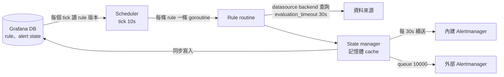

# Grafana Alerting 架構

這頁講 Grafana-managed alert rule：rule 存在 Grafana 的資料庫，由 Grafana server 行程裡的 scheduler 評估，查詢走資料來源（Prometheus、VictoriaMetrics、Loki、SQL 都一樣），結果送到 Grafana 內建的 Alertmanager、外部 Alertmanager，或兩者都送。**Data source-managed rule（rule 存在 Prometheus／Mimir／Loki ruler）不在這頁**，那些由 ruler 自己評估。

以 v13.3.0 原始碼為準（AGPL-3.0）。讀碼 標為實測的結論來自 [lab/grafana](https://github.com/HahaSula/alert-trust/tree/main/lab/grafana)（Grafana 13.3.0、Prometheus v3.13.5、Alertmanager v0.27.0）。這台機器的容器時鐘不準，lab 只看狀態與事件順序，時間以原始碼為準。

## 結論

| 問題 | 答案 |
|---|---|
| 資料消失或查詢失敗時 alert 會怎樣 | 看每條 rule 的 `no_data_state`、`exec_err_state`。設成 OK 時**立刻送 resolved**；設成 NoData／Error 時原 alert 約 2 個 interval 後 resolved，改由 `DatasourceNoData`／`DatasourceError` 接手 實測[^exp-graf-modes] |
| 續送與 EndsAt | 續送間隔寫死 30s；EndsAt = 排程時間 + 4 × max(30s, interval)[^graf-resend-delay][^graf-endsat] |
| 評估比 interval 慢 | 同一條 rule 最多一個 tick 排隊，再來的會把它擠掉，`grafana_alerting_schedule_rule_evaluations_missed_total` 增加[^graf-eval-drop][^graf-missed-slow] |
| 資料來源比 `evaluation_timeout` 慢 | 重試 3 次約 95 秒都沒有續送，外部 Alertmanager 先把 alert 標成 resolved，之後的 `DatasourceError` 也很快 resolved 實測[^exp-graf-slow] |
| Grafana 重啟 | Alert state 從資料庫還原，外部 Alertmanager 的 `startsAt` 不變 實測[^exp-graf-restart] |
| 多台 Grafana | 預設每台都評估全部 rule；沒設 `ha_peers` 時內建 Alertmanager 不去重[^graf-ha-single-node][^graf-ha-primary] |
| 官方告警 | Grafana mixin 只有 HTTP 5xx 一條，沒有任何 alerting 告警[^graf-mixin-alerts] |

## Scheduler {#scheduler}

| 項目 | 行為 |
|---|---|
| Tick | 全域一個 ticker，`scheduler_tick_interval` 預設 10s[^graf-base-interval]。Rule 的 interval 必須是它的整數倍 |
| 每個 tick 先做的事 | 到資料庫讀所有 rule 的版本，有變才整批重讀[^graf-tick-fetch-rules][^graf-fetch-rules] |
| 資料庫讀不到 | 只寫 log，繼續用上一份 rule 評估[^graf-tick-fetch-error]；新增、修改、刪除的 rule 不會生效 |
| 哪個 tick 評估 | `tick 編號 mod (interval ÷ tick) == offset`[^graf-ready-to-run] |
| Jitter | 預設依 group 分散：用 group 名稱、folder、org 算 hash，offset 是整數個 tick[^graf-jitter-default]。同一 tick 要跑的 rule 再平均攤在這個 tick 內[^graf-tick-spread] |
| 並行單位 | **每條 rule 一條 goroutine**，同一個 group 的 rule 預設並行；只有從 Prometheus 匯入的 group 依序[^graf-seq-parallel] |

所以 Grafana 的「group」只是共用 interval 和 jitter offset 的一組 rule，不是 Prometheus 那種依序執行的單位。同 group 裡一條 rule 很慢，不會拖慢其他 rule。

`grafana_alerting_scheduler_behind_seconds` 是 tick 被處理時比預定晚多少[^graf-tick-behind]。每個 tick 都要先讀資料庫，資料庫慢時它會變大。

## 評估與資料來源 {#evaluation}

一次 evaluation 是：建立查詢 pipeline（資料來源查詢加上 server-side expression），在 `evaluation_timeout`（預設 30s）內執行[^graf-eval-timeout][^graf-default-timeout]。查詢走資料來源的 plugin backend，資料來源自己的 HTTP 逾時另外生效。

| 情況 | 行為 |
|---|---|
| 查詢時間 | 用排程時間（tick），不是開始執行的時間[^graf-eval-scheduledat][^graf-evaluatedat] |
| 失敗 | 重試，`max_attempts` 預設 3，延遲 1s 起、最多 4s[^graf-default-attempts][^graf-eval-retry] |
| 逾時 | 每次 attempt 各自 30s，所以一次 evaluation 最長約 95 秒 |
| 重試用完 | `grafana_alerting_rule_evaluation_failures_total` 加 1，結果變成 Error[^graf-eval-failures] |

### 評估比 interval 慢 {#slow}

每條 rule 的 goroutine 一次只做一個 evaluation。Scheduler 送新 tick 時，如果前一個 tick 還在等，就把等待中的那個丟掉[^graf-eval-drop]，並記一次 `reason="slow_evaluation"`[^graf-missed-slow]。

- 最多只有一個 tick 在排隊，不會無限累積。
- 排隊的 tick 被執行時，**查詢時間和 EndsAt 都用它自己的排程時間**。評估 25 秒的 rule，送到 Alertmanager 時資料已經舊了 25 秒以上，EndsAt 的寬限也少了 25 秒。
- `grafana_alerting_schedule_rule_evaluations_missed_total` 帶 rule 標題（`name`），第一次發生前不存在[^graf-metric-missed]。耗時的 histogram 只有 `org` label，看不出是哪條 rule。

實測 interval 10s 的 rule 對一個每次回應要 25s／45s 的資料來源[^exp-graf-slow]：

| 資料來源延遲 | 看到的 |
|---|---|
| 25s（< `evaluation_timeout`） | 狀態一直是 Alerting、health ok，沒有任何 failure；`missed_total{reason="slow_evaluation"}` 約 90 秒內增加 5。外部 Alertmanager 的 `endsAt − updatedAt` 從約 110s 降到約 84s |
| 45s（> `evaluation_timeout`） | 一次 evaluation 要跑 3 次 attempt（約 95 秒），期間沒有續送，**外部 Alertmanager 先在 EndsAt 把原 alert 標成 resolved**，Grafana 這邊仍顯示 Alerting／ok。之後才變 Error，送出的 `DatasourceError` EndsAt 也從約 95 秒前的 tick 算，下一次 evaluation 又要 95 秒，所以它很快也被 resolved。約 150 秒內 `failures_total` 只加 1，missed 加 12 |

所以「資料來源比 `evaluation_timeout` 慢」時，Grafana 的 UI 顯示錯誤，外部 Alertmanager 那邊卻什麼都沒有 firing。要看的是 `missed_total`，不是 `failures_total`。

## 狀態機 {#states}

每條 rule 的每個 series 是一個 instance：Normal、Pending、Alerting、Recovering（`keep_firing_for`）、NoData、Error。

| 轉換 | 條件 |
|---|---|
| Normal → Pending → Alerting | 條件成立；`for` 滿了才 Alerting |
| Alerting → Recovering → Normal | 設了 `keep_firing_for` 時，條件不成立後再撐這麼久才 Normal；期間 EndsAt 繼續往後推[^graf-keepfiring] |
| 某個 series 沒出現在結果裡 | 連續 `missing_series_evals_to_resolve`（預設 2）個 interval 後 resolved；期間 Alerting 的 EndsAt 繼續往後推[^graf-missing-series][^graf-missing-default][^graf-missing-maintain] |

### NoData 與 Error 的處理 {#nodata-error}

查詢沒有結果是 NoData，查詢失敗或逾時是 Error。兩者各由 rule 的 `no_data_state`、`exec_err_state` 決定怎麼處理：

| 設定 | 處理方式 | 外部 Alertmanager 收到 |
|---|---|---|
| Alerting | 把這條 rule 現有的每個 instance 都設成 Alerting[^graf-nodata-all][^graf-error-all] | 原 alert 繼續 firing，看不出資料已經消失 |
| **OK** | 把現有的每個 instance 都設成 Normal[^graf-nodata-ok][^graf-err-ok] | **原 alert 下一次評估就 resolved**，沒有任何其他 alert |
| KeepLast | 每個 instance 維持原狀態 | 原 alert 繼續 firing |
| NoData／Error | 產生一個沒有 series label 的新 instance，送出時 `alertname` 改成 `DatasourceNoData`／`DatasourceError`，原名放在 `rulename`[^graf-ds-error-name] | 新的 `DatasourceNoData`／`DatasourceError` firing；原 alert 因為「series 缺席」，約 2 個 interval 後 resolved |

實測 四種設定都在 lab 看到上表的結果[^exp-graf-modes]。

要注意：

- **API 與 provisioning 沒寫時，`no_data_state` 是 NoData，`exec_err_state` 是 Alerting**[^graf-api-defaults][^graf-prov-err-default][^graf-prov-nodata-default]。也就是說，用 Terraform 或 provisioning 檔建立而沒寫 `execErrState` 的 rule，資料來源掛掉時會繼續 firing，不會有 `DatasourceError`。UI 的預設值沒有核對。
- 設成 NoData／Error 時，`DatasourceNoData`／`DatasourceError` 也要有通知路由。用 `alertname` 做 matcher 的路由收不到它，因為原名在 `rulename`。
- `grafana_alerting_alerts{state="error"|"nodata"}` 只數 NoData／Error 這兩種處理方式。設成 OK、Alerting、KeepLast 的 rule，資料消失時在 metric 上算 normal 或 alerting[^graf-metric-alerts]。查詢失敗仍可從 `grafana_alerting_rule_evaluation_failures_total` 看到；**資料消失（NoData）沒有任何 counter**。

見[信任契約：資料消失時的處理方式](../contracts.md#grafana-nodata-error)。

## 送通知 {#notify}

評估完的狀態先同步寫進資料庫，再送出[^graf-persist-before-send][^graf-persist-sync]。寫入失敗只寫 log，照樣送出。

| 項目 | 行為 |
|---|---|
| 送給誰 | 每個 org 的 `alertmanagersChoice`：all、internal、external[^graf-router-choice] |
| 外部 Alertmanager | 要有 `handleGrafanaManagedAlerts: true` 的 Alertmanager 資料來源，且 org 的 admin config 存在；**從沒設過 admin config 時不建立外部 sender** 實測[^exp-graf-admin] |
| 外部 queue | 預設 10000，滿了丟最舊的，`grafana_alerting_sender_dropped_total` 增加[^graf-sender-queue][^graf-sender-drop] |
| 兩邊都送不到 | 只寫 log「alerts not delivered」[^graf-router-none] |
| 續送 | Firing 的 instance 每 30s 續送一次，寫死在程式裡[^graf-resend-delay][^graf-resend-fixed][^graf-needs-sending] |
| EndsAt | 排程時間 + 4 × max(30s, interval)[^graf-endsat] |

### 和 Prometheus 的 EndsAt 比較 {#endsat}

| | Prometheus | Grafana |
|---|---|---|
| 續送間隔 | `--rules.alert.resend-delay`，預設 1m，可調 | 30s，不能調 |
| EndsAt | 4 × max(resend, E) | 4 × max(30s, E) |
| E = 10s 時的寬限 | 4 分鐘 | 2 分鐘 實測（Alertmanager 的 `endsAt − updatedAt` 約 110–120s）[^exp-graf-modes] |
| 從哪個時間算 | 評估時間 | 排程時間；評估越慢寬限越短 |

所以 Grafana 停機、或評估一直失敗且 `exec_err_state` 不是 Alerting／KeepLast 時，外部 Alertmanager 最多 2 分鐘（interval ≤ 30s 時）就把 alert 標成 resolved。用 Grafana 做 Watchdog 時，dead man's switch 的等待要用 4 × max(30s, E) 代入[死人開關契約](../contracts.md#deadman-wait)。

### 內建 Alertmanager

內建 Alertmanager 是 prometheus/alertmanager 的分支（grafana/alerting），在同一個行程裡。通知失敗看 `grafana_alerting_notifications_failed_total{integration}`，**它在 0 時不輸出**[^graf-notif-failed][^graf-notif-skipzero]，所以不能用 `== 0` 當健康檢查。Grafana 停機時內建 Alertmanager 一起停，通知鏈整條斷，只有外部的 dead man's switch 看得到。

## 狀態保存與重啟 {#restore}

- 預設每次評估後同步寫進資料庫（`alert_instance` 表）[^graf-persist-sync]。
- 啟動時先從資料庫讀回所有 instance，再開始評估。讀取失敗時以空的 state 繼續，而且**不管成功與否都標成 ready**[^graf-warm-ready]。
- 實測 同一個資料庫重啟後，firing 的 alert 直接回到 Alerting，外部 Alertmanager 的 `startsAt` 不變[^exp-graf-restart]。
- Rule 被修改時 state 清空並送 resolved；Grafana 正常關機時只清記憶體，不送 resolved[^graf-stop-forget]。

## 資料庫 {#database}

Rule、alert state、Alertmanager 設定、silence 都在 Grafana 的資料庫。

| 資料庫狀況 | 影響（依原始碼推論，lab 沒有測） |
|---|---|
| 讀不到 | Scheduler 用上一份 rule 繼續評估；rule 變更不生效[^graf-tick-fetch-error] |
| 寫不進去 | State 寫入失敗只寫 log，通知照送；重啟後 state 是舊的 |
| 慢 | 每個 tick 先讀資料庫，`grafana_alerting_scheduler_behind_seconds` 變大；state 寫入在送通知前，通知跟著變慢 |
| 重啟時讀不到 | 以空的 state 開始，`for` 從頭計時[^graf-warm-ready] |

## 多台 Grafana（HA） {#ha}

| 設定 | 評估 | 通知 |
|---|---|---|
| 多台共用資料庫，沒設 `ha_peers` | 每台都評估全部 rule | 每台的內建 Alertmanager 各送一次，重複通知 |
| 設 `ha_peers`（gossip）或 Redis | 每台都評估全部 rule | 內建 Alertmanager 之間同步 notification log 去重 |
| 再加 `ha_single_node_evaluation` | 只有叢集位置 0 的那台評估[^graf-ha-single-node][^graf-ha-primary][^graf-ha-single-init] | 同上 |

送到外部 Alertmanager 時，多台送的是同一組 label，由外部 Alertmanager 合併。每台評估的時間點不同，資料來源邊界上的結果可能不一樣，firing／resolved 會交替出現。推論（lab 沒有跑多台）

## 和 Prometheus、vmalert 的差別

| 項目 | Prometheus | vmalert | Grafana |
|---|---|---|---|
| 並行單位 | Group，group 內依序 | Group，預設依序 | **每條 rule** |
| 跑不完時 | 跳過整個 group 的 evaluation | 跳過 | 每條 rule 自己丟 tick |
| 查詢失敗 | 不續送，EndsAt 到期後 resolved | 不續送，約 2 分鐘後 resolved | 依 `exec_err_state`；OK 時立刻 resolved |
| 資料消失 | 結果空，alert resolved | 同左 | 依 `no_data_state` |
| 失敗重試 | 無 | 無 | 最多 3 次 |
| 續送 | 可調，預設 1m | 可調，預設 0 | 寫死 30s |
| 狀態保存 | `ALERTS_FOR_STATE` | Remote read | Grafana 資料庫，每次評估寫入 |
