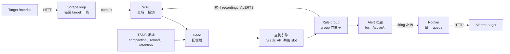

# Prometheus 架構

寫 rule 之前要知道一件事：**scrape、rule、查詢、通知和 TSDB 都在同一個行程裡，共用 CPU、記憶體和磁碟。**一個資源出問題，負責偵測的部分會一起受影響，所以 Prometheus 不能只監控自己。

Prometheus 大部分工作是並行的，但每條路徑上都有單序的環節，**瓶頸和連鎖問題都出在這些環節**。下面依資料流排列，每一段都有固定錨點，規則的 `runbook_url` 與[信任契約](../contracts.md)會連到這裡。

以 2.51.2 原始碼為準，並比對到 3.15.1。讀碼

## 服務發現 {#service-discovery}

每個 provider 一條 goroutine，彼此並行，最快 5 秒同步一次 target 清單。卡住時 target 清單更新變慢。

## Scrape loop {#scrape-loop}

| 項目 | 行為 |
|---|---|
| 同一個 target 內 | **單序**：抓取、parse、relabel、append、commit 依序跑；沒跑完下一輪不會開始，tick 被丟掉 |
| 不同 target 之間 | 並行，每個 target 一條 goroutine，用 offset 錯開 |
| 併行上限 | 沒有上限，受 CPU 限制 |
| 卡住時影響誰 | 只影響該 target，除非搶 CPU、記憶體或 WAL |

- `scrape_timeout` 不能大於 interval，而且只管 HTTP 階段。`scrape_duration_seconds` 超過 timeout 又成功時，多出來的時間花在 parse、relabel、append。
- `scrape_duration_seconds` 不含 commit，實際可見時間更晚。
- Sample 帶 scrape 開始的時間，要等結束才查得到。這就是[視窗契約](../contracts.md#range-window)要多加 `d` 的原因。
- 單一 target 的耗時受單核速度限制，加 CPU 只對競爭造成的延遲（throttling、GC）有效。

相關契約：[Scrape 要在 interval 內完成](../contracts.md#scrape-within-interval)。

## WAL 寫入 {#wal}

所有 scrape 和 rule 的 commit 都經過同一把鎖（`WL.Log`），全域單序。Segment 切換的 fsync 由另一條 goroutine 非同步執行，所以平常只寫 page cache，很快。

- 卡住時影響**全部寫入**。
- 磁碟寫滿時 scrape 和 rule 結果同時寫不進去，`prometheus_tsdb_wal_writes_failed_total` 增加。實測
- 寫滿再釋放空間後，WAL 可能留下半筆紀錄，下一次 checkpoint 才失敗。實測

## Head {#head}

Series 表分 16384 個 stripe，每條 series 一把鎖，chunk 落盤是單一背景佇列。只影響碰到相同 stripe 或 series 的操作。

重啟時要 replay WAL，**replay 期間 rule 不執行**，之後 `for` 小於 `--rules.alert.for-grace-period`（預設 10m）的 alert 還要重新計時。

## 查詢引擎 {#query-engine}

| 項目 | 行為 |
|---|---|
| 一個查詢內 | 求值在同一條 goroutine |
| 查詢之間 | 有上限的並行；**rule 和 API 搶同一組 slot**，解析與執行各搶一次 |
| 併行上限 | `--query.max-concurrency`，預設 20 |
| 卡住時影響誰 | Rule 和 API 都排隊 |

Grafana 的重查詢會讓 rule group 變慢，實驗中從幾秒變成 40 秒，scrape 不受影響。實測

## Rule group {#rule-group}

| 項目 | 行為 |
|---|---|
| 同一個 group 內 | **單序**：rule 依定義順序一條接一條跑，相鄰兩輪不重疊 |
| 不同 group 之間 | 並行，每個 group 一條 goroutine |
| 卡住時影響誰 | 同 group 的所有 alert；不影響其他 group，除非搶查詢 slot |

- 關鍵 alert 獨立成小 group。實驗中 CPU 降到 0.15 核時，獨立小 group 的偵測延遲不變，同一條 alert 放在重 group 延遲變近兩倍，還會漏事件。實測
- Alert 依賴 recording rule 時放同一個 group，順序在後。
- `concurrent-rule-eval` 在 2.x 有依賴判斷問題（3.1 修正），不要當第一選擇。

相關契約：[Rule group 要在 interval 內跑完](../contracts.md#group-within-interval)。

## Alert 狀態 {#alert-state}

在 group 的 goroutine 裡更新，存在記憶體，定期寫入 `ALERTS_FOR_STATE`。

- **查詢回傳空結果時 pending 被刪除，`for` 重算。**
- 查詢失敗或 evaluation 被跳過時 pending **不會**被刪除。
- 所以「rule 沒報錯但永遠無法 firing」只有 `changes(ALERTS_FOR_STATE[1h])` 看得出來。

## Notifier {#notifier}

2.x 到 3.9：一條 queue、一條送出迴圈，每批最多 64 筆（3.4 起預設 256，可調）。同一批同時送給所有 Alertmanager，**等全部回應才送下一批**，所以一台 Alertmanager 慢會拖累所有 alert；逾時預設 10 秒。3.10 起每台 Alertmanager 各一條 queue。

送出的 alert 帶 `EndsAt = 評估時間 + 4 × max(resend-delay, E)`，見[續送契約](../contracts.md#resend-endsat)。

## Alertmanager 的分組 {#alertmanager-dispatch}

每個 alert group 一條 goroutine，依 `group_interval` 依序送出；同 group 的多個 receiver 並行，失敗會重試。接收端慢只影響用到它的 group。細節見 [Alertmanager 元件卡](../components/alertmanager.md)。

## TSDB 維護 {#tsdb-maintenance}

Reload、retention、head compaction、block compaction、WAL 截斷都在**同一條 goroutine**（`DB.run`）。

- Compaction 慢或失敗，retention 跟著延後或停止。
- 可用空間被 compaction 用完時 reload 會停止，retention 不再執行；磁碟突然寫滿時 reload 反而正常，但沒有新 block，time retention 凍結。實測
- Reload timer 會被 compaction 訊號重置的問題到 3.13.5 仍在。實測

## 升級會改變這些嗎

| 層級 | 2.51、2.55 | 3.x |
|---|---|---|
| Scrape、WAL、Head、查詢引擎 | 相同 | 相同 |
| Rule group | 預設單序；flag 併行時依賴判斷有問題 | 預設仍單序；3.1 修正依賴判斷，3.2 起分批併行 |
| Notifier | 一條 queue，等所有 Alertmanager | 3.4 起批次可調；3.10 起每台各一條 |
| TSDB 維護 | 單一 goroutine | 仍是單一 goroutine |
| `GOMAXPROCS`、`GOMEMLIMIT` | 要開 feature flag | 3.0 起預設對齊 limit |

所以 scrape 太慢、rule group 太重這類問題，升級本身解決不了。

<small>依據（v2.51.2）：`scrape/scrape.go`（`scrapeLoop.run`、`scrapeAndReport`）、`tsdb/wlog/wlog.go`（`Log`）、`tsdb/head.go`（`DefaultStripeSize`）、`rules/group.go`（`run`、`Eval`）、`promql/engine.go`（`queueActive`）、`notifier/notifier.go`、`tsdb/db.go`（`run`）。</small>
