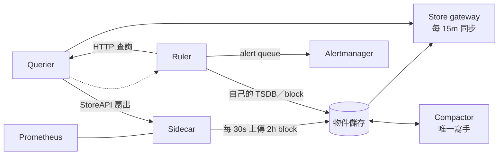

# Thanos 架構

Thanos 把多台 Prometheus 接成一個查詢入口和一個長期儲存。資料有兩條路：**最近的資料**由 sidecar 直接從 Prometheus 讀，**舊資料**由 sidecar 上傳到物件儲存，再由 store gateway 讀出來。Ruler 不碰資料，所有查詢都經過 querier。**每一段都可能少資料而不報錯**：store 斷線、block 還沒上傳、store gateway 還沒同步，querier 都照樣回 success。

以 v0.42.5 原始碼為準（Ruler 內嵌的 rules manager 是 Prometheus v3.9.1）。讀碼

<!-- figure: thanos-paths -->

機制（原始碼）：Ruler 的每次查詢都走 querier，querier 只問健康檢查通過的 StoreAPI。紅色虛線是會悄悄少資料的位置。

## Sidecar {#sidecar}

| 項目 | 行為 |
|---|---|
| 提供的時間範圍 | 從 Prometheus 最舊的樣本到無限大[^th-sc-maxt]；Prometheus 刪掉的 block 就不再提供 |
| 上傳 | 每 30 秒檢查一次新的 block[^th-sc-ship]；要求 Prometheus 關掉本地 compaction（min／max block duration 相同）[^th-sc-compaction] |
| 連不到 Prometheus | `thanos_sidecar_prometheus_up` 變 0[^th-sc-promup] |
| 上傳失敗 | 只寫 log；預設設定下提早 return，`thanos_shipper_upload_failures_total` 不增加，`thanos_shipper_dir_sync_failures_total` 增加[^th-ship-early][^th-ship-failcount][^th-ship-dirsync] |

- 上傳是**依序**的：最舊的那個 block 上傳失敗，後面的都不會上傳（除非開 `--shipper.allow-out-of-order-uploads`）。
- 中斷超過「Prometheus 保留 − 2h」，block 在上傳前被 Prometheus 刪掉，bucket 永久少一段。見[上傳與保留契約](../contracts.md#thanos-upload-retention)。
- 上傳成功的時間是 `thanos_objstore_bucket_last_successful_upload_time`[^th-objstore-last-upload]，官方 mixin 對 sidecar 沒有用它。

## Querier {#querier}

Querier 把查詢扇出給所有 StoreAPI（sidecar、store gateway、ruler、receive），依 external labels 與時間範圍過濾，合併後依 `--query.replica-label` 去重。

| 項目 | 行為 |
|---|---|
| 健康檢查 | 每 `endpoint.info-timeout`（5s，隱藏 flag）檢查一次所有 endpoint[^th-es-update][^th-q-infotimeout] |
| 檢查失敗 | 非 strict 的 endpoint 不再查詢[^th-es-queryable]；最後一次成功超過 `--store.unhealthy-timeout`（5m）後從名單移除[^th-es-remove] |
| 沒有 store 涵蓋查詢範圍 | 回空結果，不是錯誤[^th-proxy-nomatch] |
| 一個 store 都沒有 | abort 回錯（`No StoreAPIs available`），warn 回空[^th-proxy-nostores] |
| 單一 store 查詢出錯 | warn：變成 warning，其他結果照回；abort：整個查詢失敗[^th-proxy-warn] |
| 可見的狀態 | `thanos_store_nodes_grpc_connections`，依 external labels 與 store 類型[^th-es-conns] |

**Partial response 的 abort 只管查詢當下還在名單上的 store。**store 斷線 5 秒後就不在名單上，查詢回 success、沒有 warning。Lab 裡停掉 sidecar 後，abort 與 warn 兩個 group 的 `count(up) > 0` 都在下一輪評估就變成真的 resolved，rule 的 health 一直是 `ok`。實測[^exp-thanos-store-loss] 見 [abort 契約](../contracts.md#thanos-partial-abort)。

要讓 abort 真的有作用，關鍵的 store 要設成 strict（endpoint 設定的 `strict: true`，或已棄用的 `--endpoint-strict`）[^th-q-strict]，或對 store 數量告警。

## Store gateway {#store-gateway}

- 每 `--sync-block-duration`（預設 15m）同步一次 bucket 的 block 清單[^th-store-sync][^th-store-syncblocks]；新上傳的 block 最晚 15 分鐘後才查得到。
- 同步失敗只增加 `thanos_blocks_meta_sync_failures_total`[^th-fetch-failures]，已經載入的 block 照樣查詢，所以失敗只影響「新」資料，不會讓查詢失敗。

## Compactor {#compactor}

Compactor 是 bucket **唯一**的寫手，負責 compaction、downsampling、retention。同一個 bucket 跑兩個會互相覆蓋，官方用 `up` 的數量偵測。

| 項目 | 行為 |
|---|---|
| 遇到重疊的 block 等嚴重錯誤 | 預設 halt（`--debug.halt-on-error`，隱藏，預設 true）[^th-compact-halt-default][^th-compact-overlap] |
| Halt 之後 | `thanos_compact_halted` 設 1，行程停在 `select {}`，不結束[^th-compact-halt] |
| 新 block 的等待 | `--consistency-delay` 預設 30m[^th-compact-delay] |
| 待做的工作 | `thanos_compact_todo_compactions`、`thanos_compact_todo_downsample_blocks`[^th-compact-todo] |

Halt 時 `up` 仍是 1，HTTP 照樣回應。Lab 放入兩個時間範圍相同的 block 後，compactor 在第一輪就 halt，`thanos_compact_halted` 是 1。實測[^exp-thanos-compact-halt] 不監控這個值時，bucket 會一直長大、retention 不生效，查詢也越來越慢，但沒有任何錯誤。

## Ruler {#ruler}

Ruler 內嵌 Prometheus 的 rules manager，每種 partial response 策略各一個 manager[^th-rule-mgr-per-strategy]。差別在查詢：

| 項目 | 行為 |
|---|---|
| 查詢 | 每條 rule 對 `--query` 的 querier 發一次 HTTP instant query，固定要求 dedup[^th-rule-dedup]；全部失敗就回錯 `no query API server reachable`[^th-rule-noquery] |
| `partial_response_strategy` | 每個 group 設；**沒寫是 abort**[^th-prs-default] |
| 查詢時間 | `--rule-query-offset` 預設 0s[^th-rule-offset]；資料要經過 sidecar，`d` 包含 Prometheus 寫入與 querier 扇出 |
| 預設值 | `--eval-interval` 1m、`--resend-delay` 1m[^th-rule-evalint][^th-rule-resend] |
| 送通知 | 推進記憶體 queue（容量 10000、每批 100）[^th-rule-queue]，`EndsAt` 用 `ValidUntil`[^th-rule-endsat] |
| 寫入結果 | 有狀態模式寫進自己的 TSDB，`for` 從本地還原[^th-rule-stateful]，有 bucket 設定就上傳 block[^th-rule-shipper]；設了 `--remote-write.config` 改成無狀態，`for` 透過 querier 還原[^th-rule-stateless] |

### 查詢失敗 {#ruler-query-failure}

查詢失敗時 rules manager 記一次 `prometheus_rule_evaluation_failures_total` 就 return，**不續送**[^th-prom-eval-return]。最後一次送出的 `EndsAt = ts + 4 × max(interval, resend-delay)`[^th-prom-validuntil]，過了這個時間 Alertmanager 把 alert 標成 resolved，Ruler 內部卻仍是 firing。和 [Prometheus](prometheus.md)、[vmalert](vmalert.md#notify) 的假 resolved 是同一個機制，見[續送契約](../contracts.md#resend-endsat)。

- Lab 停掉 querier 後，abort 與 warn 兩個 group 都失敗，Alertmanager 裡的 alert 在 `EndsAt` 後消失；querier 回來後重新出現。實測[^exp-thanos-query-down]
- Querier 一個 StoreAPI 都沒有時回 422 `No StoreAPIs available`，Ruler 卻只記下 `no query API server reachable`：queryFunc 把每個 querier 的錯誤寫進 log 後就換下一個，最後回傳固定的訊息[^th-rule-noquery]。只看 `/api/v1/rules` 分不出是 querier 停機還是 store 全部消失，要看 Ruler 的 log 或 querier 的 `thanos_store_nodes_grpc_connections`。實測[^exp-thanos-store-loss]
- 官方 ThanosRuleHighRuleEvaluationFailures 要失敗比率 > 5% 持續 5 分鐘，比預設 4 分鐘的假 resolved 還晚。
- `vector(1)` 的 Watchdog 不讀任何 StoreAPI：store 全部斷線時它照樣 firing，只有 querier 停機才會斷。要涵蓋資料路徑，heartbeat 要讀真實的 series。

### Recording 結果在哪裡

有狀態模式的 Ruler 是一個 StoreAPI。Querier 沒有把 Ruler 加成 endpoint 時，recording rule 的結果與 `ALERTS` 在 querier 查不到，依賴它們的 rule 會回空。

## Receive {#receive}

Receive 接 remote write，依 hashring 轉送，`--receive.replication-factor` 預設 1[^th-recv-rf]。寫入的 quorum 是 `RF/2 + 1`，**RF = 2 時只要 1 份**[^th-recv-quorum]，所以 RF=2 實際上只容忍、不保證兩份。

- 複寫失敗看 `thanos_receive_replications_total{result="error"}`[^th-recv-replications]；hashring 成員數看 `thanos_receive_hashring_nodes`[^th-recv-hashring-nodes]。
- Receive 也用 shipper 上傳 block，上傳失敗的行為和 sidecar 相同。

本頁的 Receive 只讀碼，lab 沒有涵蓋。讀碼

## 和 Prometheus 的差別

| 項目 | Prometheus | Thanos Ruler |
|---|---|---|
| 和資料在同一個行程 | 是 | 否，每次查詢走 querier |
| 少一部分資料時 | 不會發生（只有本地 TSDB） | store 被移除後查詢成功、少資料 |
| 查詢失敗時 | 不續送，`EndsAt` 後假 resolved | 相同 |
| 預設 `for` 還原 | 本地 TSDB | 有狀態模式相同；無狀態模式透過 querier |
| 監控自己 | 本地 rule 就能算 | 自己的 meta 規則也走 querier，要放在 Thanos 以外的觀察者 |
