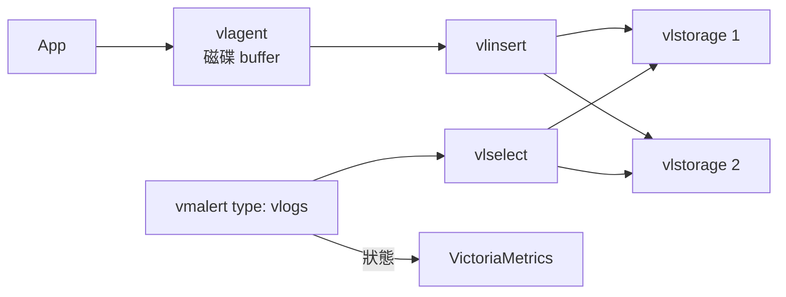

# VictoriaLogs 架構

VictoriaLogs 是 log 的儲存與查詢。Log rule 由 vmalert 評估（`type: vlogs`），狀態寫到 VictoriaMetrics，所以 **log 告警同時依賴 VictoriaLogs 和 VictoriaMetrics**。

以 v1.53.0 與實驗結果為準；這一頁的內部細節主要來自故障注入，原始碼只讀了和 rule 相關的部分。

## Single 與 cluster

| 項目 | Single | Cluster |
|---|---|---|
| 元件 | 一個行程 | `vlinsert`、`vlselect`、`vlstorage`，同一個執行檔 |
| Replication | 交給磁碟層 | **沒有**，只做 sharding |
| 缺節點時查詢 | 不存在這個狀態 | **預設回 502**，可用 `allow_partial_response=1` 改成 partial[^exp-vm-vl] |

同樣是 cluster，VictoriaMetrics 和 VictoriaLogs 的預設行為相反：VictoriaMetrics 給不完整的答案，VictoriaLogs 不給答案。同一份 alert 設計不能直接套用兩邊。

## 寫入 {#ingest}

- vlstorage 全掛 5 分鐘、或全部唯讀 10 分鐘時，vlinsert 都繼續回 200，之後幾乎查得到全部資料。實測[^exp-vm-vl]
- **但 200 不代表查得到。**全部唯讀期間，已回 200 的 log 有約 6 分鐘查不到。實測[^exp-vm-vl]
- Content-Type 錯誤時 ingestion 回 200，`vl_rows_ingested_total` 卻維持 0。導入新的 log shipper 時要驗證這個 metric。實測[^exp-vm-vl]

## Log rule 的視窗 {#log-rule-window}

沒有寫 `_time` 的 log rule，vmalert 預設只查 `[ts − interval, ts]`，視窗**不重疊**，而 `ts` 已經減掉 `eval_delay`。

- Log 延遲 `L ≤ eval_delay` 時保證涵蓋；`L > eval_delay + interval` 時事件必定漏掉，而且事後查得到。實測[^exp-vm-vl]
- 查詢故障期間的事件不會補判；改用較長的 `_time` 視窗，恢復後才能抓到。實測[^exp-vm-vl]
- 帶 `for` 的 log rule 要注意資料密度：視窗常常是空的時候，pending 會一直被刪除。實測[^exp-vm-vl]
- `* | stats count()` 在沒有 log 時仍回傳 0，不能當 canary；要加 `filter c:>0`。實測[^exp-vm-vl]

對應的時間條件見[信任契約](../contracts.md#vl-log-delay)。
