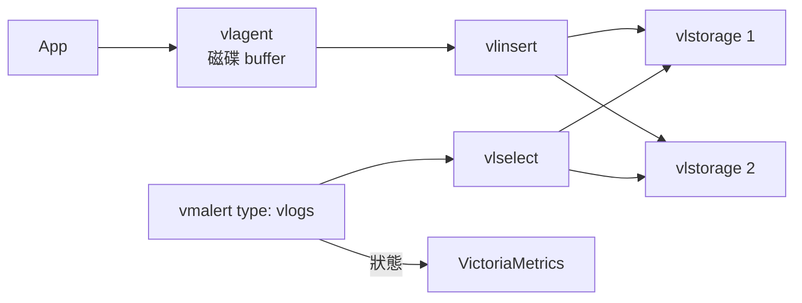

# VictoriaLogs 架構

VictoriaLogs 是 log 的儲存與查詢。Log rule 由 vmalert 評估（`type: vlogs`），狀態寫到 VictoriaMetrics，所以 **log 告警同時依賴 VictoriaLogs 和 VictoriaMetrics**。

以 v1.53.0 與實驗結果為準；這一頁的內部細節主要來自故障注入，原始碼只讀了和 rule 相關的部分。

## Single 與 cluster

| 項目 | Single | Cluster |
|---|---|---|
| 元件 | 一個行程 | `vlinsert`、`vlselect`、`vlstorage`，同一個執行檔 |
| Replication | 交給磁碟層 | **沒有**，只做 sharding |
| 缺節點時查詢 | 不存在這個狀態 | **預設回 502**，可用 `allow_partial_response=1` 改成 partial（502 實測[^exp-vm-vl]；partial 讀碼[^vl-select-502]） |

同樣是 cluster，VictoriaMetrics 和 VictoriaLogs 的預設行為相反：VictoriaMetrics 給不完整的答案，VictoriaLogs 不給答案。同一份 alert 設計不能直接套用兩邊。

## 寫入 {#ingest}

- Cluster 停 1 台 vlstorage 時，vlinsert 仍回 200，把資料轉送到剩下的節點；之後是否全部查得到，lab 沒有逐筆核對。實測[^exp-vm-vl-reachable]
- 全部 vlstorage 停時，vlinsert 每秒重試、資料留在記憶體[^vl-insert-retry]；緩衝上限與停多久會丟資料沒有測。讀碼
- Single 唯讀時寫入回 429（shipper 看得到），但 rule 不報錯，新 log 查不到。實測[^exp-vm-vl]
- Content-Type 錯誤時 ingestion 回 200，`vl_rows_ingested_total` 卻維持 0：不帶 header 可以收，`application/x-www-form-urlencoded`（Python urllib 的預設）收不到。`vl_http_requests_total` 照樣增加，所以「有請求、沒收進」可以當規則。實測[^exp-vm-vl][^exp-vm-vl-ingested]
- vlinsert 的 `vl_insert_remote_is_reachable` 只在真的要寫資料到某台 vlstorage、而且失敗時才變 0[^vl-insert-disable]；一條 stream 的前 1000 行固定寫到同一台[^vl-insert-route]。Stream 少時，停掉的那台可能沒有資料要寫，這個 metric 就一直是 1。查詢端的 `vl_select_remote_send_errors_total` 每次查詢失敗都會增加[^vl-select-send-errors]。實測[^exp-vm-vl-reachable]

## Log rule 的視窗 {#log-rule-window}

沒有寫 `_time` 的 log rule，vmalert 預設只查 `[ts − interval, ts]`，視窗**不重疊**，而 `ts` 已經減掉 `eval_delay`。

- Log 延遲 `L ≤ eval_delay` 時保證涵蓋；`L > eval_delay + interval` 時事件必定漏掉，而且事後查得到。實測[^exp-vm-vl]
- 查詢故障期間的事件不會補判；改用較長的 `_time` 視窗，恢復後才能抓到。推論（lab 沒有測 vlselect 停）
- 帶 `for` 的 log rule 要注意資料密度：視窗常常是空的時候，pending 會一直被刪除。推論[^vma-vlogs-window]（lab 的 log rule 都沒有 `for`）
- `* | stats count()` 在沒有 log 時仍回傳 0，不能當 canary；要加 `filter c:>0`。實測[^exp-vm-vl]

對應的時間條件見[信任契約](../contracts.md#vl-log-delay)。
