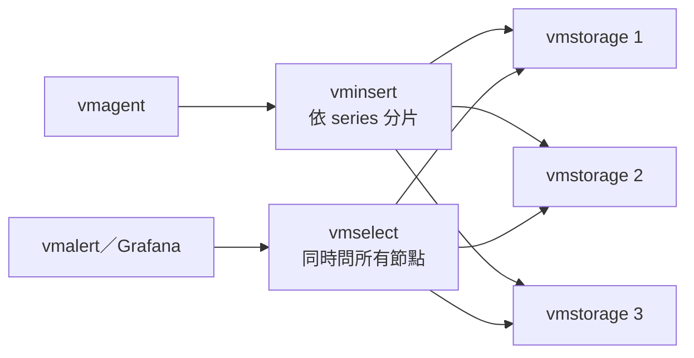

# VictoriaMetrics 架構

Single 和 cluster 跑的是同一套儲存與查詢引擎，rule 語法也相同。對 rule 來說，差別在於 cluster 多了「部分節點故障」這種狀態，而且**預設會回傳不完整的答案，HTTP 200**。

以 v1.155.0（cluster 版 v1.155.0-cluster）原始碼為準。讀碼

## Single 與 cluster

| 項目 | Single | Cluster |
|---|---|---|
| 元件 | 一個行程 | `vminsert`、`vmselect`、`vmstorage` |
| 擴充 | 垂直 | 寫入、查詢、儲存可分開水平擴充 |
| 官方建議 | 寫入低於每秒 100 萬 sample 時優先用 | 超過時才用 |
| Replication | 交給磁碟層 | `-replicationFactor`，預設 1 |
| 部分節點故障 | 不存在這個狀態，查詢只有成功或失敗 | 預設回 partial response，HTTP 200 |

## vminsert {#vminsert}

- 依 series 的 hash 把資料分到 vmstorage；`-replicationFactor=N` 時寫到 N 台不同的節點。[^vmi-rf]
- 節點無法連線時，資料改送到健康的節點（可用 `-disableReroutingOnUnavailable` 關掉）[^vmi-reroute-unavail]。
- 節點只是變慢時也會改送（`-disableRerouting`）。**RF 大於 1 時這個功能自動關閉**[^vmi-rf-auto]，因為它和 replication 不相容。
- `-dropSamplesOnOverload` 預設關閉；開了之後節點過載就直接丟資料，而且發生在複製之前。[^vmi-drop]

## vmselect {#vmselect}

| 項目 | 行為 |
|---|---|
| 一次查詢 | 同時問所有 vmstorage，合併結果 |
| 有節點失敗 | 預設回 partial response，HTTP 200；`vm_partial_results_total` 增加[^vms-partial][^exp-vm-faults] |
| 拒絕 partial | 查詢參數 `deny_partial_response=1`（vmalert 用 group 的 `params`）。官方文件寫的 `denyPartialResponse` 沒有作用 實測[^vms-denypartial][^exp-vm-faults] |
| 併發上限 | `-search.maxConcurrentRequests`，cluster 預設 2 × CPU[^vms-maxconc] |
| 排隊上限 | `-search.maxQueueDuration`，預設 10s，超過回 429[^vms-queue] |
| 最新資料 | 比 `-search.latencyOffset`（預設 30s）新的查詢時間會被改成 `now - 30s`[^vms-latency] |
| RF 時跳過慢節點 | `-search.skipSlowReplicas`，預設關閉；開了會削弱 RF 的保護[^vms-skipslow] |

Rule 和 dashboard 共用同一組併發上限，所以 dashboard 的重查詢會讓 vmalert 收到 429。

## vmstorage {#vmstorage}

- 可用空間低於 `-storage.minFreeDiskSpaceBytes`（預設 100MB）時切成唯讀[^vst-minfree][^vst-readonly]；vminsert 把資料轉到其他節點。
- 所有節點都唯讀時，資料寫不進去，rule 不報錯，只會看到資料變舊。實測[^exp-vm-faults]
- 磁碟突然變成 0 byte 時，切唯讀後仍會因 flush 失敗而 panic。實測[^exp-vm-faults]

## 這對 rule 代表什麼

| 故障 | Rule 看到什麼 | 證據 |
|---|---|---|
| RF=1，一台 vmstorage 掛 | 結果少一部分，`increase` 類的「數量太低」規則假觸發 9 分鐘 | 實測[^exp-vm-faults] |
| RF=2，一台 vmstorage 掛 | 完全不受影響 | 實測[^exp-vm-faults] |
| vmselect 全掛或飽和 | 查詢失敗，約 2 分鐘後假 resolved | 實測[^exp-vm-faults] |
| vminsert 全掛或全部唯讀 | 不報錯，資料變舊；條件 alert 繼續 firing 約 6 分鐘 | 實測[^exp-vm-faults] |

建議 cluster 用 RF=2，vmstorage 至少 3 台。
