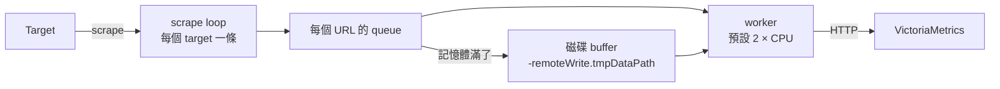

# vmagent 架構

vmagent 負責採集，再把資料寫到一個或多個遠端。採集的模型和 Prometheus 很像，差別在寫入：它中間有一層磁碟 buffer，遠端斷線時先存在本地，恢復後補送。

以 v1.155.0 原始碼為準。讀碼

## Scrape {#scrape}

| 項目 | 行為 |
|---|---|
| Target 之間 | 並行，每個 target 一條 goroutine，啟動時隨機錯開[^vmag-run][^vmag-randsleep] |
| 同一個 target | 依序：用 ticker 觸發，抓完才等下一個 tick[^vmag-ticker] |
| 抓不完時 | 和 Prometheus 一樣，tick 被丟掉，實際間隔拉長 |
| Sample 時間戳 | 對齊排定的 tick；實際時間偏離超過 interval 的 10% 時改用實際時間[^vmag-drift] |

所以 [scrape 要在 interval 內完成](../contracts.md#scrape-within-interval)這條契約對 vmagent 同樣成立。

## Remote write {#remote-write}

| 項目 | 行為 |
|---|---|
| 每個 `-remoteWrite.url` | 各自一個 queue 與磁碟 buffer，互不影響 |
| 送出 | 多條 worker 並行，`-remoteWrite.queues` 預設 2 × CPU[^vmag-queues] |
| 遠端斷線 | 資料寫進 `-remoteWrite.tmpDataPath`，恢復後補送 |
| Buffer 上限 | `-remoteWrite.maxDiskUsagePerURL`，預設 0（不限）；滿了丟最舊的資料[^vmag-maxdisk] |
| 關掉磁碟 buffer | `-remoteWrite.disableOnDiskQueue`；遠端跟不上時資料直接消失[^vmag-nodisk] |

## 這對 rule 代表什麼

- **資料會補回，rule 不會補判。**vminsert 停 400 秒時資料留在 vmagent 的 buffer，事後查同一段時間幾乎沒有缺口，但 rule 當下確實看不到資料，事後看圖會以為不該漏報。vmagent 自己停的那段則是 0 筆，沒有資料可補。實測[^exp-vm-faults]
- **資料停止時 rule 不報錯。**條件型 alert 還會繼續 firing 約 6 分鐘才 resolved，因為 vmalert 的 instant 查詢會往回找 5 分鐘。實測[^exp-vm-faults][^vma-querystep]
- **`vmagent_remotewrite_pending_data_bytes` 會反映積壓**：lab 中 vminsert 停機時升到 1366 bytes（30 條 series，低流量）；門檻要依流量設定。實測[^exp-vm-faults]

所以 vmagent 卡片的第 1 級訊號是每個關鍵 job 一條資料新鮮度 heartbeat，而不是 vmagent 自己的 metric。
