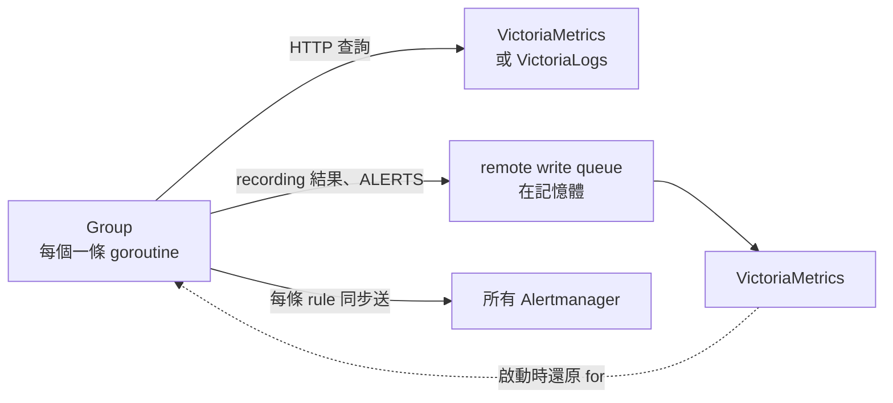

# vmalert 架構

vmalert 只負責評估，不存資料。它從 VictoriaMetrics 或 VictoriaLogs 查詢，把 recording 結果和 alert 狀態寫回 VictoriaMetrics，再把 alert 送到 Alertmanager。**每一個依賴都走網路**，所以它不會和儲存層搶 CPU，但每條網路路徑都可能讓 rule 結果出錯。

以 v1.155.0 原始碼為準。讀碼

## Group {#group}

| 項目 | 行為 |
|---|---|
| Group 之間 | 並行，每個 group 一條 goroutine[^vma-start] |
| Group 之內 | 預設**依序**（`concurrency: 1`）；調高後最多同時跑 N 條 rule[^vma-conc-default][^vma-execconc] |
| 跑不完時 | 下一輪被跳過，`vmalert_iteration_missed_total` 增加，下一次評估時間直接往後跳[^vma-missed] |

- `concurrency` 大於 1 時，rule 之間不保證順序。Alert 依賴同 group 的 recording rule 時不要調高。
- 查詢失敗會很快返回，所以查詢飽和（429）時 `iteration_missed` 仍是 0。要看錯誤比率，不要只看 missed。實測[^exp-vm-faults]

## 查詢時間 {#query-time}

vmalert 不用「現在」查詢。實際的查詢時間是：

1. 減掉 `eval_delay`（`-rule.evalDelay`，預設 30s）[^vma-evaldelay]，對應 Prometheus 的 `query_offset`；
2. 再依 `eval_alignment`（預設 true）按 interval 向下取整。

所以實際延遲落在 `eval_delay` 到 `eval_delay + interval` 之間，代入[視窗契約](../contracts.md#range-window)時要用最壞值。vmselect 另有 `-search.latencyOffset`（預設 30s）[^vms-latency]，查詢時間比它新時會被改成 `now - 30s`，只把 `eval_delay` 調小拿不到更新的資料。

沒有寫 range 的查詢，最多往回找 `-datasource.queryStep`（預設 5m）[^vma-querystep]。資料停止後，`m > 0` 這類條件還會繼續成立約 6 分鐘。實測[^exp-vm-faults]

## 送通知 {#notify}

每條 alerting rule 評估完，**立刻同步送給所有 Alertmanager，等每一台都回應（或逾時）才換下一條 rule**[^vma-exec-send][^vma-notify-send]。

- 同一批同時送給所有 Alertmanager，逾時是 `-notifier.sendTimeout`（預設 10s）[^vma-notify-timeout]。
- 因為是在 group 的 goroutine 裡同步送，一台 Alertmanager 變慢，同 group 的評估時間就跟著拉長，可能開始跳過 evaluation。Prometheus 3.10 以後每台 Alertmanager 各一條 queue，不會這樣。
- 送出的 alert 帶 `EndsAt = now + 4 × max(interval, -rule.resendDelay)`。**查詢失敗時不續送**，約 2 分鐘後 Alertmanager 把 alert 標成 resolved，連 Watchdog 也一樣。實測[^exp-vm-faults][^vma-resend] 見[續送契約](../contracts.md#resend-endsat)。

## 寫回 VictoriaMetrics {#remote-write}

Recording 結果與 `ALERTS`、`ALERTS_FOR_STATE` 先進記憶體裡的 queue（`-remoteWrite.maxQueueSize`，預設 100000）[^vma-rw-queue]，再送到 `-remoteWrite.url`。

- 重試超過 `-remoteWrite.retryMaxTime`（預設 30s）就丟棄[^vma-rw-retry]，`vmalert_remotewrite_dropped_rows_total` 增加。
- 這個 queue 在記憶體，不是 vmagent 那種磁碟 buffer。vmalert 重啟時 queue 裡的資料會遺失。

## 重啟與還原 {#restore}

狀態存在記憶體。要同時設 `-remoteWrite.url` 和 `-remoteRead.url`，重啟時才會從 `ALERTS_FOR_STATE` 還原 `for` 的計時。

- 只在程序啟動時還原一次，只針對 `for > 0` 的 rule；hot reload 不會觸發。
- 往回找的範圍是 `-remoteRead.lookback`（預設 1h）[^vma-rr-lookback]。
- 還原失敗只寫 log，評估照常繼續。狀態用的 VictoriaMetrics 掛掉時 vmalert 重啟，`for` 會從頭計時。實測[^exp-vm-vl]

## 和 Prometheus 的差別

| 項目 | Prometheus | vmalert |
|---|---|---|
| 和資料在同一個行程 | 是，搶同一組資源 | 否，走 HTTP |
| Group 內順序 | 依序 | 預設依序，可調 `concurrency` |
| 查詢時間 | 預設用 now；2.53 起可設 `query_offset` | 預設 now − 30s，再按 interval 取整 |
| 送通知 | 背景 queue，評估不等待 | 每條 rule 同步等所有 Alertmanager |
| 查詢失敗時 | Pending 不刪除，但不續送 | 不續送，約 2 分鐘後假 resolved |
| `for` 還原 | 從本地 TSDB 的 `ALERTS_FOR_STATE` | 要設 remote read，只在啟動時 |
