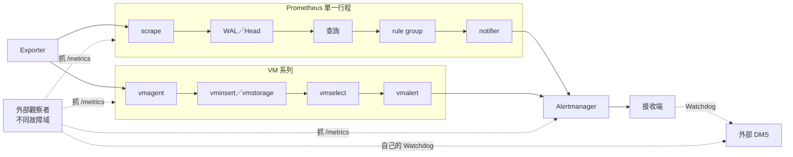

# 共同模型

每一條 alert 都要依序經過六段：**採集 → 寫入 → 查詢 → 評估 → 通知路由 → 接收**。Prometheus 一個行程包了前五段；VM 系列每段各是一個元件。失效方式不同，但要回答的問題相同：**哪一段壞掉時，誰會知道？**

## 監控的層

| 層 | 回答什麼 | 做法 | 放在哪裡 |
|---|---|---|---|
| **L0 鏈路** | 評估 → 通知 → 接收端整條活著嗎 | 每個 ruler 一條 `Watchdog`，專屬短週期路由送到外部 DMS | 被監控的 ruler；判斷在外部 |
| **L1 資料新鮮度** | 採集 → 寫入 → 查詢有新資料嗎 | 每個關鍵 job 或 log 流各一條 heartbeat | 被監控的 ruler |
| **L2 判斷正確性** | `for` 會不會一直重置，通知能不能準時到 | 依賴真實資料、帶 `for` 的 canary | 和真實 rule 相同負載的 group |
| **L3 元件邊際** | 每個元件離失效還多遠 | 元件卡的訊號 | 外部觀察者 |
| **L4 Target** | Exporter 和背後的服務是不是真的被量到 | Exporter 存活、連線、collector 成功、耗時 | 受測 ruler |

## 跨元件都成立的原則

1. **存活不等於能用。**Prometheus `up=1` 時 alert 可以永遠不 firing；Alertmanager 的 `/-/healthy`、`/-/ready` 寫死回 200，receiver 全失敗也一樣。
2. **失敗計數為 0 不代表正常。**Rule 變慢、查詢排隊時失敗數都是 0，要看耗時與 interval 的比值。
3. **`vector(1)` 不碰資料。**儲存層全掛、磁碟寫滿時它都正常，每條資料管線要有自己的 heartbeat。
4. **查詢失敗會變成假 resolved。**Prometheus 和 vmalert 都把 `EndsAt` 設成 `4 × max(resend, E)`，見[續送契約](contracts.md#resend-endsat)。
5. **寫入失敗在 rule 端是安靜的。**資料之後補回，圖看起來正常，但 rule 不會補判。
6. **Crash loop 騙得過不帶 `for` 的 heartbeat。**只有帶 `for` 的 canary 會斷。
7. **自己無法回報自己死掉。**外部觀察者要在不同故障域、走不同的 Alertmanager，而且自己也要有 DMS。
8. **上游規則依 job 名稱比對。**名稱不符時規則照常載入、永遠回傳空，沒有錯誤。

## 依 infra 組合選卡片

| 如果 infra 是 | 要用的卡 | 元件之間的契約 |
|---|---|---|
| Prometheus + Alertmanager | [Prometheus](components/prometheus.md)、[Alertmanager](components/alertmanager.md)、[外部觀察者](components/observer.md) | Prometheus → Alertmanager 的 `EndsAt`；3.10 以前 notifier 只有一條 queue |
| vmagent + VM + vmalert + Alertmanager | [vmagent](components/vmagent.md)、[VM](components/victoriametrics.md)、[vmalert](components/vmalert.md)、Alertmanager、外部觀察者 | 查詢失敗會假 resolved，Watchdog 放在不設 `resendDelay` 的獨立 vmalert；寫入故障後資料補回但不補判 |
| 再加上 VictoriaLogs | 上一列＋[VictoriaLogs](components/victorialogs.md) | Log rule 狀態寫 VM；VM 與 VL 互相收對方的資料時可能一起失明 |
| 混用 | 兩邊的卡都要 | 共用 Alertmanager 時它一壞兩邊一起斷；每個 ruler 各一條 Watchdog，DMS 要分得出是哪一條斷了 |

## 檢查流程 {#flow}

給人照著做，也給 AI 照著問。三個階段依序產出環境描述檔、現況快照、覆蓋矩陣，最後合成報告。

### 階段 1：建立環境描述

先自動偵測能偵測的（`buildinfo`、`/flags`、`/api/v2/status`），剩下的分三輪問，每輪最多 3 題，不知道就記「未知」繼續。

| 輪 | 問什麼 | 為什麼 |
|---|---|---|
| 1 | 有哪些元件、版本、怎麼連（直連、port-forward、只能貼資料） | 決定要用哪幾張卡 |
| 2 | 誰監控誰：外部觀察者在哪個故障域、告警走哪台 Alertmanager、DMS 是什麼、多久沒收到會通知誰 | 腳本看不到架構 |
| 3 | 最重要的 3 條 alert、通知時限、關鍵 job 與 log 流 | 決定 heartbeat 涵蓋誰、延遲能不能接受 |

產出是 `env.yaml`，格式見 [`env/env.example.yaml`](https://github.com/HahaSula/alert-trust/blob/main/env/env.example.yaml)。**它描述的是你的環境，不要 commit 到公開 repo。**

### 階段 2：現況快照

用唯讀腳本蒐集每個元件的規則、flag、尖峰耗時與 label 集合，代入每張卡的信任契約算出邊際。

### 階段 3：缺口

對環境裡的每個元件，逐條檢查第 1 級訊號：

| 結果 | 意思 | 怎麼判斷 |
|---|---|---|
| 涵蓋 | 有規則、有資料，在獨立的觀察者上評估 | 規則引用了這個訊號；評估它的 ruler 跟元件不在同一故障域；selector 查得到 series |
| 只在自己身上 | 規則在被監控的元件上跑，它壞掉時規則跟著停 | 評估的 ruler 就是元件本身，或同一故障域 |
| 規則在但沒資料 | 規則載入了，selector 永遠是空的 | 把 selector 拿去查詢，series 數是 0 |
| 缺少 | 沒有任何規則引用這個訊號 | 比對所有 ruler 的規則表達式 |
| 不適用 | 環境沒有這個情況 | 要寫明理由，例如單台 Alertmanager 不需要叢集規則 |

### 報告

同一份結果輸出兩種格式：Markdown 給人看（結論、環境摘要、必須先處理、邊際總表、依元件分組的缺口、建議順序、未確認的部分），JSON 給 AI 讀，讓下一次對話能直接接續。
