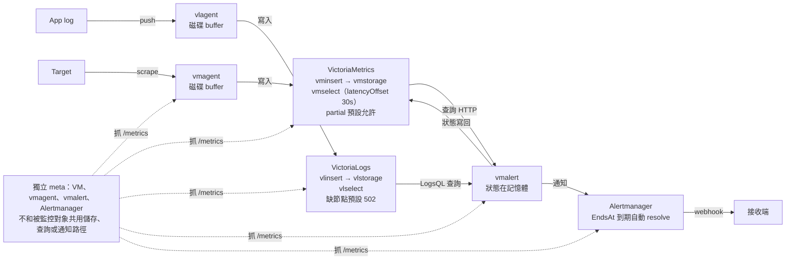

# VictoriaMetrics Rule 信任邊際

在 VM 體系裡，怎麼判斷 rule 的結果能不能信，涵蓋 VictoriaMetrics 與 VictoriaLogs 的 single 和 cluster。

!!! info "範圍與限制"
    VM v1.155.0、VL v1.53.0，通知端用 Alertmanager 0.27.0。實測數字全部來自本 repo 的 [`lab/vm`](https://github.com/HahaSula/alert-trust/tree/main/lab/vm)：延遲矩陣 12 格、VM cluster 故障 9 種、VictoriaLogs 6 項與 2 個重測。單機、每個情境只跑一次、30 條 series 低流量，容器時鐘比牆上時鐘慢。**證明的是機制與訊號順序，秒數不能直接套到大型環境。**lab 沒有測的情境標「推論」或「讀碼」，不寫秒數。Operator 只讀了原始碼，沒有實機部署。

<span class="at-chip at-ev-tested">實測</span> lab 量到　<span class="at-chip at-ev-code">讀碼</span> 由原始碼或官方文件確認　<span class="at-chip at-ev-inferred">推論</span> 由前兩者推導，未單獨驗證

## 結論

**Rule 回報 firing 或 resolved，都不等於事情真的發生或結束。**lab 中 vmselect 停止後，所有 rule 變 ERR，+101 秒時 Alertmanager 把所有 alert 標成 resolved，連 Watchdog 也一樣。問題還在，通知卻說解決了。[^exp-vm-faults][^vma-exec-send]

**主要的不信任來源有三個：**

- **查詢路徑故障**會產生假的 resolved。
- **寫入路徑故障**時 rule 完全不報錯，條件型 alert 還會繼續 firing 約 6 分鐘（lab：vminsert 停 +354 秒才 resolved）。之後資料補回來，圖表看起來完全正常，但 rule 不會補判。[^exp-vm-faults]
- **VictoriaLogs 的 rule 預設只查一個 interval 的視窗**。Log 延遲超過 `eval_delay + interval`，事件就永遠不會觸發 alert。[^exp-vm-vl]

**Watchdog 不夠。**`vector(1)` 不碰儲存層，寫入故障、全部唯讀、partial 時都照常 firing。要加資料新鮮度 canary 和獨立的 meta 監控。lab 中元件 metric 都比 rule 先反映故障：`vm_storage_is_read_only` +2 秒、`vm_rpc_vmstorage_is_reachable` +6 秒、`vm_partial_results_total` +11 秒；官方規則的 `ServiceDown` 依 job 名稱比對，lab 的 job 名稱對到 0 條，官方規則也沒有引用唯讀狀態的 metric。[^exp-vm-faults][^vst-readonly]

**可以直接做的修正：**cluster 開 `replicationFactor: 2`（lab 中 rule 完全不受單台 vmstorage 停止影響）；設定 `-rule.resendDelay=3m`（lab 中 vmselect 停 4 分鐘沒有假 resolved）；Watchdog 放在獨立的 vmalert；log rule 改用較長的 `_time` 視窗並設定足夠的 `eval_delay`。[^exp-vm-faults][^exp-vm-resend][^exp-vm-vl]

## 1. Single 和 Cluster 差在哪

兩者跑的是同一套儲存與查詢引擎，rule 語法也相同。對 rule 來說，差別在於「部分節點故障」這種狀態是否存在，以及系統怎麼回應。

| 項目 | VM single | VM cluster | VL single | VL cluster |
|---|---|---|---|---|
| 元件 | 單一行程 | `vminsert`、`vmselect`、`vmstorage` | 單一行程 | `vlinsert`、`vlselect`、`vlstorage`（同一個執行檔） |
| 擴充方式 | 垂直 | 水平，可分開擴寫入、查詢、儲存 | 垂直 | 水平 |
| 官方建議 | 寫入低於每秒 100 萬 sample 時優先用 | 超過時才用 | 能垂直擴充就優先用 | 到達單機上限才用 |
| Replication | 交給磁碟層 | `replicationFactor`，預設 1[^vmi-rf] | 交給磁碟層 | **沒有**，只做 sharding |
| 部分故障時查詢 | 不存在這個狀態 | **預設回 partial，HTTP 200**[^vms-partial] | 不存在這個狀態 | 預設回 502 <span class="at-chip at-ev-tested">實測</span>[^exp-vm-vl]，可改 partial <span class="at-chip at-ev-code">讀碼</span>[^vl-select-502] |
| 單節點故障對 rule | 全部 ERR <span class="at-chip at-ev-inferred">推論</span> | RF=1：少資料、可能假觸發；RF=2：無影響 <span class="at-chip at-ev-tested">實測</span>[^exp-vm-faults] | 全部 ERR <span class="at-chip at-ev-inferred">推論</span> | 全部 ERR <span class="at-chip at-ev-tested">實測</span>[^exp-vm-vl] |
| 多租戶 | 無 | 有 | 有 | 有 |

**同樣是 cluster，VM 和 VL 的預設行為相反。**VM 預設給你不完整的答案，VL 預設不給答案。同一份 alert 設計不能直接套兩邊。

**建議：**資料量在 single 的能力範圍內就用 single，要 HA 就跑兩套獨立的 single，前面放 `vmagent` 或 `vlagent` 複寫。一定要 cluster 時，VM 用 RF=2 且 vmstorage 至少 3 台（官方公式 2N−1）。只有 single 的情境中，查詢只會分成成功與失敗，判讀最簡單，代價是沒有水平擴充。

## 2. 架構：一條 alert 經過哪些元件

vmalert 是獨立行程，所有依賴都走網路。它不會和儲存層搶 CPU，但每條箭頭都是可能失效的路徑。Log rule 的狀態要寫到 VM，所以 VL 的告警依賴 VM。



各元件的內部細節見 [vmagent](../architecture/vmagent.md)、[VictoriaMetrics](../architecture/victoriametrics.md)、[VictoriaLogs](../architecture/victorialogs.md)、[vmalert](../architecture/vmalert.md)。

### 每段失效時，rule 會出現什麼症狀

| 路徑 | Rule 的症狀 | 報錯嗎 | 資料之後會補回嗎 |
|---|---|---|---|
| 寫入（vmagent、vminsert、唯讀） | 資料變舊，最後變空 | **不報錯** | 會，但 rule 不補判 |
| 查詢（vmselect、vlselect、飽和） | 查詢失敗，狀態凍結，不續送通知 | 會，`health=err` | 資料沒遺失 |
| 部分儲存（VM RF=1） | 結果少一部分，可能假觸發或假恢復 | **不報錯** | 節點回來後恢復 |
| vmalert 本身 | 全部停止，重啟時可恢復 `for` | 外部才看得到 | 不會補判 |
| Alertmanager、接收端 | Rule 正常，通知斷掉 | vmalert 有 metric | 不會補送 |

## 3. Rule 的信任契約

符號：`I` 實際資料間隔、`L` 資料從時間戳到可查詢的延遲、`D` 是 `eval_delay`（預設 30s）[^vma-evaldelay]、`R` 查詢視窗、`E` group interval。公式也整理在[信任契約](../contracts.md#vm-range-window)。

| 契約 | 違反時 | 怎麼查 | 證據 |
|---|---|---|---|
| `R ≥ I + L − D`（k = 0、n = 1 的特例；一般式 `(n+k)·I + max(0, L − D)` 見[契約](../contracts.md#vm-range-window)） | 視窗內沒有可見 sample，查詢回空，`for` 永遠歸零 | `time() - timestamp(m)` 的尖峰值，搭配 scrape 間隔 | <span class="at-chip at-ev-tested">實測</span>[^exp-vm-matrix] |
| 資料還在流入 | 資料停了，條件型 rule 還會繼續成立約 6 分鐘 | 每條關鍵 job 一條 heartbeat | <span class="at-chip at-ev-tested">實測</span>[^exp-vm-faults] |
| 查詢中斷短於 `4 × max(E, resendDelay)` | Alertmanager 自動 resolve，恢復時再次 firing | `vmalert_alerting_rules_errors_total` | <span class="at-chip at-ev-tested">實測</span>[^exp-vm-resend] |
| VM cluster 沒有 partial，或 rule 容忍 partial | 聚合結果變小，比例與 `increase` 可能假觸發 | `vm_partial_results_total` | <span class="at-chip at-ev-tested">實測</span>[^exp-vm-faults] |
| Log rule：`L ≤ D`（保證），`L > D + E` 必定漏 | Log 進來時視窗已過，事件永遠不觸發 | Canary log 的端到端延遲 | <span class="at-chip at-ev-tested">實測</span>[^exp-vm-vl] |
| Log rule 的 `for`：資料間隔要小於 interval | 視窗常常是空的，pending 一直被刪除 | 改用較長的 `_time` 視窗 | <span class="at-chip at-ev-inferred">推論</span>（視窗只有一個 interval[^vma-vlogs-window]；lab 的 log rule 都沒有 `for`） |
| Rule 真的有載入 | 完全沒有 rule，也沒有錯誤 | `vmalert_alerting_rules_last_evaluation_samples` 與 `/api/v1/rules` | <span class="at-chip at-ev-code">讀碼</span>[^vma-eval-samples] |

### 延遲矩陣：什麼時候 rule 永遠無法 firing

永遠成立的 `rate(lab_m[2m]) > 0`（R = 120s），group interval 30s，`D = 30s`，`for: 1m`，跑 13 分鐘。格內是第一次 firing 的秒數（從資料開始產生算起），— 表示整輪沒有 firing，括號是 pending 被清掉的次數。另外兩輪（`for: 2m`、逐次比對）見 lab。<span class="at-chip at-ev-tested">實測</span>[^exp-vm-matrix]

| 實際間隔 I | L = 0 | L = 60s | L = 120s | L = 180s |
|---|---|---|---|---|
| 30s | 208 | 208 | 275 | —（2） |
| 60s | 275 | 275 | 308 ⚠ | —（1） |
| 120s | 375 | 375 ⚠ | —（3） | —（1） |

- **公式與結果相符。**違反 `R ≥ I + L − D`（k = 0 的特例，I + L > 150）的有 6 格。滿足契約的 6 格三輪都 firing；(60, 180)、(120, 120)、(120, 180) 三輪都沒有 firing。逐次 evaluation 比對 61 次，「視窗內有沒有已寫入的 sample」的預測 0 次不符。
- **⚠ 是違反契約仍 firing 的格子。**它們只超出 30 秒，而這台機器的查詢時間落後牆上 50–77 秒，比設定的 30 秒大。查詢時間由 `evalDelay` 與 group 的啟動相位決定[^vma-eval-ts][^vma-start-phase]，不能依賴，所以公式是保證條件。
- **只要視窗夠大就沒問題。**對照組 `rate(lab_m[5m])` 12 格全部 firing。
- **視窗內沒有 sample 時 `rate` 回空，不是 0。**`for: 2m` 這輪另有 `rate(lab_m[2m]) == 0`，整輪 0 次成立。[^vms-rate-empty]
- **延遲的代價是變慢。**同一列裡 L 超過 D 之後 firing 開始變晚（I = 30s 時 L = 120s 比 L = 0 晚 67 秒）。把 D 拉大會讓整個 group 都變晚，所以只對延遲大的 group 設定。
- **資料停止時，alert 還會撐一段時間。**VM instant 查詢預設回看 5 分鐘（`-datasource.queryStep`）[^vma-querystep]。lab 中 vminsert 停止後，條件型 alert +354 秒才 resolved。[^exp-vm-faults]

## 4. VM 故障矩陣

3 台 vmstorage、30 條 series、scrape 10s、group interval 30s、`for: 1m`。時間從故障開始算（牆上時間，±5 秒）。「假 resolved」是條件其實仍成立，但 Alertmanager 把 alert 標成已解決。<span class="at-chip at-ev-tested">實測</span>[^exp-vm-faults]

| 故障（持續） | Rule 與 alert | 元件 metric |
|---|---|---|
| RF=1，1 台 vmstorage 停（240s） | 每條 series 的 alert 30 → 18（+11s），+139s 才回到 30；`sum(increase(m[3m])) < 4500` 假觸發 +86s 到 +152s；rule 沒有錯誤 | `vm_partial_results_total` +11s 開始增加；`vm_rpc_vmstorage_is_reachable` 合計 3 → 2（+6s） |
| 同上，`params: {denyPartialResponse: ["true"]}`（文件寫法） | 和預設相同：同樣假觸發（+72s 到 +139s），沒有錯誤 | |
| 同上，`params: {deny_partial_response: ["1"]}` | 沒有假觸發；+34s 起 rule 變 ERR，直到節點回來 | `vmalert_alerting_rules_errors_total` 增加 |
| RF=2，1 台 vmstorage 停（240s） | 沒有任何 alert 變化，沒有錯誤 | partial 0；reachable 3 → 2 |
| vmselect 停（240s），預設 `resendDelay` | 所有 rule +16s 變 ERR；+101s Alertmanager 把 Watchdog、Heartbeat 與所有條件型 alert 標成 resolved（假 resolved）；vmselect 回來 +5s 再 firing | 錯誤數增加 |
| 同上，`-rule.resendDelay=3m` | 240s 內 Alertmanager 沒有任何 alert 消失，Watchdog 也沒斷 | |
| 全部 vmstorage 唯讀（240s） | 沒有 rule 錯誤；Heartbeat +183s resolved；條件型 alert 到唯讀結束仍 firing | `vm_storage_is_read_only` 全部 1（+2s） |
| vminsert 停（400s） | 沒有 rule 錯誤；Heartbeat +154s resolved；條件型 alert +354s 才 resolved | `vmagent_remotewrite_pending_data_bytes` 最高 1366 |
| vmagent 停（400s，RF=2） | 沒有 rule 錯誤；Heartbeat +149s；條件型 alert +349s resolved | |

**lab 沒有測的故障**（不寫秒數）：

| 故障 | 預期 | 證據 |
|---|---|---|
| 查詢飽和（429） | 查詢排隊逾時後 rule 走查詢失敗路徑，和 vmselect 停相同，可能假 resolved；`vmalert_iteration_missed_total` 會不會增加沒有驗證 | <span class="at-chip at-ev-inferred">推論</span>[^vms-queue][^vma-exec-send] |
| 1 台 vmstorage 唯讀 | vminsert 把資料轉送到其他節點，rule 不受影響 | <span class="at-chip at-ev-inferred">推論</span>[^vmi-reroute] |
| 磁碟突然 0 byte | 剩餘空間低於 `-storage.minFreeDiskSpaceBytes` 時切唯讀；之後是否因 flush 失敗而 panic 沒有驗證 | <span class="at-chip at-ev-inferred">推論</span>[^vst-minfree] |
| vmalert 停 | 不再續送，`EndsAt` 到期後 Alertmanager 標成 resolved | <span class="at-chip at-ev-inferred">推論</span>[^vma-resend] |
| Alertmanager 停 | Rule 正常，通知中斷，`vmalert_alerts_send_errors_total` 增加 | <span class="at-chip at-ev-inferred">推論</span>[^vma-notify-send] |
| VM single 停 | 和 vmselect 停同一條查詢失敗路徑 | <span class="at-chip at-ev-inferred">推論</span>[^vma-exec-send] |

### 從這張表得到的判讀

- **VM partial 的危害不是少幾條 series。**`sum(increase(m[3m])) < 門檻` 這種「數量太低」的規則在 4 分鐘的故障裡假觸發了 66 秒（+86s 到 +152s），`for: 1m` 擋不住。
- **每條 series 的 alert 也會假 resolved。**30 條裡 12 條暫時消失，+139 秒才全部回來。vminsert 把新資料轉到健康節點後，還要再過一次 `for`。[^vmi-reroute]
- **`deny_partial_response=1` 是取捨，不是解法。**它消除假觸發，代價是 rule 在節點恢復前都無法判斷。真正解決的是 RF=2。
- **寫入故障時資料會補回，rule 不會補判。**vminsert 停 400 秒後查同一段時間，`lab_item{id="0"}` 有 36 筆（約等於全部）；vmagent 停的那段是 0 筆，vmagent 自己停就沒有資料可補。事後看圖會覺得不該漏報，但 rule 當下確實看不到。
- **「數量太低」的規則在資料完全停止時會先觸發、再自動 resolved。**視窗內沒有 sample 後查詢回空（vmagent 停 +196s firing、+229s resolved）。
- **`iteration_missed` 在這台機器上不可靠。**健康階段也每 6–7 分鐘增加一次，是容器時鐘修正造成的。查詢飽和時要看 error 比率，missed 會不會動沒有驗證。[^vma-missed]

### 實驗中發現的陷阱

- **官方文件的參數名稱沒有作用。**`vmalert.md` 範例寫 `denyPartialResponse: ["true"]`，但 vmselect 只讀 `deny_partial_response`。用文件寫法的 group，行為和預設完全相同，也沒有任何錯誤。<span class="at-chip at-ev-tested">實測</span>[^vms-denypartial][^exp-vm-faults]
- **官方 `ServiceDown` 依 job 名稱比對。**lab 的 single 用 job 名稱 `vm`，官方選擇器對到 0 條，這條規則永遠不會觸發，也沒有錯誤。lab 只查了選擇器，沒有讓 VM 停機。Operator 產生的 job 名稱要在實際環境確認。<span class="at-chip at-ev-tested">實測</span>[^exp-vm-matrix][^vm-rule-servicedown]
- **官方規則沒有引用 `vm_storage_is_read_only` 和 `vl_storage_is_read_only`。**lab 中唯讀時 rule 沒有任何錯誤。VM 的磁碟預測規則窗口是 3 天，VL 是用量超過 80%，突發情況不一定來得及。<span class="at-chip at-ev-code">讀碼</span> <span class="at-chip at-ev-tested">實測</span>[^vst-readonly][^exp-vm-faults]
- **磁碟突然 0 byte。**切唯讀的門檻預設 VM 100MB、VL 10MB，建議調高。之後會不會 panic、重啟時磁碟仍滿會怎樣，lab 都沒有測。<span class="at-chip at-ev-inferred">推論</span>[^vst-minfree]
- **`vmagent_remotewrite_pending_data_bytes` 在低流量下數值很小。**vminsert 停 400 秒時最高只有 1366 bytes（30 條 series）。門檻要依實際流量設定，不能用固定值。<span class="at-chip at-ev-tested">實測</span>[^exp-vm-faults]

## 5. VictoriaLogs 故障與 Log rule

VL v1.53.0。Log rule 的 group interval 30s（E），`-rule.evalDelay` 30s（D），沒有 `for`。<span class="at-chip at-ev-tested">實測</span>[^exp-vm-vl][^exp-vm-vl-reachable][^exp-vm-vl-ingested]

| 項目 | 結果 |
|---|---|
| Cluster 停 1 台 vlstorage（240s） | 查詢 +7s 起回 502；log rule +32s 變 ERR；+122s Alertmanager 把 canary 標成 resolved（假 resolved），vmalert 裡仍是 firing；寫入仍回 200 |
| 同上，看哪個 metric 會變（重測，各 60s） | `vl_select_remote_send_errors_total` 每次查詢都增加；`vl_insert_remote_is_reachable` 只在有 stream 要寫到停掉的那台時才變 0，只寫 1 條 stream 時一直是 1 |
| Single 唯讀（150s） | `vl_storage_is_read_only` = 1；寫入回 **429**；rule 沒有錯誤 |
| 空的 VL 上 `* \| stats count() c` | single、cluster 都回 `{"c":"0"}`；加 `\| filter c:>0` 回空 |
| 寫入不帶 Content-Type | 200，收進 5 筆 |
| 寫入帶 `application/x-www-form-urlencoded` | **200，`vl_rows_ingested_total` +0，查不到**；`vl_http_requests_total` 照樣 +1 |

**lab 沒有測的 VL 故障**（不寫秒數）：

| 故障 | 預期 | 證據 |
|---|---|---|
| 1 台 vlstorage 停，`allow_partial_response=1` | 只要有一台回完整結果就不報錯，結果少一部分 | <span class="at-chip at-ev-code">讀碼</span>[^vl-select-502] |
| vlselect 停 | Log rule 全部 ERR，接著假 resolved | <span class="at-chip at-ev-inferred">推論</span>[^vma-exec-send] |
| vlinsert 停 | 不報錯，視窗變空，canary 停止 | <span class="at-chip at-ev-inferred">推論</span> |
| 全部 vlstorage 停 | 查詢 502；vlinsert 每秒重試、資料留在記憶體 | <span class="at-chip at-ev-code">讀碼</span>[^vl-select-502][^vl-insert-retry] |
| 狀態用的 VM 停，期間 vmalert 重啟 | 評估正常，但重啟後 `for` 從頭算 | <span class="at-chip at-ev-inferred">推論</span> |

- **cluster 寫入在缺節點時仍回 200。**vlinsert 把資料轉送到剩下的節點，shipper 看不到錯誤；之後是否全部查得到，lab 沒有逐筆核對。
- **Single 唯讀時 shipper 看得到 429，rule 看不到。**rule 不報錯，新 log 查不到。
- **`* | stats count()` 不是 canary。**沒有 log 時它仍回傳 0，log 停了這條看門狗也不會中斷。要用 `filter c:>0` 並綁定一個固定會出現的 log 流。
- **Content-Type 錯時，ingestion 回 200 卻沒收資料。**不帶 header 可以收；Python urllib 的預設 `application/x-www-form-urlencoded` 收不到，`vl_rows_ingested_total` 不動，但 `vl_http_requests_total` 會增加。「有請求、沒收進」可以直接寫成規則（`MetaVLRowsNotIngested`）。導入新的 log shipper 時要驗證這兩個 metric。

### Log rule 視窗：事件會不會被漏掉

vmalert 對沒有 `_time` 的 log rule，只查 `[ts − interval, ts]`，視窗不重疊[^vma-vlogs-window]。下表是每 67 秒一筆事件（不是 30 的倍數，相位會變），延遲 `L`，D = 30s。<span class="at-chip at-ev-tested">實測</span>[^exp-vm-vl] 契約見 [Log rule 的延遲](../contracts.md#vl-log-delay)。

| Rule | L | 事件數 | 觸發次數 |
|---|---|---|---|
| `kind:event lag:0 \| stats count() c \| filter c:>0` | 0 | 9 | 8 |
| 同上，lag:20 | 20s | 9 | 8 |
| 同上，lag:45 | 45s | 9 | 8 |
| 同上，lag:90 | 90s | 8 | **0** |
| `_time:10m kind:event lag:90 …` | 90s | 8 | 1 次，持續 firing 涵蓋全部 |

- **L > D + E 時一次都沒觸發，但 log 有寫進去。**同一批 log 用 `_time:10m` 的版本有觸發。
- **L 介於 D 與 D + E 之間要看相位。**L = 45s 這次和 L ≤ D 一樣都觸發，因為這台機器實際延遲 50–77 秒。設計時用 `D ≥ 尖峰 L`。
- **L = 0、20、45 都漏了同一筆事件**（第 4 筆），原因沒有找到；VL 的 `start`／`end` 邊界另外測過是包含的。
- **文件建議的 `-rule.evalDelay` 調小要小心。**只要 log 傳輸的尖峰延遲超過這個值，事件就可能被漏掉，而且資料事後查得到。<span class="at-chip at-ev-inferred">推論</span>（由上表與契約推導）
- **長視窗的代價是不會自動恢復。**`_time:10m` 要等事件離開視窗才 resolve，事件連續時只算一次 firing。<span class="at-chip at-ev-inferred">推論</span>
- **查詢故障期間的事件不會補判。**interval 視窗的 rule 只看當下的視窗；需要補判要用 `vmalert -replay`，這次沒有測。<span class="at-chip at-ev-inferred">推論</span>[^vma-exec-send]
- **有 `for` 的 log rule 要注意資料密度。**資料間隔大於 interval 時，視窗常常是空的，pending 會被刪除；改用較長的 `_time` 視窗。lab 的 log rule 都沒有 `for`。<span class="at-chip at-ev-inferred">推論</span>[^vma-vlogs-window]

## 6. 假 resolved 怎麼處理

vmalert 查詢失敗時不會續送通知（`app/vmalert/rule/group.go` 的 `exec`）。Alertmanager 收到的 `EndsAt` 是 `now + 4 × max(E, -rule.resendDelay)`，到期就 resolve。預設 `resendDelay` 是 0，所以 E=30s 時只有 2 分鐘。<span class="at-chip at-ev-code">讀碼</span>[^vma-exec-send][^vma-resend] 契約見[續送中斷要短於 EndsAt](../contracts.md#resend-endsat)。

| 4 分鐘故障 | 預設 | `-rule.resendDelay=3m`（EndsAt 12 分鐘） |
|---|---|---|
| vmselect 停 | **假 resolved** +101s，Watchdog 也一樣 | 沒有任何 alert 消失，Watchdog 也沒斷 |
| 1 台 vlstorage 停（VL cluster） | **假 resolved** +122s | 沒有測 |

<span class="at-chip at-ev-tested">實測</span>[^exp-vm-resend][^exp-vm-vl]

**代價一：Watchdog 也跟著不會斷。**Alertmanager 會一直 repeat 到 EndsAt，所以 dead man's switch 要 12 分鐘以上才會響（由公式算出）。這就是 Watchdog 要獨立出來的原因：業務 rule 的 vmalert 用較長的 `resendDelay`，放 Watchdog 和 canary 的 vmalert 維持預設。

**代價二：部分真正的 resolved 會晚到。**lab 中設 `resendDelay=3m` 後，條件消失時有 5／23 次 Alertmanager 晚了 134–200 秒才標成 resolved，預設值 0／23 次。推論是 vmalert 用對齊後的查詢時間當 `ResolvedAt`，只有比上次送出時間晚才立即送[^vma-resolved-at][^vma-resolved-send]；這台機器查詢時間落後較多，比例可能偏高。<span class="at-chip at-ev-tested">實測</span>[^exp-vm-resend]

## 7. Monitor of monitor 架構

| 層 | 做法 | 能抓到 | 抓不到 |
|---|---|---|---|
| L0 鏈路 | 獨立 vmalert 的 `vector(1)`，透過 Alertmanager 送外部 dead man's switch | vmalert、vmselect、Alertmanager、接收路徑 | 寫入故障、全部儲存掛掉、唯讀、partial |
| L1 Metric 新鮮度 | 每條關鍵 job 一條 `time() - max(timestamp(m)) < 120`，`for: 1m` | vmagent、vminsert、全部唯讀 | Partial（max 只要有一條新資料就成立） |
| L1 Log 新鮮度 | 每條 log 管線固定送 canary log，rule 查 `_time:2m flow:canary \| stats count() c \| filter c:>0`，帶 `for` | vlagent、vlinsert、唯讀、vlselect | 延遲小於視窗的慢化 |
| L2 Meta | 另一套 VM、vmagent、vmalert、Alertmanager，抓所有元件 `/metrics`，載入第 8 節規則與官方規則 | lab 測到的故障都有元件 metric 變化（第 4、5 節） | Rule 邏輯本身寫錯 |
| L3 Rule 自檢 | 依第 3 節契約檢查每條 rule；用 `vmalert-tool` 做單元測試（這次未實測） | 視窗太小、log 視窗不足、rule 回傳空 | 未預期的資料變化 |

- **Meta 要和被監控對象分開故障。**官方多區域指南也建議每區一台獨立監控實例，可把資料複製到鄰區（`docs/guides/multi-regional-setup-dedicated-regions/README.md`）。
- **避免 VM、VL 互相依賴形成循環。**Log rule 的狀態寫到 VM；如果 VM 的 log 又只進 VL、VL 的 metric 只進 VM，兩邊可能一起失明。Meta 不要用被監控的這兩套。<span class="at-chip at-ev-inferred">推論</span>
- **Meta 也要有 dead man's switch。**否則只是把問題往外移一層。
- **Alert 有疑慮時先查 rule 自己的 metric。**vmalert 的 metric 細到單條 rule（帶 `alertname`、`group`），`/api/v1/rules` 有 `lastError`。

## 8. Meta 規則

節錄自 [`rules/victoriametrics/meta.yml`](https://github.com/HahaSula/alert-trust/blob/main/rules/victoriametrics/meta.yml)（完整版另有 vmagent、VL 磁碟與查詢、重啟、結果上限的規則）。規則用到的 metric 在 lab 中的變化見第 4、5 節；lab 沒有載入這組規則逐條確認 firing。門檻以 30s 間隔的小型實驗環境為準，要依環境調整。官方規則請同時載入。[^exp-vm-faults][^exp-vm-vl]

```yaml
groups:
  - name: meta
    interval: 15s
    rules:
      # 任何元件停止回應
      - alert: MetaTargetDown
        expr: up == 0
        for: 30s
      # Rule 查詢失敗。查詢路徑、飽和、VL 502 都先反映在這裡
      - alert: MetaRuleErrors
        expr: sum by (job, group) (rate(vmalert_alerting_rules_errors_total[2m])) > 0
        for: 30s
      # VM cluster 回傳不完整結果，alert 結果要打折扣
      - alert: MetaPartialResponses
        expr: sum(rate(vm_partial_results_total[2m])) > 0
        for: 30s
      - alert: MetaStorageUnreachable
        expr: min(vm_rpc_vmstorage_is_reachable) == 0
        for: 30s
      # reachable 只在有資料要寫到那台時才變 0，所以和查詢端的錯誤數一起看（lab 重測）
      - alert: MetaVLStorageUnreachable
        expr: |
          sum by (job, instance, addr) (increase(vl_select_remote_send_errors_total[2m])) > 0
          or min by (job, instance, addr) (vl_insert_remote_is_reachable) == 0
        for: 30s
      # 有寫入請求卻沒收進任何一行（Content-Type 錯時 HTTP 仍回 200）
      - alert: MetaVLRowsNotIngested
        expr: |
          sum by (job, instance) (rate(vl_http_requests_total{path=~"/insert/.*"}[5m])) > 0
          unless sum by (job, instance) (rate(vl_rows_ingested_total[5m])) > 0
        for: 10m
      # 唯讀時沒有 rule 錯誤，官方規則也沒有對應告警
      - alert: MetaStorageReadOnly
        expr: max(vm_storage_is_read_only) == 1
        for: 15s
      - alert: MetaVLReadOnly
        expr: max(vl_storage_is_read_only) == 1
        for: 15s
      # 通知、狀態寫入失敗
      - alert: MetaNotifierErrors
        expr: sum(rate(vmalert_alerts_send_errors_total[2m])) > 0
        for: 30s
      - alert: MetaNoRuleWrites
        expr: sum(rate(vmalert_remotewrite_errors_total[2m])) > 0
        for: 30s
      # 0.8 × interval，這裡的 interval 是 30s
      - alert: MetaGroupSlow
        expr: max(vmalert_iteration_duration_seconds{quantile="0.9"}) > 24
        for: 30s
      - alert: MetaVLAgentBacklog
        expr: sum(vlagent_remotewrite_pending_data_bytes) > 1000
        for: 30s
```

### 被監控的 vmalert 上要放的 canary

```yaml
# 獨立 vmalert，不要設定 -rule.resendDelay
groups:
  - name: chain-canary
    interval: 30s
    rules:
      - alert: Watchdog
        expr: vector(1)
      - alert: MetricsFresh
        expr: time() - max(timestamp(up{job="my-job"})) < 120
        for: 1m

# 只放在 datasource 為 VictoriaLogs 的 vmalert；flow:canary 換成你的 canary 流
  - name: chain-canary-logs
    type: vlogs
    interval: 30s
    rules:
      - alert: LogsFresh
        expr: '_time:2m flow:canary | stats count() c | filter c:>0'
        for: 2m
```

這些 canary 是「正常時 firing」，要在外部接收端設定「沒收到就告警」。`MetricsFresh` 的寫法與 lab 的 Heartbeat 相同；`LogsFresh` 的表達式與 lab 的 cluster canary 相同，但 lab 沒有加 `for`。

## 9. Operator 要注意什麼

<span class="at-chip at-ev-code">讀碼</span> 以下依 operator 原始碼與文件（api/v0.75.2 之後的 main），**沒有實機部署，K8s 還沒驗證**。

| 項目 | 行為 | 建議 |
|---|---|---|
| `VMAlert` 選 rule | 兩個 selector 都沒設且 `selectAllByDefault: false` 時，**一條 rule 都不選**。空的 `{}` 代表全選[^op-vmalert-selector] | 明確設 selector，上線後確認 `/api/v1/rules` 的數量 |
| `WATCH_NAMESPACE` | 設定後 `ruleNamespaceSelector` 被忽略 | Namespaced 模式下重新檢查 rule 範圍 |
| LogsQL 的 `VMRule` | 驗證時不看 `-rule.defaultRuleType`。沒寫 `type: vlogs` 的 group 會被拒絕 | 每個 log group 都寫 `type: vlogs`，監控 `operator_bad_objects_total` |
| 驗證時機 | Admission webhook 需要 cert-manager。沒開時，錯誤 rule 要到建立設定時才發現，`kubectl apply` 會成功 | 開 webhook，或在 CI 跑 `vmalert -dryRun` |
| `replicationFactor` | Operator 自動把 flag 帶給 vminsert、vmselect，並加 `-dedup.minScrapeInterval=1ms` | 照第 1 節用 RF=2、vmstorage 至少 3 台 |
| `replicaCount` | 預設 1 | VMAlert 開 2 個，靠 Alertmanager 去重（文件說明，未實測） |
| `VLCluster` | 沒有 replication 欄位，VL 本身也沒有 | 要 HA 看 `VLDistributed` 或 vlagent 複寫到兩套 |
| Operator 自身 | 壞掉時既有 Pod 應會繼續跑，但新 rule 不生效 <span class="at-chip at-ev-inferred">推論</span> | 載入 `config/alerting/vmoperator-rules.yaml`，監控 `operator_controller_errors_total` |

### 重點欄位範例

```yaml
apiVersion: operator.victoriametrics.com/v1beta1
kind: VMCluster
metadata: { name: main }
spec:
  retentionPeriod: "30d"
  replicationFactor: 2
  vmstorage: { replicaCount: 3 }
  vmselect:  { replicaCount: 2 }
  vminsert:  { replicaCount: 2 }
---
apiVersion: operator.victoriametrics.com/v1beta1
kind: VMAlert
metadata: { name: business }
spec:
  replicaCount: 2
  ruleSelector: { matchLabels: { tier: business } }
  datasource: { url: http://vmselect-main:8481/select/0/prometheus }
  remoteWrite: { url: http://vminsert-main:8480/insert/0/prometheus }
  remoteRead:  { url: http://vmselect-main:8481/select/0/prometheus }
  notifiers: [ { url: http://alertmanager:9093 } ]
  extraArgs: { rule.resendDelay: 3m }
---
apiVersion: operator.victoriametrics.com/v1beta1
kind: VMRule
metadata: { name: app-logs, labels: { tier: logs } }
spec:
  groups:
    - name: app-logs
      type: vlogs          # 必須明確寫
      interval: 1m
      eval_delay: 2m       # ≥ log 管線的尖峰延遲
      rules:
        - alert: AppErrors
          expr: '_time:10m level:error | stats by (app) count() c | filter c:>10'
```

欄位名稱已對照 CRD 型別，服務 URL 要依實際名稱調整。Log rule 要有自己的 `VMAlert`，datasource 指向 vlselect，remote write 和 read 指向 VM。

## 10. 建議順序

1. **先確認 rule 真的在跑。**比對預期 rule 數與 `/api/v1/rules`，查 `lastError`，並確認每條 rule 的 `last_evaluation_samples`。
2. **上 meta 和 dead man's switch。**第 7、8 節的 L0、L1、L2，這是判斷其他問題的前提。
3. **量實際延遲。**Metric 用 `time() - timestamp(m)`，log 用 canary，取尖峰值代入第 3 節的公式。
4. **修 log rule。**依尖峰延遲設 `eval_delay`，關鍵 rule 改用較長的 `_time` 視窗。
5. **處理假 resolved。**業務 vmalert 設 `-rule.resendDelay`，值依能接受的查詢中斷長度算（可容忍的中斷 ÷ 4）。
6. **處理 partial。**Cluster 開 RF=2。做不到時，把「數量太低」類規則的 group 設 `deny_partial_response: ["1"]`，並接受故障期間無法判斷。
7. **寫下值班判讀。**收到 resolved 時先看 `MetaRuleErrors` 和 `MetaTargetDown`；看到圖表正常但沒告警時，先查當時有沒有寫入故障。

## 附錄：影響 rule 信任的參數

這裡列出前面章節沒有展開、但會改變 rule 結果或讓資料默默消失的參數，每列附上可觀測的訊號。預設值來自 VM v1.155.0-cluster 和 VictoriaLogs v1.53.0 之後的 master 原始碼，Operator 或實際部署可能另外覆寫。

### 先確認實際生效的值

每個元件都有 `/flags` 端點，`/metrics` 也會輸出 `flag{name, value, is_set}`，敏感值會顯示為 `secret`。把這個 metric 納入抓取後，就能查出設定是否漂移。以下查詢由原始碼寫成，沒有實際跑過。

```text
# 看某個元件明確設定過哪些 flag
curl -s http://vmalert:8880/metrics | grep '^flag{' | grep 'is_set="true"'

# 哪些 vmalert 沒有把 resendDelay 設成預期值（放 Watchdog 的獨立 vmalert 要排除）
# Duration 會輸出成 Go 格式，所以 3m 要比對 3m0s
flag{name="rule.resendDelay", value!="3m0s"}
```

### 查詢時間與回看窗口

| 參數 | 預設 | 對 rule 的影響 | 建議與訊號 | 依據 |
|---|---|---|---|---|
| `eval_delay`／`-rule.evalDelay`（vmalert，group 可覆寫） | 30s | 查詢時間往前移。對應 Prometheus 的 `query_offset`。 | Metric rule 和 `latency_offset` 設相同值；log rule 要不小於尖峰延遲。 | <span class="at-chip at-ev-tested">實測</span>[^vma-evaldelay][^exp-vm-matrix] |
| `eval_alignment`（vmalert group） | true | 減掉 delay 後再按 interval 向下取整，實際延遲落在 `eval_delay` 到 `eval_delay + interval` 之間。 | 代入第 3 節公式時，`D` 要算最壞值。要精確控制時才設 false。 | <span class="at-chip at-ev-code">讀碼</span>[^vma-evalalign] |
| `eval_offset`（vmalert group） | 未設 | 指定評估時刻，同時略過 delay 和取整。和 `eval_delay` 同時設定會設定檢查失敗。 | 只用在需要固定時刻的低頻 rule。 | <span class="at-chip at-ev-code">讀碼</span> |
| `-search.latencyOffset`／`latency_offset`（vmselect，可逐查詢覆寫） | 30s | 查詢時間比這個值還新時，會被改成 `now - 30s`。只把 `eval_delay` 調小拿不到更新的資料。 | 要更即時就在 group `params` 同時調低兩者，並接受最新資料可能不完整。 | <span class="at-chip at-ev-code">讀碼</span>[^vms-latency] |
| `-datasource.queryStep`（vmalert） | 5m | 沒寫窗口的查詢最多往回找這麼久。資料停止後，`m > 0` 這類條件還會繼續成立。 | 依可接受的反應時間調小，並保持大於實際資料間隔。設 0 時改用 group interval。 | <span class="at-chip at-ev-tested">實測</span>[^vma-querystep][^exp-vm-faults] |
| `-search.maxLookback`／`max_lookback`（vmselect，可逐查詢覆寫） | 0（不設上限） | 限制回看窗口上限，等同 Prometheus 的 lookback delta。全域設定會影響所有查詢。 | 只想改部分 rule 時，用 group `params` 傳 `max_lookback`。 | <span class="at-chip at-ev-code">讀碼</span> |
| `-search.cacheTimestampOffset`（vmselect） | 5m | 比這段時間更新的資料一律查原始資料，更舊的才可能走快取。資料晚到時，有機會讀到補資料前的快取。 | 時鐘不同步或 vmagent 大量回補後結果不對時檢查。除錯時可對查詢加 `nocache=1`。 | <span class="at-chip at-ev-inferred">推論</span> |

### 通知與假 resolved

| 參數 | 預設 | 對 rule 的影響 | 建議與訊號 | 依據 |
|---|---|---|---|---|
| `-rule.maxResolveDuration`（vmalert） | 0（不限） | 限制 `EndsAt` 的最長時間。設太小會抵銷 `-rule.resendDelay`，假 resolved 又會提早出現。 | 和 `resendDelay` 同時設定時，確認它不小於 `4 × max(interval, resendDelay)`。 | <span class="at-chip at-ev-code">讀碼</span> |
| `-notifier.sendTimeout`（vmalert） | 10s | 送往 Alertmanager 的通知超過這個時間就算失敗。 | 監控 `vmalert_alerts_send_errors_total`。 | <span class="at-chip at-ev-code">讀碼</span>[^vma-notify-timeout] |
| `-notifier.blackhole`（vmalert） | false | 開啟後 rule 照常評估，UI 上也看得到 firing，但通知不會送出。 | 上線前檢查實際值，正式環境不應開啟。 | <span class="at-chip at-ev-code">讀碼</span> |

### Alert 狀態與 recording 結果

| 參數 | 預設 | 對 rule 的影響 | 建議與訊號 | 依據 |
|---|---|---|---|---|
| `-remoteWrite.url` + `-remoteRead.url`（vmalert） | 未設 | 兩個都設才能還原狀態，否則重啟後 `for` 重新計時。還原只在程序啟動時做一次，只針對 `for > 0` 的 rule，hot reload 不會觸發；失敗時只寫 log，評估照常繼續。 | 重啟後查 UI 的 `restored` 標記和 log 裡的 restore 錯誤。 | <span class="at-chip at-ev-code">讀碼</span> |
| `-remoteRead.lookback`（vmalert） | 1h | 重啟時往回找狀態的範圍，和一般評估無關。`ALERTS_FOR_STATE` 超過這段時間沒更新就還原不了。 | 設成不小於可能的停機時間。 | <span class="at-chip at-ev-code">讀碼</span>[^vma-rr-lookback] |
| `-remoteWrite.retryMaxTime`（vmalert） | 30s | 重試超過這個時間就丟棄該批資料。狀態和 recording 結果都會少資料，依賴 recording 結果的 rule 可能因此查不到值。 | 監控 `vmalert_remotewrite_dropped_rows_total` 和 `vmalert_remotewrite_errors_total`；寫入端可能中斷較久時調大。 | <span class="at-chip at-ev-code">讀碼</span>[^vma-rw-retry] |
| `-remoteWrite.maxQueueSize`（vmalert） | 100000 | 佇列滿時直接拒收，同樣計入丟棄數。這個佇列在記憶體裡，不是 vmagent 那種磁碟緩衝。 | 比對 `vmalert_remotewrite_queue_size` 和 `vmalert_remotewrite_queue_capacity`。 | <span class="at-chip at-ev-code">讀碼</span>[^vma-rw-queue] |

### Rule 執行

| 參數 | 預設 | 對 rule 的影響 | 建議與訊號 | 依據 |
|---|---|---|---|---|
| `limit`／`-rule.resultsLimit`（vmalert，group 可覆寫） | 0（不限） | 超限時清空該 rule 所有 active alert 並回報錯誤。事故規模越大越容易超限，正好在最需要 alert 時讓它消失。 | 上限要明顯高於事故時的 alert 數。監控 `vmalert_alerting_rules_errors_total`，並用 `vmalert_alerting_rules_last_evaluation_samples ÷ vmalert_group_rule_results_limit` 預警（`MetaRuleNearResultsLimit`）。 | <span class="at-chip at-ev-code">讀碼</span>[^vma-results-limit][^vma-results-limit-gauge] |
| `concurrency`（vmalert group） | 1 | 同一 group 的 rule 依序執行。整輪超過 interval 時，下一次評估會被跳過，事件可能落在沒查到的視窗外。 | 監控 `vmalert_iteration_missed_total`。Rule 互相依賴時不要調高。 | <span class="at-chip at-ev-code">讀碼</span>[^vma-conc-default][^vma-missed] |
| `-rule.defaultRuleType`／`type`（vmalert） | prometheus | LogsQL rule 沒寫 `type: vlogs` 時，會被當成 MetricsQL 處理。 | Log rule 的 group 明確寫 `type`。 | <span class="at-chip at-ev-code">讀碼</span> |
| `-rule.validateExpressions`／`-rule.validateTemplates`（vmalert） | true | 關閉後，寫錯的表達式或模板要到執行時才會出錯。 | 保持開啟，並在 CI 用 `vmalert -dryRun` 檢查 rule 檔。 | <span class="at-chip at-ev-code">讀碼</span> |

### VictoriaMetrics 查詢端

| 參數 | 預設 | 對 rule 的影響 | 建議與訊號 | 依據 |
|---|---|---|---|---|
| `-search.denyPartialResponse`（vmselect，全域） | false | 全域拒絕 partial response，連 dashboard 也會一起報錯。Group 層參數 `deny_partial_response` 的效果已實測，見第 4 節。 | 只有部分 rule 需要時用 group 參數。監控 `vm_partial_results_total`。 | <span class="at-chip at-ev-code">讀碼</span>[^vms-partial] |
| `-search.skipSlowReplicas`（vmselect） | false | 開啟後會跳過較慢的副本。若有資料的副本數不足 `replicationFactor`，結果可能不完整，也就是 RF=2 帶來的保護會打折。 | 資料確定都有足夠副本才開。 | <span class="at-chip at-ev-code">讀碼</span>[^vms-skipslow] |
| `-search.maxConcurrentRequests`／`-search.maxQueueDuration`（vmselect、single） | 依 CPU／10s | 飽和時查詢排隊超時並回 429，rule 進入查詢失敗路徑。Dashboard 和 rule 共用同一組上限。 | 監控 `vm_concurrent_select_limit_timeout_total`。考慮為 rule 分開 vmselect。 | <span class="at-chip at-ev-code">讀碼</span>[^vms-maxconc][^vms-queue]（lab 沒有測查詢飽和） |
| `-search.maxQueryDuration`（vmselect、single） | 30s | 查詢超時就是 rule 查詢失敗，資料量變大後，同一條 rule 可能開始間歇失敗。 | 對照 `vmalert_alerting_rules_errors_total` 和 slow query log（`-search.logSlowQueryDuration`，預設 5s）。 | <span class="at-chip at-ev-code">讀碼</span> |
| `-search.maxUniqueTimeseries`／`-search.maxSamplesPerQuery`／`-search.maxMemoryPerQuery`（vmselect、vmstorage） | 自動／1e9／0 | 查詢超過上限時會失敗。Series 暴增時最容易發生，而那常常也是事故當下。 | 把這些上限納入容量規劃，並用資料量大的 rule 測過。 | <span class="at-chip at-ev-inferred">推論</span> |

### VictoriaMetrics 寫入端

這一類參數的共同風險是資料被丟棄時 rule 不會報錯，只會表現成條件不成立。

| 參數 | 預設 | 對 rule 的影響 | 建議與訊號 | 依據 |
|---|---|---|---|---|
| `-dropSamplesOnOverload`（vminsert） | false | vmstorage 過載或無法連線時直接丟樣本。丟棄發生在複製之前，官方不建議和 `replicationFactor` 同時使用。 | 保持關閉。監控 `vm_rpc_rows_dropped_on_overload_total`。 | <span class="at-chip at-ev-code">讀碼</span>[^vmi-drop] |
| `-storage.maxHourlySeries`／`-storage.maxDailySeries`（vmstorage、single） | 0（不限） | 超限後新 series 的資料會被丟棄，rule 查不到新 series，也不會報錯。 | 有設定時，監控 `vm_hourly_series_limit_rows_dropped_total` 和 daily 版本。 | <span class="at-chip at-ev-code">讀碼</span> |
| `-maxLabelsPerTimeseries`／`-maxLabelValueLen`（vminsert、single） | 40／4KiB | 超過限制的 series 會被忽略，只有 metric 計數。 | 監控 `vm_rows_ignored_total`，看 `reason` 標籤。 | <span class="at-chip at-ev-code">讀碼</span> |
| `-retentionPeriod`（vmstorage、single） | 1M | Rule 窗口超過保留期時，只會算到還留著的資料，不會報錯。 | 確認最長的 rule 窗口小於保留期。 | <span class="at-chip at-ev-inferred">推論</span> |
| `-remoteWrite.maxDiskUsagePerURL`（vmagent） | 0（不限） | 緩衝達到上限時會丟最舊的資料。不設上限時，長時間中斷可能吃滿磁碟。 | 依可容忍的中斷時間估算大小。監控 `vm_persistentqueue_bytes_pending` 和 `vm_persistentqueue_bytes_dropped_total`。 | <span class="at-chip at-ev-code">讀碼</span>[^vmag-maxdisk] |
| `-remoteWrite.disableOnDiskQueue`／`-remoteWrite.dropSamplesOnOverload`（vmagent） | false | 關閉磁碟緩衝並允許丟樣本後，遠端跟不上時資料就直接消失，事後也不會回補。 | 監控 `vmagent_remotewrite_samples_dropped_total`。 | <span class="at-chip at-ev-code">讀碼</span>[^vmag-nodisk] |
| `-promscrape.maxScrapeSize`（vmagent） | 16MiB | 回應超過上限就被拒絕，該 target 的 metric 全部中斷。Series 暴增時最容易踩到。 | 監控 `up == 0`，並從 scrape 錯誤確認原因。 | <span class="at-chip at-ev-inferred">推論</span> |
| `-promscrape.noStaleMarkers`（vmagent） | false | 開啟後 target 消失時不寫 stale marker，舊值可能在回看窗口內繼續被查到。 | 保持關閉。 | <span class="at-chip at-ev-inferred">推論</span> |

### VictoriaLogs

| 參數 | 預設 | 對 rule 的影響 | 建議與訊號 | 依據 |
|---|---|---|---|---|
| `-search.allowPartialResponse`（vlselect，全域） | false | 全域允許 partial response，節點故障時 log rule 會變成查到不完整的結果，而不是報錯[^vl-select-502]。Group 層的 `allow_partial_response` 沒有在 lab 測。 | Log rule 建議保持關閉。 | <span class="at-chip at-ev-code">讀碼</span> |
| `-search.maxConcurrentRequests`／`-search.maxQueueDuration`（vlselect） | 依 CPU／10s | 飽和時查詢排隊超時，log rule 進入查詢失敗路徑。大範圍的人工查詢也可能擠掉 rule。 | 監控 `vl_concurrent_select_limit_timeout_total`。 | <span class="at-chip at-ev-code">讀碼</span> |
| `-search.maxQueryDuration`（vlselect） | 30s | 加長 `_time` 視窗能防漏事件，但查詢也更慢，可能開始超時。 | 調整視窗後，實測最慢 rule 的查詢時間。 | <span class="at-chip at-ev-inferred">推論</span> |
| `-retentionPeriod`／`-futureRetention`（vlstorage、single） | 7d／2d | 時間戳超出範圍的 log 在寫入時就被拒絕。時鐘錯誤或晚到太久的 log 不會觸發 rule。 | 監控 `vl_rows_dropped_total`，看 `reason` 標籤。 | <span class="at-chip at-ev-code">讀碼</span> |
| `-insert.maxLineSizeBytes`（vlinsert、single） | 256KiB | 超長的 log 會被略過。Stack trace 這類長內容可能剛好是 rule 要抓的事件。 | 監控 `vl_too_long_lines_skipped_total`。 | <span class="at-chip at-ev-code">讀碼</span> |
| `-insert.maxFieldsPerLine`（vlinsert、single） | 1000 | 欄位過多的 log 會被丟棄，rule 查不到。 | 監控 `vl_rows_dropped_total{reason="too_many_fields"}`。 | <span class="at-chip at-ev-code">讀碼</span> |
| `-retention.maxDiskSpaceUsageBytes`／`-retention.maxDiskUsagePercent`（vlstorage、single） | 0（未啟用） | 接近上限時刪除最舊的分區。保留期會比 `-retentionPeriod` 短，長窗口 log rule 可能算到比預期少的資料。兩者互斥。 | 確認實際保留天數仍大於最長的 rule 窗口。 | <span class="at-chip at-ev-inferred">推論</span> |
| `-remoteWrite.maxDiskUsagePerURL`（vlagent） | 0 | 緩衝達到上限時會丟最舊的資料，那些 log 永遠不會進入 rule 的視窗。 | 監控 `vlagent_remotewrite_packets_dropped_total`。緩衝上限本身沒有實測。 | <span class="at-chip at-ev-code">讀碼</span> |

## 限制與來源

**實驗限制：**單機 Docker，每個情境只跑一次，30 條 series、低流量，容器時鐘比牆上時鐘慢（10 秒的 `sleep` 在牆上是 10–13 秒）。證明的是機制與訊號順序，秒數不能直接套到大型環境。延遲矩陣用延後 push 模擬資料可見延遲，沒有測真實 scrape 過慢。細節見 [`lab/vm/README.md`](https://github.com/HahaSula/alert-trust/blob/main/lab/vm/README.md)。

**沒有測：**查詢飽和（429）、磁碟突然 0 byte、vmalert／Alertmanager／VM single 本身停機、VL `allow_partial_response`、vlselect／vlinsert 停、全部 vlstorage 停、K8s 與 operator 實機、vmalert 多副本去重、`vmalert -replay`、`vmalert-tool`、vlinsert 的緩衝上限、磁碟仍滿時重啟、vmauth 和 VMDistributed。

**實驗重現：**程式與原始結果在本 repo 的 [`lab/vm`](https://github.com/HahaSula/alert-trust/tree/main/lab/vm)。

**主要原始碼（VM 的 cluster 分支 v1.155.0-cluster、VictoriaLogs v1.53.0 之後的 master）：**`app/vmalert/rule/alerting.go` 的 `exec`、`alertsToSend`；`app/vmalert/rule/group.go` 的 `exec`、`getResolveDuration`；`app/vmalert/datasource/client_vlogs.go`；`lib/httputil/bool.go`；`app/vminsert/netstorage/netstorage.go`；`lib/storage/table.go`；VictoriaLogs `lib/logstorage/storage.go`；operator `internal/controller/operator/factory/vmcluster/vmcluster.go`、`api/operator/v1beta1/vmrule_types.go`。

相關頁面：[Prometheus Rule 信任邊際](prometheus-trust.md)、[Alert Pending 抖動分析](pending-jitter.md)、[Alertmanager 監控指南](alertmanager.md)。

- [VictoriaMetrics cluster 文件](https://docs.victoriametrics.com/victoriametrics/cluster-victoriametrics/)
- [VictoriaLogs cluster 文件](https://docs.victoriametrics.com/victorialogs/cluster/)
- [vmalert 文件](https://docs.victoriametrics.com/victoriametrics/vmalert/)
- [Alerting with Logs](https://docs.victoriametrics.com/victorialogs/vmalert/)
- [Operator：VMAlert](https://docs.victoriametrics.com/operator/resources/vmalert/)
