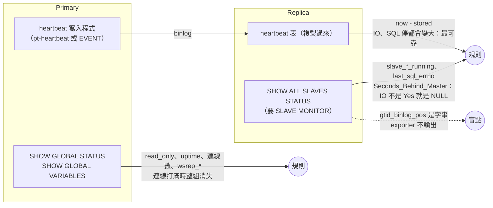
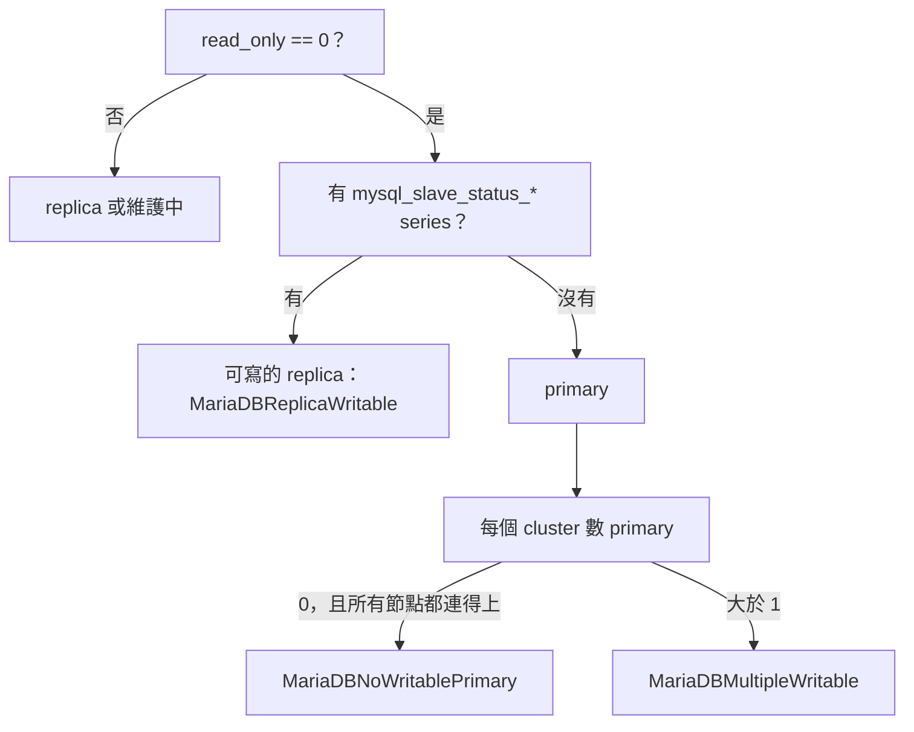

# MariaDB 本體怎麼監控

[元件卡](../components/mariadb.md)回答「exporter 真的有在量嗎」。這頁回答另一個問題：**MariaDB 本身該看哪些訊號**，每個訊號從資料庫的哪裡來、mysqld_exporter v0.21.0 有沒有輸出、預設有沒有開、要什麼權限。MySQL 的原始碼與 metric 名稱不同，另一頁：[MySQL 本體怎麼監控](mysql.md)。exporter 是同一個，metric 前綴仍是 `mysql_`。

依據是 mysqld_exporter 與 MariaDB 11.4.13 的原始碼與官方文件，加上幾組小實驗：單台 MariaDB 停資料庫、停 exporter、收回權限<span class="at-chip at-ev-tested">實測</span>[^exp-mysql]；一組 primary + async replica（GTID），開長交易、做 deadlock、讓 replica 延遲三種方式、讓 replication 因衝突停下、semi-sync、打滿連線、kill -9 primary、failover 並讓舊 primary 回來<span class="at-chip at-ev-tested">實測</span>[^exp-mysql-ha]；三台 Galera 暫停兩台、沒有 replica 時的 binlog 過期、ASH 取樣器<span class="at-chip at-ev-tested">實測</span>[^my-asp-exp]。lab 與 MySQL 同時跑，這頁只引用 MariaDB 那一邊的數字。

10.6、10.11、11.4、11.8、12.3 五條 LTS 線的差異（權限、replica 狀態欄位、binlog purge、performance_schema）從原始碼整理在 [MariaDB 各版本的監控差異](versions/mariadb.md)，只讀碼；lab 跑的是 11.4.13。查詢與 session 分析在 [ASH 頁](mariadb-ash.md)。

## 五段導覽 {#five-sections}

本頁依面向寫成；對應到[五段框架](../map.md)的位置如下，元件卡已依五段排列。

| 段落 | 元件卡 | 本頁 |
|---|---|---|
| 1 架構 | [架構頁](../architecture/db-relational.md)、[元件卡](../components/mariadb.md#architecture) | — |
| 2 正確使用 | [元件卡](../components/mariadb.md#usage) | [建議的設定](#recommended)、[用自訂查詢補上](#custom-queries) |
| 3 正確觀測 | [元件卡](../components/mariadb.md#observe) | [監測自檢](#exporter) |
| 4 不正確使用時的觀測 | [元件卡](../components/mariadb.md#misuse)、[寫得不好的查詢](../components/mariadb.md#bad-query-table) | [九個面向一覽](#aspects)、[效能與故障情境](#performance) |
| 5 目前無法觀測的痕跡 | [元件卡](../components/mariadb.md#blind) | [盲點與補法](#blind-spots)、[Exporter 覆蓋矩陣](#coverage) |

## 先講結論

1. **照 exporter README 給權限，replica 上的 replication metric 會整組消失。**MariaDB 的 `REPLICATION CLIENT` 只等於 `BINLOG MONITOR`，`SHOW SLAVE STATUS` 要 `SLAVE MONITOR`；11.0 起 `SUPER` 也不涵蓋。缺少時 `slave_status` 的 `collector_success` 是 0，所有 replication 規則回傳空。<span class="at-chip at-ev-tested">實測</span>[^exp-mysql]<span class="at-chip at-ev-code">讀碼</span>[^ver-mdb-repl-client-alias][^ver-mdb114-slave-status-priv][^ver-mdb114-super-upgrade]
2. **沒開 Galera 的 MariaDB 也有 wsrep_*。**官方映像用 `WITH_WSREP` 編譯，`wsrep_ready` 0、`wsrep_cluster_status` 0；上游的 `wsrep_ready != 1` 對每台普通 MariaDB 誤報。所有 Galera 規則都要配 `wsrep_on == 1`。<span class="at-chip at-ev-tested">實測</span>[^exp-mysql][^my-trace-mdb-wsrep-ifdef]
3. **連線打滿時，連線數規則會消失。**exporter 的一般帳號也收到 Error 1040，`mysql_up` 變 0，`threads_connected` 消失；看得到的只有 `mysql_up` 規則與事後的 `connection_errors_total{error="max_connections"}`。<span class="at-chip at-ev-tested">實測</span>[^exp-mysql-ha][^mariadb-conn-errors]
4. **Seconds_Behind_Master 比 MySQL 更容易是 NULL。**只要 IO thread 不是 `Yes` 就是 NULL，即使 relay log 還沒套用完。延遲要用 heartbeat 表；11.8 起另有 `Master_Slave_time_diff`。<span class="at-chip at-ev-tested">實測</span>[^exp-mysql-ha]<span class="at-chip at-ev-code">讀碼</span>[^my-trace-mdb-sbm-null][^ver-mdb118-last-event-time]
5. **replication metric 的名稱五條線都一樣。**`REPLICA` 只是 `SLAVE` 的同義字，exporter 的 `SHOW ALL SLAVES STATUS` 第一個就成功，輸出 `mysql_slave_status_slave_*`、`seconds_behind_master`；不像 MySQL 8.4 會改名。<span class="at-chip at-ev-code">讀碼</span>[^ver-mdb-replica-keyword][^ver-mdb-show-all-slaves]
6. **單機 MariaDB 的 binlog 不會過期刪除（11.4 起）。**`slave_connections_needed_for_purge` 預設 1，沒有 replica 連著時 `binlog_expire_logs_seconds` 到期也不刪，binlog 會一直長到磁碟滿。<span class="at-chip at-ev-tested">實測</span>[^my-asp-exp][^my-asp-mdb-purge-needs-slave]
7. **performance_schema 五條線都預設 OFF。**每帳號連線數、每個 digest 的耗時與錯誤都依賴它，沒開時 collector 回報成功但沒有 series；開了以後 quantile、lock_time、cpu_time 仍是 0。<span class="at-chip at-ev-tested">實測</span>[^exp-mysql-ha][^exp-mysql-perf][^ver-mdb-pfs-default-off]
8. **Undo history 與 deadlock 預設就有。**`Innodb_history_list_length`、`Innodb_deadlocks` 是 global status，不用開 innodb_metrics；MySQL 沒有這兩個。<span class="at-chip at-ev-tested">實測</span>[^exp-mysql-ha][^mariadb-innodb-deadlocks]
9. **Galera 失去 quorum 時 exporter 照常回應。**三台暫停兩台後，倖存節點變 non-Primary、讀取回 ERROR 1047，`mysql_up` 仍是 1。要看 `wsrep_cluster_status`。<span class="at-chip at-ev-tested">實測</span>[^my-asp-exp]
10. **errant GTID、備份與損毀，exporter 都看不到。**`gtid_binlog_pos`、`gtid_binlog_state` 是字串；沒有備份 collector；頁面損毀沒有 status 計數。<span class="at-chip at-ev-tested">實測</span>[^exp-mysql-ha][^my-asp-exp]

## 誰看得到什麼



## 九個面向一覽 {#aspects}

訊號依[元件卡](../components/mariadb.md)的 `aspect` 分成九組，每節最後有一張**證據鏈**表：規則 → 資料庫原始碼（值在哪裡產生）→ 表或變數 → exporter 原始碼與 SQL → metric。更細的逐行追蹤在[附錄](mariadb-appendix.md)。

| 面向 | 主要盲點 | 一節 |
|---|---|---|
| 監測自檢 | 權限不足（SLAVE MONITOR）時 replication metric 整組消失 | [exporter](#exporter) |
| 可用性 | 單次 OOM kill 只看得到 uptime 歸零；crash loop 只看得到 mysql_up | [availability](#availability) |
| 工作量與效能 | 執行中的語句沒有 digest、沒有 quantile（見 [ASH](mariadb-ash.md)） | [workload](#workload) |
| 資源與飽和 | 連線打滿時連線數 metric 消失；10.11 起 pending fsync 不含 redo | [saturation](#saturation) |
| 複寫與 HA | Seconds_Behind_Master 斷線時是 NULL；errant GTID 看不到 | [replication](#replication) |
| 叢集與共識 | 沒開 Galera 也有 wsrep_*；狀態是字串 | [cluster](#cluster) |
| 資料維護與完整性 | 頁面損毀沒有任何 metric | [maintenance](#maintenance) |
| 資料保護 | binlog 預設關、sync_binlog 預設 0；exporter 沒有備份 metric | [protection](#protection) |
| 容量與成長 | 11.4 起沒有 replica 時 binlog 不刪 | [capacity](#capacity) |

每個面向的訊號數見[資料庫總覽](index.md)。

## 監測自檢（exporter） {#exporter}

exporter 有三層「活著」：`up`、`mysql_up`、`mysql_exporter_collector_success`，每一層壞掉時下一層的 series 整組消失。規則、門檻與實驗都在[元件卡](../components/mariadb.md)的 exporter 一組。和 MariaDB 有關的幾點：

- **權限**：`GRANT PROCESS, BINLOG MONITOR, SLAVE MONITOR, SELECT`。10.6／10.11 的 `SUPER` 還涵蓋 `SLAVE MONITOR` 與 `BINLOG MONITOR`；11.0 起不涵蓋，**在 11.x 新建**、只給 `SUPER` 的帳號 `slave_status` 與 `binlog_size` 會失敗，從 10.x 升上來的帳號則會自動補上。要 `--collect.slave_hosts` 時另加 `REPLICATION MASTER ADMIN`。<span class="at-chip at-ev-code">讀碼</span>[^ver-mdb1011-slave-status-priv][^ver-mdb114-slave-status-priv][^ver-mdb1011-binlogs-priv][^ver-mdb114-binlogs-priv][^ver-mdb114-super-upgrade][^ver-mdb114-slave-hosts-priv]
- **收回 PROCESS** 時 innodb_cmp、innodb_cmpmem、innodb_metrics 的 `collector_success` 變 0（實驗 1150 → 1060 條 series）；processlist 仍回報成功，但只看得到自己的連線。<span class="at-chip at-ev-tested">實測</span>[^exp-mysql]
- **MySQL 專用的 collector 不會被跳過。**exporter 把 `@@version` 的「主版號.次版號」轉成浮點數（10.6、11.4…），都大於所有門檻；`perf_schema.replication_applier_status_by_worker` 開了一定失敗（實驗：11.4 上 collector 0）。<span class="at-chip at-ev-tested">實測</span>[^exp-mysql-ha][^ver-ex-version-float][^ver-mdb-pfs-worker-cols]
- **query_response_time 預設開**，沒裝 plugin 時回報成功、沒有 series。<span class="at-chip at-ev-code">讀碼</span>[^ver-ex-qrt-nil]
- **資料庫主機停機時**，scrape 耗時約等於 `scrape_timeout` 減 `--timeout-offset`（實驗 4s → 3.75s）。<span class="at-chip at-ev-tested">實測</span>[^exp-mysql]
- **exporter 的 SQL 與原始碼一致**；slave_status 的 `SHOW ALL SLAVES STATUS` 第一條就成功。[^exp-mysql-trace]

## 叢集與共識 {#cluster}

這裡指 **Galera**：成員之間要達成多數才能寫入（Primary component），和 primary／replica 的 async 複寫不同。

| 項目 | MariaDB Galera |
|---|---|
| 共識 | Galera 的 group communication；每筆 writeset 在各節點 certification |
| 多數 | 不在 Primary component 的節點拒絕讀寫（`wsrep_cluster_status` = non-Primary） |
| 成員狀態在哪 | `wsrep_cluster_status`、`wsrep_cluster_size`（server 端）[^my-asp-mdb-wsrep-status-var][^my-asp-mdb-wsrep-size-set]、`wsrep_local_state`（provider） |
| Flow control | 收到的佇列超過 `gcs.fc_limit` 就送 pause，整個叢集等最慢的節點 |
| mysqld_exporter | 全在 `SHOW GLOBAL STATUS`，預設就有；provider 的計數經 `wsrep_show_status` 帶出[^my-asp-mdb-wsrep-provider-vars][^my-asp-mdb-wsrep-provider-status] |

| 要看什麼 | 資料庫的來源 | exporter metric（collector） | 預設 | 權限 | 證據 |
|---|---|---|---|---|---|
| Galera 能不能服務 | `wsrep_ready`、`wsrep_local_state` | `mysql_global_status_wsrep_ready`、`..._local_state` | 開 | — | 實測[^exp-mysql][^my-trace-mdb-wsrep-ready] |
| Galera quorum | `wsrep_cluster_status`、`wsrep_cluster_size` | `mysql_global_status_wsrep_cluster_status`（Primary → 1）、`..._cluster_size` | 開 | — | 實測[^my-asp-exp][^my-asp-ex-parse-nonprimary] |
| Galera flow control | `wsrep_flow_control_paused_ns`、`_sent`、`wsrep_local_recv_queue` | `mysql_global_status_wsrep_flow_control_paused_ns` 等 | 開 | — | 讀碼[^my-asp-gal-fc-paused-ns][^my-asp-gal-recv-queue]；實測：有輸出[^my-asp-exp] |

- **沒開 Galera 的 MariaDB 也有 wsrep_*。**實驗中普通 MariaDB 輸出 `wsrep_ready` 0、`wsrep_cluster_status` 0（Disconnected）、`wsrep_cluster_size` 0，上游規則 `wsrep_ready != 1` 對每台普通 MariaDB 誤報。所有 Galera 規則都要 `and on (job, instance) mysql_global_variables_wsrep_on == 1`。<span class="at-chip at-ev-tested">實測</span>[^exp-mysql][^my-asp-exp][^my-asp-mdb-wsrep-disconnected]
- **non-Primary 的節點拒絕讀取，但 exporter 照常。**三台暫停兩台 29 秒後，gal1 是 `non-Primary`、size 1、`wsrep_ready` OFF、`wsrep_local_state` 0（Initialized）；exporter 輸出 `wsrep_cluster_status` 0、所有 collector 成功；`SELECT` 回 `ERROR 1047 WSREP has not yet prepared node for application use`。恢復後兩台回來、size 回到 3。<span class="at-chip at-ev-tested">實測</span>[^my-asp-exp]
- **字串狀態怎麼變成數字**：server 依 provider 狀態把 `wsrep_cluster_status` 設成 `Primary`、`non-Primary` 或 `Disconnected`[^my-asp-mdb-wsrep-primary][^my-asp-mdb-wsrep-nonprimary]；exporter 的 `parseStatus` 把 `primary` 轉 1、`non-primary`／`disconnected` 轉 0。[^my-trace-ex-parse-primary][^my-asp-ex-parse-nonprimary]`wsrep_flow_control_active` 是 `true`／`false`，exporter 不認得，被跳過。[^my-asp-gal-fc-active]
- **flow control 用 `_paused_ns` 的速率。**`wsrep_flow_control_paused` 是「自上次 FLUSH STATUS 以來」的比例，越久越鈍；`wsrep_flow_control_paused_ns` 是累計奈秒，`rate()/1e9` 就是這段時間的暫停比例。<span class="at-chip at-ev-code">讀碼</span>[^my-asp-gal-fc-paused-ns][^my-asp-gal-fc-paused]
- **flow control 沒有重現。**把 gal2 限到 0.05 核、`gcs.fc_limit=1` 後在 gal1 寫 3000 筆單列交易，`flow_control_paused_ns` 與 `flow_control_sent` 都維持 0。規則的證據停在讀碼。<span class="at-chip at-ev-tested">實測</span>[^my-asp-exp]
- **版本**：五條線的 wsrep 變數沒有逐版比對，只確認 `wsrep_on` 都有（[版本差異](versions/mariadb.md#signals)）。
- **role-detection 不要套在 Galera 上**：每台都可寫，「可寫的節點數 > 1」是正常的。

### 證據鏈 {#chain-cluster}

| 規則 | DB 原始碼 | 表／變數 | exporter 原始碼與 SQL | metric |
|---|---|---|---|---|
| `MariaDBGaleraNotReady` | [^my-trace-mdb-wsrep-ready][^my-trace-mdb-wsrep-ifdef] | `wsrep_ready` | `SHOW GLOBAL STATUS`[^my-trace-ex-gs-query] | `mysql_global_status_wsrep_ready` |
| `MariaDBGaleraOutOfSync` | provider 狀態[^my-asp-mdb-wsrep-provider-status] | `wsrep_local_state` | 同上 | `mysql_global_status_wsrep_local_state` |
| `MariaDBGaleraNonPrimary` | [^my-asp-mdb-wsrep-status-var][^my-asp-mdb-wsrep-primary][^my-asp-mdb-wsrep-nonprimary] | `wsrep_cluster_status` | 字串轉 1／0[^my-asp-ex-parse-nonprimary][^my-asp-ex-gs-wsrep-status] | `mysql_global_status_wsrep_cluster_status` |
| `MariaDBGaleraClusterShrunk` | [^my-asp-mdb-wsrep-size-var][^my-asp-mdb-wsrep-size-set] | `wsrep_cluster_size` | `SHOW GLOBAL STATUS` | `mysql_global_status_wsrep_cluster_size` |
| `MariaDBGaleraFlowControl` | Galera 26.4.27[^my-asp-gal-fc-paused-ns][^my-asp-gal-fc-sent][^my-asp-gal-recv-queue] | `wsrep_flow_control_paused_ns` | 同上 | `mysql_global_status_wsrep_flow_control_paused_ns` |

## 複寫與 HA {#replication}

<a id="ha"></a>

| 要看什麼 | 資料庫的來源 | exporter metric（collector） | 預設 | 權限 | 證據 |
|---|---|---|---|---|---|
| IO／SQL thread | `SHOW ALL SLAVES STATUS`（`REPLICA` 是同義字） | `mysql_slave_status_slave_io_running`、`..._slave_sql_running`（每個來源一組，`connection_name` label） | 開 | SLAVE MONITOR | 實測[^exp-mysql-ha][^ver-mdb-show-all-slaves] |
| 停下的原因 | `Last_SQL_Errno`、`Last_IO_Errno` | `mysql_slave_status_last_sql_errno`、`..._last_io_errno` | 開 | 同上 | 實測 |
| 延遲（伺服器算的） | `Seconds_Behind_Master` | `mysql_slave_status_seconds_behind_master` | 開 | 同上 | 實測、讀碼[^my-trace-mdb-sbm-field][^my-trace-mdb-sbm-null] |
| 延遲（11.8 起） | `Master_Slave_time_diff`、`Master_last_event_time`、`Slave_last_event_time` | `mysql_slave_status_master_slave_time_diff` 等（datetime 轉 Unix 秒，時區當 UTC，推論） | 開 | 同上 | 讀碼[^ver-mdb118-last-event-time][^ver-mdb118-all-only-cols][^ver-ex-parse-datetime] |
| 延遲（heartbeat） | heartbeat 表（pt-heartbeat 格式） | `mysql_heartbeat_now_timestamp_seconds`、`mysql_heartbeat_stored_timestamp_seconds` | 關 | SELECT on heartbeat 表；另外要有寫入程式 | 實測[^my-heartbeat-query] |
| 有沒有在複製（不會消失） | `Slave_running` | `mysql_global_status_slave_running`（gauge） | 開 | — | 讀碼[^ver-mdb-slave-running] |
| 能不能寫 | `read_only`（沒有 super_read_only） | `mysql_global_variables_read_only` | 開 | — | 實測 |
| GTID 開關 | `gtid_strict_mode` | `mysql_global_variables_gtid_strict_mode` | 開 | — | 實測[^exp-mysql-ha] |
| GTID 內容 | `gtid_binlog_pos`、`gtid_binlog_state` | **沒有**（字串被跳過） | — | — | 實測[^my-global-variables-parse] |
| replica 的 GTID 位置 | `SHOW ALL SLAVES STATUS` 的 `Gtid_Slave_Pos`、`Gtid_IO_Pos` | `mysql_slave_status_gtid_slave_pos{domain_id,server_id}`（slave_status 把 GTID 拆成 label） | 開 | SLAVE MONITOR | 實測[^my-trace-ex-slave-gtid][^my-trace-mdb-gtid-slave-pos][^exp-mysql-ha] |
| Semi-sync | `Rpl_semi_sync_master_status`（內建，名稱只有 master） | `mysql_global_status_rpl_semi_sync_master_status`、`..._no_tx`、`..._clients` | 開 | — | 實測[^exp-mysql-ha][^ver-mdb123-semisync-master] |

Galera 不是 primary／replica 的 async 複寫，放在[叢集與共識](#cluster)。

### 延遲：heartbeat 與 Seconds_Behind_Master

MariaDB 的 `Seconds_Behind_Master` 只要 IO thread 不是 `Yes`（`Connecting`、`Preparing`、`No`）就是 NULL，即使 relay log 還有沒套用完的事件；SQL thread 停了也是 NULL。<span class="at-chip at-ev-code">讀碼</span>[^my-trace-mdb-sbm-field][^my-trace-mdb-sbm-null]`Slave_IO_Running` 可能是 `Preparing`，exporter 不認得這個值，該次 scrape 的 series 會短暫消失（推論，未觀察到）。[^my-trace-mdb-io-running-vals][^my-parse-connecting]

| 情境 | Seconds_Behind_Master | heartbeat 延遲 | 結果 |
|---|---|---|---|
| SQL thread 等 metadata lock（primary 做 ALTER，replica 有開著的交易） | 21 秒 | 21 秒 | 一致 |
| IO thread 停 25 秒 | **消失（NULL）** | 29 秒 | 只有 heartbeat 看得到 |
| SQL thread 停 20 秒 | **消失（NULL）** | 23 秒 | 只有 heartbeat 看得到 |
| 衝突寫入，SQL thread 因 1062 停下 | **消失** | 持續變大 | `last_sql_errno=1062` 帶出原因 |
| primary 的 heartbeat 寫入程式停 25 秒 | 0 | **每台**都變大 | heartbeat 誤報，但「每台一起變大」本身就是訊號 |

<span class="at-chip at-ev-tested">實測</span>[^exp-mysql-ha]

heartbeat 的前提是寫入程式活著，而且跟著 primary 走。實驗用 primary 上的 EVENT 寫 heartbeat；EVENT 複製到 replica 時是 SLAVESIDE_DISABLED，failover 後新 primary 不會寫，heartbeat 從此停住。正式環境用 pt-heartbeat 之類的外部程式，由 HA 工具在升級時啟動。11.8 起的 `Master_Slave_time_diff` 可以當第二個來源（未實測）。

### 角色與 failover



- **不要用靜態的 role label 判斷角色。**failover 後 `role="primary"` 指向已停的舊節點，`MariaDBPrimaryReadOnly` 查不到任何東西。從 metric 推：可寫、而且沒有 replica 狀態的就是 primary。cluster 要自己用 relabel 加。<span class="at-chip at-ev-tested">實測</span>[^exp-mysql-ha]
- **舊 primary 回來時兩邊都能寫。**實驗中舊 primary 重啟後 `read_only=0`，cluster 裡有 2 台可寫、不在複製的節點，`MariaDBMultipleWritable` firing。<span class="at-chip at-ev-tested">實測</span>[^exp-mysql-ha]
- **連線打滿時 `read_only` 也會消失**，所以 `MariaDBNoWritablePrimary` 在有節點連不上時不判斷，交給 `MariaDBNotReachable`。<span class="at-chip at-ev-tested">實測</span>[^exp-mysql-ha]
- **Replica 擋不住所有寫入。**MariaDB 沒有 super_read_only，有 READ ONLY ADMIN 權限的帳號可以繞過 `read_only`。在 replica 上寫入時 replication 照常，要等 primary 寫到同一筆才停下。
- **primary 被 kill 時**，replica 的 `slave_io_running=0`、`last_io_errno=2003`；primary 回來後 30 秒內自動重連，errno 歸 0。所以 `last_io_errno` 不適合單獨當告警，規則只用 `last_sql_errno`。<span class="at-chip at-ev-tested">實測</span>[^exp-mysql-ha]

### GTID 一致性

errant transaction（replica 有、primary 沒有的交易）會讓下一次 failover 出錯，exporter 卻看不到。看 replica 的 `gtid_binlog_state` 有沒有出現 replica 自己的 server_id（實驗中 `gtid_binlog_pos` 變成 `0-2-645`）；`gtid_strict_mode=ON` 可以在源頭擋掉一部分（[MariaDB GTID](https://mariadb.com/kb/en/gtid/)）。replica 狀態裡的 `Gtid_Slave_Pos` 有輸出成 metric，但那是「套用到哪裡」，errant 交易不在裡面。<span class="at-chip at-ev-tested">實測</span>[^exp-mysql-ha][^my-trace-mdb-gtid-binlog-pos]用[自訂查詢](#custom-queries)讓每台輸出每個 (domain_id, server_id) 的 seq，在 PromQL 裡比。

### Semi-sync

MariaDB 的 semi-sync 是內建的，名稱只有 `Rpl_semi_sync_master_*`（五條線都是）。沒開時 status 也是 0，所以規則一定要配 `rpl_semi_sync_master_enabled == 1`。實驗中 primary 開、replica 沒開時 status 一直是 0；replica 開了之後 status 回到 1、`clients=1`。<span class="at-chip at-ev-tested">實測</span>[^exp-mysql-ha][^ver-mdb123-semisync-master]

### 證據鏈 {#chain-replication}

| 規則 | DB 原始碼 | 表／變數 | exporter 原始碼與 SQL | metric |
|---|---|---|---|---|
| `MariaDBReplicationNotRunning` | [^my-trace-mdb-io-running-vals][^ver-mdb114-sbm-col] | `Slave_IO_Running`、`Slave_SQL_Running` | `SHOW ALL SLAVES STATUS`（第一個就成功）[^my-slave-queries][^ver-ex-slave-loop]；`Connecting` → 0[^my-parse-connecting] | `mysql_slave_status_slave_{io,sql}_running` |
| `MariaDBReplicationError` | [^my-trace-mdb-last-sql-errno] | `Last_SQL_Errno` | 同上 | `mysql_slave_status_last_sql_errno` |
| `MariaDBReplicaStatusMissing` | — | 同上（整組消失） | 非 replica 時沒有任何列[^my-slave-skip] | `mysql_slave_status_*` |
| `MariaDBHeartbeatLag` | pt-heartbeat 寫入的表（不是資料庫內建） | `heartbeat.heartbeat.ts` | `SELECT UNIX_TIMESTAMP(ts), UNIX_TIMESTAMP(NOW(6))`[^my-heartbeat-query][^my-trace-ex-hb-now] | `mysql_heartbeat_*_timestamp_seconds` |
| `MariaDBReplicationLag` | [^my-trace-mdb-sbm-field][^my-trace-mdb-sbm-null] | `Seconds_Behind_Master` | NULL 解析失敗、不輸出[^my-trace-ex-parse-float] | `mysql_slave_status_seconds_behind_master` |
| `MariaDBReplicaWritable`、`MariaDBNoWritablePrimary`、`MariaDBMultipleWritable` | [^my-trace-mdb-readonly] | `read_only` | `SHOW GLOBAL VARIABLES`[^my-trace-ex-gv-query] | `mysql_global_variables_read_only` |
| `MariaDBSemiSyncDegraded` | [^my-trace-mdb-semisync-status] | `Rpl_semi_sync_master_status` | `SHOW GLOBAL STATUS` | `mysql_global_status_rpl_semi_sync_master_status` |

## 可用性 {#availability}

<a id="stability"></a>

| 要看什麼 | 資料庫的來源 | exporter metric（collector） | 預設 | 權限 | 證據 |
|---|---|---|---|---|---|
| 服務在不在 | 連線 + `SELECT @@version` | `mysql_up`（exporter 本體） | 開 | 能登入即可 | 實測[^exp-mysql] |
| 重啟、crash、OOM kill | `Uptime` | `mysql_global_status_uptime`（global_status） | 開 | — | 實測：kill -9 後 uptime 歸零[^exp-mysql-ha] |
| primary 能不能寫 | `read_only` | `mysql_global_variables_read_only`（global_variables） | 開 | — | 實測[^exp-mysql-ha] |

- **OOM kill 在 metric 上只是一次重啟。**`uptime` 歸零、`mysql_up` 短暫變 0；原因要看 kernel log 或容器事件（[host#oom-kills](../components/host.md#oom-kills)）。停機短於 `MariaDBNotReachable` 的 `for` 時，只有 `MariaDBRestarted` 會響；起不來的 crash loop 則相反，只有 `mysql_up` 規則看得到，見 [OOM kill](#perf-oom)。<span class="at-chip at-ev-tested">實測</span>[^exp-mysql-ha][^exp-mysql-perf]
- **`mysql_up` 只做 ping**，不代表寫得進去；真正的寫入要外部探測，或 heartbeat 寫入程式自己回報成功時間。
- Galera 變成 non-Primary 時 `mysql_up` 仍是 1，讀寫卻被擋住，見[叢集與共識](#cluster)。<span class="at-chip at-ev-tested">實測</span>[^my-asp-exp]

| 規則 | DB 原始碼 | 表／變數 | exporter 原始碼與 SQL | metric |
|---|---|---|---|---|
| `MariaDBNotReachable` | — | 連線與 `SELECT @@version` | 開連線失敗就讓 `mysql_up` = 0[^my-trace-ex-up][^my-trace-ex-version-query] | `mysql_up` |
| `MariaDBRestarted`、`MariaDBRestartedRepeatedly` | [^my-trace-mdb-uptime] | `Uptime` | `SHOW GLOBAL STATUS`[^my-trace-ex-gs-query] | `mysql_global_status_uptime` |
| `MariaDBPrimaryReadOnly` | [^my-trace-mdb-readonly] | `read_only` | `SHOW GLOBAL VARIABLES`[^my-trace-ex-gv-query] | `mysql_global_variables_read_only` |

## 資源與飽和 {#saturation}

<a id="usage"></a>

| 要看什麼 | 資料庫的來源 | exporter metric（collector） | 預設 | 權限 | 證據 |
|---|---|---|---|---|---|
| 連線數 | `Threads_connected`、`max_connections` | `mysql_global_status_threads_connected`、`mysql_global_variables_max_connections` | 開 | — | 實測[^exp-mysql-ha] |
| 被拒的連線 | `Connection_errors_max_connections` | `mysql_global_status_connection_errors_total{error="max_connections"}` | 開 | — | 實測[^exp-mysql-ha][^mariadb-conn-errors] |
| 每帳號連線數 | `sys.x$user_summary.current_connections`；上限在 `mysql.user.max_user_connections` | `mysql_sys_current_connections{user}`、`mysql_mysql_max_user_connections{mysql_user}` | 關 | SELECT on sys、mysql.user；要開 performance_schema | 讀碼[^my-sys-user-summary][^my-mysql-user-maxconn]；實測：沒開 performance_schema 時沒有 series[^exp-mysql-ha] |
| 執行中的 thread | `Threads_running` | `mysql_global_status_threads_running` | 開 | — | 讀碼[^my-trace-mdb-threads-running]；實測：metadata lock 情境中升高[^exp-mysql-perf] |
| thread cache | `Threads_created`、`Connections`、`thread_cache_size` | `mysql_global_status_threads_created`、`..._connections`、`mysql_global_variables_thread_cache_size` | 開 | — | 讀碼[^spl-mdb114-threads-created][^spl-mdb114-thread-created-inc][^spl-mdb114-thread-cache-size] |
| Row lock 等待 | `Innodb_row_lock_current_waits`、`Innodb_row_lock_time` | `mysql_global_status_innodb_row_lock_current_waits` 等 | 開 | — | 實測[^exp-mysql-ha] |
| Metadata lock 等待 | `information_schema.PROCESSLIST.state` | `mysql_info_schema_processlist_threads{state="waiting_for_table_metadata_lock"}`（info_schema.processlist） | 關 | PROCESS | 實測[^exp-mysql-ha][^my-processlist-query] |
| Table open cache | `Table_open_cache_overflows`、`_misses`、`Opened_tables` | `mysql_global_status_table_open_cache_overflows` 等 | 開 | — | 讀碼[^my-asp-mdb-toc-overflows] |
| Buffer pool 與 redo | `Innodb_buffer_pool_reads`、`_wait_free`、`Innodb_log_waits` | `mysql_global_status_innodb_buffer_pool_reads`、`..._wait_free`、`..._innodb_log_waits` | 開 | — | 實測[^exp-mysql-perf]、讀碼[^my-global-status-re] |
| fsync 排隊 | `Innodb_data_pending_fsyncs`（內容隨版本變，見下） | `mysql_global_status_innodb_data_pending_fsyncs` | 開 | — | 讀碼[^spl-mdb106-pending-fsyncs-calc][^spl-mdb114-pending-fsyncs] |
| 暫存表落到磁碟 | `Created_tmp_disk_tables`、`Created_tmp_tables`；11.8 起 `Tmp_space_used` | `mysql_global_status_created_tmp_disk_tables` 等 | 開 | — | 實測[^exp-mysql-perf]、讀碼[^ver-mdb118-tmp-space] |

- **max_connections 之外還有一條給 CONNECTION ADMIN 的連線**，exporter 預設開兩條，所以就算給了也只有一條進得去（讀碼；lab 這一段 MariaDB 的 app 連線沒有全部建立，不算數）。要讓查詢在打滿時仍進得去，走 `extra_port`（有自己的連線計數，不需要額外權限）；query-exporter 已實測，見[用自訂查詢補上](#custom-queries)。[^my-q-mdb-ignore-maxconn][^my-q-mdb-conn-check][^my-q-mdb-extra-scheduler]
- **被拒的計數要事後才看得到。**打滿當下 exporter 自己也進不來；連線降下後 `connection_errors_total{error="max_connections"}` 才更新（實驗 +2），用 `increase(...[10m]) > 0` 寫規則。被拒時同時加 `Aborted_connects`。[^mariadb-conn-errors]高峰本身留在 `Max_used_connections`，見[容量與成長](#capacity)。
- **超過 MAX_USER_CONNECTIONS 不算 Connection_errors。**實驗中第三條連線回 ERROR 1226，只有 `Aborted_connects` +1。每帳號連線數要開 performance_schema 才有。<span class="at-chip at-ev-tested">實測</span>[^exp-mysql-ha]
- **thread cache 失效**：one-thread-per-connection（預設）時，新連線先交給 thread cache，接不下才建立新 thread、`Threads_created` 加 1；`thread_cache_size` 預設 256。`MariaDBThreadCacheMisses` 看 `Threads_created／Connections` 的比例，並要求每秒至少 1 條新連線。`thread_handling=pool-of-threads` 時連線不經過這段程式，這條不適用。<span class="at-chip at-ev-code">讀碼</span>[^spl-mdb106-threads-created][^spl-mdb114-threads-created][^spl-mdb123-threads-created][^spl-mdb114-thread-created-inc][^dbr-mdb-thread-handling]
- **fsync 排隊的內容隨版本變。**10.6 的 `Innodb_data_pending_fsyncs` 是 redo log 的 pending flush 加上 tablespace 的 pending flush；10.11、11.4、11.8、12.3 直接讀 `fil_n_pending_tablespace_flushes`，只算資料檔，commit 等 redo fsync 的排隊看不到。它是 scrape 那一刻的快照，不是延遲；`MariaDBPendingFsyncs` 用 10 分鐘平均 > 1（例子）。fsync 延遲本身只有主機層有（[host#disk-latency](../components/host.md#disk-latency)）。<span class="at-chip at-ev-code">讀碼</span>[^spl-mdb106-pending-fsyncs][^spl-mdb106-pending-fsyncs-calc][^spl-mdb1011-pending-fsyncs][^spl-mdb114-pending-fsyncs][^spl-mdb118-pending-fsyncs][^spl-mdb123-pending-fsyncs][^spl-mdb114-tablespace-flush-inc]
- **11.x 沒有 change buffer**，`Innodb_ibuf_*` 消失，不要用在規則裡。[^ver-mdb1011-ibuf-size]

| 規則 | DB 原始碼 | 表／變數 | exporter 原始碼與 SQL | metric |
|---|---|---|---|---|
| `MariaDBTooManyConnections` | `max_connections`[^my-asp-mdb-max-connections] | `Threads_connected`、`max_connections` | `SHOW GLOBAL STATUS`、`SHOW GLOBAL VARIABLES`[^my-trace-ex-gs-query][^my-trace-ex-gv-query] | `..._threads_connected`、`..._max_connections` |
| `MariaDBHighThreadsRunning` | [^my-trace-mdb-threads-running] | `Threads_running` | 同上 | `mysql_global_status_threads_running` |
| `MariaDBConnectionsRefused` | [^my-trace-mdb-connerr-var] | `Connection_errors_max_connections` | `connection_errors_` 前綴轉成 label[^my-trace-ex-gs-connerr] | `mysql_global_status_connection_errors_total` |
| `MariaDBThreadCacheMisses` | [^spl-mdb114-threads-created][^spl-mdb114-connections] | `Threads_created`、`Connections` | `SHOW GLOBAL STATUS`，數值照名稱輸出[^my-global-status-skip] | `mysql_global_status_threads_created`、`..._connections` |
| `MariaDBUserConnectionLimit` | sys view 與 `mysql.user`（未逐行核對） | `sys.x$user_summary`、`mysql.user` | [^my-sys-user-summary][^my-mysql-user-maxconn] | `mysql_sys_current_connections`、`mysql_mysql_max_user_connections` |
| `MariaDBRowLockWaits`、`MariaDBRowLockWaitTime` | [^my-trace-mdb-rowlock-var][^my-trace-mdb-rowlock-export] | `Innodb_row_lock_current_waits`、`Innodb_row_lock_time` | `SHOW GLOBAL STATUS`[^my-trace-ex-gs-query] | `mysql_global_status_innodb_row_lock_*` |
| `MariaDBMetadataLockWaits` | state 字串[^my-perf-mdb-mdl-state] | `PROCESSLIST.STATE` | `GROUP BY user, host, command, state`[^my-processlist-query][^my-trace-ex-pl-sanitize] | `mysql_info_schema_processlist_threads` |
| `MariaDBInnoDBLogWaits` | [^my-perf-mdb-log-waits] | `Innodb_log_waits` | `SHOW GLOBAL STATUS` | `mysql_global_status_innodb_log_waits` |
| `MariaDBBufferPoolWaitFree` | [^my-asp-mdb-bp-wait-free] | `Innodb_buffer_pool_wait_free` | 同上 | `mysql_global_status_innodb_buffer_pool_wait_free` |
| `MariaDBPendingFsyncs` | [^spl-mdb114-pending-fsyncs][^spl-mdb114-tablespace-flush-inc] | `Innodb_data_pending_fsyncs` | 同上 | `mysql_global_status_innodb_data_pending_fsyncs` |
| `MariaDBBufferPoolDiskReads` | [^my-asp-mdb-bp-reads] | `Innodb_buffer_pool_reads`、`_read_requests` | 同上 | `mysql_global_status_innodb_buffer_pool_reads` |
| `MariaDBTmpDiskTables` | [^my-asp-mdb-tmp-disk] | `Created_tmp_disk_tables` | 同上 | `mysql_global_status_created_tmp_disk_tables` |
| `MariaDBTableOpenCacheOverflows` | [^my-asp-mdb-toc-overflows] | `Table_open_cache_overflows` | 同上 | `mysql_global_status_table_open_cache_overflows` |

## 工作量與效能 {#workload}

這一節看整體的吞吐、錯誤與延遲。要再往下分析到「哪個 session、哪條 SQL、在等什麼」，見[查詢與 session 分析（ASH）](mariadb-ash.md)。

| 要看什麼 | 資料庫的來源 | exporter metric（collector） | 預設 | 權限 | 證據 |
|---|---|---|---|---|---|
| 吞吐量 | `Com_commit`、`Queries`、`Handler_*`（沒有 `Innodb_rows_*`） | `mysql_global_status_commands_total{command="commit"}`、`mysql_global_status_queries`、`..._handlers_total` | 開 | — | 實測[^exp-mysql-perf][^my-perf-ex-commands][^my-perf-mdb-no-rows] |
| 慢查詢 | `Slow_queries` | `mysql_global_status_slow_queries` | 開 | — | 實測[^my-trace-mdb-slow] |
| 哪個 SQL 慢 | `events_statements_summary_by_digest` | `mysql_perf_schema_events_statements_*`（perf_schema.eventsstatements） | 關 | SELECT；要開 performance_schema | 實測[^exp-mysql-perf][^my-perf-ex-stmt-query] |
| 語句錯誤 | 同一張表加總 | `mysql_perf_schema_events_statements_sum_errors`（perf_schema.eventsstatementssum） | 關 | SELECT；要開 performance_schema | 實測[^my-perf-ex-stmtsum-query] |
| Deadlock | `Innodb_deadlocks` | `mysql_global_status_innodb_deadlocks` | 開 | — | 實測[^exp-mysql-ha][^mariadb-innodb-deadlocks] |
| 連線建立失敗 | `Aborted_connects` | `mysql_global_status_aborted_connects` | 開 | — | 實測[^exp-mysql-ha] |
| 此刻在做事的 session | `PROCESSLIST` 的 command、state | `mysql_info_schema_processlist_threads{command,state}`（info_schema.processlist） | 關 | PROCESS | 實測[^my-asp-exp-ash][^my-processlist-query] |

- **Slow_queries 不管 slow log 有沒有開都會計數**，門檻是 `long_query_time`（預設 10 秒）。要知道是哪個查詢，開 `perf_schema.eventsstatements`（要先開 performance_schema）或讀 slow log，見[找慢 SQL](#perf-slow-sql)。
- **吞吐量掉下來本身不說原因**，先動的通常是 `threads_running`，見[效能與故障情境](#performance)。
- **processlist collector 是一個以 scrape 間隔取樣的簡化 ASH**：只有 command 與 state 兩個維度，等 row lock 的 session 是 `updating`、看不出在等鎖。MariaDB 缺 digest 的 quantile 與 CPU 時間，執行中的語句也沒有 digest；每秒取樣的取樣器原型與它怎麼接到這些訊號，見 [MariaDB 的 ASH 缺口](mariadb-ash.md)。<span class="at-chip at-ev-tested">實測</span>[^my-asp-exp-ash]

| 規則 | DB 原始碼 | 表／變數 | exporter 原始碼與 SQL | metric |
|---|---|---|---|---|
| `MariaDBThroughputDrop` | `Com_*` 由命令計數陣列產生（未逐行核對） | `Com_commit` | `com_` 前綴轉成 `commands_total{command}`[^my-perf-ex-commands] | `mysql_global_status_commands_total` |
| `MariaDBSlowQueries` | [^my-trace-mdb-slow] | `Slow_queries` | `SHOW GLOBAL STATUS`[^my-trace-ex-gs-query] | `mysql_global_status_slow_queries` |
| `MariaDBSlowDigest` | 摘要表[^my-asp-mdb-esms-locktime] | `events_statements_summary_by_digest` | 依 `SUM_TIMER_WAIT` 取前 250 個[^my-perf-ex-stmt-query][^my-perf-ex-stmt-topn] | `mysql_perf_schema_events_statements_seconds_total`、`..._total` |
| `MariaDBStatementErrors` | 同上 | 同上（`SUM_ERRORS` 加總） | `SUM(SUM_ERRORS)`[^my-perf-ex-stmtsum-query][^my-perf-ex-stmtsum-errors] | `mysql_perf_schema_events_statements_sum_errors` |
| `MariaDBDeadlocks` | [^my-trace-mdb-deadlock-inc][^mariadb-innodb-deadlocks] | `Innodb_deadlocks` | `SHOW GLOBAL STATUS` | `mysql_global_status_innodb_deadlocks` |
| `MariaDBAbortedConnects` | [^my-asp-mdb-aborted-connects] | `Aborted_connects` | `SHOW GLOBAL STATUS`[^my-trace-ex-gs-query] | `mysql_global_status_aborted_connects` |

## 資料維護與完整性 {#maintenance}

| 要看什麼 | 資料庫的來源 | exporter metric（collector） | 預設 | 權限 | 證據 |
|---|---|---|---|---|---|
| 長交易 | `information_schema.INNODB_TRX` | `mysql_info_schema_innodb_trx_oldest_transaction_age_seconds{state}`（info_schema.innodb_trx） | 關 | PROCESS | 實測[^exp-mysql-ha][^my-innodb-trx-query] |
| Undo history（purge 跟不上） | `Innodb_history_list_length` | `mysql_global_status_innodb_history_list_length` | 開 | — | 實測[^exp-mysql-ha][^ver-mdb114-history-len] |
| 救援模式 | `innodb_force_recovery` | `mysql_global_variables_innodb_force_recovery` | 開 | — | 讀碼[^my-asp-mdb-force-recovery] |
| 表的未使用空間 | `information_schema.TABLES.DATA_FREE` | `mysql_info_schema_table_size{component="data_free"}`（info_schema.tables） | 關 | SELECT | 讀碼[^my-asp-ex-tables-query] |
| 頁面損毀 | 只在 error log | **沒有**（`Innodb_num_pages_page_compression_error` 只算 page compression） | — | — | 讀碼[^my-asp-mdb-page-compress-err] |

- **長交易在沒開 collector 時沒有任何訊號。**`innodb_trx` 在沒有交易時也不輸出 series（不是 0），要靠 `collector_success` 確認。實驗中 14 秒的交易與 11 秒的等鎖交易分成 `state="RUNNING"`、`state="LOCK WAIT"` 兩條。<span class="at-chip at-ev-tested">實測</span>[^exp-mysql-ha]
- **Undo history 預設就有，而且會馬上降。**consistent snapshot 擋住 purge 時 414；交易結束後降到 1。開了 innodb_metrics 時 `trx_rseg_history_len` 也有，值相同。門檻見 [Purge 被擋住](#perf-purge)。<span class="at-chip at-ev-tested">實測</span>[^exp-mysql-ha]
- **`innodb_force_recovery` ≥ 4 時 InnoDB 是唯讀**，但 `read_only` 仍可能是 0；看 `innodb_force_recovery` 本身。
- **損毀沒有 status 計數。**補法：log pipeline 對 error log 的 InnoDB 損毀訊息告警，加上定期 `CHECK TABLE`（`mariadb-check`）把結果寫成 textfile metric。tablespace 檔案遺失時 crash recovery 失敗、進入 2 秒一次的重啟迴圈，metric 上只看得到 `mysql_up` 0，見[磁碟滿](#perf-disk-full)。<span class="at-chip at-ev-tested">實測</span>[^exp-mysql-perf]
- **`info_schema.tables` 是每張表一組 series**，表多時 cardinality 高，用 `--collect.info_schema.tables.databases` 限定 schema。

| 規則 | DB 原始碼 | 表／變數 | exporter 原始碼與 SQL | metric |
|---|---|---|---|---|
| `MariaDBLongTransaction` | [^my-trace-mdb-trx-started] | `INNODB_TRX.trx_started` | `MAX(NOW() - trx_started)` 依 state 分組[^my-innodb-trx-query][^my-trace-ex-trx-desc] | `mysql_info_schema_innodb_trx_oldest_transaction_age_seconds` |
| `MariaDBInnoDBHistoryLength` | [^my-trace-mdb-histlen-var][^my-trace-mdb-histlen-export] | `Innodb_history_list_length` | global status | `mysql_global_status_innodb_history_list_length` |
| `MariaDBInnoDBForceRecovery` | [^my-asp-mdb-force-recovery] | `innodb_force_recovery` | `SHOW GLOBAL VARIABLES`[^my-trace-ex-gv-query] | `mysql_global_variables_innodb_force_recovery` |
| `MariaDBTableFragmented` | — | `information_schema.TABLES.DATA_FREE` 等 | `SELECT ... ifnull(DATA_FREE, '0') ... WHERE TABLE_SCHEMA = ?`[^my-asp-ex-tables-query][^my-asp-ex-tables-datafree] | `mysql_info_schema_table_size{component}` |

## 資料保護 {#protection}

能不能還原到某個時間點，要三樣東西：**完整備份**、**從備份那一刻起連續的 binlog**、**有人驗證過備份能還原**。mysqld_exporter 只看得到第二樣的一部分。

| 要看什麼 | 資料庫的來源 | exporter metric（collector） | 預設 | 權限 | 證據 |
|---|---|---|---|---|---|
| binlog 有沒有開 | `log_bin` | `mysql_global_variables_log_bin` | 開 | — | 實測：預設 0[^my-asp-exp][^my-asp-mdb-log-bin] |
| binlog 保留多久 | `binlog_expire_logs_seconds`（另有 `expire_logs_days`；11.4 起 `max_binlog_total_size`） | `mysql_global_variables_binlog_expire_logs_seconds` | 開 | — | 實測：預設 0[^my-asp-exp][^my-asp-mdb-binlog-expire][^ver-mdb114-max-binlog-total] |
| binlog 用量 | `SHOW BINARY LOGS`；11.4 起 `Binlog_disk_use` | `mysql_binlog_size_bytes`、`mysql_binlog_files`（binlog_size）；`mysql_global_status_binlog_disk_use` | 關／開 | BINLOG MONITOR | 實測[^my-asp-ex-binlog-query]、讀碼[^ver-mdb114-binlog-disk-use] |
| 斷電時的耐久性 | `sync_binlog`、`innodb_flush_log_at_trx_commit` | `mysql_global_variables_sync_binlog` 等 | 開 | — | 實測：sync_binlog 預設 0[^my-asp-exp] |
| GTID（PITR 時定位交易） | `gtid_strict_mode` | 見[複寫與 HA](#replication) | 開 | — | 實測 |
| 最近一次成功的備份 | 不在資料庫裡 | **沒有** | — | — | 讀碼：沒有備份相關的 collector[^my-default-collectors] |

- **`log_bin=0` 時 binlog_size collector 不輸出任何 series**，`collector_success` 仍是 1；「沒開 binlog」要看 `mysql_global_variables_log_bin`。<span class="at-chip at-ev-tested">實測</span>[^my-asp-ex-binlog-skip][^my-asp-exp]
- **sync_binlog 預設是 0**（交給 OS 決定何時寫入磁碟），斷電時 binlog 可能少掉已 commit 的交易；`MariaDBDurabilityRelaxed` 在預設的 MariaDB 上會響，這是刻意的。<span class="at-chip at-ev-tested">實測</span>[^my-asp-mdb-sync-binlog]
- **12.3 的 `binlog_storage_engine`**（預設空）啟用後 binlog 存在 storage engine 裡，`SHOW BINARY LOGS` 與 `Binlog_disk_use` 的輸出沒有核對。[^ver-mdb123-binlog-engine]
- **備份要自己輸出 metric。**備份 job（mariabackup、mariadb-dump）成功後寫一個 textfile，或推到 Pushgateway；告警看「多久沒有成功」與「metric 整個不見」兩條。名稱與門檻是例子：<span class="at-chip at-ev-inferred">推論</span>

```text
# /var/lib/node_exporter/textfile/mysql_backup.prom，由備份 script 最後一步原子地寫入（先寫暫存檔再 mv）
mysql_backup_last_success_timestamp_seconds{cluster="c1",tool="mariabackup",kind="full"} 1794200000
mysql_backup_size_bytes{cluster="c1",tool="mariabackup",kind="full"} 5.2e+09
mysql_backup_duration_seconds{cluster="c1",tool="mariabackup",kind="full"} 840
```

- **binlog 開著不代表能還原。**binlog 和資料在同一顆磁碟上時一起壞；要確認 binlog 有被複製到別處。exporter 看不到串流的進度。

| 規則 | DB 原始碼 | 表／變數 | exporter 原始碼與 SQL | metric |
|---|---|---|---|---|
| `MariaDBBinlogDisabled` | [^my-asp-mdb-log-bin] | `log_bin` | `SHOW GLOBAL VARIABLES`（ON → 1）[^my-trace-ex-gv-query][^my-parse-status] | `mysql_global_variables_log_bin` |
| `MariaDBBinlogRetentionShort` | 預設 0[^my-asp-mdb-binlog-expire] | `binlog_expire_logs_seconds` | 同上 | `mysql_global_variables_binlog_expire_logs_seconds` |
| `MariaDBDurabilityRelaxed` | `sync_binlog`[^my-asp-mdb-sync-binlog] | 兩個系統變數 | 同上 | `mysql_global_variables_sync_binlog`、`..._innodb_flush_log_at_trx_commit` |
| `MariaDBBackupStale`、`MariaDBBackupMetricMissing` | — | 備份 job 自己寫的 textfile | 不經過 mysqld_exporter | `mysql_backup_last_success_timestamp_seconds`（例子） |

## 容量與成長 {#capacity}

| 要看什麼 | 資料庫的來源 | exporter metric（collector） | 預設 | 權限 | 證據 |
|---|---|---|---|---|---|
| 磁碟 | 不在資料庫裡 | 沒有；用 node_exporter（[host#disk-space](../components/host.md#disk-space)） | — | — | 實測[^exp-mysql-perf] |
| binlog 有沒有照設定刪除（11.4 起） | `SHOW BINARY LOGS`、`slave_connections_needed_for_purge`、`Slaves_connected` | `mysql_binlog_files`、`mysql_global_variables_slave_connections_needed_for_purge`、`mysql_global_status_slaves_connected` | 關／開 | BINLOG MONITOR | 實測[^my-asp-exp][^my-asp-mdb-purge-needs-slave]、讀碼[^spl-mdb114-purge-check][^spl-mdb114-slaves-connected] |
| AUTO_INCREMENT 用量 | `information_schema.TABLES.AUTO_INCREMENT`、`COLUMNS.COLUMN_TYPE` | `mysql_info_schema_auto_increment_column`、`..._column_max`（auto_increment.columns） | 關 | SELECT | 實測[^my-asp-exp][^my-asp-ex-autoinc-query] |
| 連線高水位 | `Max_used_connections`；11.4 起 `Max_used_connections_time` | `mysql_global_status_max_used_connections` | 開 | — | 實測[^exp-mysql-ha]、讀碼[^ver-mdb114-max-used-conn-time] |
| 資料量 | `information_schema.TABLES` 的 `DATA_LENGTH + INDEX_LENGTH` | `mysql_info_schema_schema_size_bytes{schema}`（info_schema.schema_size） | 關 | SELECT | 實測[^my-asp-exp][^my-asp-ex-schema-size-query] |

- **磁碟滿時資料庫不會停。**InnoDB 資料檔長不出去時立刻回 `ERROR 1114`，其他表照常寫入，見[磁碟滿](#perf-disk-full)；`mysql_up` 仍是 1。11.8 起 `Tmp_space_used` 與 `max_tmp_total_space_usage` 可以看暫存空間，超過上限時查詢被擋。<span class="at-chip at-ev-tested">實測</span>[^exp-mysql-perf][^ver-mdb118-max-tmp-total]
- **沒有 replica 連著時 binlog 不會過期刪除（11.4 起）。**`slave_connections_needed_for_purge` 預設 1：purge 時處理過那個 binlog 的 replica 少於這個數就跳過。實驗：`binlog_expire_logs_seconds=20`，FLUSH 三次後 5 個檔，等 30 秒再 FLUSH 變成 6 個（沒刪）；設成 0 後 FLUSH 變 3 個。單機 MariaDB 開 binlog 做 PITR 時，binlog 會一直長到磁碟滿，設定看起來卻是對的。`MariaDBBinlogNotPurged` 比 `Slaves_connected` 與這個值（規則未在 lab 觸發）。10.6、10.11 沒有這個變數。<span class="at-chip at-ev-tested">實測</span>[^my-asp-exp][^my-asp-mdb-purge-needs-slave][^ver-mdb114-purge-needed]
- **AUTO_INCREMENT 馬上看得到。**沒有 MySQL 那種統計快取：TINYINT 表插入 100 列後馬上是 128／127（已超過上限，下一筆 INSERT 會失敗）。<span class="at-chip at-ev-tested">實測</span>[^my-asp-exp]
- **`Max_used_connections` 在 exporter 被擋在外面時也會記下來**：打滿後是 max_connections + 1，也計入 extra_port 的連線。<span class="at-chip at-ev-tested">實測</span>[^exp-mysql-ha][^my-trace-mdb-max-used-upd]

| 規則 | DB 原始碼 | 表／變數 | exporter 原始碼與 SQL | metric |
|---|---|---|---|---|
| `MariaDBDataDiskFilling`、`MariaDBDataDiskFillingSoon` | — | 檔案系統 | node_exporter（job、mountpoint 是佔位符） | `node_filesystem_avail_bytes` |
| `MariaDBBinlogNotPurged` | [^spl-mdb114-purge-check][^spl-mdb114-slaves-connected][^ver-mdb114-purge-needed] | `Slaves_connected`、`slave_connections_needed_for_purge` | `SHOW GLOBAL STATUS`、`SHOW GLOBAL VARIABLES` | `mysql_global_status_slaves_connected`、`mysql_global_variables_slave_connections_needed_for_purge` |
| `MariaDBAutoIncrementNearMax` | — | `TABLES.AUTO_INCREMENT`、`COLUMNS.DATA_TYPE` | `pow(2, case data_type ...)-1 as max_int`[^my-asp-ex-autoinc-query] | `mysql_info_schema_auto_increment_column(_max)` |
| `MariaDBConnectionPeakNearMax` | [^my-trace-mdb-max-used][^my-trace-mdb-max-used-upd] | `Max_used_connections`、`max_connections` | `SHOW GLOBAL STATUS`、`SHOW GLOBAL VARIABLES` | `mysql_global_status_max_used_connections` |

## 效能與故障情境 {#performance}

依據是一組小實驗：MariaDB 11.4.13 一台（2 核、1 GB、`performance_schema=ON`），一個限速工作負載（8 條連線、每秒最多 320 筆「點查 + 單列 UPDATE + COMMIT」），scrape 每 5 秒一次，依序做 11 個情境（同時有一台 MySQL 跑同一組情境，數字在 [MySQL 頁](mysql.md#performance)）。<span class="at-chip at-ev-tested">實測</span>[^exp-mysql-perf]

先講結論：

1. **吞吐量掉下來時，先動的幾乎都是 `threads_running`。**row lock、metadata lock、CPU 限制三種情境，`threads_running` 都在情境開始後 4–10 秒升到 10–12，commit 速率在同一個或之後幾個 scrape 掉下來。`MariaDBHighThreadsRunning` 的門檻是 `max_connections` 的 60%，連線池小的應用永遠碰不到。
2. **Metadata lock 會讓整張表停住，row lock 規則看不到，也查不到是誰擋住。**後面 9 個 session 全部排隊、commit 掉到 0；`performance_schema.metadata_locks` 查不到 PENDING（instrument 預設關）。
3. **Row lock 等待數最多等於應用的連線數**，`MariaDBRowLockWaits`（> 10）不會響；改看 `rate(innodb_row_lock_time) / 1000`。
4. **找慢 SQL 要先開 performance_schema**；只輸出總耗時前 250 個 digest，quantile、lock_time、cpu_time 永遠是 0，只能用平均。
5. **buffer pool 太小時 `wait_free` 不會動**，只看得到磁碟讀取比例。
6. **tablespace 檔案不見時 crash recovery 失敗、2 秒退出**，進入重啟迴圈，uptime 一次都沒被抓到。

| 情境 | 客戶端看到的 | 先動的指標 | exporter 看不到 | 怎麼查 | 規則 |
|---|---|---|---|---|---|
| [慢查詢](#perf-slow-sql) | 沒有變慢（限速負載） | `slow_queries`、每個 digest 的 `rows_examined` | slow log 原文、執行計畫、quantile | slow log ＋ `log_slow_verbosity`、`SHOW ANALYZE` | `MariaDBSlowQueries`、`MariaDBSlowDigest` |
| [Row lock](#perf-row-lock) | TPS 273 → 98，1205 錯誤 | `row_lock_current_waits`、`threads_running`（9 秒）→ commit | 誰擋住誰 | `INNODB_TRX`、`INNODB_LOCK_WAITS`（未實測） | `MariaDBRowLockWaitTime`、`MariaDBStatementErrors`、`MariaDBThroughputDrop` |
| [Metadata lock](#perf-mdl) | 全停 | `mdl_waiting` 9、commit 0 | MDL 持有者 | `SHOW PROCESSLIST` 找最舊的交易；`METADATA_LOCK_INFO`（要 plugin） | `MariaDBMetadataLockWaits` |
| [Purge 被擋](#perf-purge) | 沒有變慢（60 秒內） | history list 50 秒到 13,663 | — | `INNODB_TRX` 找最舊的 snapshot | `MariaDBInnoDBHistoryLength` |
| [CPU 限制](#perf-cpu) | TPS 273 → 155，p99 0.5 秒 | `threads_running`、scrape 耗時 → commit | CPU 用量 | 容器或主機 CPU | `MariaDBThroughputDrop` |
| [Buffer pool 太小](#perf-buffer-pool) | TPS 約 −10%，p99 383 ms | `innodb_buffer_pool_reads` 升到 1,946/s | — | `information_schema.INNODB_BUFFER_POOL_STATS` | `MariaDBBufferPoolDiskReads` |
| [暫存表落到磁碟](#perf-tmp) | 沒有變慢 | `created_tmp_disk_tables` 6.5/s | 哪個查詢（要 eventsstatements） | slow log | `MariaDBTmpDiskTables` |
| [Redo 太小](#perf-redo) | 沒有重現 | `innodb_log_waits` 一直是 0 | — | `Innodb_checkpoint_age` | `MariaDBInnoDBLogWaits` |
| [連線風暴](#perf-storm) | 既有連線 TPS 273 → 116；新連線被拒 | `mysql_up` 變 0（10 秒），其他 metric 消失 | 打滿當下的一切 | 事後的 `connection_errors_total` | `MariaDBNotReachable`、`MariaDBConnectionsRefused` |
| [磁碟滿](#perf-disk-full) | 只有寫那張表的語句失敗（1114） | 語句錯誤數 | 磁碟用量 | error log、node_exporter | `MariaDBDataDiskFilling`、`MariaDBStatementErrors` |
| [OOM kill](#perf-oom) | 斷線 4–5 秒，5 秒後 TPS 回到 320 | `mysql_up` 一次 0，下一次 uptime 7–8 | OOM 原因 | 容器事件、kernel log | `MariaDBRestarted`、`MariaDBRestartedRepeatedly`、`MariaDBNotReachable` |

這台機器的容器時鐘不穩，客戶端每隔一段時間會出現 4–7 秒的空白（基線也有），所以「停頓」只看明顯更長的。<span class="at-chip at-ev-tested">實測</span>[^exp-mysql-perf]

### 找慢 SQL {#perf-slow-sql}

- **要先開 `performance_schema`。**MariaDB 五條線都預設 OFF，要重啟才能改。[^my-perf-mdb-pfs-default][^ver-mdb123-pfs-default-off]沒開時 collector 仍回報成功，只是沒有 series。`performance_schema_digests_size` 是 5,000。
- **collector 的查詢**：依 `SUM_TIMER_WAIT` 排序取前 `--collect.perf_schema.eventsstatements.limit`（預設 250）個，`DIGEST_TEXT` 截在 120 字。[^my-perf-ex-stmt-query][^my-perf-ex-stmt-topn][^my-perf-ex-stmt-digest-text][^my-perf-ex-stmt-defaults]實驗中送 300 種不同形狀的查詢後固定在 250 個 digest、4,771 條 series。<span class="at-chip at-ev-tested">實測</span>[^exp-mysql-perf]
- **quantile、lock_time、cpu_time 永遠是 0。**exporter 只對 MySQL ≥ 8.0.28 查這些欄位（依 `@@version` 是否含 mariadb 判斷），MariaDB 的 series 仍然輸出但值是 0；摘要表本身也沒有 quantile 與 `SUM_CPU_TIME`。用 `rate(..._seconds_total) / rate(..._total)` 的平均寫規則。<span class="at-chip at-ev-tested">實測</span>[^my-perf-ex-stmt-8028][^my-perf-ex-stmt-locktime][^ver-ex-flavor][^exp-mysql-perf]
- **digest 在語句結束後才寫入**，執行中的長查詢看不到；見 [ASH 頁](mariadb-ash.md#gap)。[^my-asp-mdb-pfs-digest-at-end]
- **Slow_queries 和 slow log 無關。**實驗把 `long_query_time` 設成 0.5，兩個 client 跑 filesort 與 `SLEEP(1)`，30 秒內 +36。<span class="at-chip at-ev-tested">實測</span>[^exp-mysql-perf][^my-trace-mdb-slow]
- sys schema 10.6 起內建，`sys.statement_analysis` 要開 performance_schema 才有資料。[^my-asp-mdb-sys-statement-analysis]

### Row lock {#perf-row-lock}

一個交易 `UPDATE ... WHERE id <= 50000` 後不 commit（持有 25% 的列）。

- 9 秒內 8 條連線全部在等：`innodb_row_lock_current_waits` 8、`threads_running` 升到 11；commit 從約 275/s 掉到 0.7/s。每 10 秒（`innodb_lock_wait_timeout`）有一批 1205 錯誤，客戶端共 24 次。<span class="at-chip at-ev-tested">實測</span>[^exp-mysql-perf]
- 等 row lock 的 session 在 processlist 的 state 是 `updating`，`state=~".*lock.*"` 查不到。
- 語句錯誤數（`events_statements_sum_errors`）升到 2.1 次/秒；global status 沒有「lock wait timeout 次數」。
- 查擋住的人：`information_schema.INNODB_LOCK_WAITS` 搭配 `INNODB_TRX`（這個查詢未實測）。

### Metadata lock：DDL 卡在長交易後面 {#perf-mdl}

一個交易 `BEGIN; SELECT ... WHERE id=1;` 後不 commit，3 秒後 `ALTER TABLE ... ADD COLUMN`。

- 11 秒時 9 個 session 在 `waiting_for_table_metadata_lock`，commit 0，`innodb_row_lock_current_waits` 0，最舊的交易只有 25–26 秒。<span class="at-chip at-ev-tested">實測</span>[^exp-mysql-perf]
- ALTER 不會自己放棄：`lock_wait_timeout` 預設 86,400 秒（一天）。[^my-perf-mdb-lock-wait-timeout]exporter 自己的連線設成 2 秒。[^my-trace-ex-lockwait]
- `perf_schema.eventswaits` 的 MDL instrument 預設沒開，一直是 0；`performance_schema.metadata_locks` 也查不到 PENDING，只能在 `SHOW PROCESSLIST` 找開最久的連線，或裝 `metadata_lock_info` plugin（[自訂查詢](#custom-queries)）。<span class="at-chip at-ev-tested">實測</span>[^exp-mysql-perf][^my-perf-ex-waits-query]

### Purge 被擋住 {#perf-purge}

`START TRANSACTION WITH CONSISTENT SNAPSHOT` 開著約 60 秒，同時每秒約 250–320 筆 UPDATE。History list 在 50 秒時到 13,663，交易結束後 40 秒內回到 152，吞吐量沒有變化。`MariaDBInnoDBHistoryLength` 的門檻 50,000 在這個寫入量下要幾分鐘才會碰到；長交易本身用 `MariaDBLongTransaction` 抓得比較早。<span class="at-chip at-ev-tested">實測</span>[^exp-mysql-perf]

### CPU 限制 {#perf-cpu}

`docker update --cpus 0.1`（原本 2 核）45 秒。`threads_running` 升到 10、scrape 耗時從 0.03 秒升到 0.97 秒；commit 從 320/s 掉到 73/s，客戶端 p99 0.5 秒，沒有錯誤。exporter 看不到 CPU 用量（[host#container-cpu-throttling](../components/host.md#container-cpu-throttling)）。<span class="at-chip at-ev-tested">實測</span>[^exp-mysql-perf]

### Buffer pool 太小 {#perf-buffer-pool}

執行中把 `innodb_buffer_pool_size` 從 128M 縮到 16M（表約 44 MB）。`innodb_buffer_pool_reads` 從 0–18/s 升到 1,946/s，佔讀取請求 35%；TPS 273 → 245，p99 383 ms。`innodb_buffer_pool_wait_free` 一直是 0，所以 `MariaDBBufferPoolWaitFree` 抓不到這種情況；用命中率（`MariaDBBufferPoolDiskReads`）。<span class="at-chip at-ev-tested">實測</span>[^exp-mysql-perf]

### 暫存表落到磁碟 {#perf-tmp}

兩個 client 用 `tmp_table_size=64K` 反覆 GROUP BY。`created_tmp_disk_tables` 升到 6.5/s，佔所有暫存表 44%。限速負載下 TPS 沒有變化。<span class="at-chip at-ev-tested">實測</span>[^exp-mysql-perf]

### Redo log 太小 {#perf-redo}

對 6 萬列的表連續三次全表 UPDATE，先用預設 redo（96M），再把 `innodb_log_file_size` 縮到 16M。`innodb_log_waits` 一直是 0：它量的是 log buffer（16M）不夠，不是 redo 檔案太小。[^my-perf-mdb-log-waits]`Innodb_checkpoint_age` 在預設大小時到 77 MB，縮小後最高 2 MB。[^my-perf-mdb-checkpoint-age]沒有重現吞吐量下降；卡片目前沒有 checkpoint age 的訊號。<span class="at-chip at-ev-tested">實測</span>[^exp-mysql-perf]

### 連線風暴 {#perf-storm}

150 條連線反覆「連線 → 全表掃描 → 斷線」30 秒（`max_connections=100`）。10 秒內 `mysql_up` 變 0，其他 mysql_* 消失 25–30 秒；exporter 偶爾擠進去時 `threads_connected` 65、`threads_running` 66。TPS 273 → 116。風暴結束後 `connection_errors_total{error="max_connections"}` +1,840、`aborted_connects` +2,169（被拒的連線也算進 Aborted_connects）、`max_used_connections` 101。<span class="at-chip at-ev-tested">實測</span>[^exp-mysql-perf]

### 磁碟滿 {#perf-disk-full}

一張 `DATA DIRECTORY` 指到 24 MB tmpfs 的表，每次插入 10 列 × 4 KB。

- 2.4 秒、3,160 列後立刻回 `ERROR 1114 The table 'fill' is full`，不等待；其他表照常寫入。error log 只記 `The table 'fill' is full`。`mysql_up` 1、TPS 不變。<span class="at-chip at-ev-tested">實測</span>[^exp-mysql-perf]
- **tablespace 檔案不見時 crash recovery 會失敗。**這張表的 tmpfs 在容器重啟後是空的；之後被 kill 再啟動時，crash recovery 找不到 `/fill/app/fill.ibd`，`Cannot apply log ... corrupted file` → `Plugin initialization aborted` → `Aborting`，每次啟動 2 秒就退出，進入重啟迴圈。這段期間 `mysql_up` 一直是 0，uptime 從來沒被抓到。<span class="at-chip at-ev-tested">實測</span>[^exp-mysql-perf]

### OOM kill {#perf-oom}

把容器記憶體上限降到「目前用量 + 150 MB」（486m），再把 `innodb_buffer_pool_size` 加到 1G。

- 加大 buffer pool 的那一刻就觸發 OOM kill（docker `oom` 事件、exit 137）；`restart: on-failure` 立刻重啟。Crash recovery 3 秒（`To recover: 7913 pages`）；客戶端斷線 4–5 秒，5 秒後回到 320 tx/s。<span class="at-chip at-ev-tested">實測</span>[^exp-mysql-perf]
- Prometheus 只抓到**一次** `mysql_up` = 0，下一次 uptime 已經是 7–8 秒。所以 `MariaDBNotReachable`（`for: 1m`）不會響，能看到的是 `MariaDBRestarted` 與 `resets(mysql_global_status_uptime[...])`。OOM 的原因要看容器的 `oom` 事件或 kernel log（[host#oom-kills](../components/host.md#oom-kills)）。
- **Crash loop 看起來不一樣**（上一節的 tablespace 遺失）：uptime 一次都沒被 scrape 到，只剩 `MariaDBNotReachable`、`MariaDBCollectorsMissing` 響。規則：單次重啟用 `MariaDBRestarted`；一直被 kill 用 `MariaDBRestartedRepeatedly`；起不來的交給 `MariaDBNotReachable`。

## Exporter 覆蓋矩陣 {#coverage}

預設開的 collector：global_status、global_variables、slave_status、info_schema.innodb_cmp、info_schema.innodb_cmpmem、info_schema.query_response_time。[^my-default-collectors]

| 資料庫來源 | Collector | 代表 metric | 預設 | 權限 | 11.4 | 版本差異 |
|---|---|---|---|---|---|---|
| `SHOW GLOBAL STATUS` | global_status | `mysql_global_status_*`（含 history_list_length、deadlocks、wsrep_*） | 開 | — | ✓ | 11.4 起 `Binlog_disk_use`；11.8 起 `Tmp_space_used`；11.x 沒有 `Innodb_ibuf_*` |
| `SHOW GLOBAL VARIABLES` | global_variables | `mysql_global_variables_*`（字串值跳過；沒有 super_read_only） | 開 | — | ✓ | 11.4 起 `slave_connections_needed_for_purge` |
| `SHOW ALL SLAVES STATUS` | slave_status | `mysql_slave_status_*`（`slave_*`、`connection_name` label、`gtid_slave_pos{domain_id,server_id}`） | 開 | SLAVE MONITOR | ✓ | 11.8 起多 `Master_Slave_time_diff` 等 |
| heartbeat 表 | heartbeat | `mysql_heartbeat_*` | 關 | SELECT | ✓ | — |
| `INNODB_TRX` | info_schema.innodb_trx | `mysql_info_schema_innodb_trx_*` | 關 | PROCESS | ✓ | — |
| `INNODB_METRICS`（只取 enabled 的計數器） | info_schema.innodb_metrics | `mysql_info_schema_innodb_metrics_*`（部分沒有 `_total`） | 關 | PROCESS | ✓ | — |
| `PROCESSLIST` | info_schema.processlist | `mysql_info_schema_processlist_threads{state}` | 關 | PROCESS（沒有時只看到自己） | ✓ | — |
| `sys.x$user_summary` | sys.user_summary | `mysql_sys_current_connections{user}` 等 | 關 | SELECT on sys | 沒開 performance_schema 時回報成功但沒有資料 | — |
| `mysql.user` | mysql.user | `mysql_mysql_max_user_connections{mysql_user}` | 關 | SELECT on mysql.user | ✓ | — |
| `SHOW BINARY LOGS` | binlog_size | `mysql_binlog_size_bytes`、`mysql_binlog_files` | 關 | BINLOG MONITOR | ✓ | 12.3 的 binlog_storage_engine 未核對 |
| `replication_applier_status_by_worker` | perf_schema.replication_applier_status_by_worker | — | 關 | — | **collector 失敗** | 五條線都沒有 exporter 要的欄位 |
| `events_statements_summary_by_digest` | perf_schema.eventsstatements | `mysql_perf_schema_events_statements_*` | 關 | SELECT | 要開 performance_schema；quantile、lock_time 永遠 0 | — |
| 同上加總 | perf_schema.eventsstatementssum | `mysql_perf_schema_events_statements_sum_*` | 關 | SELECT | 要開 performance_schema | — |
| `events_waits_summary_global_by_event_name` | perf_schema.eventswaits | `mysql_perf_schema_events_waits_*{event_name}` | 關 | SELECT | MDL instrument 預設關，一直是 0 | — |
| `wsrep_*`（server 與 Galera provider） | global_status | `mysql_global_status_wsrep_*`、`mysql_galera_status_info` | 開 | — | ✓（沒開 Galera 也有一部分）[^my-asp-exp] | — |
| `information_schema.TABLES`（每張表） | info_schema.tables | `mysql_info_schema_table_size{component}`、`..._table_rows` | 關 | SELECT | ✓ | — |
| 同上加總 | info_schema.schema_size | `mysql_info_schema_schema_size_bytes{schema}` | 關 | SELECT | ✓[^my-asp-exp] | — |
| `TABLES.AUTO_INCREMENT` ⨝ `COLUMNS` | auto_increment.columns | `mysql_info_schema_auto_increment_column(_max)` | 關 | SELECT | ✓[^my-asp-exp] | — |
| `@@query_response_time_stats`（plugin） | info_schema.query_response_time | plugin 的回應時間分布 | 開 | — | 沒裝 plugin 時成功、沒有 series | — |
| 備份紀錄 | — | 沒有 | — | — | textfile | — |
| `gtid_binlog_pos`、`gtid_binlog_state` | — | 沒有 | — | — | 盲點 | — |
| 磁碟、記憶體、OOM、fsync 延遲 | — | 沒有 | — | — | [主機卡](../components/host.md) | — |

## 盲點與補法 {#blind-spots}

| 盲點 | 為什麼 | 補法 |
|---|---|---|
| 連線打滿時的連線數 | exporter 也被擋，整組 metric 消失 | 告警靠 `mysql_up` 與事後的 `connection_errors_total`；[自訂查詢走 extra_port](#custom-queries) |
| errant GTID | `gtid_binlog_state` 是字串 | [自訂查詢](#custom-queries)輸出每個 (domain_id, server_id) 的 seq，在 PromQL 比 replica 與 primary |
| Metadata lock 細節 | 沒有 collector；performance_schema 預設關 | [自訂查詢](#custom-queries)讀 `METADATA_LOCK_INFO`（plugin），輸出等待數、阻擋者數與持有時間 |
| Replica 錯誤訊息與錯誤名稱 | `Last_SQL_Error` 是字串；沒有錯誤名稱表 | 補不了：用 `mysql_slave_status_last_sql_errno`，訊息看 `SHOW SLAVE STATUS` |
| 執行中語句的 digest、長尾延遲、CPU 時間 | digest 在語句結束才寫入；沒有 quantile | [ASH 取樣器](mariadb-ash.md#sampler) |
| 每帳號、每查詢統計 | performance_schema 預設關 | 開 `performance_schema=ON`（要重啟，佔記憶體） |
| 磁碟用量、OOM 原因、fsync 延遲、CPU | 不在資料庫裡 | [主機卡](../components/host.md)：`rules/host/meta.yml`（只讀碼） |
| 真正的寫入 | `mysql_up` 只做 ping | heartbeat 寫入程式自己回報成功時間，或應用層探測 |
| 備份新鮮度 | 沒有備份 collector | 備份 job 寫 textfile metric，見[資料保護](#protection) |
| 頁面損毀 | 沒有 status 計數，只在 error log | log pipeline 對 error log 告警；離峰排程 `CHECK TABLE` 寫 textfile（太重，不放進自訂查詢） |

## 用自訂查詢補上 {#custom-queries}

「資料庫有、exporter 沒輸出」的幾項，用 query-exporter 5.2.2 跑自訂查詢補上；設定在 [`queries/query-exporter/mysql.yaml`](https://github.com/HahaSula/alert-trust/blob/main/queries/query-exporter/mysql.yaml)（MariaDB 的查詢名稱是 `mariadb_*`），規則在 `rules/targets/mariadb.yml` 的 `mariadb-custom-queries` 群組。Lab 直接掛載同一份設定，查詢 SQL 依 MariaDB 11.4 寫。<span class="at-chip at-ev-tested">實測</span>[^my-q-exp]

| 盲點 | 結果 | 新 metric（都帶 `database`、`cluster`） | 規則 |
|---|---|---|---|
| 連線打滿當下的連線數 | 補上（要開 extra_port） | `mysql_q_threads_connected`、`mysql_q_max_connections` | `MariaDBConnectionsExhausted` |
| errant GTID | 補上（在 PromQL 裡比 replica 與 primary） | `mysql_q_gtid_binlog_state_seq{domain_id,server_id}`、`mysql_q_read_only` | `MariaDBErrantGtid` |
| Metadata lock 誰擋住誰 | 補上數字；「是誰」不放 label | `mysql_q_mdl_waiting_sessions`、`_oldest_wait_seconds`、`_blocking_sessions`、`_idle_blocking_sessions`、`_blocker_age_seconds` | `MariaDBMetadataLockBlocker` |
| ASH 彙總（[取樣器](mariadb-ash.md#sampler)） | 輸出取樣器的 60 秒彙總 | `mysql_q_ash_active_sessions{wait_class,digest}`、`mysql_q_ash_sampler_enabled`、`mysql_q_ash_sampler_last_run_age_seconds` | `MariaDBAshSamplerStopped`、`MariaDBRowLockActiveSessions` |
| Replica 錯誤訊息 | 補不了 | — | — |

### 連線打滿時查詢怎麼進得去

一般帳號在打滿時一定被拒，只放行有 `CONNECTION ADMIN` 的帳號。[^my-q-mdb-ignore-maxconn][^my-q-mdb-conn-check]建議用 **extra_port**：`--extra-port`、`--extra-max-connections` 至少 2；extra_port 有自己的連線計數，不需要額外權限，這些連線也不算進 `Threads_connected`（實驗中 mdb2 只有 extra_port 連線時是 0）。要重啟才能開。[^my-q-mdb-extra-port][^my-q-mdb-extra-scheduler][^my-q-mdb-extra-max-default][^ver-mdb123-extra-port]不要給帳號 `CONNECTION ADMIN` 繞過。

實驗：mdb1 的 `max_connections=10`，開 15 條 `SELECT SLEEP(75)`。mysqld_exporter（一般 port）`mysql_up` 0，從一般 port 新開連線收到 `ERROR 1040`；同一時間 query-exporter 走 extra_port：`mysql_q_threads_connected` 10、比例 1，`MariaDBConnectionsExhausted` 的運算式成立（lab 當時跑的是改名前的同一條規則）；CLI 從 3307 新開連線也成功。<span class="at-chip at-ev-tested">實測</span>[^my-q-exp]第一輪用預設 `extra_max_connections=1`：query-exporter 的常駐連線佔掉唯一的位置，CLI 從 3307 也被拒，所以建議至少 2。<span class="at-chip at-ev-tested">實測</span>[^my-q-exp-1]

### errant GTID

讀 `@@global.gtid_binlog_state`，它保留每個 (domain_id, server_id) 的最後一筆 GTID。[^my-q-mdb-binlog-state-pair][^my-q-mdb-gtid-binlog-state]不能用 `gtid_binlog_pos`：它每個 domain 只留最後一筆，下一筆複寫事件就把本機寫入蓋掉（實驗：`0-2-161` → `0-1-161`，state 仍有 `0-2-161`）。前提是每台都 `log_slave_updates=ON`。規則：read_only=1 的節點某個 (domain, server_id) 的 seq 在 2 分鐘前就大於 primary 現在的值，或 primary 沒有這組 → errant；只在剛好一台可寫時評估。

實驗：在 read_only 的 mdb2 上直接寫一筆，mdb2 多出 `server_id=2` 的 seq，errant GTID 規則進入 pending（`for: 5m`，lab 沒有等到 firing）。<span class="at-chip at-ev-tested">實測</span>[^my-q-exp]

### Metadata lock 阻擋者

等待者是 `PROCESSLIST.STATE='Waiting for table metadata lock'`[^my-perf-mdb-mdl-state]；阻擋者用 `METADATA_LOCK_INFO`（要 `INSTALL SONAME 'metadata_lock_info'`，官方映像內附），它只列已取得的鎖[^my-q-mdb-mli-granted]：阻擋者 = 和「正在等的 session 持有鎖的同一張表」上的其他持有者；持有多久用 `LOCK_TIME_MS`。[^my-q-mdb-mli-time]限制：排在 ALTER 後面、自己沒有持有任何鎖的 SELECT 只算進等待數，找不到阻擋者。

實驗：閒置交易讀 `app.t` → `ALTER TABLE` → `SELECT`。等待 2、阻擋者 1、閒置的阻擋者 1、阻擋者持有約 30 秒；交易結束後全部回到 0。<span class="at-chip at-ev-tested">實測</span>[^my-q-exp]

### Replica 錯誤碼：補不了

`replication_applier_status_by_worker` 的列數等於 `slave_parallel_threads`，預設 0 就沒有列，還要 `performance_schema=ON`[^my-q-mdb-worker-rows]；也沒有 `events_errors_summary_*`。實驗中 mdb2 的 by_worker 表 0 列，`SHOW SLAVE STATUS` 的 `Last_SQL_Errno` 是 1062。繼續用 mysqld_exporter 的 `mysql_slave_status_last_sql_errno`（[複寫與 HA](#replication)）。<span class="at-chip at-ev-tested">實測</span>[^my-q-exp]

### ASH

[ASH 頁](mariadb-ash.md#sampler)的取樣器在資料庫裡每秒取樣，query-exporter 只讀 `ash.aas_60s`（7 種等待類別 × 前 10 個 digest＋other，上限 77 條 series）和取樣 EVENT 的狀態（`information_schema.EVENTS` 只列有 `EVENT` 權限的 schema，所以要 `GRANT EVENT ON ash.*`）。實驗：一個交易持有 row lock，3 個 UPDATE 等它，`mysql_q_ash_active_sessions{wait_class="lock_row"}` 是 1.75，和同一時間直接查 `ash.aas_60s` 相同；`ALTER EVENT ... DISABLE` 後 `mysql_q_ash_sampler_enabled` 0、`MariaDBAshSamplerStopped` 進入 pending。<span class="at-chip at-ev-tested">實測</span>[^my-q-exp-ash]

### query-exporter 本身的失效方式

| 行為 | 影響 | 對策 | 依據 |
|---|---|---|---|
| 查詢依 `interval` 由排程執行，和 scrape 無關[^my-q-qe-interval] | 失敗時 metric 不更新 | 每個 metric 設 expiration；mdb2 停機後約 90 秒自訂 series 全部消失 | 讀碼＋實測[^my-q-qe-expiration][^my-q-exp] |
| 查詢回 0 列時不更新 `query_timestamp`[^my-q-qe-empty-rows][^my-q-qe-timestamp-empty] | 用 `query_timestamp` 判斷停滯會誤報 | `MariaDBCustomQueryStale` 用 `queries_total{status="success"}` 的增加量 | 讀碼＋實測[^my-q-exp-1] |
| 欄位名稱或數量不符是 fatal，查詢被永久移除[^my-q-qe-fatal][^my-q-qe-doomed] | 之後只剩不再增加的成功計數 | 同上 | 讀碼 |
| 連不上資料庫只加 `database_errors_total`，沒有 query label[^my-q-qe-connect-error] | — | `MariaDBCustomQueryFailing` 同時看兩個 counter | 讀碼＋實測：mdb2 停機後 `database_errors_total` 2[^my-q-exp] |
| APScheduler 3.11 的 `misfire_grace_time` 預設 1 秒[^my-q-aps-grace][^my-q-aps-missed] | 時鐘慢的機器上 30 秒的 ASH 查詢約 3 分鐘只成功 2 次、跳過 3 次 | expiration 至少 4 倍 interval；時鐘不穩的環境改成每次 scrape 執行 | 實測[^my-q-exp-ash-interval][^my-q-exp-ash] |

### 權限

```sql
CREATE USER 'qexporter'@'%' IDENTIFIED BY '...' WITH MAX_USER_CONNECTIONS 2;
GRANT PROCESS ON *.* TO 'qexporter'@'%';
INSTALL SONAME 'metadata_lock_info';
GRANT SELECT, EVENT ON ash.* TO 'qexporter'@'%';               -- 只在裝了 ASH 取樣器時
```

每個查詢 timeout 5 秒，連線時另外設 `lock_wait_timeout=2` 與 `max_statement_time=4`。

## 建議的 exporter 設定 {#recommended}

```text
--collect.info_schema.innodb_trx          # 長交易
--collect.info_schema.processlist         # metadata lock 等待、簡化的 active session
--collect.heartbeat                       # 搭配 pt-heartbeat；--collect.heartbeat.database/table
--collect.binlog_size                     # binlog 用量（11.4 起也可以只看 Binlog_disk_use）
--collect.mysql.user                      # 每帳號的 MAX_USER_CONNECTIONS
--collect.auto_increment.columns          # AUTO_INCREMENT 用量（每個欄位一組 series）
--collect.info_schema.schema_size         # 每個 schema 的資料量
# 開了 performance_schema 才有資料：
--collect.sys.user_summary
--collect.perf_schema.eventsstatements
--collect.perf_schema.eventsstatementssum
# 不要開：--collect.perf_schema.replication_applier_status_by_worker（MariaDB 上一定失敗）
```

帳號：

```sql
CREATE USER 'exporter'@'%' IDENTIFIED BY '...' WITH MAX_USER_CONNECTIONS 3;
GRANT PROCESS, BINLOG MONITOR, SLAVE MONITOR, SELECT ON *.* TO 'exporter'@'%';
```

- `REPLICATION CLIENT` 在 MariaDB 只等於 `BINLOG MONITOR`；replica 上一定要 `SLAVE MONITOR`。11.0 起 `SUPER` 不再涵蓋這兩個。[^ver-mdb-repl-client-alias][^ver-mdb114-super-upgrade]
- `SELECT ON *.*` 可以縮成 heartbeat 表、`sys`、`mysql.user`、`performance_schema` 幾個 schema。
- MAX_USER_CONNECTIONS 3 時 exporter 一次 scrape 用掉 2 條；兩台 Prometheus 同時抓就會超過，見[元件卡](../components/mariadb.md#db-up-flapping)。

## 規則 {#rules}

規則在 [`rules/targets/mariadb.yml`](https://github.com/HahaSula/alert-trust/blob/main/rules/targets/mariadb.yml)，分成 liveness、budget、replication、ha、cluster（Galera）、maintenance、protection、capacity、stability、usage、performance、custom-queries 幾組；每條規則的 `runbook_url` 指回[元件卡](../components/mariadb.md)上對應的訊號。佔位符：`job="mariadb"`、`cluster`、`role`、`pitr`、node_exporter 的 `job="node"` 與 `mountpoint`、備份 metric 的名稱。規則名稱是 `MariaDB*`；lab 跑的是拆檔前的同一組運算式（當時叫 `MySQL*`），舊的 `components/mysqld_exporter/` 連結會落在[拆卡說明頁](../components/mysqld_exporter.md)。

## 實驗 {#lab}

lab 都在 [`lab/targets/mysql/`](https://github.com/HahaSula/alert-trust/tree/main/lab/targets/mysql)，多數同時跑 MariaDB 11.4 與 MySQL 8.4.7；這頁只引用 MariaDB 那一邊的結果。

- 根目錄的 `run.sh`：單台 MariaDB 11.4，停資料庫、停 exporter、收回權限，結果 `results/run-20261108.md`。[^exp-mysql]
- [`ha/`](https://github.com/HahaSula/alert-trust/tree/main/lab/targets/mysql/ha)：primary + replica，9 個情境；MariaDB 節點的 metric 名稱清單在 `results/names-mdb1.txt`、`names-mdb2.txt`。[^exp-mysql-ha]
- [`perf/`](https://github.com/HahaSula/alert-trust/tree/main/lab/targets/mysql/perf)：11 個效能與故障情境。[^exp-mysql-perf]
- [`custom-queries/`](https://github.com/HahaSula/alert-trust/tree/main/lab/targets/mysql/custom-queries)：extra_port、METADATA_LOCK_INFO、gtid_binlog_state、ASH 彙總、資料庫停機。[^my-q-exp]
- [`ash/`](https://github.com/HahaSula/alert-trust/tree/main/lab/targets/mysql/ash)：三台 Galera 的 quorum、沒有 replica 時的 binlog 過期、auto_increment、ASH 取樣器。[^my-asp-exp][^my-asp-exp-ash]
- [`trace/`](https://github.com/HahaSula/alert-trust/tree/main/lab/targets/mysql/trace)：exporter 實際送出的 SQL。[^exp-mysql-trace]

10.6、10.11、11.8、12.3 沒有跑 lab，差異只讀碼（[版本差異](versions/mariadb.md)）。
