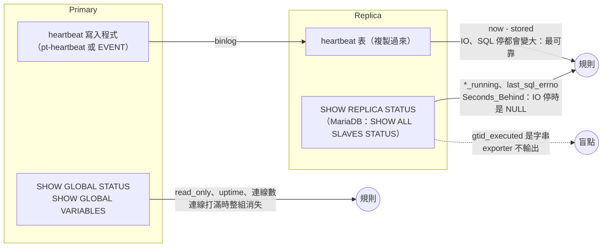
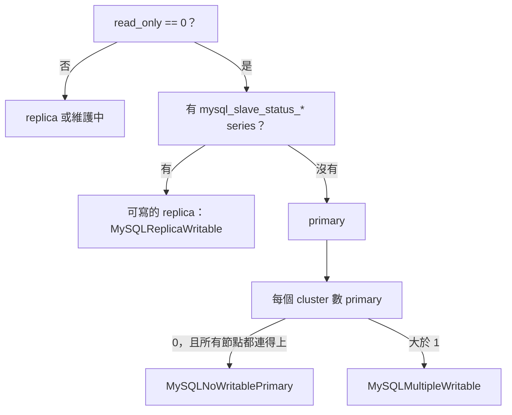

# MySQL／MariaDB 本體怎麼監控

[元件卡](../components/mysqld_exporter.md)回答「exporter 真的有在量嗎」。這頁回答另一個問題：**MySQL 與 MariaDB 本身該看哪些訊號**，每個訊號從資料庫的哪裡來、mysqld_exporter v0.21.0 有沒有輸出、預設有沒有開、要什麼權限。

依據是 mysqld_exporter、MySQL 8.4.7、MariaDB 11.4.13 的原始碼與官方手冊，加上一組小實驗：兩種資料庫各一組 primary + async replica（GTID），開長交易、做 deadlock、讓 replica 延遲三種方式、讓 replication 因衝突停下、讓 semi-sync 退回 async、打滿連線、kill -9 primary、做一次 failover 並讓舊 primary 回來。<span class="at-chip at-ev-tested">實測</span>[^exp-mysql-ha]

## 先講結論

1. **連線打滿時，連線數規則會消失。**max_connections 用完時 exporter 的一般帳號也收到 Error 1040，`mysql_up` 變 0，`threads_connected` 消失，「連線數 / max_connections > 0.8」回傳空。看得到的只有 `mysql_up` 規則，以及連線降下來之後 `connection_errors_total{error="max_connections"}` 的增加量。<span class="at-chip at-ev-tested">實測</span>[^exp-mysql-ha][^mysql-conn-reserved]
2. **Seconds_Behind 在 replica 斷線時是 NULL。**IO thread 停了、SQL thread 已追完，`Seconds_Behind_Source` 就是 NULL，exporter 不輸出；heartbeat 延遲同時已經 27–29 秒。延遲要用 heartbeat 表，Seconds_Behind 只當輔助。<span class="at-chip at-ev-tested">實測</span>[^exp-mysql-ha][^mysql-sbs-null]
3. **failover 會讓三種東西失效。**升級的 replica 做了 `RESET REPLICA ALL`，所有 `mysql_slave_status_*` 消失；靜態的 `role="primary"` label 指向舊節點；heartbeat 寫入程式若是 primary 上的 EVENT，在新 primary 上是停用的，heartbeat 從此停住。舊 primary 回來時兩台都可寫，只有「從 metric 推角色、按 cluster 計數」的規則看得到。<span class="at-chip at-ev-tested">實測</span>[^exp-mysql-ha]
4. **errant GTID 完全看不到。**在 replica 上誤寫一筆後，MySQL 的 `GTID_SUBSET(replica, primary)` 變 0，MariaDB 的 `gtid_binlog_pos` 出現 replica 自己的 server_id，但 exporter 只輸出 `gtid_mode` 這類開關，`gtid_executed`、`gtid_binlog_pos` 是字串、直接被跳過。MariaDB replica 的 `Gtid_Slave_Pos` 有被拆成 `mysql_slave_status_gtid_slave_pos{domain_id,server_id}`，但那是「套用到哪裡」，errant 交易不在裡面。<span class="at-chip at-ev-tested">實測</span>[^exp-mysql-ha][^my-global-variables-parse][^my-trace-ex-slave-gtid]
5. **Semi-sync 退回 async 時 commit 照常成功。**唯一的變化是 `rpl_semi_sync_*_status` 從 1 變 0。MariaDB 內建 semi-sync，沒開時 status 也是 0，所以要和 `enabled == 1` 一起看。<span class="at-chip at-ev-tested">實測</span>[^exp-mysql-ha]
6. **MySQL 與 MariaDB 的同一個訊號名稱不同。**Undo history、deadlock 在 MariaDB 是預設就有的 global status；MySQL 沒有這兩個 status，只能開 `info_schema.innodb_metrics`，而且 deadlock 的 metric 在 MySQL 有 `_total`、在 MariaDB 沒有。規則要用 `or` 把兩種名稱接起來。<span class="at-chip at-ev-tested">實測</span>[^exp-mysql-ha][^my-innodb-metrics-name][^mariadb-innodb-deadlocks]
7. **很多關鍵訊號預設沒開。**長交易（`info_schema.innodb_trx`）、MySQL 的 undo history 與 deadlock（`info_schema.innodb_metrics`）、metadata lock 等待（`info_schema.processlist`）、heartbeat、每帳號連線數（`sys.user_summary`、`mysql.user`）都預設關。預設只開 6 個 collector。[^my-default-collectors]

## 誰看得到什麼



## 穩定 {#stability}

| 要看什麼 | 資料庫的來源 | exporter metric（collector） | 預設 | 權限 | 證據 |
|---|---|---|---|---|---|
| 服務在不在 | 連線 + ping | `mysql_up`（exporter 本體） | 開 | 能登入即可 | 實測[^exp-mysql] |
| 重啟、crash、OOM kill | `Uptime` | `mysql_global_status_uptime`（global_status） | 開 | — | 實測：kill -9 後 uptime 歸零[^exp-mysql-ha] |
| 救援模式 | `innodb_force_recovery` | `mysql_global_variables_innodb_force_recovery`（global_variables） | 開 | — | 手冊 |
| 磁碟滿 | 不在資料庫裡 | 沒有；用 node_exporter。binlog 用量：`mysql_binlog_size_bytes`（binlog_size） | 關 | REPLICATION CLIENT | 手冊 |
| 長交易 | `information_schema.INNODB_TRX` | `mysql_info_schema_innodb_trx_oldest_transaction_age_seconds{state}`（info_schema.innodb_trx） | 關 | PROCESS | 實測[^exp-mysql-ha][^my-innodb-trx-query] |
| Undo history | MariaDB：`Innodb_history_list_length`；MySQL：`INNODB_METRICS.trx_rseg_history_len` | MariaDB：`mysql_global_status_innodb_history_list_length`；MySQL：`mysql_info_schema_innodb_metrics_transaction_trx_rseg_history_len` | MariaDB 開；MySQL 關 | MySQL 要 PROCESS | 實測[^exp-mysql-ha] |
| Deadlock | MariaDB：`Innodb_deadlocks`；兩者：`INNODB_METRICS.lock_deadlocks` | `mysql_global_status_innodb_deadlocks`；`..._lock_lock_deadlocks_total`（MySQL）／`..._lock_lock_deadlocks`（MariaDB） | MariaDB 開；MySQL 關 | PROCESS | 實測[^exp-mysql-ha][^mariadb-innodb-deadlocks] |
| Replication 因錯誤停下 | `Last_SQL_Errno` | `mysql_slave_status_last_sql_errno`（slave_status） | 開 | 見 [HA](#ha) | 實測[^exp-mysql-ha] |

- **磁碟滿時資料庫不會停。**手冊說的「卡在寫入、每分鐘檢查一次空間並寫 error log」是 MyISAM、binlog 這類寫入；InnoDB 資料檔長不出去時是立刻回 `ERROR 1114`，見[磁碟滿](#perf-disk-full)。<span class="at-chip at-ev-tested">實測</span>[^exp-mysql-perf]兩種情況 `mysql_up` 都仍是 1。mysqld_exporter 沒有磁碟用量的 metric，要用 node_exporter 看資料目錄與 binlog 目錄的掛載點。<span class="at-chip at-ev-upstream">上游</span>（[MySQL 手冊：磁碟滿](https://dev.mysql.com/doc/refman/8.4/en/full-disk.html)）
- **OOM kill 在 metric 上只是一次重啟。**`uptime` 歸零、`mysql_up` 短暫變 0；原因要看 kernel log 或容器事件。停機短於 `MySQLNotReachable` 的 `for` 時，只有 `MySQLRestarted` 會響。<span class="at-chip at-ev-tested">實測</span>[^exp-mysql-ha]
- **`innodb_force_recovery` ≥ 4 時 InnoDB 是唯讀**，但 `read_only` 仍可能是 0；看 `innodb_force_recovery` 本身。（[MySQL 手冊](https://dev.mysql.com/doc/refman/8.4/en/forcing-innodb-recovery.html)）
- **長交易在沒開 collector 時沒有任何訊號。**`innodb_trx` 在沒有交易時也不輸出 series（不是 0），所以「沒開」和「沒有長交易」看起來一樣，要靠 `collector_success` 確認。實驗中 11–16 秒的交易與等鎖的交易分成 `state="RUNNING"`、`state="LOCK WAIT"` 兩條。<span class="at-chip at-ev-tested">實測</span>[^exp-mysql-ha]
- **Undo history 的下降速度兩邊不同。**consistent snapshot 擋住 purge 時兩邊都到四百多；交易結束後 MariaDB 降到 1，MySQL 一段時間內仍是 500。門檻要抓得比日常高很多。<span class="at-chip at-ev-tested">實測</span>[^exp-mysql-ha]

## 使用 {#usage}

| 要看什麼 | 資料庫的來源 | exporter metric（collector） | 預設 | 權限 | 證據 |
|---|---|---|---|---|---|
| 連線數 | `Threads_connected`、`max_connections` | `mysql_global_status_threads_connected`、`mysql_global_variables_max_connections` | 開 | — | 實測[^exp-mysql-ha] |
| 被拒的連線 | `Connection_errors_max_connections` | `mysql_global_status_connection_errors_total{error="max_connections"}` | 開 | — | 實測[^exp-mysql-ha][^mariadb-conn-errors] |
| 曾經到過的最高連線數 | `Max_used_connections` | `mysql_global_status_max_used_connections` | 開 | — | 實測：打滿後是 31（max_connections + 1） |
| 每帳號連線數 | `sys.x$user_summary.current_connections`；上限在 `mysql.user.max_user_connections` | `mysql_sys_current_connections{user}`（sys.user_summary）、`mysql_mysql_max_user_connections{mysql_user}`（mysql.user） | 關 | SELECT on sys、mysql.user；MariaDB 要開 performance_schema | 實測[^exp-mysql-ha][^my-sys-user-summary][^my-mysql-user-maxconn] |
| 執行中的 thread | `Threads_running` | `mysql_global_status_threads_running` | 開 | — | 讀碼[^my-trace-my-threads-running]；實測：metadata lock 情境中升高[^exp-mysql-perf] |
| 慢查詢 | `Slow_queries` | `mysql_global_status_slow_queries` | 開 | — | 手冊；實測：`SLEEP(30)` 也算 |
| Row lock 等待 | `Innodb_row_lock_current_waits`、`Innodb_row_lock_time` | `mysql_global_status_innodb_row_lock_current_waits` 等 | 開 | — | 實測[^exp-mysql-ha] |
| Metadata lock 等待 | `information_schema.PROCESSLIST.state` | `mysql_info_schema_processlist_threads{state="waiting_for_table_metadata_lock"}`（info_schema.processlist） | 關 | PROCESS | 實測[^exp-mysql-ha][^my-processlist-query] |
| Table open cache | `Table_open_cache_overflows`、`_misses`、`Opened_tables` | `mysql_global_status_table_open_cache_overflows` 等 | 開 | — | 讀碼 |
| Buffer pool 與 redo | `Innodb_buffer_pool_wait_free`、`Innodb_log_waits`、`Innodb_buffer_pool_pages_*` | `mysql_global_status_innodb_buffer_pool_wait_free`、`..._innodb_log_waits`、`mysql_global_status_buffer_pool_pages{state}` | 開 | — | 讀碼[^my-global-status-re] |
| 暫存表落到磁碟 | `Created_tmp_disk_tables`、`Created_tmp_tables` | `mysql_global_status_created_tmp_disk_tables` 等 | 開 | — | 讀碼 |
| 連線建立失敗 | `Aborted_connects` | `mysql_global_status_aborted_connects` | 開 | — | 實測[^exp-mysql-ha] |

- **max_connections 有一條保留給管理帳號的連線。**MySQL 允許 max_connections + 1 條，最後一條只給有 CONNECTION_ADMIN（或 SUPER）的帳號。[^mysql-conn-reserved]實驗中把 CONNECTION_ADMIN 給 exporter 後 `mysql_up` 回到 1，但 exporter 預設開 2 條連線，第二條仍被拒，MySQL 上 global_variables 等 7 個 collector 失敗，`max_connections` 跟著消失，比例規則還是空。<span class="at-chip at-ev-tested">實測</span>[^exp-mysql-ha]要讓 exporter 在打滿時仍看得到，可以考慮 MySQL 8.4 的獨立管理埠（`admin_address`）或 MariaDB 的 `extra_port`／`extra_max_connections`，未實測。
- **被拒的計數要事後才看得到。**打滿當下 exporter 自己也進不來；連線降下後 `connection_errors_total{error="max_connections"}` 才更新，用 `increase(...[10m]) > 0` 寫規則。MariaDB 被拒時同時加 `Aborted_connects`。[^mariadb-conn-errors]
- **超過 MAX_USER_CONNECTIONS 不算 Connection_errors。**實驗中第三條連線回 ERROR 1226，只有 `Aborted_connects` +1。要預警得用 sys.user_summary 的目前連線數除以 mysql.user 的上限；兩個 collector 的帳號 label 一個叫 `user`、一個叫 `mysql_user`，要 `label_replace`。exporter 自己用掉 3 條上限中的 2 條（0.67）。<span class="at-chip at-ev-tested">實測</span>[^exp-mysql-ha]
- **Slow_queries 不管 slow log 有沒有開都會計數**，門檻是 `long_query_time`（預設 10 秒）。要知道是哪個查詢，開 `perf_schema.eventsstatements` 或讀 slow log。（[MySQL 手冊](https://dev.mysql.com/doc/refman/8.4/en/server-status-variables.html)）

## HA {#ha}

| 要看什麼 | 資料庫的來源 | exporter metric（collector） | 預設 | 權限 | 證據 |
|---|---|---|---|---|---|
| IO／SQL thread | `SHOW REPLICA STATUS`（MariaDB 先試 `SHOW ALL SLAVES STATUS`） | `mysql_slave_status_slave_*_running`（MariaDB）、`..._replica_*_running`（MySQL 8.4） | 開 | MySQL：REPLICATION CLIENT；MariaDB ≥ 10.5.9：SLAVE MONITOR | 實測[^exp-mysql-ha][^my-slave-queries] |
| 停下的原因 | `Last_SQL_Errno`、`Last_IO_Errno` | `mysql_slave_status_last_sql_errno`、`..._last_io_errno` | 開 | 同上 | 實測 |
| 延遲（伺服器算的） | `Seconds_Behind_Master`／`_Source` | `mysql_slave_status_seconds_behind_master`／`_source` | 開 | 同上 | 實測、讀碼[^mysql-sbs-compute] |
| 延遲（heartbeat） | heartbeat 表（pt-heartbeat 格式） | `mysql_heartbeat_now_timestamp_seconds`、`mysql_heartbeat_stored_timestamp_seconds` | 關 | SELECT on heartbeat 表；另外要有寫入程式 | 實測[^my-heartbeat-query] |
| 每個 applier worker 的時間戳 | `performance_schema.replication_applier_status_by_worker` | `mysql_perf_schema_*`（perf_schema.replication_applier_status_by_worker） | 關 | SELECT on performance_schema；**MariaDB 沒有這張表，collector 失敗** | 實測[^my-applier-worker] |
| 能不能寫 | `read_only`、`super_read_only`（MySQL） | `mysql_global_variables_read_only`、`..._super_read_only` | 開 | — | 實測 |
| GTID 開關 | `gtid_mode`、`enforce_gtid_consistency`、`gtid_strict_mode`（MariaDB） | `mysql_global_variables_gtid_mode` 等；只有 ON／OFF 會輸出 | 開 | — | 實測[^my-parse-status] |
| GTID 內容 | `gtid_executed`（MySQL）、`gtid_binlog_pos`（MariaDB） | **沒有**（字串被跳過） | — | — | 實測[^my-global-variables-parse] |
| MariaDB replica 的 GTID 位置 | `SHOW ALL SLAVES STATUS` 的 `Gtid_Slave_Pos`、`Gtid_IO_Pos` | `mysql_slave_status_gtid_slave_pos{domain_id,server_id}`（slave_status 把 GTID 拆成 label） | 開 | SLAVE MONITOR | 實測：在 mdb2 的名稱清單裡[^my-trace-ex-slave-gtid][^my-trace-mdb-gtid-slave-pos][^exp-mysql-ha] |
| Semi-sync | `Rpl_semi_sync_master_status`（MariaDB 內建）、`Rpl_semi_sync_source_status`（MySQL plugin） | `mysql_global_status_rpl_semi_sync_*_status`、`..._no_tx`、`..._clients` | 開（plugin 載入後才有） | — | 實測 |
| Galera | `wsrep_*` | `mysql_global_status_wsrep_*`、`mysql_global_variables_wsrep_on` | 開 | — | 實測[^exp-mysql] |
| Group Replication | `performance_schema.replication_group_members` | perf_schema.replication_group_members | 關 | SELECT on performance_schema | 未實測 |

### 延遲：heartbeat 與 Seconds_Behind

`Seconds_Behind_Source` 是「現在時間減去 SQL thread 正在套用的事件在 primary 上的時間戳」。[^mysql-sbs-compute]它只在 SQL thread 在跑時有值；SQL thread 追完 relay log 時，IO thread 在跑就是 0、不在跑就是 NULL。[^mysql-sbs-null]MariaDB 的 `Seconds_Behind_Master` 更容易是 NULL：只要 IO thread 不是 `Yes`（`Connecting`、`Preparing`、`No`）就是 NULL，即使 relay log 還有沒套用完的事件。<span class="at-chip at-ev-code">讀碼</span>[^my-trace-mdb-sbm-field][^my-trace-mdb-sbm-null]

其他和 replica 狀態有關的解析細節：<span class="at-chip at-ev-code">讀碼</span>

- MariaDB 的 `Slave_IO_Running` 可能是 `Preparing`，exporter 不認得這個值，該次 scrape 的 series 會短暫消失（推論，未觀察到）。[^my-trace-mdb-io-running-vals][^my-parse-connecting]
- MySQL 8.4 上 slave_status 每次 scrape 先試 8 條舊語法才成功，exporter 帳號的 ER_PARSE_ERROR 每次 scrape 加 8，屬正常現象。[^my-trace-ex-slave-loop][^exp-mysql-trace]
- 以「`.數字`」結尾的字串（如 binlog 檔名 `mysql-bin.000003`）會被跳過，所以沒有 `master_log_file` 這類 metric。[^my-trace-ex-parse-logre]

| 情境 | Seconds_Behind | heartbeat 延遲 | 結果 |
|---|---|---|---|
| SQL thread 等 metadata lock（primary 做 ALTER，replica 有開著的交易） | 21／28 秒 | 21／28 秒 | 一致 |
| IO thread 停 25 秒 | **消失（NULL）** | 27–29 秒 | 只有 heartbeat 看得到 |
| SQL thread 停 20 秒 | **消失（NULL）** | 21–23 秒 | 只有 heartbeat 看得到 |
| 衝突寫入，SQL thread 因 1062 停下 | **消失** | 持續變大 | `last_sql_errno=1062` 帶出原因 |
| primary 的 heartbeat 寫入程式停 25 秒 | 0 | **每台**都 25–28 秒 | heartbeat 誤報，但「每台一起變大」本身就是訊號 |

數字是 MariaDB／MySQL。<span class="at-chip at-ev-tested">實測</span>[^exp-mysql-ha]

heartbeat 的前提是寫入程式活著，而且跟著 primary 走。實驗用 primary 上的 EVENT 寫 heartbeat；EVENT 複製到 replica 時是 SLAVESIDE_DISABLED，failover 後新 primary 不會寫，heartbeat 從此停住。正式環境用 pt-heartbeat 之類的外部程式，由 HA 工具在升級時啟動。

### 角色與 failover



- **不要用靜態的 role label 判斷角色。**failover 後 `role="primary"` 指向已停的舊節點，`MySQLPrimaryReadOnly` 查不到任何東西。從 metric 推：可寫、而且沒有 replica 狀態的就是 primary。cluster 要自己用 relabel 加。<span class="at-chip at-ev-tested">實測</span>[^exp-mysql-ha]
- **舊 primary 回來時兩邊都能寫。**實驗中舊 primary 重啟後 `read_only=0`，兩個 cluster 各有 2 台可寫、不在複製的節點，`MySQLMultipleWritable` firing。<span class="at-chip at-ev-tested">實測</span>[^exp-mysql-ha]
- **連線打滿時 `read_only` 也會消失。**一開始的 `MySQLNoWritablePrimary` 在 primary 被打滿時誤報（read_only 不見了，看起來像沒有 primary），規則改成「有節點連不上時不判斷」，交給 `MySQLNotReachable`。<span class="at-chip at-ev-tested">實測</span>[^exp-mysql-ha]
- **Replica 要擋得住寫入。**MySQL 用 `super_read_only=ON`（root 也擋）；MariaDB 沒有 super_read_only，有 READ ONLY ADMIN 權限的帳號可以繞過 `read_only`。在 replica 上寫入時 replication 照常，要等 primary 寫到同一筆才停下。
- **primary 被 kill 時**，replica 的 `io_running=0`、`last_io_errno=2003`；primary 回來後 30 秒內自動重連，errno 歸 0。所以 `last_io_errno` 不適合單獨當告警，規則只用 `last_sql_errno`。<span class="at-chip at-ev-tested">實測</span>[^exp-mysql-ha]

### GTID 一致性

errant transaction（replica 有、primary 沒有的交易）會讓下一次 failover 出錯，exporter 卻看不到。要另外跑查詢（cron、HA 工具或 blackbox 的自訂 script）：

- MySQL：在 primary 上 `SELECT GTID_SUBSET('<replica 的 gtid_executed>', @@gtid_executed)`，0 代表有 errant。（[MySQL 手冊](https://dev.mysql.com/doc/refman/8.4/en/gtid-functions.html)）
- MariaDB：看 replica 的 `gtid_binlog_pos` 有沒有出現 replica 自己的 server_id（實驗中變成 `0-2-645`）；`gtid_strict_mode=ON` 可以在源頭擋掉一部分。（[MariaDB GTID](https://mariadb.com/kb/en/gtid/)）

### Semi-sync

實驗中 primary 開 semi-sync、replica 沒開：MySQL 開啟當下 status=1，第一筆寫入等 ACK 逾時（3 秒）後變 0；之後寫入正常、不報錯，`no_tx` 一直增加。MariaDB replica 開 semi-sync 後 status 回到 1、`clients=1`。MySQL replica 開著 `super_read_only` 時 `INSTALL PLUGIN` 會失敗（ERROR 1290），要先關掉再裝。<span class="at-chip at-ev-tested">實測</span>[^exp-mysql-ha]

### Galera（只有 MariaDB）

沒開 Galera 的 MariaDB 也輸出 `wsrep_ready=0`，上游規則 `wsrep_ready != 1` 對每台普通 MariaDB 誤報。要加上 `wsrep_on == 1`。<span class="at-chip at-ev-tested">實測</span>[^exp-mysql]

### MySQL 8.4 的改名

MySQL 8.4 移除 `SHOW SLAVE STATUS`，exporter 改用 `SHOW REPLICA STATUS`，metric 名稱跟著欄位名變成 `mysql_slave_status_replica_io_running`、`..._seconds_behind_source`。MariaDB 11.4 仍是 `slave_*`、`seconds_behind_master`。規則要兩種名稱一起比對。[^my-slave-queries]

## 效能與故障情境 {#performance}

吞吐量掉下來或資料庫停掉時，哪個指標先動、exporter 看不到什麼、要去哪裡查。依據是一組小實驗：MariaDB 11.4 與 MySQL 8.4 各一台（2 核、1 GB），每台一個限速工作負載（8 條連線、每秒最多 320 筆「點查 + 單列 UPDATE + COMMIT」），scrape 每 5 秒一次，依序做 11 個情境。<span class="at-chip at-ev-tested">實測</span>[^exp-mysql-perf]

先講結論：

1. **吞吐量掉下來時，先動的幾乎都是 `threads_running`。**row lock、metadata lock、CPU 限制三種情境，`threads_running` 都在情境開始後 4–10 秒從 2–5 升到 10–13，commit 速率在同一個或之後幾個 scrape 掉下來。但 `MySQLHighThreadsRunning` 的門檻是 `max_connections` 的 60%（實驗是 60），連線池小的應用永遠碰不到。
2. **Metadata lock 會讓整張表停住，row lock 規則看不到。**一個讀了一列沒 commit 的交易（25 秒）加一個 `ALTER TABLE`，後面 9 個 session 全部排隊，commit 從 320/s 掉到 0，最長停頓 37 秒；`innodb_row_lock_current_waits` 是 0，長交易規則（> 300 秒）也不會響。只有 processlist collector 的 `state="waiting_for_table_metadata_lock"` 看得到。
3. **Row lock 等待數最多等於應用的連線數。**8 條連線全部卡住時 `innodb_row_lock_current_waits` 是 8，`MySQLRowLockWaits`（> 10）不會響；改看 `rate(innodb_row_lock_time) / 1000`（平均同時在等的 session 數，實驗 8–9.8）。
4. **找慢 SQL 靠 `perf_schema.eventsstatements`，但有三個坑。**只輸出總耗時前 250 個 digest；latency summary 的 `quantile` label 是 `"99.0"` 不是 `"0.99"`；MariaDB 的 quantile、lock_time、cpu_time 永遠是 0。MariaDB 還要先開 `performance_schema`（預設 OFF，要重啟）。
5. **InnoDB 資料檔長不出去時是立刻報錯，不是卡住。**放在 24 MB tmpfs 的表寫滿時兩邊都立刻回 `ERROR 1114 The table is full`，其他表照常寫入，`mysql_up` 仍是 1；exporter 只看得到語句錯誤數。
6. **OOM 與 crash loop 在 metric 上的樣子不一樣。**單次 OOM kill 後兩邊 3–4 秒就重新接受連線，Prometheus 只抓到一次 `mysql_up` = 0，`MySQLNotReachable`（`for: 1m`）不會響，只有 uptime 歸零看得到。crash loop（每次啟動 2 秒就退出）則相反：uptime 一次都沒被抓到，只有 `mysql_up` 規則看得到。

| 情境 | 客戶端看到的 | 先動的指標（秒＝距情境開始） | exporter 看不到 | 怎麼查 | 規則 |
|---|---|---|---|---|---|
| [慢查詢](#perf-slow-sql) | 沒有變慢（限速負載） | `slow_queries`（12–17 秒）、每個 digest 的 `rows_examined` | slow log 原文、執行計畫、排不進前 250 的 digest | `sys.statement_analysis`、`EXPLAIN` | `MySQLSlowQueries`、`MySQLSlowDigest` |
| [Row lock](#perf-row-lock) | TPS 273 → 98／90，1205 錯誤，p99 4.8–9.8 秒 | `row_lock_current_waits`、`threads_running`（9 秒）→ commit（14 秒） | 誰擋住誰 | `sys.innodb_lock_waits`、`INNODB_TRX` | `MySQLRowLockWaitTime`、`MySQLStatementErrors`、`MySQLThroughputDrop` |
| [Metadata lock](#perf-mdl) | 全停 37 秒 | `mdl_waiting` 9（11 秒）、commit 0 | MariaDB 的 MDL 持有者 | MySQL：`sys.schema_table_lock_waits`；兩邊：`SHOW PROCESSLIST` 找最舊的交易 | `MySQLMetadataLockWaits` |
| [Purge 被擋](#perf-purge) | 沒有變慢（60 秒內） | history list 50 秒到 13,663／13,474 | — | `INNODB_TRX` 找最舊的 snapshot | `MySQLInnoDBHistoryLength`（50,000 在這個寫入量下要約 3.6 分鐘） |
| [CPU 限制](#perf-cpu) | TPS 273 → 155／112，p99 0.5／3.6 秒 | `threads_running`、scrape 耗時（4 秒）→ commit（4–9 秒） | CPU 用量（要 cAdvisor 或 node_exporter） | 容器或主機 CPU、`sys.statement_analysis` 的總耗時 | `MySQLThroughputDrop` |
| [Buffer pool 太小](#perf-buffer-pool) | TPS 約 −10%，p99 340–380 ms | `innodb_buffer_pool_reads` 0–18 → 1,800–2,500/s（1–6 秒） | — | `information_schema.INNODB_BUFFER_POOL_STATS` | `MySQLBufferPoolDiskReads` |
| [暫存表落到磁碟](#perf-tmp) | 沒有變慢 | `created_tmp_disk_tables` 0.2–0.5 → 6.5–9.5/s | 哪個查詢（要 eventsstatements 的 `tmp_disk_tables_total`） | `sys.statements_with_temp_tables` | `MySQLTmpDiskTables` |
| [Redo 太小](#perf-redo) | 沒有重現 | `innodb_log_waits` 一直是 0 | — | checkpoint age | `MySQLInnoDBLogWaits` |
| [連線風暴](#perf-storm) | 既有連線 TPS 273 → 116／108；新連線被拒 | `mysql_up` 變 0（10 秒），其他 metric 消失 | 打滿當下的一切 | 事後的 `connection_errors_total` | `MySQLNotReachable`、`MySQLConnectionsRefused` |
| [磁碟滿](#perf-disk-full) | 只有寫那張表的語句失敗（1114） | 語句錯誤數 | 磁碟用量 | error log、node_exporter | `MySQLDataDiskFilling`、`MySQLStatementErrors` |
| [OOM kill](#perf-oom) | 斷線 4–5 秒（2013、2003），5–8 秒後 TPS 回到 320 | `mysql_up` 一次 0，下一次 uptime 7–8 | OOM 原因 | 容器事件、kernel log | `MySQLRestarted`、`MySQLRestartedRepeatedly`、`MySQLNotReachable` |

TPS 是客戶端「成功交易數 ÷ 時間窗長度」，前面是 MariaDB、後面是 MySQL。這台機器的容器時鐘不穩，客戶端每隔一段時間會出現 4–7 秒的空白（基線也有），所以「停頓」只看明顯更長的。<span class="at-chip at-ev-tested">實測</span>[^exp-mysql-perf]

### 找慢 SQL {#perf-slow-sql}

| 來源 | exporter | 看得到 | 看不到 |
|---|---|---|---|
| `Slow_queries`（超過 `long_query_time` 的次數） | 預設就有 | 有沒有慢查詢、多快在增加 | 是哪個查詢 |
| `events_statements_summary_by_digest` | `--collect.perf_schema.eventsstatements`（預設關） | 每個 digest 的次數、總耗時、rows_examined／sent、錯誤、暫存表、no_index_used；MySQL 另有 p95／p99／p999、lock_time、cpu_time | 參數值、執行計畫、排不進前 N 的 digest |
| 同一張表加總 | `--collect.perf_schema.eventsstatementssum`（預設關） | 全部 digest 的錯誤、暫存表、全表掃描總數（不受前 N 限制） | 是哪個 digest |
| slow log、`EXPLAIN` | 沒有 | 原始 SQL 與參數、執行計畫 | — |

- **collector 的查詢**：依 `SUM_TIMER_WAIT` 排序取前 `--collect.perf_schema.eventsstatements.limit`（預設 250）個，只取 `LAST_SEEN` 在 `timelimit`（預設 86400 秒）內的，`DIGEST_TEXT` 截在 `digest_text_limit`（預設 120）字。[^my-perf-ex-stmt-query][^my-perf-ex-stmt-topn][^my-perf-ex-stmt-lastseen][^my-perf-ex-stmt-digest-text][^my-perf-ex-stmt-defaults][^my-perf-ex-stmt-flags]
- **Cardinality**：每個 digest 一組 `schema`、`digest`、`digest_text` label，19 條 series（15 個 counter + summary 的 3 個 quantile、sum、count）。[^my-perf-ex-stmt-labels]實驗中送 300 種不同形狀的查詢後，兩邊都固定在 250 個 digest、4,771 條 series；collector 耗時 13–16 ms。規模要靠 `limit` 控制，另外 `digest_text` 會隨截斷長度變，同一個 digest 改長度後是新的 series。<span class="at-chip at-ev-tested">實測</span>[^exp-mysql-perf]
- **quantile label 不是 0.99。**exporter 用 95、99、999 當 map key，label 值變成 `"95.0"`、`"99.0"`、`"999.0"`；照慣例寫 `quantile="0.99"` 回傳空。MariaDB 不走 MySQL ≥ 8.0.28 的查詢，quantile、`lock_time_seconds_total`、`cpu_time_seconds_total` 仍然輸出，但永遠是 0。<span class="at-chip at-ev-tested">實測</span>[^my-perf-ex-stmt-quantile][^my-perf-ex-stmt-8028][^my-perf-ex-stmt-locktime][^exp-mysql-perf]
- **用平均值寫規則**：`rate(..._seconds_total[5m]) / rate(..._total[5m])` 是每個 digest 的平均耗時，兩種資料庫都能用。實驗中 filesort 全表掃描的 digest 每秒檢查 27 萬列，是 `rows_examined` 的第一名；總耗時第一名是 `SLEEP` 與 `COMMIT`。
- **MariaDB 要先開 `performance_schema`。**MariaDB 預設 OFF、MySQL 預設 ON，都要重啟才能改。[^my-perf-mdb-pfs-default][^my-perf-my-pfs-default]沒開時 collector 仍回報成功，只是沒有 series。`performance_schema_digests_size` 是 MariaDB 5,000、MySQL 10,000。
- **Slow_queries 和 slow log 無關。**實驗把 `long_query_time` 設成 0.5，兩個 client 跑 filesort 與 `SLEEP(1)`，30 秒內各 +36／+38。<span class="at-chip at-ev-tested">實測</span>[^exp-mysql-perf][^my-trace-my-slow][^my-trace-mdb-slow]

在資料庫上查（MySQL 的 sys schema 預設就有；MariaDB 11.4 也有 sys，但要開 performance_schema 才有資料）：

```sql
-- 總耗時最高的語句；full_scan、rows_examined_avg 看是不是缺索引
SELECT query, exec_count, total_latency, max_latency, rows_examined_avg, full_scan
  FROM sys.statement_analysis ORDER BY total_latency DESC LIMIT 10;
SELECT * FROM sys.statements_with_full_table_scans LIMIT 10;
SELECT * FROM sys.statements_with_temp_tables LIMIT 10;
-- 錯誤碼分布（exporter 沒有這個）
SELECT ERROR_NUMBER, ERROR_NAME, SUM_ERROR_RAISED
  FROM performance_schema.events_errors_summary_global_by_error WHERE SUM_ERROR_RAISED > 0 ORDER BY 3 DESC;
```

實驗中 MySQL 的 `sys.statement_analysis` 把 `COMMIT` 的 `max_latency` 顯示成 213.50 d，是這台機器時鐘不穩造成的，不要拿單次最大值當依據。<span class="at-chip at-ev-tested">實測</span>[^exp-mysql-perf]

### Row lock {#perf-row-lock}

一個交易 `UPDATE ... WHERE id <= 50000` 後不 commit（持有 25% 的列）。

- 9 秒內 8 條連線全部在等：`innodb_row_lock_current_waits` 8、`innodb_trx_transactions{state="LOCK WAIT"}` 8、`threads_running` 3 → 11；commit 從約 275/s 掉到 0.7／1.1/s。每 10 秒（`innodb_lock_wait_timeout`）有一批 1205 錯誤，客戶端共 24／16 次。<span class="at-chip at-ev-tested">實測</span>[^exp-mysql-perf]
- 等 row lock 的 session 在 processlist 的 state 是 `updating`，`state=~".*lock.*"` 查不到。
- 語句錯誤數（`events_statements_sum_errors`）升到 2.1／0.9 次/秒；global status 沒有「lock wait timeout 次數」。
- 查擋住的人：MySQL 用 `sys.innodb_lock_waits`（讀 `performance_schema.data_lock_waits`）；MariaDB 用 `information_schema.INNODB_LOCK_WAITS` 搭配 `INNODB_TRX`（這兩個查詢未實測）。

### Metadata lock：DDL 卡在長交易後面 {#perf-mdl}

一個交易 `BEGIN; SELECT ... WHERE id=1;` 後不 commit，3 秒後 `ALTER TABLE ... ADD COLUMN`。

- ALTER 要排他的 metadata lock，排在交易後面；之後所有用到這張表的語句（連點查也是）排在 ALTER 後面。11 秒時兩邊都是 9 個 session 在 `waiting_for_table_metadata_lock`，commit 0、QPS 4–5（只剩 exporter 自己），`innodb_row_lock_current_waits` 0，最舊的交易只有 25–26 秒。<span class="at-chip at-ev-tested">實測</span>[^exp-mysql-perf]
- ALTER 不會自己放棄：`lock_wait_timeout` 預設 MySQL 31,536,000 秒（一年）、MariaDB 86,400 秒（一天）。[^my-perf-my-lock-wait-timeout][^my-perf-mdb-lock-wait-timeout]exporter 自己的連線設成 2 秒，所以 exporter 不會被卡住。[^my-trace-ex-lockwait]
- processlist 的 state 字串兩邊相同（"Waiting for table metadata lock"），exporter 轉成小寫底線。[^my-perf-my-mdl-state][^my-perf-mdb-mdl-state][^my-trace-ex-pl-sanitize]
- `perf_schema.eventswaits` 的 `wait/lock/metadata/sql/mdl` 不適合即時告警：等待結束才累計，MySQL 在交易結束時一次加 328 秒；MariaDB 預設沒開這個 instrument，一直是 0。[^my-perf-ex-waits-query]
- 誰擋住：MySQL 的 `performance_schema.metadata_locks` 看得到 9 個 PENDING（EXCLUSIVE、SHARED_READ），`sys.schema_table_lock_waits` 直接給出 `blocking_pid` 與 `KILL` 語句；MariaDB 的 `metadata_locks` 查不到（instrument 預設關），只能在 `SHOW PROCESSLIST` 找開最久的連線。

```sql
-- MySQL
SELECT waiting_query, blocking_pid, blocking_account, sql_kill_blocking_connection FROM sys.schema_table_lock_waits;
-- 兩邊都可用：最舊的交易
SELECT trx_mysql_thread_id, trx_started, trx_state FROM information_schema.INNODB_TRX ORDER BY trx_started LIMIT 5;
```

### Purge 被擋住 {#perf-purge}

`START TRANSACTION WITH CONSISTENT SNAPSHOT` 開著約 60 秒，同時每秒約 250–320 筆 UPDATE。History list 在 50 秒時到 13,663（MariaDB）／13,474（MySQL），交易結束後 40 秒內回到 152／156，吞吐量沒有變化。`MySQLInnoDBHistoryLength` 的門檻 50,000 在這個寫入量下約要 3.6 分鐘才會碰到；長交易本身用 `MySQLLongTransaction` 抓得比較早。<span class="at-chip at-ev-tested">實測</span>[^exp-mysql-perf]

### CPU 限制 {#perf-cpu}

`docker update --cpus 0.1`（原本 2 核）45 秒。

- `threads_running` 升到 10／11、scrape 耗時從 0.03 秒升到 0.97／0.56 秒（4 秒內）；commit 從 320/s 掉到 73／45/s，客戶端 p99 0.5／3.6 秒，沒有錯誤。<span class="at-chip at-ev-tested">實測</span>[^exp-mysql-perf]
- exporter 看不到 CPU 用量或 throttling；scrape 耗時變長是一個間接訊號，再嚴重就會碰到 `MySQLScrapeNearTimeout`。

### Buffer pool 太小 {#perf-buffer-pool}

執行中把 `innodb_buffer_pool_size` 從 128M 縮到 16M（表約 44 MB／102 MB）。

- `innodb_buffer_pool_reads`（要到磁碟讀的頁）從 0–18/s 升到 1,946／1,437/s，佔讀取請求 35%／20%；客戶端 TPS 約降 10%（273 → 245／243），p99 383／340 ms。<span class="at-chip at-ev-tested">實測</span>[^exp-mysql-perf]
- `innodb_buffer_pool_wait_free` 只有 MySQL 動（約 4/s），MariaDB 一直是 0，所以 `MySQLBufferPoolWaitFree` 抓不到 MariaDB 的這種情況；用命中率（`MySQLBufferPoolDiskReads`）。
- 這組數據的磁碟是本機 SSD；磁碟慢時 TPS 掉得更多。

### 暫存表落到磁碟 {#perf-tmp}

兩個 client 用 `tmp_table_size=64K` 反覆 GROUP BY。`created_tmp_disk_tables` 升到 6.5／9.5/s，佔所有暫存表 44%／84%；eventsstatements 的 `tmp_disk_tables_total` 能指出是哪個 digest。MySQL 8.4 的 TempTable 引擎超過上限改用 InnoDB 磁碟表時也算在 `Created_tmp_disk_tables` 裡。限速負載下 TPS 沒有變化。<span class="at-chip at-ev-tested">實測</span>[^exp-mysql-perf]

### Redo log 太小 {#perf-redo}

對 6 萬列的表連續三次全表 UPDATE，先用預設 redo（MariaDB 96M、MySQL 100M），再把 redo 縮到最小（MariaDB `innodb_log_file_size=16M`、MySQL `innodb_redo_log_capacity=8M`）。

- 兩次 `innodb_log_waits` 都是 0：它量的是 log buffer（MariaDB 16M、MySQL 64M）不夠，不是 redo 檔案太小。[^my-perf-my-log-waits][^my-perf-mdb-log-waits]
- checkpoint age（MariaDB `Innodb_checkpoint_age`；MySQL `Innodb_redo_log_current_lsn − Innodb_redo_log_checkpoint_lsn`）在預設大小時到 77 MB／66 MB，縮小後最高 2 MB／6 MB，表示 InnoDB 一直在刷頁。[^my-perf-mdb-checkpoint-age][^my-perf-my-redo-lsn]
- **沒有重現吞吐量下降**：第二輪的大量 UPDATE 可能排在第一輪後面等鎖，兩輪的寫入量不一定相同。這個情境只當作「哪些指標看得到 checkpoint 壓力」的參考。<span class="at-chip at-ev-tested">實測</span>[^exp-mysql-perf]

### 連線風暴 {#perf-storm}

150 條連線反覆「連線 → 全表掃描 → 斷線」30 秒（`max_connections=100`）。

- 10 秒內兩邊 `mysql_up` 都變 0（exporter 也被擋），其他 mysql_* 消失 25–30 秒；exporter 偶爾擠進去時 `threads_connected` 是 65／89、`threads_running` 66／88。<span class="at-chip at-ev-tested">實測</span>[^exp-mysql-perf]
- 原本就連著的工作負載沒有收到錯誤，但全表掃描搶 CPU，TPS 從 273 掉到 116／108。
- 風暴結束後：`connection_errors_total{error="max_connections"}` 一分鐘內 +1,840／+4,040，`aborted_connects` +2,169／+298（MariaDB 把被拒的連線也算進 Aborted_connects，MySQL 沒有），`max_used_connections` 101（max_connections + 1）。這和[使用](#usage)一節的結論一致。

### 磁碟滿 {#perf-disk-full}

一張 `DATA DIRECTORY` 指到 24 MB tmpfs 的表（MySQL 要在 `innodb_directories` 裡），每次插入 10 列 × 4 KB。

- 2.4／3.2 秒、3,160 列後兩邊都立刻回 `ERROR 1114 The table 'fill' is full`，不等待；之後同一張表塞一列小資料、其他表的 UPDATE 都成功。MySQL error log 記 `posix_fallocate() ... Operating system error number 28`，MariaDB 只記 `The table 'fill' is full`。`mysql_up` 1、TPS 不變。<span class="at-chip at-ev-tested">實測</span>[^exp-mysql-perf]
- 所以「磁碟滿時卡住、每分鐘重試」不適用於 InnoDB 資料檔變大的情況；手冊說的等待是 MyISAM、binlog 等寫入。redo、binlog、資料目錄本身滿的情況沒有測。
- **tablespace 檔案不見時 crash recovery 會失敗。**這張表的 tmpfs 在容器重啟後是空的；之後 MariaDB 被 kill 再啟動時，crash recovery 找不到 `/fill/app/fill.ibd`，`Cannot apply log ... corrupted file` → `Plugin initialization aborted` → `Aborting`，每次啟動 2 秒就退出，進入重啟迴圈。這段期間 `mysql_up` 一直是 0，uptime 從來沒被抓到。<span class="at-chip at-ev-tested">實測</span>[^exp-mysql-perf]

### OOM kill {#perf-oom}

把容器記憶體上限降到「目前用量 + 150 MB」（MariaDB 486m、MySQL 730m），再把 `innodb_buffer_pool_size` 加到 1G。

- 加大 buffer pool 的那一刻就觸發 OOM kill（docker `oom` 事件、exit 137），還沒開始寫大表；`restart: on-failure` 立刻重啟。<span class="at-chip at-ev-tested">實測</span>[^exp-mysql-perf]
- Crash recovery 很快：MariaDB 從啟動到 `ready for connections` 3 秒（`To recover: 7913 pages`），MySQL 3 秒（XA crash recovery）。客戶端斷線 4–5 秒（先 2013 Lost connection，再 2003 Can't connect），MariaDB 5 秒、MySQL 8 秒後回到 320 tx/s（MySQL 頭 3 秒只有 26–89 tx/s）。
- Prometheus 每 5 秒抓一次，只抓到**一次** `mysql_up` = 0，下一次 uptime 已經是 7–8 秒。所以 `MySQLNotReachable`（`for: 1m`）不會響，能看到的是 `MySQLRestarted`（uptime < 300）與 `resets(mysql_global_status_uptime[...])`（257 → 8）。`MySQLUpFlapping` 也響了。
- OOM 的原因不在任何 mysql_* metric 裡；要看容器的 `oom` 事件、cAdvisor 的 `container_oom_events_total` 或 kernel log。
- **Crash loop 看起來不一樣。**第一次執行時（上一節的 tablespace 遺失，與一次上限設得比 MySQL 啟動所需還低的 OOM），容器每 2 秒就退出、反覆重啟，uptime 一次都沒被 scrape 到，`MySQLRestarted` 與 `resets()` 都沒有資料；只剩 `MySQLNotReachable`、`MySQLCollectorsMissing` 響。<span class="at-chip at-ev-tested">實測</span>[^exp-mysql-perf]
- 規則：單次重啟用 `MySQLRestarted`；`MySQLRestartedRepeatedly`（一小時內 `resets(uptime) > 1`）抓「每次都起得來但一直被 kill」；起不來的 crash loop 交給 `MySQLNotReachable`。


## Exporter 覆蓋矩陣 {#coverage}

預設開的 collector：global_status、global_variables、slave_status、info_schema.innodb_cmp、info_schema.innodb_cmpmem、info_schema.query_response_time。[^my-default-collectors]

| 資料庫來源 | Collector | 代表 metric | 預設 | 權限 | MySQL 8.4 | MariaDB 11.4 |
|---|---|---|---|---|---|---|
| `SHOW GLOBAL STATUS` | global_status | `mysql_global_status_*` | 開 | — | ✓ | ✓（多了 history_list_length、deadlocks） |
| `SHOW GLOBAL VARIABLES` | global_variables | `mysql_global_variables_*`（字串值跳過） | 開 | — | ✓ | ✓（沒有 super_read_only） |
| `SHOW REPLICA STATUS` | slave_status | `mysql_slave_status_*` | 開 | REPLICATION CLIENT；MariaDB 加 SLAVE MONITOR | `replica_*` | `slave_*` |
| heartbeat 表 | heartbeat | `mysql_heartbeat_*` | 關 | SELECT | ✓ | ✓ |
| `INNODB_TRX` | info_schema.innodb_trx | `mysql_info_schema_innodb_trx_*` | 關 | PROCESS | ✓ | ✓ |
| `INNODB_METRICS`（只取 enabled 的計數器） | info_schema.innodb_metrics | `mysql_info_schema_innodb_metrics_*` | 關 | PROCESS | ✓（計數器有 `_total`） | ✓（部分沒有 `_total`） |
| `PROCESSLIST` | info_schema.processlist | `mysql_info_schema_processlist_threads{state}` | 關 | PROCESS（沒有時只看到自己） | ✓ | ✓ |
| `sys.x$user_summary` | sys.user_summary | `mysql_sys_current_connections{user}` 等 | 關 | SELECT on sys | ✓ | 回報成功但沒有資料（performance_schema 預設關） |
| `mysql.user` | mysql.user | `mysql_mysql_max_user_connections{mysql_user}` | 關 | SELECT on mysql.user | ✓ | ✓ |
| `SHOW BINARY LOGS` | binlog_size | `mysql_binlog_size_bytes`、`mysql_binlog_files` | 關 | REPLICATION CLIENT | ✓ | ✓ |
| `replication_applier_status_by_worker` | perf_schema.replication_applier_status_by_worker | `mysql_perf_schema_*` | 關 | SELECT | ✓ | **collector 失敗** |
| `events_statements_summary_by_digest` | perf_schema.eventsstatements | `mysql_perf_schema_events_statements_*` | 關 | SELECT | ✓（前 250 個 digest；quantile label 是 `"99.0"`）[^exp-mysql-perf] | 要開 performance_schema；quantile、lock_time 永遠 0 |
| 同上加總 | perf_schema.eventsstatementssum | `mysql_perf_schema_events_statements_sum_*` | 關 | SELECT | ✓ | 要開 performance_schema |
| `events_waits_summary_global_by_event_name` | perf_schema.eventswaits | `mysql_perf_schema_events_waits_*{event_name}` | 關 | SELECT | ✓（MDL 等待結束才累計） | MDL instrument 預設關，一直是 0 |
| `gtid_executed`、`gtid_binlog_pos` | — | 沒有 | — | — | 盲點 | 盲點 |
| `Gtid_Slave_Pos`（replica 狀態） | slave_status | `mysql_slave_status_gtid_slave_pos{domain_id,server_id}` | 開 | SLAVE MONITOR | 不適用 | ✓[^my-trace-ex-slave-gtid] |
| 磁碟、記憶體、OOM | — | 沒有 | — | — | node_exporter | node_exporter |

權限的影響（收回 PROCESS、SLAVE MONITOR 時哪些 collector 失敗）見[元件卡](../components/mysqld_exporter.md#exporter-grants)與前一輪實驗。[^exp-mysql]

## 盲點與補法 {#blind-spots}

| 盲點 | 為什麼 | 補法 |
|---|---|---|
| 連線打滿時的連線數 | exporter 也被擋，整組 metric 消失 | 告警靠 `mysql_up` 與事後的 `connection_errors_total`；或讓 exporter 走管理埠 |
| errant GTID | `gtid_executed` 是字串 | 外部 script 跑 `GTID_SUBSET`，結果用 textfile 或 pushgateway 送進來 |
| 磁碟用量 | 不在資料庫裡 | node_exporter，規則要知道資料目錄的掛載點 |
| OOM 原因 | 只看得到 uptime 歸零 | kernel log、cAdvisor 的 OOM 事件 |
| 真正的寫入 | `mysql_up` 只做 ping | heartbeat 寫入程式自己回報成功時間，或應用層探測 |
| Replica 錯誤訊息 | `Last_SQL_Error` 是字串 | 規則帶 errno，細節看 `SHOW REPLICA STATUS` |
| MariaDB 的每帳號、每查詢統計 | performance_schema 預設關 | 開 `performance_schema=ON`（要重啟，佔記憶體） |
| Metadata lock 細節 | 沒有 collector 讀 `performance_schema.metadata_locks` | processlist 的 state 只能看到「有人在等」 |

## 建議的 exporter 設定 {#recommended}

```text
--collect.info_schema.innodb_trx          # 長交易
--collect.info_schema.innodb_metrics      # MySQL 的 undo history、deadlock
--collect.info_schema.processlist         # metadata lock 等待（--collect.info_schema.processlist.min_time 預設 0）
--collect.heartbeat                       # 搭配 pt-heartbeat；--collect.heartbeat.database/table
--collect.binlog_size                     # binlog 用量
--collect.sys.user_summary                # 每帳號連線數（MySQL；MariaDB 要先開 performance_schema）
--collect.mysql.user                      # 每帳號的 MAX_USER_CONNECTIONS
```

帳號：

```sql
-- MySQL 8.4
CREATE USER 'exporter'@'%' IDENTIFIED BY '...' WITH MAX_USER_CONNECTIONS 3;
GRANT PROCESS, REPLICATION CLIENT, SELECT ON *.* TO 'exporter'@'%';
-- MariaDB 10.5.9 起另外要
GRANT SLAVE MONITOR ON *.* TO 'exporter'@'%';
```

- `SELECT ON *.*` 可以縮成 heartbeat 表、`sys`、`mysql.user`、`performance_schema` 幾個 schema。
- MAX_USER_CONNECTIONS 3 時 exporter 一次 scrape 用掉 2 條；兩台 Prometheus 同時抓就會超過，見[元件卡](../components/mysqld_exporter.md#db-up-flapping)。
- 是否給 CONNECTION_ADMIN 要取捨：它讓 exporter 在打滿時還有一條連線，但只有一條，而且和 DBA 搶同一個保留位子。

## 規則 {#rules}

規則在 [`rules/targets/mysql.yml`](https://github.com/HahaSula/alert-trust/blob/main/rules/targets/mysql.yml)，分成 replication、ha、stability、usage、performance 幾組（performance 是[效能與故障情境](#performance)新增的）；每條規則的 `runbook_url` 指回[元件卡](../components/mysqld_exporter.md)上對應的訊號。佔位符：`job="mysql"`、`cluster`、`role`、node_exporter 的 `job="node"` 與 `mountpoint`。

## 實驗 {#lab}

[`lab/targets/mysql/ha/`](https://github.com/HahaSula/alert-trust/tree/main/lab/targets/mysql/ha)：`./run.sh` 起 4 台資料庫、4 台 exporter、1 台 Prometheus（只開 127.0.0.1:22090），跑完 9 個情境後 `docker compose down -v`，約 13 分鐘。原始結果與摘要在 `results/run-20261108.md`，各節點的 metric 名稱清單在 `results/names-*.txt`。[^exp-mysql-ha]

[`lab/targets/mysql/perf/`](https://github.com/HahaSula/alert-trust/tree/main/lab/targets/mysql/perf)：`./run.sh` 跑 11 個效能與故障情境（約 21 分鐘），`./run.sh focus` 只重做 metadata lock 與 OOM（約 7 分鐘）；只開 127.0.0.1:22690，結束後 `docker compose down -v`。[^exp-mysql-perf]
