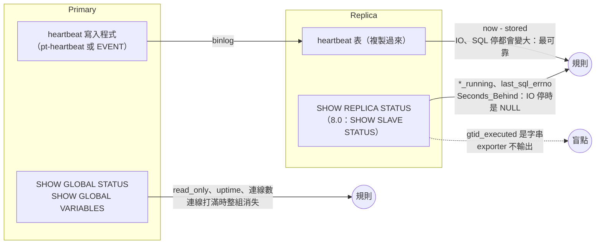
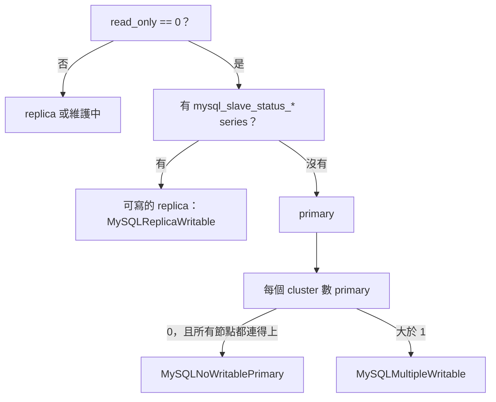

# MySQL 本體怎麼監控

[元件卡](../components/mysql.md)回答「exporter 真的有在量嗎」。這頁回答另一個問題：**MySQL 本身該看哪些訊號**，每個訊號從資料庫的哪裡來、mysqld_exporter v0.21.0 有沒有輸出、預設有沒有開、要什麼權限。MariaDB 的原始碼與 metric 名稱不同，另一頁：[MariaDB 本體怎麼監控](mariadb.md)。

依據是 mysqld_exporter 與 MySQL 8.4.7 的原始碼與官方手冊，加上一組小實驗：MySQL 8.4.7 一組 primary + async replica（GTID），開長交易、做 deadlock、讓 replica 延遲三種方式、讓 replication 因衝突停下、讓 semi-sync 退回 async、打滿連線、kill -9 primary、做一次 failover 並讓舊 primary 回來。<span class="at-chip at-ev-tested">實測</span>[^exp-mysql-ha]叢集、資料保護與容量三個面向另外做了一組：三台 Group Replication 暫停兩台、binlog 預設值、information_schema 統計快取。<span class="at-chip at-ev-tested">實測</span>[^my-asp-exp]lab 與 MariaDB 同時跑，這頁只引用 MySQL 那一邊的數字。

8.0、8.4 LTS、9.7 LTS 之間的差異（metric 改名、認證、semi-sync plugin、Group Replication 預設值）從原始碼整理在 [MySQL 各版本的監控差異](versions/mysql.md)，只讀碼。

## 先講結論

1. **連線打滿時，連線數規則會消失。**max_connections 用完時 exporter 的一般帳號也收到 Error 1040，`mysql_up` 變 0，`threads_connected` 消失，「連線數 / max_connections > 0.8」回傳空。看得到的只有 `mysql_up` 規則，以及連線降下來之後 `connection_errors_total{error="max_connections"}` 的增加量。<span class="at-chip at-ev-tested">實測</span>[^exp-mysql-ha][^mysql-conn-reserved]
2. **Seconds_Behind_Source 在 replica 斷線時是 NULL。**IO thread 停了、SQL thread 已追完，`Seconds_Behind_Source` 就是 NULL，exporter 不輸出；heartbeat 延遲同時已經 27 秒。延遲要用 heartbeat 表，Seconds_Behind 只當輔助。<span class="at-chip at-ev-tested">實測</span>[^exp-mysql-ha][^mysql-sbs-null]
3. **failover 會讓三種東西失效。**升級的 replica 做了 `RESET REPLICA ALL`，所有 `mysql_slave_status_*` 消失；靜態的 `role="primary"` label 指向舊節點；heartbeat 寫入程式若是 primary 上的 EVENT，在新 primary 上是停用的，heartbeat 從此停住。舊 primary 回來時兩台都可寫，只有「從 metric 推角色、按 cluster 計數」的規則看得到。<span class="at-chip at-ev-tested">實測</span>[^exp-mysql-ha]
4. **8.0 升 8.4 時 replication metric 全部改名。**exporter 在 8.0 先成功的是 `SHOW SLAVE STATUS`（`mysql_slave_status_slave_io_running`、`seconds_behind_master`），8.4 起只有 `SHOW REPLICA STATUS`（`replica_io_running`、`seconds_behind_source`）。只寫一種名稱的規則升版後回傳空，不會報錯。<span class="at-chip at-ev-code">讀碼</span>[^ver-my80-show-slave-status][^ver-my84-show-replica-only][^ver-ex-slave-loop]
5. **errant GTID 完全看不到。**在 replica 上誤寫一筆後 `GTID_SUBSET(replica, primary)` 變 0，但 exporter 只輸出 `gtid_mode` 這類開關，`gtid_executed` 是字串、直接被跳過。<span class="at-chip at-ev-tested">實測</span>[^exp-mysql-ha][^my-global-variables-parse]
6. **Semi-sync 退回 async 時 commit 照常成功。**唯一的變化是 `rpl_semi_sync_source_status` 從 1 變 0；沒裝 plugin 時這組 metric 不存在。9.7 只剩 `source` 這組 plugin。<span class="at-chip at-ev-tested">實測</span>[^exp-mysql-ha][^ver-my97-semisync-plugins]
7. **很多關鍵訊號預設沒開。**長交易（`info_schema.innodb_trx`）、undo history 與 deadlock（MySQL 沒有對應的 global status，只能開 `info_schema.innodb_metrics`）、metadata lock 等待（`info_schema.processlist`）、heartbeat、每帳號連線數（`sys.user_summary`、`mysql.user`）都預設關。預設只開 6 個 collector。[^my-default-collectors]
8. **失去 quorum 時 exporter 照常回應。**Group Replication 三台暫停兩台後，倖存節點自己仍是 ONLINE、`mysql_up` 1，寫入卻卡住（client 逾時的那筆在恢復後其實 commit 了）。要用 UNREACHABLE 的成員數判斷，不能靠 `mysql_up`。<span class="at-chip at-ev-tested">實測</span>[^my-asp-exp]
9. **exporter 帳號的認證方式要跟著版本。**8.4 起 `mysql_native_password` 預設不啟用、9.7 移除；8.0 上這樣建的帳號升版後 `mysql_up` 變 0。<span class="at-chip at-ev-code">讀碼</span>[^ver-my84-native-pw-cached][^ver-my97-no-native-pw]
10. **備份與損毀，exporter 都看不到。**沒有備份 collector，頁面損毀沒有 status 計數；備份要由備份 job 自己輸出最後成功時間，損毀要看 error log。information_schema 統計（auto_increment、表大小）最多晚一天。<span class="at-chip at-ev-tested">實測</span>[^my-asp-exp][^my-asp-my-is-stats-expiry]

## 誰看得到什麼



## 九個面向一覽 {#aspects}

訊號依[元件卡](../components/mysql.md)的 `aspect` 分成九組，每節最後有一張**證據鏈**表：規則 → 資料庫原始碼（值在哪裡產生）→ 表或變數 → exporter 原始碼與 SQL → metric。更細的逐行追蹤在[附錄](mysql-appendix.md)。

| 面向 | 主要盲點 | 一節 |
|---|---|---|
| 監測自檢 | exporter 或資料庫停機時 series 整組消失 | [exporter](#exporter) |
| 可用性 | 單次 OOM kill 只看得到 uptime 歸零 | [availability](#availability) |
| 工作量與效能 | 排不進前 250 的 digest 看不到 | [workload](#workload) |
| 資源與飽和 | 連線打滿時連線數 metric 消失；fsync 只有排隊數、沒有延遲 | [saturation](#saturation) |
| 複寫與 HA | Seconds_Behind 斷線時是 NULL；8.0／8.4 名稱不同；errant GTID 看不到 | [replication](#replication) |
| 叢集與共識 | GR 成員狀態是 label；8.4 起被踢出的成員 exporter 連不上 | [cluster](#cluster) |
| 資料維護與完整性 | 頁面損毀沒有任何 metric | [maintenance](#maintenance) |
| 資料保護 | exporter 沒有備份 metric | [protection](#protection) |
| 容量與成長 | information_schema 統計值最多晚一天 | [capacity](#capacity) |

每個面向的訊號數見[資料庫總覽](index.md)。

## 監測自檢（exporter） {#exporter}

exporter 有三層「活著」：`up`、`mysql_up`、`mysql_exporter_collector_success`，每一層壞掉時下一層的 series 整組消失。規則、門檻與實驗都在[元件卡](../components/mysql.md)的 exporter 一組，這頁不重複。和資料庫本體有關的三點：

- **連線打滿時 exporter 自己也進不來**，`mysql_up` 變 0，所以飽和類規則要搭配 `MySQLNotReachable`（見[資源與飽和](#saturation)）。<span class="at-chip at-ev-tested">實測</span>[^exp-mysql-ha]
- **exporter 的 SQL 與原始碼一致**，`general_log` 記到的語句和 collector 檔案裡的常數一字不差。[^exp-mysql-trace]
- **slave_status 每次 scrape 先試 8 條舊語法才成功**（8.4 上），exporter 帳號的 ER_PARSE_ERROR 每次 scrape 加 8，屬正常現象。[^my-trace-ex-slave-loop][^exp-mysql-trace]

## 叢集與共識 {#cluster}

這裡指 **Group Replication（InnoDB Cluster）**：成員之間要達成多數才能寫入，和 primary／replica 的 async 複寫不同。

| 項目 | MySQL Group Replication |
|---|---|
| 共識 | XCom（Paxos 系）；每筆交易先在群組內 certification |
| 多數 | 每個成員自己判斷：`members − unreachable ≤ members / 2` 時擋住寫入[^my-asp-my-gr-quorum][^my-asp-my-gr-blocked] |
| 成員狀態在哪 | `performance_schema.replication_group_members.MEMBER_STATE`：ONLINE、RECOVERING、OFFLINE、ERROR、UNREACHABLE[^my-asp-my-grm-state-col][^my-asp-my-grm-unreachable] |
| Flow control | applier／certifier 佇列超過門檻（預設 25000）就節流[^my-asp-my-gr-fc-applier][^my-asp-my-gr-fc-certifier] |
| mysqld_exporter | `perf_schema.replication_group_members`、`perf_schema.replication_group_member_stats`（都預設關）[^my-asp-ex-def-grm] |
| 被踢出的成員（版本差異） | 8.0 預設 `READ_ONLY`；8.4 起預設 `OFFLINE_MODE`，沒有 `CONNECTION_ADMIN` 的 exporter 會被斷線（推論：那台的 `mysql_up` 變 0）[^ver-my80-gr-exit-readonly][^ver-my84-gr-exit-offline] |

| 要看什麼 | 資料庫的來源 | exporter metric（collector） | 預設 | 權限 | 證據 |
|---|---|---|---|---|---|
| GR 成員狀態 | `replication_group_members` | `mysql_perf_schema_replication_group_member_info{member_host,member_state,member_role,...}` = 1 | 關 | SELECT on performance_schema | 實測[^my-asp-exp][^my-asp-ex-grm-labels] |
| GR 佇列 | `replication_group_member_stats`（只查本機） | `mysql_perf_schema_transactions_in_queue`、`..._remote_in_applier_queue` | 關 | 同上 | 實測[^my-asp-exp][^my-asp-ex-grms-query] |
| GR 門檻 | `group_replication_flow_control_*_threshold` | `mysql_global_variables_group_replication_flow_control_applier_threshold` 等 | 開 | — | 實測：兩個都是 25000[^my-asp-exp] |
| GR 節流時間（9.7） | `component_group_replication_flow_control_stats` 的 `Gr_flow_control_throttle_*` | global_status 會輸出數值型的（推論） | 要 `INSTALL COMPONENT` | — | 讀碼[^ver-my97-gr-fc-stats] |

- **成員狀態是 label。**collector 把每一列的所有欄位都變成 label、值固定 1，所以狀態一變，舊 series 消失、新 series 出現。規則要寫成「`member_state!="ONLINE"` 的 series 存在」，不能寫 `== 0`。<span class="at-chip at-ev-code">讀碼</span>[^my-asp-ex-grm-labels][^my-asp-ex-grm-metric]實驗中每條 series 有 8 個 label（含 `member_id`、`member_version`、`member_communication_stack`）。<span class="at-chip at-ev-tested">實測</span>[^my-asp-exp]
- **失去多數時 exporter 照常回應。**三台暫停兩台 24 秒後，倖存的 gr1 看到自己 ONLINE／PRIMARY、另外兩台 UNREACHABLE，`mysql_up` 1、collector 成功；這時 gr1 的 INSERT 卡住，5 秒後 client 逾時。恢復後 29 秒內三台回到 ONLINE，**那筆逾時的 INSERT 其實 commit 了**（表裡有 1 列）。所以「client 逾時」不等於「沒寫入」，`MySQLGroupQuorumLost` 用 UNREACHABLE 的數量判斷，不看自己的狀態。<span class="at-chip at-ev-tested">實測</span>[^my-asp-exp]
- **`group_replication_unreachable_majority_timeout` 預設 0**（實驗輸出確認），失去多數的成員會一直等，不會自己退出。
- **被踢出的成員從其他成員的表裡消失**，不會留一列 ERROR；所以另外比「看到的成員數比一小時內少」（`MySQLGroupMembersMissing`）。<span class="at-chip at-ev-code">讀碼</span>（[MySQL 手冊](https://dev.mysql.com/doc/refman/8.4/en/group-replication-monitoring.html)）
- **8.4 社群版看不到節流本身。**8.4.7 社群版的 global status 有一組 `Gr_*` 共識計數（實驗中 exporter 輸出 `mysql_global_status_gr_all_consensus_proposals_count` 等 22 個），但沒有 `Gr_flow_control_*`；只能看佇列長度對門檻的比例。9.7 起社群版可以裝 flow control 統計 component。<span class="at-chip at-ev-tested">實測</span>[^my-asp-exp][^ver-my97-gr-fc-stats]
- **member_stats 只輸出本機**（`WHERE MEMBER_ID=@@server_uuid`），每台都要抓。[^my-asp-ex-grms-query]

### 證據鏈 {#chain-cluster}

| 規則 | DB 原始碼 | 表／變數 | exporter 原始碼與 SQL | metric |
|---|---|---|---|---|
| `MySQLGroupMemberNotOnline`、`MySQLGroupMembersMissing` | [^my-asp-my-grm-state-col][^my-asp-my-grm-unreachable] | `performance_schema.replication_group_members.MEMBER_STATE` | `SELECT * FROM performance_schema.replication_group_members`，欄位全變 label[^my-asp-ex-grm-query][^my-asp-ex-grm-labels] | `mysql_perf_schema_replication_group_member_info` |
| `MySQLGroupQuorumLost` | 多數判斷[^my-asp-my-gr-quorum] | 同上（`UNREACHABLE` 的數量） | 同上 | 同上 |
| `MySQLGroupApplierQueueHigh` | 欄位[^my-asp-my-grms-queue-col][^my-asp-my-grms-applier-col]、門檻[^my-asp-my-gr-fc-applier][^my-asp-my-gr-fc-certifier] | `replication_group_member_stats.COUNT_TRANSACTIONS_*`、`group_replication_flow_control_*_threshold` | `... WHERE MEMBER_ID=@@server_uuid`[^my-asp-ex-grms-query][^my-asp-ex-grms-queue][^my-asp-ex-grms-applier] | `mysql_perf_schema_transactions_*_queue` |

實驗觀察：成員狀態與 quorum 的鏈在 lab 裡看到 metric 變化；flow control 沒有觸發。[^my-asp-exp]

## 複寫與 HA {#replication}

<a id="ha"></a>

| 要看什麼 | 資料庫的來源 | exporter metric（collector） | 預設 | 權限 | 證據 |
|---|---|---|---|---|---|
| IO／SQL thread | 8.4／9.7：`SHOW REPLICA STATUS`；8.0：`SHOW SLAVE STATUS` | 8.4 起 `mysql_slave_status_replica_*_running`；8.0 `..._slave_*_running` | 開 | REPLICATION CLIENT | 實測（8.4.7）[^exp-mysql-ha][^my-slave-queries]、讀碼（8.0）[^ver-my80-old-names] |
| 停下的原因 | `Last_SQL_Errno`、`Last_IO_Errno` | `mysql_slave_status_last_sql_errno`、`..._last_io_errno` | 開 | 同上 | 實測 |
| 延遲（伺服器算的） | `Seconds_Behind_Source`（8.0 用舊語法時是 `Seconds_Behind_Master`） | `mysql_slave_status_seconds_behind_source`／`_master` | 開 | 同上 | 實測、讀碼[^mysql-sbs-compute][^ver-my84-sbs-col] |
| 延遲（heartbeat） | heartbeat 表（pt-heartbeat 格式） | `mysql_heartbeat_now_timestamp_seconds`、`mysql_heartbeat_stored_timestamp_seconds` | 關 | SELECT on heartbeat 表；另外要有寫入程式 | 實測[^my-heartbeat-query] |
| 每個 applier worker 的時間戳 | `performance_schema.replication_applier_status_by_worker` | `mysql_perf_schema_*`（perf_schema.replication_applier_status_by_worker） | 關 | SELECT on performance_schema | 實測[^my-applier-worker] |
| applier 細項（9.7） | `replication_applier_metrics`、`replication_applier_progress_by_worker`（component） | **沒有 collector** | — | — | 讀碼[^ver-my97-applier-metrics][^ver-my97-applier-progress] |
| 能不能寫 | `read_only`、`super_read_only` | `mysql_global_variables_read_only`、`..._super_read_only` | 開 | — | 實測 |
| GTID 開關 | `gtid_mode`、`enforce_gtid_consistency` | `mysql_global_variables_gtid_mode` 等；只有 ON／OFF 會輸出 | 開 | — | 實測[^my-parse-status] |
| GTID 內容 | `gtid_executed` | **沒有**（字串被跳過） | — | — | 實測[^my-global-variables-parse] |
| Semi-sync | `Rpl_semi_sync_source_status`（新 plugin）、`Rpl_semi_sync_master_status`（舊 plugin，9.7 移除） | `mysql_global_status_rpl_semi_sync_*_status`、`..._no_tx`、`..._clients` | plugin 載入後才有 | — | 實測[^exp-mysql-ha]、讀碼[^ver-my97-semisync-plugins] |

### 延遲：heartbeat 與 Seconds_Behind

`Seconds_Behind_Source` 是「現在時間減去 SQL thread 正在套用的事件在 primary 上的時間戳」。[^mysql-sbs-compute]它只在 SQL thread 在跑時有值；SQL thread 追完 relay log 時，IO thread 在跑就是 0、不在跑就是 NULL。[^mysql-sbs-null]

以「`.數字`」結尾的字串（如 binlog 檔名 `mysql-bin.000003`）會被跳過，所以沒有 `master_log_file` 這類 metric。<span class="at-chip at-ev-code">讀碼</span>[^my-trace-ex-parse-logre]

| 情境 | Seconds_Behind_Source | heartbeat 延遲 | 結果 |
|---|---|---|---|
| SQL thread 等 metadata lock（primary 做 ALTER，replica 有開著的交易） | 28 秒 | 28 秒 | 一致 |
| IO thread 停 25 秒 | **消失（NULL）** | 27 秒 | 只有 heartbeat 看得到 |
| SQL thread 停 20 秒 | **消失（NULL）** | 21 秒 | 只有 heartbeat 看得到 |
| 衝突寫入，SQL thread 因 1062 停下 | **消失** | 持續變大 | `last_sql_errno=1062` 帶出原因 |
| primary 的 heartbeat 寫入程式停 25 秒 | 0 | **每台**都變大 | heartbeat 誤報，但「每台一起變大」本身就是訊號 |

<span class="at-chip at-ev-tested">實測</span>[^exp-mysql-ha]

heartbeat 的前提是寫入程式活著，而且跟著 primary 走。實驗用 primary 上的 EVENT 寫 heartbeat；EVENT 複製到 replica 時是 SLAVESIDE_DISABLED，failover 後新 primary 不會寫，heartbeat 從此停住。正式環境用 pt-heartbeat 之類的外部程式，由 HA 工具在升級時啟動。

### 角色與 failover



- **不要用靜態的 role label 判斷角色。**failover 後 `role="primary"` 指向已停的舊節點，`MySQLPrimaryReadOnly` 查不到任何東西。從 metric 推：可寫、而且沒有 replica 狀態的就是 primary。cluster 要自己用 relabel 加。<span class="at-chip at-ev-tested">實測</span>[^exp-mysql-ha]
- **舊 primary 回來時兩邊都能寫。**實驗中舊 primary 重啟後 `read_only=0`，cluster 裡有 2 台可寫、不在複製的節點，`MySQLMultipleWritable` firing。<span class="at-chip at-ev-tested">實測</span>[^exp-mysql-ha]
- **連線打滿時 `read_only` 也會消失。**一開始的 `MySQLNoWritablePrimary` 在 primary 被打滿時誤報（read_only 不見了，看起來像沒有 primary），規則改成「有節點連不上時不判斷」，交給 `MySQLNotReachable`。<span class="at-chip at-ev-tested">實測</span>[^exp-mysql-ha]
- **Replica 要擋得住寫入。**用 `super_read_only=ON`（連 root 也擋）。在 replica 上寫入時 replication 照常，要等 primary 寫到同一筆才停下。
- **primary 被 kill 時**，replica 的 `replica_io_running=0`、`last_io_errno=2003`；primary 回來後 30 秒內自動重連，errno 歸 0。所以 `last_io_errno` 不適合單獨當告警，規則只用 `last_sql_errno`。<span class="at-chip at-ev-tested">實測</span>[^exp-mysql-ha]

### GTID 一致性

errant transaction（replica 有、primary 沒有的交易）會讓下一次 failover 出錯，exporter 卻看不到。在 primary 上 `SELECT GTID_SUBSET('<replica 的 gtid_executed>', @@gtid_executed)`，0 代表有 errant（[MySQL 手冊](https://dev.mysql.com/doc/refman/8.4/en/gtid-functions.html)）；或用[自訂查詢](#custom-queries)讓每台輸出每個 source UUID 的交易數，在 PromQL 裡比。

### Semi-sync

實驗中 primary 開 semi-sync、replica 沒開：開啟當下 status=1，第一筆寫入等 ACK 逾時（3 秒）後變 0；之後寫入正常、不報錯，`no_tx` 一直增加。replica 開著 `super_read_only` 時 `INSTALL PLUGIN` 會失敗（ERROR 1290），要先關掉再裝。<span class="at-chip at-ev-tested">實測</span>[^exp-mysql-ha]8.0／8.4 有新舊兩組 plugin（`semisync_source` 與 `semisync_master`），9.7 只剩新的，規則兩組一起比對。<span class="at-chip at-ev-code">讀碼</span>[^ver-my84-semisync-master-plugin][^ver-my97-semisync-plugins]

### 版本：8.0 與 8.4 的名稱 {#versions}

| 版本 | exporter 先成功的語法 | metric 名稱 |
|---|---|---|
| 8.0 | `SHOW SLAVE STATUS` | `mysql_slave_status_slave_io_running`、`..._slave_sql_running`、`..._seconds_behind_master` |
| 8.4、9.7 | `SHOW REPLICA STATUS`（舊語法 parse error） | `mysql_slave_status_replica_io_running`、`..._replica_sql_running`、`..._seconds_behind_source` |

規則的寫法：`*_running` 用 `__name__` 正規式一起比對（io 與 sql 兩條的 label 相同，`a or b` 會把第二條丟掉）；`seconds_behind_*` 用 `or`（同一台只有一個）。`MySQLReplicaStatusMissing` 也兩種名稱一起比，升版那一刻不會誤報。<span class="at-chip at-ev-code">讀碼</span>[^ver-ex-slave-loop][^ver-my80-old-names][^ver-my84-sbs-col]

### 證據鏈 {#chain-replication}

| 規則 | DB 原始碼 | 表／變數 | exporter 原始碼與 SQL | metric |
|---|---|---|---|---|
| `MySQLReplicationNotRunning` | [^my-trace-my-io-running-field][^my-trace-my-io-running-val] | `Replica_IO_Running`、`Replica_SQL_Running` | 依序試 `SHOW ALL SLAVES STATUS`…`SHOW REPLICA STATUS`[^my-slave-queries][^my-trace-ex-slave-loop]；`Connecting` → 0[^my-parse-connecting] | `mysql_slave_status_{slave,replica}_{io,sql}_running` |
| `MySQLReplicationError` | [^my-trace-my-last-sql-errno] | `Last_SQL_Errno` | 同上 | `mysql_slave_status_last_sql_errno` |
| `MySQLReplicaStatusMissing` | — | 同上（整組消失） | 非 replica 時沒有任何列[^my-slave-skip] | `mysql_slave_status_*` |
| `MySQLHeartbeatLag` | pt-heartbeat 寫入的表（不是資料庫內建） | `heartbeat.heartbeat.ts` | `SELECT UNIX_TIMESTAMP(ts), UNIX_TIMESTAMP(NOW(6))`[^my-heartbeat-query][^my-trace-ex-hb-now] | `mysql_heartbeat_*_timestamp_seconds` |
| `MySQLReplicationLag` | [^my-trace-my-sbs-field][^mysql-sbs-null] | `Seconds_Behind_Source` | NULL 解析失敗、不輸出[^my-trace-ex-parse-float] | `mysql_slave_status_seconds_behind_source`（8.0：`_master`） |
| `MySQLReplicaWritable`、`MySQLNoWritablePrimary`、`MySQLMultipleWritable` | [^my-trace-my-readonly][^my-trace-my-super-readonly] | `read_only`、`super_read_only` | `SHOW GLOBAL VARIABLES`[^my-trace-ex-gv-query] | `mysql_global_variables_(super_)read_only` |
| `MySQLSemiSyncDegraded` | [^my-trace-my-semisync-status] | `Rpl_semi_sync_source_status` | `SHOW GLOBAL STATUS` | `mysql_global_status_rpl_semi_sync_*_status` |

## 可用性 {#availability}

<a id="stability"></a>

| 要看什麼 | 資料庫的來源 | exporter metric（collector） | 預設 | 權限 | 證據 |
|---|---|---|---|---|---|
| 服務在不在 | 連線 + `SELECT @@version` | `mysql_up`（exporter 本體） | 開 | 能登入即可（8.4 起不要用 `mysql_native_password`） | 實測[^exp-mysql-ha]、讀碼[^ver-my84-native-pw-cached] |
| 重啟、crash、OOM kill | `Uptime` | `mysql_global_status_uptime`（global_status） | 開 | — | 實測：kill -9 後 uptime 歸零[^exp-mysql-ha] |
| primary 能不能寫 | `read_only` | `mysql_global_variables_read_only`（global_variables） | 開 | — | 實測[^exp-mysql-ha] |

- **OOM kill 在 metric 上只是一次重啟。**`uptime` 歸零、`mysql_up` 短暫變 0；原因要看 kernel log 或容器事件（[host#oom-kills](../components/host.md#oom-kills)）。停機短於 `MySQLNotReachable` 的 `for` 時，只有 `MySQLRestarted` 會響；起不來的 crash loop 則相反，只有 `mysql_up` 規則看得到，見 [OOM kill](#perf-oom)。<span class="at-chip at-ev-tested">實測</span>[^exp-mysql-ha][^exp-mysql-perf]
- **`mysql_up` 只做 ping**，不代表寫得進去；真正的寫入要外部探測，或 heartbeat 寫入程式自己回報成功時間。
- Group Replication 失去多數時 `mysql_up` 仍是 1，寫入卻被擋住，見[叢集與共識](#cluster)。<span class="at-chip at-ev-tested">實測</span>[^my-asp-exp]

| 規則 | DB 原始碼 | 表／變數 | exporter 原始碼與 SQL | metric |
|---|---|---|---|---|
| `MySQLNotReachable` | — | 連線與 `SELECT @@version` | 開連線失敗就讓 `mysql_up` = 0[^my-trace-ex-up][^my-trace-ex-version-query] | `mysql_up` |
| `MySQLRestarted`、`MySQLRestartedRepeatedly` | [^my-trace-my-uptime] | `Uptime` | `SHOW GLOBAL STATUS`[^my-trace-ex-gs-query] | `mysql_global_status_uptime` |
| `MySQLPrimaryReadOnly` | [^my-trace-my-readonly] | `read_only` | `SHOW GLOBAL VARIABLES`[^my-trace-ex-gv-query] | `mysql_global_variables_read_only` |

## 資源與飽和 {#saturation}

<a id="usage"></a>

| 要看什麼 | 資料庫的來源 | exporter metric（collector） | 預設 | 權限 | 證據 |
|---|---|---|---|---|---|
| 連線數 | `Threads_connected`、`max_connections` | `mysql_global_status_threads_connected`、`mysql_global_variables_max_connections` | 開 | — | 實測[^exp-mysql-ha] |
| 被拒的連線 | `Connection_errors_max_connections` | `mysql_global_status_connection_errors_total{error="max_connections"}` | 開 | — | 實測[^exp-mysql-ha][^my-trace-my-connerr-var] |
| 每帳號連線數 | `sys.x$user_summary.current_connections`；上限在 `mysql.user.max_user_connections` | `mysql_sys_current_connections{user}`（sys.user_summary）、`mysql_mysql_max_user_connections{mysql_user}`（mysql.user） | 關 | SELECT on sys、mysql.user | 實測[^exp-mysql-ha][^my-sys-user-summary][^my-mysql-user-maxconn] |
| 執行中的 thread | `Threads_running` | `mysql_global_status_threads_running` | 開 | — | 讀碼[^my-trace-my-threads-running]；實測：metadata lock 情境中升高[^exp-mysql-perf] |
| thread cache | `Threads_created`、`Connections`、`thread_cache_size` | `mysql_global_status_threads_created`、`mysql_global_status_connections`、`mysql_global_variables_thread_cache_size` | 開 | — | 讀碼[^spl-my84-threads-created][^spl-my84-thread-created-inc][^spl-my84-thread-cache-autosize] |
| Row lock 等待 | `Innodb_row_lock_current_waits`、`Innodb_row_lock_time` | `mysql_global_status_innodb_row_lock_current_waits` 等 | 開 | — | 實測[^exp-mysql-ha] |
| Metadata lock 等待 | `information_schema.PROCESSLIST.state` | `mysql_info_schema_processlist_threads{state="waiting_for_table_metadata_lock"}`（info_schema.processlist） | 關 | PROCESS | 實測[^exp-mysql-ha][^my-processlist-query] |
| Table open cache | `Table_open_cache_overflows`、`_misses`、`Opened_tables` | `mysql_global_status_table_open_cache_overflows` 等 | 開 | — | 讀碼[^my-asp-my-toc-overflows] |
| Buffer pool 與 redo | `Innodb_buffer_pool_reads`、`_wait_free`、`Innodb_log_waits` | `mysql_global_status_innodb_buffer_pool_reads`、`..._wait_free`、`..._innodb_log_waits` | 開 | — | 實測[^exp-mysql-perf]、讀碼[^my-global-status-re] |
| fsync 排隊 | `Innodb_data_pending_fsyncs`（redo log ＋ tablespace 的 pending flush） | `mysql_global_status_innodb_data_pending_fsyncs` | 開 | — | 讀碼[^spl-my84-pending-fsyncs][^spl-my84-pending-fsyncs-calc] |
| 暫存表落到磁碟 | `Created_tmp_disk_tables`、`Created_tmp_tables` | `mysql_global_status_created_tmp_disk_tables` 等 | 開 | — | 實測[^exp-mysql-perf] |

- **max_connections 有一條保留給管理帳號的連線。**MySQL 允許 max_connections + 1 條，最後一條只給有 CONNECTION_ADMIN（或 SUPER）的帳號。[^mysql-conn-reserved]實驗中把 CONNECTION_ADMIN 給 exporter 後 `mysql_up` 回到 1，但 exporter 預設開 2 條連線，第二條仍被拒，global_variables 等 7 個 collector 失敗，`max_connections` 跟著消失，比例規則還是空。<span class="at-chip at-ev-tested">實測</span>[^exp-mysql-ha]要讓查詢在打滿時仍進得去，走獨立的管理埠（`admin_address`，8.0.14 起三條線都有）；query-exporter 已實測這個做法，見[用自訂查詢補上](#custom-queries)。<span class="at-chip at-ev-tested">實測</span>[^my-q-exp][^ver-my80-admin-port]
- **被拒的計數要事後才看得到。**打滿當下 exporter 自己也進不來；連線降下後 `connection_errors_total{error="max_connections"}` 才更新（實驗 +10），用 `increase(...[10m]) > 0` 寫規則。高峰本身留在 `Max_used_connections`，見[容量與成長](#capacity)。
- **超過 MAX_USER_CONNECTIONS 不算 Connection_errors。**實驗中第三條連線回 ERROR 1226，只有 `Aborted_connects` +1。要預警得用 sys.user_summary 的目前連線數除以 mysql.user 的上限；兩個 collector 的帳號 label 一個叫 `user`、一個叫 `mysql_user`，要 `label_replace`。<span class="at-chip at-ev-tested">實測</span>[^exp-mysql-ha]
- **thread cache 失效**：每條新連線在 cache 裡沒有閒置 thread 時才建立 thread、`Threads_created` 加 1；`thread_cache_size` 沒設時自動是 8 + max_connections / 100（上限 100）。`MySQLThreadCacheMisses` 看 `Threads_created／Connections` 的比例，並要求每秒至少 1 條新連線，避免長連線環境的分母太小。8.0.46、8.4.13、9.7.4 都有這個變數。<span class="at-chip at-ev-code">讀碼</span>[^spl-my80-threads-created][^spl-my84-threads-created][^spl-my97-threads-created][^spl-my84-thread-cache-var]
- **fsync 排隊**：`Innodb_data_pending_fsyncs` 是 redo log 與 tablespace 此刻還沒完成的 fsync 數，三條線都是同一個算法。它是 scrape 那一刻的快照，不是延遲；`MySQLPendingFsyncs` 用 10 分鐘平均 > 1（例子）。fsync 延遲本身只有主機層有（[host#disk-latency](../components/host.md#disk-latency)）。<span class="at-chip at-ev-code">讀碼</span>[^spl-my80-pending-fsyncs][^spl-my84-pending-fsyncs][^spl-my97-pending-fsyncs][^spl-my84-pending-fsyncs-calc]

| 規則 | DB 原始碼 | 表／變數 | exporter 原始碼與 SQL | metric |
|---|---|---|---|---|
| `MySQLTooManyConnections` | `max_connections`[^my-asp-my-max-connections] | `Threads_connected`、`max_connections` | `SHOW GLOBAL STATUS`、`SHOW GLOBAL VARIABLES`[^my-trace-ex-gs-query][^my-trace-ex-gv-query] | `..._threads_connected`、`..._max_connections` |
| `MySQLHighThreadsRunning` | [^my-trace-my-threads-running] | `Threads_running` | 同上 | `mysql_global_status_threads_running` |
| `MySQLConnectionsRefused` | [^my-trace-my-connerr-var][^my-trace-my-connerr-inc] | `Connection_errors_max_connections` | `connection_errors_` 前綴轉成 label[^my-trace-ex-gs-connerr] | `mysql_global_status_connection_errors_total` |
| `MySQLThreadCacheMisses` | [^spl-my84-threads-created][^spl-my84-connections] | `Threads_created`、`Connections` | `SHOW GLOBAL STATUS`，數值照名稱輸出[^my-global-status-skip] | `mysql_global_status_threads_created`、`..._connections` |
| `MySQLUserConnectionLimit` | sys view 與 `mysql.user`（未逐行核對） | `sys.x$user_summary`、`mysql.user` | [^my-sys-user-summary][^my-mysql-user-maxconn] | `mysql_sys_current_connections`、`mysql_mysql_max_user_connections` |
| `MySQLRowLockWaits`、`MySQLRowLockWaitTime` | [^my-trace-my-rowlock-var][^my-trace-my-rowlock-inc] | `Innodb_row_lock_current_waits`、`Innodb_row_lock_time` | `SHOW GLOBAL STATUS`[^my-trace-ex-gs-query] | `mysql_global_status_innodb_row_lock_*` |
| `MySQLMetadataLockWaits` | state 字串[^my-perf-my-mdl-state] | `PROCESSLIST.STATE` | `GROUP BY user, host, command, state`[^my-processlist-query][^my-trace-ex-pl-sanitize] | `mysql_info_schema_processlist_threads` |
| `MySQLInnoDBLogWaits` | [^my-perf-my-log-waits] | `Innodb_log_waits` | `SHOW GLOBAL STATUS` | `mysql_global_status_innodb_log_waits` |
| `MySQLBufferPoolWaitFree` | [^my-asp-my-bp-wait-free] | `Innodb_buffer_pool_wait_free` | 同上 | `mysql_global_status_innodb_buffer_pool_wait_free` |
| `MySQLPendingFsyncs` | [^spl-my84-pending-fsyncs][^spl-my84-pending-fsyncs-calc] | `Innodb_data_pending_fsyncs` | 同上 | `mysql_global_status_innodb_data_pending_fsyncs` |
| `MySQLBufferPoolDiskReads` | [^my-asp-my-bp-reads] | `Innodb_buffer_pool_reads`、`_read_requests` | 同上 | `mysql_global_status_innodb_buffer_pool_reads` |
| `MySQLTmpDiskTables` | [^my-asp-my-tmp-disk] | `Created_tmp_disk_tables` | 同上 | `mysql_global_status_created_tmp_disk_tables` |
| `MySQLTableOpenCacheOverflows` | [^my-asp-my-toc-overflows] | `Table_open_cache_overflows` | 同上 | `mysql_global_status_table_open_cache_overflows` |

## 工作量與效能 {#workload}

| 要看什麼 | 資料庫的來源 | exporter metric（collector） | 預設 | 權限 | 證據 |
|---|---|---|---|---|---|
| 吞吐量 | `Com_commit`、`Queries`、`Innodb_rows_*` | `mysql_global_status_commands_total{command="commit"}`、`mysql_global_status_queries`、`..._innodb_row_ops_total` | 開 | — | 實測[^exp-mysql-perf][^my-perf-ex-commands][^my-perf-my-rows-read] |
| 慢查詢 | `Slow_queries` | `mysql_global_status_slow_queries` | 開 | — | 實測[^my-trace-my-slow] |
| 哪個 SQL 慢 | `events_statements_summary_by_digest` | `mysql_perf_schema_events_statements_*`（perf_schema.eventsstatements） | 關 | SELECT | 實測[^exp-mysql-perf][^my-perf-ex-stmt-query] |
| 語句錯誤 | 同一張表加總 | `mysql_perf_schema_events_statements_sum_errors`（perf_schema.eventsstatementssum） | 關 | SELECT | 實測[^my-perf-ex-stmtsum-query] |
| Deadlock | `INNODB_METRICS.lock_deadlocks`（MySQL 沒有 `Innodb_deadlocks` status） | `mysql_info_schema_innodb_metrics_lock_lock_deadlocks_total` | 關 | PROCESS | 實測[^exp-mysql-ha][^my-trace-my-deadlock-mon] |
| 連線建立失敗 | `Aborted_connects` | `mysql_global_status_aborted_connects` | 開 | — | 實測[^exp-mysql-ha] |
| 此刻在做事的 session | `PROCESSLIST` 的 command、state | `mysql_info_schema_processlist_threads{command,state}`（info_schema.processlist） | 關 | PROCESS | 實測[^exp-mysql-ha][^my-processlist-query] |

- **Slow_queries 不管 slow log 有沒有開都會計數**，門檻是 `long_query_time`（預設 10 秒）。要知道是哪個查詢，開 `perf_schema.eventsstatements` 或讀 slow log，見[找慢 SQL](#perf-slow-sql)。（[MySQL 手冊](https://dev.mysql.com/doc/refman/8.4/en/server-status-variables.html)）
- **吞吐量掉下來本身不說原因**，先動的通常是 `threads_running`，見[效能與故障情境](#performance)。
- **processlist collector 是一個以 scrape 間隔取樣的簡化 ASH**：只有 command 與 state 兩個維度，等 row lock 的 session 是 `updating`、看不出在等鎖。要知道語句與等待事件，直接查 performance_schema（`events_statements_current`、`events_waits_current`、`sys.session`），exporter 沒有對應的 collector。MySQL 和 MariaDB 都沒有內建、依時間取樣的 ASH；MariaDB 的取樣器原型見 [MariaDB 的 ASH 缺口](mariadb-ash.md)。

| 規則 | DB 原始碼 | 表／變數 | exporter 原始碼與 SQL | metric |
|---|---|---|---|---|
| `MySQLThroughputDrop` | `Com_*` 由命令計數陣列產生（未逐行核對） | `Com_commit` | `com_` 前綴轉成 `commands_total{command}`[^my-perf-ex-commands] | `mysql_global_status_commands_total` |
| `MySQLSlowQueries` | [^my-trace-my-slow] | `Slow_queries` | `SHOW GLOBAL STATUS`[^my-trace-ex-gs-query] | `mysql_global_status_slow_queries` |
| `MySQLSlowDigest` | 摘要表[^my-asp-my-esms-quantile] | `events_statements_summary_by_digest` | 依 `SUM_TIMER_WAIT` 取前 250 個[^my-perf-ex-stmt-query][^my-perf-ex-stmt-topn] | `mysql_perf_schema_events_statements_seconds_total`、`..._total` |
| `MySQLStatementErrors` | 同上 | 同上（`SUM_ERRORS` 加總） | `SUM(SUM_ERRORS)`[^my-perf-ex-stmtsum-query][^my-perf-ex-stmtsum-errors] | `mysql_perf_schema_events_statements_sum_errors` |
| `MySQLDeadlocks` | `lock_deadlocks`[^my-trace-my-deadlock-mon][^my-trace-my-deadlock-inc] | `INNODB_METRICS` | innodb_metrics 只取 enabled 的計數器[^my-trace-ex-im-colquery][^my-innodb-metrics-name] | `..._lock_lock_deadlocks_total` |
| `MySQLAbortedConnects` | [^my-asp-my-aborted-connects] | `Aborted_connects` | `SHOW GLOBAL STATUS`[^my-trace-ex-gs-query] | `mysql_global_status_aborted_connects` |

## 資料維護與完整性 {#maintenance}

| 要看什麼 | 資料庫的來源 | exporter metric（collector） | 預設 | 權限 | 證據 |
|---|---|---|---|---|---|
| 長交易 | `information_schema.INNODB_TRX` | `mysql_info_schema_innodb_trx_oldest_transaction_age_seconds{state}`（info_schema.innodb_trx） | 關 | PROCESS | 實測[^exp-mysql-ha][^my-innodb-trx-query] |
| Undo history（purge 跟不上） | `INNODB_METRICS.trx_rseg_history_len`（MySQL 沒有 `Innodb_history_list_length` status） | `mysql_info_schema_innodb_metrics_transaction_trx_rseg_history_len` | 關 | PROCESS | 實測[^exp-mysql-ha] |
| 救援模式 | `innodb_force_recovery` | `mysql_global_variables_innodb_force_recovery` | 開 | — | 讀碼[^my-asp-my-force-recovery] |
| 表的未使用空間 | `information_schema.TABLES.DATA_FREE` | `mysql_info_schema_table_size{component="data_free"}`（info_schema.tables） | 關 | SELECT | 讀碼[^my-asp-ex-tables-query] |
| 頁面損毀 | 只在 error log | **沒有** | — | — | 讀碼 |

- **長交易在沒開 collector 時沒有任何訊號。**`innodb_trx` 在沒有交易時也不輸出 series（不是 0），所以「沒開」和「沒有長交易」看起來一樣，要靠 `collector_success` 確認。實驗中 16 秒的交易與 14 秒的等鎖交易分成 `state="RUNNING"`、`state="LOCK WAIT"` 兩條。<span class="at-chip at-ev-tested">實測</span>[^exp-mysql-ha]
- **Undo history 不會馬上降。**consistent snapshot 擋住 purge 時到 434；交易結束後一段時間內仍是 500。門檻要抓得比日常高很多，見 [Purge 被擋住](#perf-purge)。<span class="at-chip at-ev-tested">實測</span>[^exp-mysql-ha]`Innodb_purge_trx_id_age` 只在 debug build 有，正式版看不到。[^my-asp-my-purge-age-debug]8.0 與 9.7 的 INNODB_METRICS 預設計數器沒有逐一核對。
- **`innodb_force_recovery` ≥ 4 時 InnoDB 是唯讀**，但 `read_only` 仍可能是 0；看 `innodb_force_recovery` 本身。（[MySQL 手冊](https://dev.mysql.com/doc/refman/8.4/en/forcing-innodb-recovery.html)）
- **損毀沒有 status 計數。**沒有「讀到損毀頁」的計數；補法：log pipeline 對 error log 的 InnoDB 損毀訊息告警，加上定期 `CHECK TABLE`（`mysqlcheck`）把結果寫成 textfile metric。crash recovery 失敗時 metric 上只看得到 `mysql_up` 0。
- **`info_schema.tables` 是每張表一組 series**，表多時 cardinality 高，用 `--collect.info_schema.tables.databases` 限定 schema；值有統計快取，見[容量與成長](#capacity)。

| 規則 | DB 原始碼 | 表／變數 | exporter 原始碼與 SQL | metric |
|---|---|---|---|---|
| `MySQLLongTransaction` | [^my-trace-my-trx-started] | `INNODB_TRX.trx_started` | `MAX(NOW() - trx_started)` 依 state 分組[^my-innodb-trx-query][^my-trace-ex-trx-desc] | `mysql_info_schema_innodb_trx_oldest_transaction_age_seconds` |
| `MySQLInnoDBHistoryLength` | [^my-trace-my-histlen-mon][^my-trace-my-histlen-val] | `trx_rseg_history_len` | innodb_metrics[^my-trace-ex-im-colquery] | `..._trx_rseg_history_len` |
| `MySQLInnoDBForceRecovery` | [^my-asp-my-force-recovery] | `innodb_force_recovery` | `SHOW GLOBAL VARIABLES`[^my-trace-ex-gv-query] | `mysql_global_variables_innodb_force_recovery` |
| `MySQLTableFragmented` | 統計快取[^my-asp-my-is-stats-expiry] | `information_schema.TABLES.DATA_FREE` 等 | `SELECT ... ifnull(DATA_FREE, '0') ... WHERE TABLE_SCHEMA = ?`[^my-asp-ex-tables-query][^my-asp-ex-tables-datafree] | `mysql_info_schema_table_size{component}` |

## 資料保護 {#protection}

能不能還原到某個時間點，要三樣東西：**完整備份**、**從備份那一刻起連續的 binlog**、**有人驗證過備份能還原**。mysqld_exporter 只看得到第二樣的一部分。

| 要看什麼 | 資料庫的來源 | exporter metric（collector） | 預設 | 權限 | 證據 |
|---|---|---|---|---|---|
| binlog 有沒有開 | `log_bin` | `mysql_global_variables_log_bin` | 開 | — | 實測：8.4 預設 1[^my-asp-exp] |
| binlog 保留多久 | `binlog_expire_logs_seconds`（8.4 移除 `expire_logs_days`） | `mysql_global_variables_binlog_expire_logs_seconds` | 開 | — | 實測：2592000[^my-asp-exp][^my-asp-my-binlog-expire]、讀碼[^ver-my80-expire-logs-days] |
| binlog 用量 | `SHOW BINARY LOGS` | `mysql_binlog_size_bytes`、`mysql_binlog_files`、`mysql_binlog_file_number`（binlog_size） | 關 | REPLICATION CLIENT | 實測[^my-asp-ex-binlog-query] |
| 斷電時的耐久性 | `sync_binlog`、`innodb_flush_log_at_trx_commit` | `mysql_global_variables_sync_binlog` 等 | 開 | — | 實測：兩個預設都是 1[^my-asp-exp] |
| GTID（PITR 時定位交易） | `gtid_mode` | 見[複寫與 HA](#replication) | 開 | — | 實測 |
| 最近一次成功的備份 | 不在資料庫裡 | **沒有** | — | — | 讀碼：沒有備份相關的 collector[^my-default-collectors] |

- **`log_bin=0` 時 binlog_size collector 不輸出任何 series**，`collector_success` 仍是 1；「沒開 binlog」要看 `mysql_global_variables_log_bin`。<span class="at-chip at-ev-tested">實測</span>[^my-asp-ex-binlog-skip][^my-asp-exp]
- **8.4 移除 `SHOW MASTER STATUS`**，改成 `SHOW BINARY LOG STATUS`；exporter 不用它，但自訂查詢與腳本要改。<span class="at-chip at-ev-code">讀碼</span>[^ver-my84-binary-log-status]
- **備份要自己輸出 metric。**建議的模式：備份 job 成功後寫一個 textfile（node_exporter 的 textfile collector），或推到 Pushgateway；告警看「多久沒有成功」與「metric 整個不見」兩條。名稱與門檻是例子：<span class="at-chip at-ev-inferred">推論</span>

```text
# /var/lib/node_exporter/textfile/mysql_backup.prom，由備份 script 最後一步原子地寫入（先寫暫存檔再 mv）
mysql_backup_last_success_timestamp_seconds{cluster="c1",tool="xtrabackup",kind="full"} 1794200000
mysql_backup_size_bytes{cluster="c1",tool="xtrabackup",kind="full"} 5.2e+09
mysql_backup_duration_seconds{cluster="c1",tool="xtrabackup",kind="full"} 840
```

- **binlog 開著不代表能還原。**binlog 和資料在同一顆磁碟上時一起壞；要確認 binlog 有被複製到別處（replica、`mysqlbinlog --read-from-remote-server --stop-never` 之類的串流）。exporter 看不到串流的進度。

| 規則 | DB 原始碼 | 表／變數 | exporter 原始碼與 SQL | metric |
|---|---|---|---|---|
| `MySQLBinlogDisabled` | [^my-asp-my-log-bin] | `log_bin` | `SHOW GLOBAL VARIABLES`（ON → 1）[^my-trace-ex-gv-query][^my-parse-status] | `mysql_global_variables_log_bin` |
| `MySQLBinlogRetentionShort` | 預設 30 天[^my-asp-my-binlog-expire][^ver-my84-binlog-expire-seconds] | `binlog_expire_logs_seconds` | 同上 | `mysql_global_variables_binlog_expire_logs_seconds` |
| `MySQLDurabilityRelaxed` | `sync_binlog`[^my-asp-my-sync-binlog]；`innodb_flush_log_at_trx_commit`[^my-asp-my-flush-log-trx] | 兩個系統變數 | 同上 | `mysql_global_variables_sync_binlog`、`..._innodb_flush_log_at_trx_commit` |
| `MySQLBackupStale`、`MySQLBackupMetricMissing` | — | 備份 job 自己寫的 textfile | 不經過 mysqld_exporter | `mysql_backup_last_success_timestamp_seconds`（例子） |

## 容量與成長 {#capacity}

| 要看什麼 | 資料庫的來源 | exporter metric（collector） | 預設 | 權限 | 證據 |
|---|---|---|---|---|---|
| 磁碟 | 不在資料庫裡 | 沒有；用 node_exporter（[host#disk-space](../components/host.md#disk-space)） | — | — | 實測[^exp-mysql-perf] |
| binlog 有沒有照設定刪除 | `SHOW BINARY LOGS`、`binlog_expire_logs_auto_purge` | `mysql_binlog_files`、`mysql_global_variables_binlog_expire_logs_auto_purge` | 關／開 | REPLICATION CLIENT | 讀碼[^spl-my84-auto-purge] |
| AUTO_INCREMENT 用量 | `information_schema.TABLES.AUTO_INCREMENT`、`COLUMNS.COLUMN_TYPE` | `mysql_info_schema_auto_increment_column`、`..._column_max`（auto_increment.columns） | 關 | SELECT | 實測[^my-asp-exp][^my-asp-ex-autoinc-query] |
| 連線高水位 | `Max_used_connections` | `mysql_global_status_max_used_connections` | 開 | — | 實測[^exp-mysql-ha] |
| 資料量 | `information_schema.TABLES` 的 `DATA_LENGTH + INDEX_LENGTH` | `mysql_info_schema_schema_size_bytes{schema}`（info_schema.schema_size） | 關 | SELECT | 讀碼[^my-asp-ex-schema-size-query] |

- **磁碟滿時資料庫不會停。**InnoDB 資料檔長不出去時立刻回 `ERROR 1114`，其他表照常寫入；手冊說的「卡在寫入、每分鐘檢查一次空間並寫 error log」是 MyISAM、binlog 這類寫入，見[磁碟滿](#perf-disk-full)。兩種情況 `mysql_up` 都仍是 1。<span class="at-chip at-ev-tested">實測</span>[^exp-mysql-perf]（[MySQL 手冊：磁碟滿](https://dev.mysql.com/doc/refman/8.4/en/full-disk.html)）
- **information_schema 統計值最多晚一天。**`AUTO_INCREMENT`、`DATA_LENGTH`、`DATA_FREE` 走統計快取（`information_schema_stats_expiry` 預設 86400 秒）。實驗中新表插入 10 列、再插入 50 列，兩次 scrape 都沒有這張表的 auto_increment；`ANALYZE TABLE` 之後才出現（74，`INSERT ... SELECT` 會先保留一段自動遞增值，所以比 `MAX(id)+1` 的 61 大）。<span class="at-chip at-ev-tested">實測</span>[^my-asp-exp][^my-asp-my-is-stats-expiry]
- **`Max_used_connections` 在 exporter 被擋在外面時也會記下來**：打滿後是 max_connections + 1。它從重啟（或 FLUSH STATUS）起算，適合當「最近曾經多接近上限」的訊號。<span class="at-chip at-ev-tested">實測</span>[^exp-mysql-ha]
- **binlog 不刪的另一個原因**：`binlog_expire_logs_auto_purge=0` 時 expire 到期也不自動刪（三條線都有這個變數，lab 的 8.4.7 預設 1）。<span class="at-chip at-ev-code">讀碼</span>[^spl-my80-auto-purge][^spl-my84-auto-purge][^spl-my97-auto-purge]

| 規則 | DB 原始碼 | 表／變數 | exporter 原始碼與 SQL | metric |
|---|---|---|---|---|
| `MySQLDataDiskFilling`、`MySQLDataDiskFillingSoon` | — | 檔案系統 | node_exporter（job、mountpoint 是佔位符） | `node_filesystem_avail_bytes` |
| `MySQLAutoIncrementNearMax` | 統計快取[^my-asp-my-is-stats-expiry] | `TABLES.AUTO_INCREMENT`、`COLUMNS.DATA_TYPE` | `pow(2, case data_type ...)-1 as max_int`[^my-asp-ex-autoinc-query] | `mysql_info_schema_auto_increment_column(_max)` |
| `MySQLConnectionPeakNearMax` | [^my-trace-my-max-used][^my-trace-my-max-used-upd] | `Max_used_connections`、`max_connections` | `SHOW GLOBAL STATUS`、`SHOW GLOBAL VARIABLES` | `mysql_global_status_max_used_connections` |

## 效能與故障情境 {#performance}

吞吐量掉下來或資料庫停掉時，哪個指標先動、exporter 看不到什麼、要去哪裡查。依據是一組小實驗：MySQL 8.4.7 一台（2 核、1 GB），一個限速工作負載（8 條連線、每秒最多 320 筆「點查 + 單列 UPDATE + COMMIT」），scrape 每 5 秒一次，依序做 11 個情境（同時有一台 MariaDB 跑同一組情境，數字在 [MariaDB 頁](mariadb.md#performance)）。<span class="at-chip at-ev-tested">實測</span>[^exp-mysql-perf]

先講結論：

1. **吞吐量掉下來時，先動的幾乎都是 `threads_running`。**row lock、metadata lock、CPU 限制三種情境，`threads_running` 都在情境開始後 4–10 秒升到 11–13，commit 速率在同一個或之後幾個 scrape 掉下來。但 `MySQLHighThreadsRunning` 的門檻是 `max_connections` 的 60%（實驗是 60），連線池小的應用永遠碰不到。
2. **Metadata lock 會讓整張表停住，row lock 規則看不到。**一個讀了一列沒 commit 的交易加一個 `ALTER TABLE`，後面 9 個 session 全部排隊，commit 從 320/s 掉到 0；`innodb_row_lock_current_waits` 是 0，長交易規則（> 300 秒）也不會響。只有 processlist collector 的 `state="waiting_for_table_metadata_lock"` 看得到。
3. **Row lock 等待數最多等於應用的連線數。**8 條連線全部卡住時 `innodb_row_lock_current_waits` 是 8，`MySQLRowLockWaits`（> 10）不會響；改看 `rate(innodb_row_lock_time) / 1000`。
4. **找慢 SQL 靠 `perf_schema.eventsstatements`，但有兩個坑。**只輸出總耗時前 250 個 digest；latency summary 的 `quantile` label 是 `"99.0"` 不是 `"0.99"`。
5. **InnoDB 資料檔長不出去時是立刻報錯，不是卡住。**放在 24 MB tmpfs 的表寫滿時立刻回 `ERROR 1114 The table is full`，其他表照常寫入，`mysql_up` 仍是 1；exporter 只看得到語句錯誤數。
6. **OOM 與 crash loop 在 metric 上的樣子不一樣。**單次 OOM kill 後 3 秒就重新接受連線，Prometheus 只抓到一次 `mysql_up` = 0，`MySQLNotReachable`（`for: 1m`）不會響，只有 uptime 歸零看得到。crash loop 則相反：uptime 一次都沒被抓到，只有 `mysql_up` 規則看得到。

| 情境 | 客戶端看到的 | 先動的指標（秒＝距情境開始） | exporter 看不到 | 怎麼查 | 規則 |
|---|---|---|---|---|---|
| [慢查詢](#perf-slow-sql) | 沒有變慢（限速負載） | `slow_queries`、每個 digest 的 `rows_examined` | slow log 原文、執行計畫、排不進前 250 的 digest | `sys.statement_analysis`、`EXPLAIN` | `MySQLSlowQueries`、`MySQLSlowDigest` |
| [Row lock](#perf-row-lock) | TPS 273 → 90，1205 錯誤 | `row_lock_current_waits`、`threads_running`（9 秒）→ commit | 誰擋住誰 | `sys.innodb_lock_waits`、`INNODB_TRX` | `MySQLRowLockWaitTime`、`MySQLStatementErrors`、`MySQLThroughputDrop` |
| [Metadata lock](#perf-mdl) | 全停 | `mdl_waiting` 9、commit 0 | — | `sys.schema_table_lock_waits` | `MySQLMetadataLockWaits` |
| [Purge 被擋](#perf-purge) | 沒有變慢（60 秒內） | history list 50 秒到 13,474 | — | `INNODB_TRX` 找最舊的 snapshot | `MySQLInnoDBHistoryLength` |
| [CPU 限制](#perf-cpu) | TPS 273 → 112，p99 3.6 秒 | `threads_running`、scrape 耗時 → commit | CPU 用量（要 cAdvisor 或 node_exporter） | 容器或主機 CPU、`sys.statement_analysis` 的總耗時 | `MySQLThroughputDrop` |
| [Buffer pool 太小](#perf-buffer-pool) | TPS 約 −10%，p99 340 ms | `innodb_buffer_pool_reads` 升到 1,437/s | — | `information_schema.INNODB_BUFFER_POOL_STATS` | `MySQLBufferPoolDiskReads` |
| [暫存表落到磁碟](#perf-tmp) | 沒有變慢 | `created_tmp_disk_tables` 9.5/s | 哪個查詢（要 eventsstatements 的 `tmp_disk_tables_total`） | `sys.statements_with_temp_tables` | `MySQLTmpDiskTables` |
| [Redo 太小](#perf-redo) | 沒有重現 | `innodb_log_waits` 一直是 0 | — | checkpoint age | `MySQLInnoDBLogWaits` |
| [連線風暴](#perf-storm) | 既有連線 TPS 273 → 108；新連線被拒 | `mysql_up` 變 0（10 秒），其他 metric 消失 | 打滿當下的一切 | 事後的 `connection_errors_total` | `MySQLNotReachable`、`MySQLConnectionsRefused` |
| [磁碟滿](#perf-disk-full) | 只有寫那張表的語句失敗（1114） | 語句錯誤數 | 磁碟用量 | error log、node_exporter | `MySQLDataDiskFilling`、`MySQLStatementErrors` |
| [OOM kill](#perf-oom) | 斷線 4–5 秒（2013、2003），8 秒後 TPS 回到 320 | `mysql_up` 一次 0，下一次 uptime 7–8 | OOM 原因 | 容器事件、kernel log | `MySQLRestarted`、`MySQLRestartedRepeatedly`、`MySQLNotReachable` |

TPS 是客戶端「成功交易數 ÷ 時間窗長度」。這台機器的容器時鐘不穩，客戶端每隔一段時間會出現 4–7 秒的空白（基線也有），所以「停頓」只看明顯更長的。<span class="at-chip at-ev-tested">實測</span>[^exp-mysql-perf]

### 找慢 SQL {#perf-slow-sql}

| 來源 | exporter | 看得到 | 看不到 |
|---|---|---|---|
| `Slow_queries`（超過 `long_query_time` 的次數） | 預設就有 | 有沒有慢查詢、多快在增加 | 是哪個查詢 |
| `events_statements_summary_by_digest` | `--collect.perf_schema.eventsstatements`（預設關） | 每個 digest 的次數、總耗時、rows_examined／sent、錯誤、暫存表、no_index_used、p95／p99／p999、lock_time、cpu_time | 參數值、執行計畫、排不進前 N 的 digest |
| 同一張表加總 | `--collect.perf_schema.eventsstatementssum`（預設關） | 全部 digest 的錯誤、暫存表、全表掃描總數（不受前 N 限制） | 是哪個 digest |
| slow log、`EXPLAIN` | 沒有 | 原始 SQL 與參數、執行計畫 | — |

- **collector 的查詢**：依 `SUM_TIMER_WAIT` 排序取前 `--collect.perf_schema.eventsstatements.limit`（預設 250）個，只取 `LAST_SEEN` 在 `timelimit`（預設 86400 秒）內的，`DIGEST_TEXT` 截在 `digest_text_limit`（預設 120）字。[^my-perf-ex-stmt-query][^my-perf-ex-stmt-topn][^my-perf-ex-stmt-lastseen][^my-perf-ex-stmt-digest-text][^my-perf-ex-stmt-defaults][^my-perf-ex-stmt-flags]
- **Cardinality**：每個 digest 一組 `schema`、`digest`、`digest_text` label，19 條 series（15 個 counter + summary 的 3 個 quantile、sum、count）。[^my-perf-ex-stmt-labels]實驗中送 300 種不同形狀的查詢後固定在 250 個 digest、4,771 條 series；collector 耗時 13–16 ms。規模要靠 `limit` 控制，另外 `digest_text` 會隨截斷長度變，同一個 digest 改長度後是新的 series。<span class="at-chip at-ev-tested">實測</span>[^exp-mysql-perf]
- **quantile label 不是 0.99。**exporter 用 95、99、999 當 map key，label 值變成 `"95.0"`、`"99.0"`、`"999.0"`；照慣例寫 `quantile="0.99"` 回傳空。quantile、lock_time、cpu_time 只在 MySQL ≥ 8.0.28 查（8.0.46、8.4、9.7 都符合）。<span class="at-chip at-ev-tested">實測</span>[^my-perf-ex-stmt-quantile][^my-perf-ex-stmt-8028][^exp-mysql-perf]
- **用平均值寫規則**：`rate(..._seconds_total[5m]) / rate(..._total[5m])` 是每個 digest 的平均耗時。實驗中 filesort 全表掃描的 digest 是 `rows_examined` 的第一名；總耗時第一名是 `SLEEP` 與 `COMMIT`。
- **performance_schema 在 8.0、8.4、9.7 都預設 ON**，`performance_schema_digests_size` 是 10,000。[^my-perf-my-pfs-default][^ver-my-pfs-default-on]
- **Slow_queries 和 slow log 無關。**實驗把 `long_query_time` 設成 0.5，兩個 client 跑 filesort 與 `SLEEP(1)`，30 秒內 +38。<span class="at-chip at-ev-tested">實測</span>[^exp-mysql-perf][^my-trace-my-slow]

在資料庫上查：

```sql
-- 總耗時最高的語句；full_scan、rows_examined_avg 看是不是缺索引
SELECT query, exec_count, total_latency, max_latency, rows_examined_avg, full_scan
  FROM sys.statement_analysis ORDER BY total_latency DESC LIMIT 10;
SELECT * FROM sys.statements_with_full_table_scans LIMIT 10;
SELECT * FROM sys.statements_with_temp_tables LIMIT 10;
-- 錯誤碼分布（exporter 沒有這個）
SELECT ERROR_NUMBER, ERROR_NAME, SUM_ERROR_RAISED
  FROM performance_schema.events_errors_summary_global_by_error WHERE SUM_ERROR_RAISED > 0 ORDER BY 3 DESC;
```

實驗中 `sys.statement_analysis` 把 `COMMIT` 的 `max_latency` 顯示成 213.50 d，是這台機器時鐘不穩造成的，不要拿單次最大值當依據。<span class="at-chip at-ev-tested">實測</span>[^exp-mysql-perf]

### Row lock {#perf-row-lock}

一個交易 `UPDATE ... WHERE id <= 50000` 後不 commit（持有 25% 的列）。

- 9 秒內 8 條連線全部在等：`innodb_row_lock_current_waits` 8、`innodb_trx_transactions{state="LOCK WAIT"}` 8、`threads_running` 3 → 11；commit 從約 275/s 掉到 1.1/s。每 10 秒（`innodb_lock_wait_timeout`）有一批 1205 錯誤，客戶端共 16 次。<span class="at-chip at-ev-tested">實測</span>[^exp-mysql-perf]
- 等 row lock 的 session 在 processlist 的 state 是 `updating`，`state=~".*lock.*"` 查不到。
- 語句錯誤數（`events_statements_sum_errors`）升到 0.9 次/秒；global status 沒有「lock wait timeout 次數」。
- 查擋住的人：`sys.innodb_lock_waits`（讀 `performance_schema.data_lock_waits`，這個查詢未實測）。

### Metadata lock：DDL 卡在長交易後面 {#perf-mdl}

一個交易 `BEGIN; SELECT ... WHERE id=1;` 後不 commit，3 秒後 `ALTER TABLE ... ADD COLUMN`。

- ALTER 要排他的 metadata lock，排在交易後面；之後所有用到這張表的語句（連點查也是）排在 ALTER 後面。11 秒時 9 個 session 在 `waiting_for_table_metadata_lock`，commit 0、QPS 只剩 exporter 自己，`innodb_row_lock_current_waits` 0，最舊的交易只有 25–26 秒。<span class="at-chip at-ev-tested">實測</span>[^exp-mysql-perf]
- ALTER 不會自己放棄：`lock_wait_timeout` 預設 31,536,000 秒（一年）。[^my-perf-my-lock-wait-timeout]exporter 自己的連線設成 2 秒，所以 exporter 不會被卡住。[^my-trace-ex-lockwait]
- processlist 的 state 是 "Waiting for table metadata lock"，exporter 轉成小寫底線。[^my-perf-my-mdl-state][^my-trace-ex-pl-sanitize]
- `perf_schema.eventswaits` 的 `wait/lock/metadata/sql/mdl` 不適合即時告警：等待結束才累計，交易結束時一次加 328 秒。[^my-perf-ex-waits-query]
- 誰擋住：`performance_schema.metadata_locks` 看得到 9 個 PENDING（EXCLUSIVE、SHARED_READ），`sys.schema_table_lock_waits` 直接給出 `blocking_pid` 與 `KILL` 語句。

```sql
SELECT waiting_query, blocking_pid, blocking_account, sql_kill_blocking_connection FROM sys.schema_table_lock_waits;
SELECT trx_mysql_thread_id, trx_started, trx_state FROM information_schema.INNODB_TRX ORDER BY trx_started LIMIT 5;
```

### Purge 被擋住 {#perf-purge}

`START TRANSACTION WITH CONSISTENT SNAPSHOT` 開著約 60 秒，同時每秒約 250–320 筆 UPDATE。History list 在 50 秒時到 13,474，交易結束後 40 秒內回到 156，吞吐量沒有變化。`MySQLInnoDBHistoryLength` 的門檻 50,000 在這個寫入量下要幾分鐘才會碰到；長交易本身用 `MySQLLongTransaction` 抓得比較早。<span class="at-chip at-ev-tested">實測</span>[^exp-mysql-perf]

### CPU 限制 {#perf-cpu}

`docker update --cpus 0.1`（原本 2 核）45 秒。

- `threads_running` 升到 11、scrape 耗時從 0.03 秒升到 0.56 秒（4 秒內）；commit 從 320/s 掉到 45/s，客戶端 p99 3.6 秒，沒有錯誤。<span class="at-chip at-ev-tested">實測</span>[^exp-mysql-perf]
- exporter 看不到 CPU 用量或 throttling（[host#container-cpu-throttling](../components/host.md#container-cpu-throttling)）；scrape 耗時變長是一個間接訊號，再嚴重就會碰到 `MySQLScrapeNearTimeout`。

### Buffer pool 太小 {#perf-buffer-pool}

執行中把 `innodb_buffer_pool_size` 從 128M 縮到 16M（表約 102 MB）。

- `innodb_buffer_pool_reads`（要到磁碟讀的頁）從 0–18/s 升到 1,437/s，佔讀取請求 20%；客戶端 TPS 約降 10%（273 → 243），p99 340 ms。`innodb_buffer_pool_wait_free` 約 4/s。<span class="at-chip at-ev-tested">實測</span>[^exp-mysql-perf]
- 這組數據的磁碟是本機 SSD；磁碟慢時 TPS 掉得更多。8.4 改了 InnoDB 的 IO 預設值，從 8.0 升上來時這類門檻要重新取基準（[版本差異](versions/mysql.md#diff)）。

### 暫存表落到磁碟 {#perf-tmp}

兩個 client 用 `tmp_table_size=64K` 反覆 GROUP BY。`created_tmp_disk_tables` 升到 9.5/s，佔所有暫存表 84%；eventsstatements 的 `tmp_disk_tables_total` 能指出是哪個 digest。TempTable 引擎超過上限改用 InnoDB 磁碟表時也算在 `Created_tmp_disk_tables` 裡。限速負載下 TPS 沒有變化。<span class="at-chip at-ev-tested">實測</span>[^exp-mysql-perf]9.7 另有 `Count_hit_tmp_table_size`。[^ver-my97-count-hit-tmp]

### Redo log 太小 {#perf-redo}

對 6 萬列的表連續三次全表 UPDATE，先用預設 redo（100M），再把 `innodb_redo_log_capacity` 縮到 8M。

- 兩次 `innodb_log_waits` 都是 0：它量的是 log buffer（64M）不夠，不是 redo 檔案太小。[^my-perf-my-log-waits]
- checkpoint age（`Innodb_redo_log_current_lsn − Innodb_redo_log_checkpoint_lsn`）在預設大小時到 66 MB，縮小後最高 6 MB，表示 InnoDB 一直在刷頁。[^my-perf-my-redo-lsn]卡片目前沒有 checkpoint age 的訊號。
- **沒有重現吞吐量下降**，這個情境只當作「哪些指標看得到 checkpoint 壓力」的參考。<span class="at-chip at-ev-tested">實測</span>[^exp-mysql-perf]

### 連線風暴 {#perf-storm}

150 條連線反覆「連線 → 全表掃描 → 斷線」30 秒（`max_connections=100`）。

- 10 秒內 `mysql_up` 變 0（exporter 也被擋），其他 mysql_* 消失 25–30 秒；exporter 偶爾擠進去時 `threads_connected` 是 89、`threads_running` 88。<span class="at-chip at-ev-tested">實測</span>[^exp-mysql-perf]
- 原本就連著的工作負載沒有收到錯誤，但全表掃描搶 CPU，TPS 從 273 掉到 108。
- 風暴結束後：`connection_errors_total{error="max_connections"}` 一分鐘內 +4,040，`aborted_connects` 只 +298（被拒的連線不算進 Aborted_connects），`max_used_connections` 101（max_connections + 1）。

### 磁碟滿 {#perf-disk-full}

一張 `DATA DIRECTORY` 指到 24 MB tmpfs 的表（要在 `innodb_directories` 裡），每次插入 10 列 × 4 KB。

- 3.2 秒、3,160 列後立刻回 `ERROR 1114 The table 'fill' is full`，不等待；之後同一張表塞一列小資料、其他表的 UPDATE 都成功。error log 記 `posix_fallocate() ... Operating system error number 28`。`mysql_up` 1、TPS 不變。<span class="at-chip at-ev-tested">實測</span>[^exp-mysql-perf]
- 所以「磁碟滿時卡住、每分鐘重試」不適用於 InnoDB 資料檔變大的情況；手冊說的等待是 MyISAM、binlog 等寫入。redo、binlog、資料目錄本身滿的情況沒有測。

### OOM kill {#perf-oom}

把容器記憶體上限降到「目前用量 + 150 MB」（730m），再把 `innodb_buffer_pool_size` 加到 1G。

- 加大 buffer pool 的那一刻就觸發 OOM kill（docker `oom` 事件、exit 137），還沒開始寫大表；`restart: on-failure` 立刻重啟。<span class="at-chip at-ev-tested">實測</span>[^exp-mysql-perf]
- Crash recovery 3 秒（XA crash recovery）。客戶端斷線 4–5 秒（先 2013 Lost connection，再 2003 Can't connect），8 秒後回到 320 tx/s（頭 3 秒只有 26–89 tx/s）。
- Prometheus 每 5 秒抓一次，只抓到**一次** `mysql_up` = 0，下一次 uptime 已經是 7–8 秒。所以 `MySQLNotReachable`（`for: 1m`）不會響，能看到的是 `MySQLRestarted`（uptime < 300）與 `resets(mysql_global_status_uptime[...])`。
- OOM 的原因不在任何 mysql_* metric 裡；要看容器的 `oom` 事件、cAdvisor 的 `container_oom_events_total` 或 kernel log（[host#oom-kills](../components/host.md#oom-kills)）。
- **Crash loop 看起來不一樣。**第一次執行時上限設得比 MySQL 啟動所需還低，容器反覆 OOM 重啟，uptime 一次都沒被 scrape 到，`MySQLRestarted` 與 `resets()` 都沒有資料；只剩 `MySQLNotReachable`、`MySQLCollectorsMissing` 響。<span class="at-chip at-ev-tested">實測</span>[^exp-mysql-perf]
- 規則：單次重啟用 `MySQLRestarted`；`MySQLRestartedRepeatedly`（一小時內 `resets(uptime) > 1`）抓「每次都起得來但一直被 kill」；起不來的 crash loop 交給 `MySQLNotReachable`。

## Exporter 覆蓋矩陣 {#coverage}

預設開的 collector：global_status、global_variables、slave_status、info_schema.innodb_cmp、info_schema.innodb_cmpmem、info_schema.query_response_time。[^my-default-collectors]`query_response_time` 在 MySQL 沒有這個變數，collector 把失敗當成「沒有資料」，仍回報成功。[^my-trace-ex-qrt-check]

| 資料庫來源 | Collector | 代表 metric | 預設 | 權限 | 8.4 | 版本差異 |
|---|---|---|---|---|---|---|
| `SHOW GLOBAL STATUS` | global_status | `mysql_global_status_*` | 開 | — | ✓（沒有 history_list_length、deadlocks） | 9.7 多 `Count_hit_tmp_table_size` |
| `SHOW GLOBAL VARIABLES` | global_variables | `mysql_global_variables_*`（字串值跳過） | 開 | — | ✓ | 8.4 移除 `expire_logs_days` |
| `SHOW REPLICA STATUS` | slave_status | `mysql_slave_status_*` | 開 | REPLICATION CLIENT | `replica_*` | 8.0 是 `slave_*` |
| heartbeat 表 | heartbeat | `mysql_heartbeat_*` | 關 | SELECT | ✓ | — |
| `INNODB_TRX` | info_schema.innodb_trx | `mysql_info_schema_innodb_trx_*` | 關 | PROCESS | ✓ | — |
| `INNODB_METRICS`（只取 enabled 的計數器） | info_schema.innodb_metrics | `mysql_info_schema_innodb_metrics_*` | 關 | PROCESS | ✓（計數器有 `_total`） | 8.0／9.7 預設計數器未核對 |
| `PROCESSLIST` | info_schema.processlist | `mysql_info_schema_processlist_threads{state}` | 關 | PROCESS（沒有時只看到自己） | ✓ | — |
| `sys.x$user_summary` | sys.user_summary | `mysql_sys_current_connections{user}` 等 | 關 | SELECT on sys | ✓ | — |
| `mysql.user` | mysql.user | `mysql_mysql_max_user_connections{mysql_user}` | 關 | SELECT on mysql.user | ✓ | — |
| `SHOW BINARY LOGS` | binlog_size | `mysql_binlog_size_bytes`、`mysql_binlog_files` | 關 | REPLICATION CLIENT | ✓ | — |
| `replication_applier_status_by_worker` | perf_schema.replication_applier_status_by_worker | `mysql_perf_schema_*` | 關 | SELECT | ✓ | — |
| `events_statements_summary_by_digest` | perf_schema.eventsstatements | `mysql_perf_schema_events_statements_*` | 關 | SELECT | ✓（前 250 個 digest；quantile label 是 `"99.0"`）[^exp-mysql-perf] | 8.0.28 起有 quantile、CPU、lock time |
| 同上加總 | perf_schema.eventsstatementssum | `mysql_perf_schema_events_statements_sum_*` | 關 | SELECT | ✓ | — |
| `events_waits_summary_global_by_event_name` | perf_schema.eventswaits | `mysql_perf_schema_events_waits_*{event_name}` | 關 | SELECT | ✓（MDL 等待結束才累計） | — |
| `replication_group_members` | perf_schema.replication_group_members | `mysql_perf_schema_replication_group_member_info{member_state,...}` | 關 | SELECT | ✓（Group Replication）[^my-asp-exp] | 8.4 起被踢出的成員進 offline_mode |
| `replication_group_member_stats`（本機） | perf_schema.replication_group_member_stats | `mysql_perf_schema_transactions_*` | 關 | SELECT | ✓[^my-asp-exp] | — |
| `information_schema.TABLES`（每張表） | info_schema.tables | `mysql_info_schema_table_size{component}`、`..._table_rows` | 關 | SELECT | ✓（統計快取最多晚一天） | — |
| 同上加總 | info_schema.schema_size | `mysql_info_schema_schema_size_bytes{schema}` | 關 | SELECT | ✓ | — |
| `TABLES.AUTO_INCREMENT` ⨝ `COLUMNS` | auto_increment.columns | `mysql_info_schema_auto_increment_column(_max)` | 關 | SELECT | ✓（統計快取）[^my-asp-exp] | — |
| 9.7 applier metrics component | — | 沒有 | — | — | 不適用 | 9.7 才有 |
| 備份紀錄 | — | 沒有 | — | — | textfile | — |
| `gtid_executed` | — | 沒有 | — | — | 盲點 | — |
| 磁碟、記憶體、OOM、fsync 延遲 | — | 沒有 | — | — | [主機卡](../components/host.md) | — |

## 盲點與補法 {#blind-spots}

| 盲點 | 為什麼 | 補法 |
|---|---|---|
| 連線打滿時的連線數 | exporter 也被擋，整組 metric 消失 | 告警靠 `mysql_up` 與事後的 `connection_errors_total`；[自訂查詢走 admin port](#custom-queries) |
| errant GTID | `gtid_executed` 是字串 | [自訂查詢](#custom-queries)輸出每個 source UUID 的數字，在 PromQL 比 replica 與 primary |
| 磁碟用量、OOM 原因、fsync 延遲、CPU | 不在資料庫裡 | [主機卡](../components/host.md)：`rules/host/meta.yml`（只讀碼） |
| 真正的寫入 | `mysql_up` 只做 ping | heartbeat 寫入程式自己回報成功時間，或應用層探測 |
| Replica 錯誤訊息 | `Last_SQL_Error` 是字串 | 規則帶 errno；[自訂查詢](#custom-queries)加上 `ER_` 名稱；訊息本身看 `SHOW REPLICA STATUS` |
| Metadata lock 細節 | 沒有 collector 讀 `performance_schema.metadata_locks` | [自訂查詢](#custom-queries)輸出等待數、阻擋者數與持有時間；是誰看 `sys.schema_table_lock_waits` |
| 9.7 的 applier metrics | component 的表沒有 collector | 自訂查詢（這裡沒有提供） |
| 備份新鮮度 | 沒有備份 collector | 備份 job 寫 textfile metric（`mysql_backup_last_success_timestamp_seconds`，例子），見[資料保護](#protection) |
| 頁面損毀 | 沒有 status 計數，只在 error log | log pipeline 對 error log 告警；離峰排程 `CHECK TABLE` 寫 textfile（太重，不放進自訂查詢） |
| GR 節流時間（8.0、8.4） | `Gr_flow_control_*` 在 8.4 以前只有 Enterprise component 有 | 看 applier／certifier 佇列對門檻的比例；9.7 裝 component |

## 用自訂查詢補上 {#custom-queries}

「資料庫有、exporter 沒輸出」的四項，用 query-exporter 5.2.2（映像 `adonato/query-exporter:5.2.2`）跑自訂查詢補上；設定在 [`queries/query-exporter/mysql.yaml`](https://github.com/HahaSula/alert-trust/blob/main/queries/query-exporter/mysql.yaml)（MySQL 的查詢名稱是 `mysql_*`），規則在 `rules/targets/mysql.yml` 的 `mysql-custom-queries` 群組。Lab 直接掛載同一份設定，查詢 SQL 依 MySQL 8.4.7 寫。<span class="at-chip at-ev-tested">實測</span>[^my-q-exp]

| 盲點 | 結果 | 新 metric（都帶 `database`、`cluster`） | 規則 |
|---|---|---|---|
| 連線打滿當下的連線數 | 補上（要開 admin port） | `mysql_q_threads_connected`、`mysql_q_max_connections` | `MySQLConnectionsExhausted` |
| errant GTID | 補上（在 PromQL 裡比 replica 與 primary） | `mysql_q_gtid_executed_transactions{source_uuid}`、`mysql_q_read_only` | `MySQLErrantGtid` |
| Metadata lock 誰擋住誰 | 補上數字；「是誰」不放 label | `mysql_q_mdl_waiting_sessions`、`_oldest_wait_seconds`、`_blocking_sessions`、`_idle_blocking_sessions`、`_blocker_age_seconds` | `MySQLMetadataLockBlocker` |
| Replica 錯誤訊息 | 補上錯誤碼與名稱；訊息文字補不了 | `mysql_q_replica_last_error_timestamp_seconds{channel,thread,errno,error_name}` | `MySQLReplicaErrorCode` |
| 頁面損毀 | 不做 | — | — |
| 真正的寫入 | 不做 | — | — |

不做的兩項：`CHECK TABLE` 要讀整張表並加鎖，不能放進每 15–60 秒的查詢；寫入探測要讓監控帳號有寫入權限，改用 pt-heartbeat ＋ `--collect.heartbeat`（見[延遲](#replication)）。

### 連線打滿時查詢怎麼進得去

一般帳號在打滿時一定被拒：只放行 admin 連線或有 `SUPER`／`CONNECTION_ADMIN`／`SERVICE_CONNECTION_ADMIN` 的帳號。[^my-q-my-admin-bypass][^mysql-conn-reserved]

| 做法 | 條件 | 代價 |
|---|---|---|
| **admin port**（建議） | `--admin-address=<IP 或主機名稱>`（不接受 `0.0.0.0`）、`--admin-port`（預設 33062）；帳號要 `SERVICE_CONNECTION_ADMIN`[^my-q-my-admin-address][^my-q-my-admin-priv] | 要重啟才能開；這個權限只影響連線，不給資料權限 |
| 只靠 query-exporter 的常駐連線 | connection-pool 預設 1 條常駐連線[^my-q-qe-pool-size][^my-q-qe-pool-persist]，打滿前已連上就能繼續查（連線數上限只在連線時檢查） | 斷線就要重連：資料庫重啟、查詢 timeout（query-exporter 會丟掉那條連線[^my-q-qe-timeout-drop]）、每 3600 秒 `pool_recycle`[^my-q-qe-pool-recycle]；打滿時重連會被拒（讀碼，未實測） |
| 給帳號 `CONNECTION_ADMIN` | — | 不要：它同時讓帳號在 `read_only` 下可寫、可以 KILL 別人的連線[^my-q-my-connadmin-readonly][^my-q-my-connadmin-kill] |

實驗：my1 的 `max_connections=10`，開 15 條 `SELECT SLEEP(75)`。mysqld_exporter（一般 port）`mysql_up` 是 0，`threads_connected` 消失；同一時間 query-exporter 走 admin port：`mysql_q_threads_connected` 10、比例 1，`MySQLConnectionsExhausted` 進入 pending；CLI 從 33062 新開連線也成功。<span class="at-chip at-ev-tested">實測</span>[^my-q-exp]

### errant GTID

單一查詢只連一台，算不出「replica 的 `gtid_executed` 是不是 primary 的子集」（`GTID_SUBSET` 要同時拿到兩邊的字串）。做法是用 `JSON_TABLE` 把 `@@global.gtid_executed`[^my-q-my-gtid-executed] 拆成每個 source UUID 的交易數（各區間長度加總），在 PromQL 裡比：read_only=1 的節點，某個 UUID 的值在 2 分鐘前就大於 read_only=0 那台現在的值，或 primary 根本沒有這個 UUID → errant。用 2 分鐘前的值是為了避開 replica 比 primary 晚 scrape 而暫時看起來比較多；只在剛好一台可寫時評估。

實驗：在 read_only 的 my2 上直接寫一筆。my2 多出 `source_uuid=<my2 的 UUID>` 1 筆（`GTID_SUBSET` 同時是 0），`MySQLErrantGtid` 進入 pending（`for: 5m`，lab 沒有等到 firing）。寫入之前規則沒有出現在 ALERTS。<span class="at-chip at-ev-tested">實測</span>[^my-q-exp]Cardinality：label 數 = 曾經寫過這組資料的 server UUID 數。

### Metadata lock 阻擋者

等待者是 `performance_schema.metadata_locks` 的 `LOCK_STATUS='PENDING'`[^my-q-my-mdl-status]；阻擋者是同一張表上 `GRANTED`、自己沒有 PENDING 的 thread；持有多久用阻擋者 InnoDB 交易開啟的秒數。查詢都是沒有 `GROUP BY` 的彙總，一定回一列（沒有等待時是 0；NULL 會被當成 0[^my-q-qe-null-zero]），所以沒有 label、不會累積 series。

實驗：閒置交易讀 `app.t` → `ALTER TABLE` → `SELECT`。等待 2、阻擋者 1、閒置的阻擋者 1、阻擋者持有約 33 秒；交易結束後全部回到 0。同一時間 `sys.schema_table_lock_waits` 列出 4 列。`MySQLMetadataLockBlocker`（最久等待 > 30 秒、`for: 1m`）在 lab 的 75 秒裡沒有走到 pending（容器時鐘慢）。<span class="at-chip at-ev-tested">實測</span>[^my-q-exp]

### Replica 錯誤碼

讀 `performance_schema.replication_applier_status_by_worker` 與 `replication_connection_status` 的 `LAST_ERROR_NUMBER`[^my-q-my-worker-errno][^my-q-my-conn-errno]，join `events_errors_summary_global_by_error` 拿到 `ER_` 名稱[^my-q-my-error-name]。`errno`、`error_name` 是有限集合，可以當 label；`LAST_ERROR_MESSAGE` 含表名與值，是自由文字，不放。值是錯誤時間（Unix 秒），只輸出有錯誤的列，設 60 秒 expiration：錯誤清掉後 series 會消失。[^my-q-qe-expiration][^my-q-qe-expire-on-scrape]

實驗：replica 先有 id=100，primary 再寫 id=100。my2 輸出 `errno="1062"`、`error_name="ER_DUP_ENTRY"`、`thread="applier"`，`MySQLReplicaErrorCode` 進入 pending（第一輪到 firing[^my-q-exp-1]）；修好並 `START REPLICA SQL_THREAD` 後 15 秒 series 仍在（expiration 60 秒），再 70 秒消失。<span class="at-chip at-ev-tested">實測</span>[^my-q-exp]

### query-exporter 本身的失效方式

| 行為 | 影響 | 對策 | 依據 |
|---|---|---|---|
| 查詢依 `interval` 由排程執行，和 scrape 無關[^my-q-qe-interval] | 失敗時 metric 不更新，沒有 expiration 會一直停在最後一個值 | 每個 metric 設 expiration | 讀碼[^my-q-qe-expiration]；資料庫停機後自訂 series 在 expiration 後消失（lab 用 MariaDB 量）[^my-q-exp] |
| 查詢回 0 列時不更新任何 metric，也不更新 `query_timestamp`[^my-q-qe-empty-rows][^my-q-qe-timestamp-empty] | 用 `query_timestamp` 判斷停滯會誤報（第一輪：正常沒有錯誤的 replica 查詢被判成停滯） | `MySQLCustomQueryStale` 改用 `queries_total{status="success"}` 的增加量 | 讀碼＋實測[^my-q-exp-1] |
| 欄位名稱或數量不符是 fatal，查詢被永久移除[^my-q-qe-fatal][^my-q-qe-doomed] | 之後只剩不再增加的成功計數 | 同上，5 分鐘沒有成功就告警 | 讀碼 |
| 連不上資料庫只加 `database_errors_total`，沒有 query label[^my-q-qe-connect-error] | 兩張卡的規則都會看到同一個計數 | `MySQLCustomQueryFailing` 同時看兩個 counter | 讀碼 |
| APScheduler 3.11 的 `misfire_grace_time` 預設 1 秒，晚到超過 1 秒的那次直接跳過[^my-q-aps-grace][^my-q-aps-missed] | 時鐘慢的機器上較長間隔的查詢會被跳過 | expiration 至少 4 倍 interval；時鐘不穩的環境改成每次 scrape 執行 | 實測[^my-q-exp-ash-interval] |
| 每個 metric 自動加 `database` label（項目名稱）[^my-q-qe-db-label]；`query_interval` 不帶[^my-q-qe-interval-labels] | 規則要用 `(cluster, database)` 對齊，不能用 `instance`（那是 query-exporter 的位址） | 設定裡用 database `labels` 標 `cluster` | 讀碼 |

### 權限、成本與 cardinality

```sql
CREATE USER 'qexporter'@'%' IDENTIFIED BY '...' WITH MAX_USER_CONNECTIONS 2;
GRANT PROCESS ON *.* TO 'qexporter'@'%';
GRANT SELECT ON performance_schema.* TO 'qexporter'@'%';
GRANT SERVICE_CONNECTION_ADMIN ON *.* TO 'qexporter'@'%';   -- 只在走 admin port 時
```

| 查詢 | interval | 成本 | series 數（每台） |
|---|---|---|---|
| 連線與角色（`mysql_server`） | 15s | 讀一個 status 變數 | 3 |
| errant GTID（`mysql_gtid`） | 30s | 拆一個字串，和 UUID 數成正比 | 寫過的 server 數 |
| metadata lock（`mysql_mdl`） | 15s | 掃 metadata lock 清單（和持有中的 MDL 數成正比） | 5 |
| replica 錯誤碼（`mysql_replica_errors`） | 15s | 讀 by_worker（列數 = applier worker 數） | 0（有錯誤時每個 channel × thread 1 條） |

每個查詢 timeout 5 秒，連線時另外設 `lock_wait_timeout=2` 與 `max_execution_time=4000`。<span class="at-chip at-ev-tested">實測</span>[^my-q-exp]

## 建議的 exporter 設定 {#recommended}

```text
--collect.info_schema.innodb_trx          # 長交易
--collect.info_schema.innodb_metrics      # undo history、deadlock（MySQL 沒有對應的 global status）
--collect.info_schema.processlist         # metadata lock 等待（--collect.info_schema.processlist.min_time 預設 0）
--collect.heartbeat                       # 搭配 pt-heartbeat；--collect.heartbeat.database/table
--collect.binlog_size                     # binlog 用量
--collect.sys.user_summary                # 每帳號連線數
--collect.mysql.user                      # 每帳號的 MAX_USER_CONNECTIONS
--collect.perf_schema.replication_group_members        # Group Replication 成員狀態（只在 GR 節點）
--collect.perf_schema.replication_group_member_stats   # Group Replication 佇列（只輸出本機）
--collect.auto_increment.columns          # AUTO_INCREMENT 用量（每個欄位一組 series）
--collect.info_schema.schema_size         # 每個 schema 的資料量
```

帳號：

```sql
CREATE USER 'exporter'@'%' IDENTIFIED WITH caching_sha2_password BY '...' WITH MAX_USER_CONNECTIONS 3;
GRANT PROCESS, REPLICATION CLIENT, SELECT ON *.* TO 'exporter'@'%';
```

- `SELECT ON *.*` 可以縮成 heartbeat 表、`sys`、`mysql.user`、`performance_schema` 幾個 schema。
- 認證方式：8.4 起 `mysql_native_password` 預設停用、9.7 移除；exporter 的 driver 支援 `caching_sha2_password`（沒有 TLS 的 TCP 連線會向 server 要 RSA 公鑰）。[^ver-my84-native-pw-cached][^ver-my97-no-native-pw][^ver-ex-gsd-sha2]
- MAX_USER_CONNECTIONS 3 時 exporter 一次 scrape 用掉 2 條；兩台 Prometheus 同時抓就會超過，見[元件卡](../components/mysql.md#db-up-flapping)。
- 是否給 CONNECTION_ADMIN 要取捨：它讓 exporter 在打滿時還有一條連線，但只有一條，而且和 DBA 搶同一個保留位子；Group Replication 8.4 起被踢出的成員進 offline_mode，沒有它的 exporter 會被斷線。

## 規則 {#rules}

規則在 [`rules/targets/mysql.yml`](https://github.com/HahaSula/alert-trust/blob/main/rules/targets/mysql.yml)，分成 liveness、budget、replication、ha、cluster（Group Replication）、maintenance、protection、capacity、stability、usage、performance、custom-queries 幾組；每條規則的 `runbook_url` 指回[元件卡](../components/mysql.md)上對應的訊號，每個面向的證據鏈在上面各節。佔位符：`job="mysql"`、`cluster`、`role`、`pitr`、node_exporter 的 `job="node"` 與 `mountpoint`、備份 metric 的名稱。舊的 `components/mysqld_exporter/` 連結會落在[拆卡說明頁](../components/mysqld_exporter.md)。

## 實驗 {#lab}

lab 都在 [`lab/targets/mysql/`](https://github.com/HahaSula/alert-trust/tree/main/lab/targets/mysql)，同時跑 MySQL 8.4.7 與 MariaDB 11.4；這頁只引用 MySQL 那一邊的結果。

- [`ha/`](https://github.com/HahaSula/alert-trust/tree/main/lab/targets/mysql/ha)：`./run.sh` 起 4 台資料庫（MySQL、MariaDB 各一組 primary + replica）、4 台 exporter、1 台 Prometheus（只開 127.0.0.1:22090），跑完 9 個情境後 `docker compose down -v`，約 13 分鐘。結果在 `results/run-20261108.md`，MySQL 節點的 metric 名稱清單在 `results/names-my1.txt`、`names-my2.txt`。[^exp-mysql-ha]
- [`perf/`](https://github.com/HahaSula/alert-trust/tree/main/lab/targets/mysql/perf)：`./run.sh` 跑 11 個效能與故障情境（約 21 分鐘），`./run.sh focus` 只重做 metadata lock 與 OOM（約 7 分鐘）；只開 127.0.0.1:22690。[^exp-mysql-perf]
- [`custom-queries/`](https://github.com/HahaSula/alert-trust/tree/main/lab/targets/mysql/custom-queries)：query-exporter 5.2.2 的 6 個情境，約 14 分鐘。[^my-q-exp]
- [`ash/`](https://github.com/HahaSula/alert-trust/tree/main/lab/targets/mysql/ash)：三台 Group Replication 的 quorum、binlog 預設值、auto_increment 統計快取（同一組 lab 也跑 MariaDB Galera 與 ASH）。[^my-asp-exp]
- [`trace/`](https://github.com/HahaSula/alert-trust/tree/main/lab/targets/mysql/trace)：exporter 實際送出的 SQL。[^exp-mysql-trace]

8.0.46、8.4.13、9.7.4 沒有跑 lab，差異只讀碼（[版本差異](versions/mysql.md)）。
