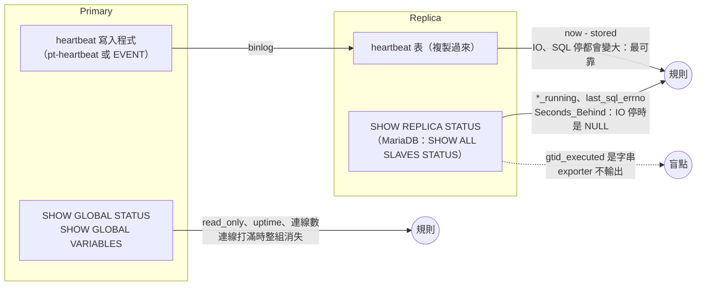
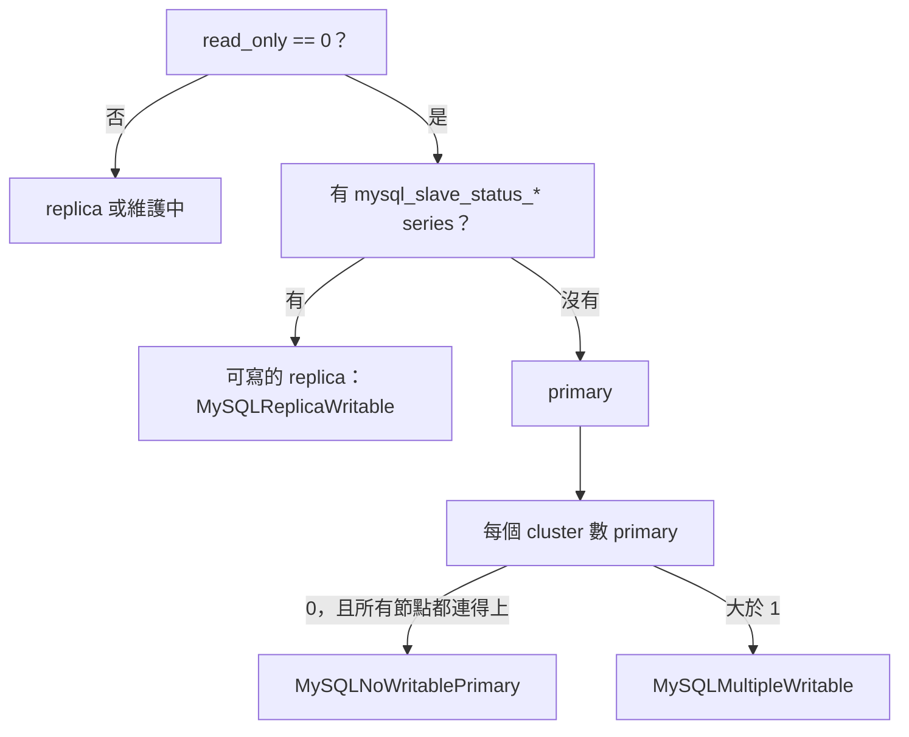

# MySQL／MariaDB 本體怎麼監控

[元件卡](../components/mysqld_exporter.md)回答「exporter 真的有在量嗎」。這頁回答另一個問題：**MySQL 與 MariaDB 本身該看哪些訊號**，每個訊號從資料庫的哪裡來、mysqld_exporter v0.21.0 有沒有輸出、預設有沒有開、要什麼權限。

依據是 mysqld_exporter、MySQL 8.4.7、MariaDB 11.4.13 的原始碼與官方手冊，加上一組小實驗：兩種資料庫各一組 primary + async replica（GTID），開長交易、做 deadlock、讓 replica 延遲三種方式、讓 replication 因衝突停下、讓 semi-sync 退回 async、打滿連線、kill -9 primary、做一次 failover 並讓舊 primary 回來。<span class="at-chip at-ev-tested">實測</span>[^exp-mysql-ha]

## 先講結論

1. **連線打滿時，連線數規則會消失。**max_connections 用完時 exporter 的一般帳號也收到 Error 1040，`mysql_up` 變 0，`threads_connected` 消失，「連線數 / max_connections > 0.8」回傳空。看得到的只有 `mysql_up` 規則，以及連線降下來之後 `connection_errors_total{error="max_connections"}` 的增加量。<span class="at-chip at-ev-tested">實測</span>[^exp-mysql-ha][^mysql-conn-reserved]
2. **Seconds_Behind 在 replica 斷線時是 NULL。**IO thread 停了、SQL thread 已追完，`Seconds_Behind_Source` 就是 NULL，exporter 不輸出；heartbeat 延遲同時已經 27–29 秒。延遲要用 heartbeat 表，Seconds_Behind 只當輔助。<span class="at-chip at-ev-tested">實測</span>[^exp-mysql-ha][^mysql-sbs-null]
3. **failover 會讓三種東西失效。**升級的 replica 做了 `RESET REPLICA ALL`，所有 `mysql_slave_status_*` 消失；靜態的 `role="primary"` label 指向舊節點；heartbeat 寫入程式若是 primary 上的 EVENT，在新 primary 上是停用的，heartbeat 從此停住。舊 primary 回來時兩台都可寫，只有「從 metric 推角色、按 cluster 計數」的規則看得到。<span class="at-chip at-ev-tested">實測</span>[^exp-mysql-ha]
4. **errant GTID 完全看不到。**在 replica 上誤寫一筆後，MySQL 的 `GTID_SUBSET(replica, primary)` 變 0，MariaDB 的 `gtid_binlog_pos` 出現 replica 自己的 server_id，但 exporter 只輸出 `gtid_mode` 這類開關，`gtid_executed` 是字串、直接被跳過。<span class="at-chip at-ev-tested">實測</span>[^exp-mysql-ha][^my-global-variables-parse]
5. **Semi-sync 退回 async 時 commit 照常成功。**唯一的變化是 `rpl_semi_sync_*_status` 從 1 變 0。MariaDB 內建 semi-sync，沒開時 status 也是 0，所以要和 `enabled == 1` 一起看。<span class="at-chip at-ev-tested">實測</span>[^exp-mysql-ha]
6. **MySQL 與 MariaDB 的同一個訊號名稱不同。**Undo history、deadlock 在 MariaDB 是預設就有的 global status；MySQL 沒有這兩個 status，只能開 `info_schema.innodb_metrics`，而且 deadlock 的 metric 在 MySQL 有 `_total`、在 MariaDB 沒有。規則要用 `or` 把兩種名稱接起來。<span class="at-chip at-ev-tested">實測</span>[^exp-mysql-ha][^my-innodb-metrics-name][^mariadb-innodb-deadlocks]
7. **很多關鍵訊號預設沒開。**長交易（`info_schema.innodb_trx`）、MySQL 的 undo history 與 deadlock（`info_schema.innodb_metrics`）、metadata lock 等待（`info_schema.processlist`）、heartbeat、每帳號連線數（`sys.user_summary`、`mysql.user`）都預設關。預設只開 6 個 collector。[^my-default-collectors]

## 誰看得到什麼



## 穩定 {#stability}

| 要看什麼 | 資料庫的來源 | exporter metric（collector） | 預設 | 權限 | 證據 |
|---|---|---|---|---|---|
| 服務在不在 | 連線 + ping | `mysql_up`（exporter 本體） | 開 | 能登入即可 | 實測[^exp-mysql] |
| 重啟、crash、OOM kill | `Uptime` | `mysql_global_status_uptime`（global_status） | 開 | — | 實測：kill -9 後 uptime 歸零[^exp-mysql-ha] |
| 救援模式 | `innodb_force_recovery` | `mysql_global_variables_innodb_force_recovery`（global_variables） | 開 | — | 手冊 |
| 磁碟滿 | 不在資料庫裡 | 沒有；用 node_exporter。binlog 用量：`mysql_binlog_size_bytes`（binlog_size） | 關 | REPLICATION CLIENT | 手冊 |
| 長交易 | `information_schema.INNODB_TRX` | `mysql_info_schema_innodb_trx_oldest_transaction_age_seconds{state}`（info_schema.innodb_trx） | 關 | PROCESS | 實測[^exp-mysql-ha][^my-innodb-trx-query] |
| Undo history | MariaDB：`Innodb_history_list_length`；MySQL：`INNODB_METRICS.trx_rseg_history_len` | MariaDB：`mysql_global_status_innodb_history_list_length`；MySQL：`mysql_info_schema_innodb_metrics_transaction_trx_rseg_history_len` | MariaDB 開；MySQL 關 | MySQL 要 PROCESS | 實測[^exp-mysql-ha] |
| Deadlock | MariaDB：`Innodb_deadlocks`；兩者：`INNODB_METRICS.lock_deadlocks` | `mysql_global_status_innodb_deadlocks`；`..._lock_lock_deadlocks_total`（MySQL）／`..._lock_lock_deadlocks`（MariaDB） | MariaDB 開；MySQL 關 | PROCESS | 實測[^exp-mysql-ha][^mariadb-innodb-deadlocks] |
| Replication 因錯誤停下 | `Last_SQL_Errno` | `mysql_slave_status_last_sql_errno`（slave_status） | 開 | 見 [HA](#ha) | 實測[^exp-mysql-ha] |

- **磁碟滿時資料庫不會停，也不報錯。**MySQL 會卡在寫入、每分鐘檢查一次空間並寫 error log，所以 `mysql_up` 仍是 1，症狀是 `threads_running` 慢慢升高。mysqld_exporter 沒有磁碟用量的 metric，要用 node_exporter 看資料目錄與 binlog 目錄的掛載點。<span class="at-chip at-ev-upstream">上游</span>（[MySQL 手冊：磁碟滿](https://dev.mysql.com/doc/refman/8.4/en/full-disk.html)）
- **OOM kill 在 metric 上只是一次重啟。**`uptime` 歸零、`mysql_up` 短暫變 0；原因要看 kernel log 或容器事件。停機短於 `MySQLNotReachable` 的 `for` 時，只有 `MySQLRestarted` 會響。<span class="at-chip at-ev-tested">實測</span>[^exp-mysql-ha]
- **`innodb_force_recovery` ≥ 4 時 InnoDB 是唯讀**，但 `read_only` 仍可能是 0；看 `innodb_force_recovery` 本身。（[MySQL 手冊](https://dev.mysql.com/doc/refman/8.4/en/forcing-innodb-recovery.html)）
- **長交易在沒開 collector 時沒有任何訊號。**`innodb_trx` 在沒有交易時也不輸出 series（不是 0），所以「沒開」和「沒有長交易」看起來一樣，要靠 `collector_success` 確認。實驗中 11–16 秒的交易與等鎖的交易分成 `state="RUNNING"`、`state="LOCK WAIT"` 兩條。<span class="at-chip at-ev-tested">實測</span>[^exp-mysql-ha]
- **Undo history 的下降速度兩邊不同。**consistent snapshot 擋住 purge 時兩邊都到四百多；交易結束後 MariaDB 降到 1，MySQL 一段時間內仍是 500。門檻要抓得比日常高很多。<span class="at-chip at-ev-tested">實測</span>[^exp-mysql-ha]

## 使用 {#usage}

| 要看什麼 | 資料庫的來源 | exporter metric（collector） | 預設 | 權限 | 證據 |
|---|---|---|---|---|---|
| 連線數 | `Threads_connected`、`max_connections` | `mysql_global_status_threads_connected`、`mysql_global_variables_max_connections` | 開 | — | 實測[^exp-mysql-ha] |
| 被拒的連線 | `Connection_errors_max_connections` | `mysql_global_status_connection_errors_total{error="max_connections"}` | 開 | — | 實測[^exp-mysql-ha][^mariadb-conn-errors] |
| 曾經到過的最高連線數 | `Max_used_connections` | `mysql_global_status_max_used_connections` | 開 | — | 實測：打滿後是 31（max_connections + 1） |
| 每帳號連線數 | `sys.x$user_summary.current_connections`；上限在 `mysql.user.max_user_connections` | `mysql_sys_current_connections{user}`（sys.user_summary）、`mysql_mysql_max_user_connections{mysql_user}`（mysql.user） | 關 | SELECT on sys、mysql.user；MariaDB 要開 performance_schema | 實測[^exp-mysql-ha][^my-sys-user-summary][^my-mysql-user-maxconn] |
| 執行中的 thread | `Threads_running` | `mysql_global_status_threads_running` | 開 | — | 讀碼[^my-global-status-re] |
| 慢查詢 | `Slow_queries` | `mysql_global_status_slow_queries` | 開 | — | 手冊；實測：`SLEEP(30)` 也算 |
| Row lock 等待 | `Innodb_row_lock_current_waits`、`Innodb_row_lock_time` | `mysql_global_status_innodb_row_lock_current_waits` 等 | 開 | — | 實測[^exp-mysql-ha] |
| Metadata lock 等待 | `information_schema.PROCESSLIST.state` | `mysql_info_schema_processlist_threads{state="waiting_for_table_metadata_lock"}`（info_schema.processlist） | 關 | PROCESS | 實測[^exp-mysql-ha][^my-processlist-query] |
| Table open cache | `Table_open_cache_overflows`、`_misses`、`Opened_tables` | `mysql_global_status_table_open_cache_overflows` 等 | 開 | — | 讀碼 |
| Buffer pool 與 redo | `Innodb_buffer_pool_wait_free`、`Innodb_log_waits`、`Innodb_buffer_pool_pages_*` | `mysql_global_status_innodb_buffer_pool_wait_free`、`..._innodb_log_waits`、`mysql_global_status_buffer_pool_pages{state}` | 開 | — | 讀碼[^my-global-status-re] |
| 暫存表落到磁碟 | `Created_tmp_disk_tables`、`Created_tmp_tables` | `mysql_global_status_created_tmp_disk_tables` 等 | 開 | — | 讀碼 |
| 連線建立失敗 | `Aborted_connects` | `mysql_global_status_aborted_connects` | 開 | — | 實測[^exp-mysql-ha] |

- **max_connections 有一條保留給管理帳號的連線。**MySQL 允許 max_connections + 1 條，最後一條只給有 CONNECTION_ADMIN（或 SUPER）的帳號。[^mysql-conn-reserved]實驗中把 CONNECTION_ADMIN 給 exporter 後 `mysql_up` 回到 1，但 exporter 預設開 2 條連線，第二條仍被拒，MySQL 上 global_variables 等 7 個 collector 失敗，`max_connections` 跟著消失，比例規則還是空。<span class="at-chip at-ev-tested">實測</span>[^exp-mysql-ha]要讓 exporter 在打滿時仍看得到，可以考慮 MySQL 8.4 的獨立管理埠（`admin_address`）或 MariaDB 的 `extra_port`／`extra_max_connections`，未實測。
- **被拒的計數要事後才看得到。**打滿當下 exporter 自己也進不來；連線降下後 `connection_errors_total{error="max_connections"}` 才更新，用 `increase(...[10m]) > 0` 寫規則。MariaDB 被拒時同時加 `Aborted_connects`。[^mariadb-conn-errors]
- **超過 MAX_USER_CONNECTIONS 不算 Connection_errors。**實驗中第三條連線回 ERROR 1226，只有 `Aborted_connects` +1。要預警得用 sys.user_summary 的目前連線數除以 mysql.user 的上限；兩個 collector 的帳號 label 一個叫 `user`、一個叫 `mysql_user`，要 `label_replace`。exporter 自己用掉 3 條上限中的 2 條（0.67）。<span class="at-chip at-ev-tested">實測</span>[^exp-mysql-ha]
- **Slow_queries 不管 slow log 有沒有開都會計數**，門檻是 `long_query_time`（預設 10 秒）。要知道是哪個查詢，開 `perf_schema.eventsstatements` 或讀 slow log。（[MySQL 手冊](https://dev.mysql.com/doc/refman/8.4/en/server-status-variables.html)）

## HA {#ha}

| 要看什麼 | 資料庫的來源 | exporter metric（collector） | 預設 | 權限 | 證據 |
|---|---|---|---|---|---|
| IO／SQL thread | `SHOW REPLICA STATUS`（MariaDB 先試 `SHOW ALL SLAVES STATUS`） | `mysql_slave_status_slave_*_running`（MariaDB）、`..._replica_*_running`（MySQL 8.4） | 開 | MySQL：REPLICATION CLIENT；MariaDB ≥ 10.5.9：SLAVE MONITOR | 實測[^exp-mysql-ha][^my-slave-queries] |
| 停下的原因 | `Last_SQL_Errno`、`Last_IO_Errno` | `mysql_slave_status_last_sql_errno`、`..._last_io_errno` | 開 | 同上 | 實測 |
| 延遲（伺服器算的） | `Seconds_Behind_Master`／`_Source` | `mysql_slave_status_seconds_behind_master`／`_source` | 開 | 同上 | 實測、讀碼[^mysql-sbs-compute] |
| 延遲（heartbeat） | heartbeat 表（pt-heartbeat 格式） | `mysql_heartbeat_now_timestamp_seconds`、`mysql_heartbeat_stored_timestamp_seconds` | 關 | SELECT on heartbeat 表；另外要有寫入程式 | 實測[^my-heartbeat-query] |
| 每個 applier worker 的時間戳 | `performance_schema.replication_applier_status_by_worker` | `mysql_perf_schema_*`（perf_schema.replication_applier_status_by_worker） | 關 | SELECT on performance_schema；**MariaDB 沒有這張表，collector 失敗** | 實測[^my-applier-worker] |
| 能不能寫 | `read_only`、`super_read_only`（MySQL） | `mysql_global_variables_read_only`、`..._super_read_only` | 開 | — | 實測 |
| GTID 開關 | `gtid_mode`、`enforce_gtid_consistency`、`gtid_strict_mode`（MariaDB） | `mysql_global_variables_gtid_mode` 等；只有 ON／OFF 會輸出 | 開 | — | 實測[^my-parse-status] |
| GTID 內容 | `gtid_executed`（MySQL）、`gtid_binlog_pos`／`gtid_slave_pos`（MariaDB） | **沒有**（字串被跳過） | — | — | 實測[^my-global-variables-parse] |
| Semi-sync | `Rpl_semi_sync_master_status`（MariaDB 內建）、`Rpl_semi_sync_source_status`（MySQL plugin） | `mysql_global_status_rpl_semi_sync_*_status`、`..._no_tx`、`..._clients` | 開（plugin 載入後才有） | — | 實測 |
| Galera | `wsrep_*` | `mysql_global_status_wsrep_*`、`mysql_global_variables_wsrep_on` | 開 | — | 實測[^exp-mysql] |
| Group Replication | `performance_schema.replication_group_members` | perf_schema.replication_group_members | 關 | SELECT on performance_schema | 未實測 |

### 延遲：heartbeat 與 Seconds_Behind

`Seconds_Behind_Source` 是「現在時間減去 SQL thread 正在套用的事件在 primary 上的時間戳」。[^mysql-sbs-compute]它只在 SQL thread 在跑時有值；SQL thread 追完 relay log 時，IO thread 在跑就是 0、不在跑就是 NULL。[^mysql-sbs-null]

| 情境 | Seconds_Behind | heartbeat 延遲 | 結果 |
|---|---|---|---|
| SQL thread 等 metadata lock（primary 做 ALTER，replica 有開著的交易） | 21／28 秒 | 21／28 秒 | 一致 |
| IO thread 停 25 秒 | **消失（NULL）** | 27–29 秒 | 只有 heartbeat 看得到 |
| SQL thread 停 20 秒 | **消失（NULL）** | 21–23 秒 | 只有 heartbeat 看得到 |
| 衝突寫入，SQL thread 因 1062 停下 | **消失** | 持續變大 | `last_sql_errno=1062` 帶出原因 |
| primary 的 heartbeat 寫入程式停 25 秒 | 0 | **每台**都 25–28 秒 | heartbeat 誤報，但「每台一起變大」本身就是訊號 |

數字是 MariaDB／MySQL。<span class="at-chip at-ev-tested">實測</span>[^exp-mysql-ha]

heartbeat 的前提是寫入程式活著，而且跟著 primary 走。實驗用 primary 上的 EVENT 寫 heartbeat；EVENT 複製到 replica 時是 SLAVESIDE_DISABLED，failover 後新 primary 不會寫，heartbeat 從此停住。正式環境用 pt-heartbeat 之類的外部程式，由 HA 工具在升級時啟動。

### 角色與 failover



- **不要用靜態的 role label 判斷角色。**failover 後 `role="primary"` 指向已停的舊節點，`MySQLPrimaryReadOnly` 查不到任何東西。從 metric 推：可寫、而且沒有 replica 狀態的就是 primary。cluster 要自己用 relabel 加。<span class="at-chip at-ev-tested">實測</span>[^exp-mysql-ha]
- **舊 primary 回來時兩邊都能寫。**實驗中舊 primary 重啟後 `read_only=0`，兩個 cluster 各有 2 台可寫、不在複製的節點，`MySQLMultipleWritable` firing。<span class="at-chip at-ev-tested">實測</span>[^exp-mysql-ha]
- **連線打滿時 `read_only` 也會消失。**一開始的 `MySQLNoWritablePrimary` 在 primary 被打滿時誤報（read_only 不見了，看起來像沒有 primary），規則改成「有節點連不上時不判斷」，交給 `MySQLNotReachable`。<span class="at-chip at-ev-tested">實測</span>[^exp-mysql-ha]
- **Replica 要擋得住寫入。**MySQL 用 `super_read_only=ON`（root 也擋）；MariaDB 沒有 super_read_only，有 READ ONLY ADMIN 權限的帳號可以繞過 `read_only`。在 replica 上寫入時 replication 照常，要等 primary 寫到同一筆才停下。
- **primary 被 kill 時**，replica 的 `io_running=0`、`last_io_errno=2003`；primary 回來後 30 秒內自動重連，errno 歸 0。所以 `last_io_errno` 不適合單獨當告警，規則只用 `last_sql_errno`。<span class="at-chip at-ev-tested">實測</span>[^exp-mysql-ha]

### GTID 一致性

errant transaction（replica 有、primary 沒有的交易）會讓下一次 failover 出錯，exporter 卻看不到。要另外跑查詢（cron、HA 工具或 blackbox 的自訂 script）：

- MySQL：在 primary 上 `SELECT GTID_SUBSET('<replica 的 gtid_executed>', @@gtid_executed)`，0 代表有 errant。（[MySQL 手冊](https://dev.mysql.com/doc/refman/8.4/en/gtid-functions.html)）
- MariaDB：看 replica 的 `gtid_binlog_pos` 有沒有出現 replica 自己的 server_id（實驗中變成 `0-2-645`）；`gtid_strict_mode=ON` 可以在源頭擋掉一部分。（[MariaDB GTID](https://mariadb.com/kb/en/gtid/)）

### Semi-sync

實驗中 primary 開 semi-sync、replica 沒開：MySQL 開啟當下 status=1，第一筆寫入等 ACK 逾時（3 秒）後變 0；之後寫入正常、不報錯，`no_tx` 一直增加。MariaDB replica 開 semi-sync 後 status 回到 1、`clients=1`。MySQL replica 開著 `super_read_only` 時 `INSTALL PLUGIN` 會失敗（ERROR 1290），要先關掉再裝。<span class="at-chip at-ev-tested">實測</span>[^exp-mysql-ha]

### Galera（只有 MariaDB）

沒開 Galera 的 MariaDB 也輸出 `wsrep_ready=0`，上游規則 `wsrep_ready != 1` 對每台普通 MariaDB 誤報。要加上 `wsrep_on == 1`。<span class="at-chip at-ev-tested">實測</span>[^exp-mysql]

### MySQL 8.4 的改名

MySQL 8.4 移除 `SHOW SLAVE STATUS`，exporter 改用 `SHOW REPLICA STATUS`，metric 名稱跟著欄位名變成 `mysql_slave_status_replica_io_running`、`..._seconds_behind_source`。MariaDB 11.4 仍是 `slave_*`、`seconds_behind_master`。規則要兩種名稱一起比對。[^my-slave-queries]

## Exporter 覆蓋矩陣 {#coverage}

預設開的 collector：global_status、global_variables、slave_status、info_schema.innodb_cmp、info_schema.innodb_cmpmem、info_schema.query_response_time。[^my-default-collectors]

| 資料庫來源 | Collector | 代表 metric | 預設 | 權限 | MySQL 8.4 | MariaDB 11.4 |
|---|---|---|---|---|---|---|
| `SHOW GLOBAL STATUS` | global_status | `mysql_global_status_*` | 開 | — | ✓ | ✓（多了 history_list_length、deadlocks） |
| `SHOW GLOBAL VARIABLES` | global_variables | `mysql_global_variables_*`（字串值跳過） | 開 | — | ✓ | ✓（沒有 super_read_only） |
| `SHOW REPLICA STATUS` | slave_status | `mysql_slave_status_*` | 開 | REPLICATION CLIENT；MariaDB 加 SLAVE MONITOR | `replica_*` | `slave_*` |
| heartbeat 表 | heartbeat | `mysql_heartbeat_*` | 關 | SELECT | ✓ | ✓ |
| `INNODB_TRX` | info_schema.innodb_trx | `mysql_info_schema_innodb_trx_*` | 關 | PROCESS | ✓ | ✓ |
| `INNODB_METRICS`（只取 enabled 的計數器） | info_schema.innodb_metrics | `mysql_info_schema_innodb_metrics_*` | 關 | PROCESS | ✓（計數器有 `_total`） | ✓（部分沒有 `_total`） |
| `PROCESSLIST` | info_schema.processlist | `mysql_info_schema_processlist_threads{state}` | 關 | PROCESS（沒有時只看到自己） | ✓ | ✓ |
| `sys.x$user_summary` | sys.user_summary | `mysql_sys_current_connections{user}` 等 | 關 | SELECT on sys | ✓ | 回報成功但沒有資料（performance_schema 預設關） |
| `mysql.user` | mysql.user | `mysql_mysql_max_user_connections{mysql_user}` | 關 | SELECT on mysql.user | ✓ | ✓ |
| `SHOW BINARY LOGS` | binlog_size | `mysql_binlog_size_bytes`、`mysql_binlog_files` | 關 | REPLICATION CLIENT | ✓ | ✓ |
| `replication_applier_status_by_worker` | perf_schema.replication_applier_status_by_worker | `mysql_perf_schema_*` | 關 | SELECT | ✓ | **collector 失敗** |
| `events_statements_summary_by_digest` | perf_schema.eventsstatements | `mysql_perf_schema_events_statements_*` | 關 | SELECT | 未實測 | 要開 performance_schema |
| `gtid_executed`、`gtid_binlog_pos` | — | 沒有 | — | — | 盲點 | 盲點 |
| 磁碟、記憶體、OOM | — | 沒有 | — | — | node_exporter | node_exporter |

權限的影響（收回 PROCESS、SLAVE MONITOR 時哪些 collector 失敗）見[元件卡](../components/mysqld_exporter.md#exporter-grants)與前一輪實驗。[^exp-mysql]

## 盲點與補法 {#blind-spots}

| 盲點 | 為什麼 | 補法 |
|---|---|---|
| 連線打滿時的連線數 | exporter 也被擋，整組 metric 消失 | 告警靠 `mysql_up` 與事後的 `connection_errors_total`；或讓 exporter 走管理埠 |
| errant GTID | `gtid_executed` 是字串 | 外部 script 跑 `GTID_SUBSET`，結果用 textfile 或 pushgateway 送進來 |
| 磁碟用量 | 不在資料庫裡 | node_exporter，規則要知道資料目錄的掛載點 |
| OOM 原因 | 只看得到 uptime 歸零 | kernel log、cAdvisor 的 OOM 事件 |
| 真正的寫入 | `mysql_up` 只做 ping | heartbeat 寫入程式自己回報成功時間，或應用層探測 |
| Replica 錯誤訊息 | `Last_SQL_Error` 是字串 | 規則帶 errno，細節看 `SHOW REPLICA STATUS` |
| MariaDB 的每帳號、每查詢統計 | performance_schema 預設關 | 開 `performance_schema=ON`（要重啟，佔記憶體） |
| Metadata lock 細節 | 沒有 collector 讀 `performance_schema.metadata_locks` | processlist 的 state 只能看到「有人在等」 |

## 建議的 exporter 設定 {#recommended}

```text
--collect.info_schema.innodb_trx          # 長交易
--collect.info_schema.innodb_metrics      # MySQL 的 undo history、deadlock
--collect.info_schema.processlist         # metadata lock 等待（--collect.info_schema.processlist.min_time 預設 0）
--collect.heartbeat                       # 搭配 pt-heartbeat；--collect.heartbeat.database/table
--collect.binlog_size                     # binlog 用量
--collect.sys.user_summary                # 每帳號連線數（MySQL；MariaDB 要先開 performance_schema）
--collect.mysql.user                      # 每帳號的 MAX_USER_CONNECTIONS
```

帳號：

```sql
-- MySQL 8.4
CREATE USER 'exporter'@'%' IDENTIFIED BY '...' WITH MAX_USER_CONNECTIONS 3;
GRANT PROCESS, REPLICATION CLIENT, SELECT ON *.* TO 'exporter'@'%';
-- MariaDB 10.5.9 起另外要
GRANT SLAVE MONITOR ON *.* TO 'exporter'@'%';
```

- `SELECT ON *.*` 可以縮成 heartbeat 表、`sys`、`mysql.user`、`performance_schema` 幾個 schema。
- MAX_USER_CONNECTIONS 3 時 exporter 一次 scrape 用掉 2 條；兩台 Prometheus 同時抓就會超過，見[元件卡](../components/mysqld_exporter.md#db-up-flapping)。
- 是否給 CONNECTION_ADMIN 要取捨：它讓 exporter 在打滿時還有一條連線，但只有一條，而且和 DBA 搶同一個保留位子。

## 規則 {#rules}

規則在 [`rules/targets/mysql.yml`](https://github.com/HahaSula/alert-trust/blob/main/rules/targets/mysql.yml)，分成 replication、ha、stability、usage 幾組；每條規則的 `runbook_url` 指回[元件卡](../components/mysqld_exporter.md)上對應的訊號。佔位符：`job="mysql"`、`cluster`、`role`、node_exporter 的 `job="node"` 與 `mountpoint`。

## 實驗 {#lab}

[`lab/targets/mysql/ha/`](https://github.com/HahaSula/alert-trust/tree/main/lab/targets/mysql/ha)：`./run.sh` 起 4 台資料庫、4 台 exporter、1 台 Prometheus（只開 127.0.0.1:22090），跑完 9 個情境後 `docker compose down -v`，約 13 分鐘。原始結果與摘要在 `results/run-20261108.md`，各節點的 metric 名稱清單在 `results/names-*.txt`。[^exp-mysql-ha]
