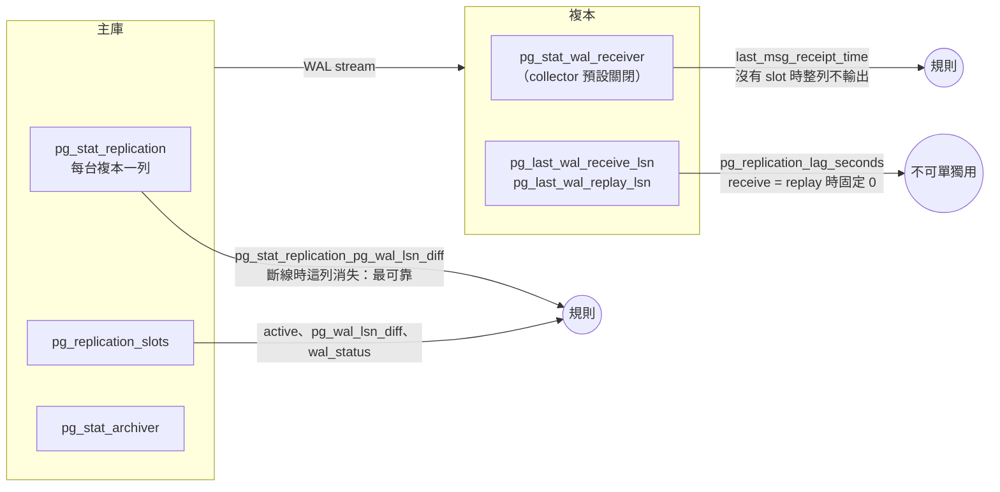

# PostgreSQL 本體怎麼監控

[元件卡](../components/postgres_exporter.md)回答「exporter 真的有在量嗎」。這頁回答另一個問題：**PostgreSQL 本身該看哪些訊號**，每個訊號從 PostgreSQL 的哪裡來、postgres_exporter v0.20.1 有沒有輸出、要什麼權限、在哪個版本會變。

依據是 PostgreSQL 與 exporter 的原始碼，加上一組小實驗：PostgreSQL 16.15 與 17.11 各一組主從，切斷複寫、停複本、讓 archive 失敗、用完連線、kill 一個 backend、提升複本、把 pg_wal 寫滿。實測[^pg-exp-target]

## 先講結論

1. **時間延遲不能單獨用。**`pg_replication_lag_seconds` 在複本收到的 WAL 都已套用時固定是 0：主庫沒寫入時是 0，複本斷線 40 秒、主庫持續寫入時也是 0。延遲要看主庫端的位元組 `pg_stat_replication_pg_wal_lsn_diff`，「有沒有在收」要看主庫上那一列還在不在。實測[^pg-exp-target][^pg-c-replication-lag]
2. **一個表鎖就能讓監控整個消失。**`stat_user_tables` 對每張表呼叫 `pg_table_size()`，要拿 AccessShareLock。有人持有 ACCESS EXCLUSIVE（ALTER TABLE、VACUUM FULL）時 exporter 卡住、`up` 變 0，而且每次 scrape 都多一條等鎖的連線：5 秒 scrape 時一個 exporter 25 秒內累積 5 條（兩個 exporter 共 11 條）。實測[^pg-exp-target-raw][^pg-c-user-tables-size]
3. **crash recovery 不會改變 postmaster 啟動時間。**kill -9 一個 backend，PostgreSQL 0.3 秒內重新初始化，`pg_up` 一直是 1，`pg_postmaster_start_time_seconds` 不變；看得出來的只有 `pg_stat_database_*` counter 被歸零（crash recovery 會丟棄累積統計）。實測[^pg-exp-target][^pg-src-starttime][^pg-src-crash-stats]
4. **沒有 pg_monitor 的帳號看到的是 NULL，不是錯誤。**`pg_stat_replication` 只剩 pid、`pg_stat_wal_receiver` 整列是 NULL、`pg_stat_activity` 看不到別人的 state。對應的 collector 都回報成功，只是沒有資料或數字是 0。實測[^pg-exp-target][^pg-src-walsnd-privs][^pg-src-walrcv-privs]
5. **連線額滿時 exporter 要有保留位子。**沒有保留位子的 exporter：`pg_up` 仍是 1（舊連線還在），collector 結果整組消失。授予 `pg_use_reserved_connections`（16 起）的 exporter 照常看到 15 條連線。實測[^pg-exp-target][^pg-src-reserved]
6. **split brain 只有跨 instance 才看得出來。**提升複本後舊主庫仍在跑，兩台的 `pg_replication_is_replica` 都是 0，各自的規則都正常。要在 target 上加 cluster label，計算每個 cluster 有幾台不在 recovery。實測[^pg-exp-target]
7. **很多關鍵欄位 exporter 根本不輸出**：`sync_state`、`write_lag`／`flush_lag`／`replay_lag`、`synchronous_standby_names`、`backend_xid` 的 age、`last_failed_wal`、索引是否有效、timeline、磁碟剩餘空間。見[盲點](#blind-spots)。

## 誰看得到什麼

## 穩定 {#stability}

| 要看什麼 | PostgreSQL 的來源 | exporter metric（collector） | 預設 | 權限／版本 | 證據 |
|---|---|---|---|---|---|
| 重啟 | `pg_postmaster_start_time()` | `pg_postmaster_start_time_seconds`（postmaster） | 關 | — | 實測 |
| crash recovery | log：`all server processes terminated; reinitializing`；crash recovery 丟棄累積統計[^pg-src-crash-reinit][^pg-src-crash-stats] | `resets(pg_stat_database_xact_commit)`（stat_database） | 開 | 13～17 都會歸零（14 以前在 StartupXLOG 呼叫 pgstat_reset_all） | 實測 |
| pg_wal 大小 | `pg_ls_waldir()` | `pg_wal_size_bytes`、`pg_wal_segments`（wal）[^pg-c-wal-query] | 開 | 需要 pg_monitor | 實測 |
| 磁碟剩餘空間 | 作業系統 | 無 | — | 用 node_exporter | — |
| XID／multixact age | `age(datfrozenxid)`、`mxid_age(datminmxid)` | `pg_database_wraparound_age_datfrozenxid_seconds`、`..._datminmxid_seconds`（database_wraparound）[^pg-c-wraparound-query] | 關 | 名稱是 seconds，實際是交易數 | 讀碼 |
| 長交易、idle in transaction | `pg_stat_activity.xact_start`、`state` | `pg_stat_activity_max_tx_duration{state}`（stat_activity）[^pg-c-activity-query]；`pg_long_running_transactions*`（long_running_transactions）[^pg-c-longtx-query] | 開／關 | 看別人的 session 需要 pg_read_all_stats[^pg-src-activity-privs] | 實測 |
| 擋住 vacuum 的 XID | `pg_stat_activity.backend_xid`／`backend_xmin`、`pg_replication_slots.xmin`、`pg_prepared_xacts` | 無 | — | — | 實測 |
| deadlock | `pg_stat_database.deadlocks` | `pg_stat_database_deadlocks`（stat_database）[^pg-c-database-columns] | 開 | — | 實測 |
| checkpoint 壓力 | ≤16 `pg_stat_bgwriter`；17 `pg_stat_checkpointer`[^pg-src-bgwriter16][^pg-src-checkpointer-view] | ≤16 `pg_stat_bgwriter_checkpoints_*`（stat_bgwriter）；17 `pg_stat_checkpointer_num_*`（stat_checkpointer）[^pg-c-bgwriter-17][^pg-c-checkpointer-17] | 開／**關** | 17 起換 collector | 實測 |
| autovacuum、dead tuple | `pg_stat_user_tables` | `pg_stat_user_tables_n_dead_tup`、`last_autovacuum`（stat_user_tables） | 開 | 只有 DSN 那一個資料庫 | 實測 |
| bloat | 需要 pgstattuple 或估算查詢 | 無 | — | — | — |
| 失效索引、checksum 失敗 | `pg_index.indisvalid`、`pg_stat_database.checksum_failures`、amcheck | 無 | — | — | 讀碼 |

重點：

- **idle in transaction 擋住 vacuum。**實驗中一個 session 開了交易拿到 XID 後閒置，之後燒掉 3000 個 XID、更新整張表再 VACUUM：VACUUM 回報「10000 are dead but not yet removable，removable cutoff 是 3003 XIDs old」。exporter 這時能看到的是 `max_tx_duration{state="idle in transaction"}=36s` 與 `n_dead_tup=10001`，看不到「卡住幾個 XID」。實測[^pg-exp-target-raw]
- **`database_wraparound` 量的不是卡住的交易。**它是 `datfrozenxid` 的 age，代表 vacuum 凍結到哪裡；卡住的交易會讓它長期無法下降，但短期看不出來。PostgreSQL 在 2^31 − 4000 萬時開始警告、− 300 萬時拒絕新的 XID（16 與 17 相同）。讀碼[^pg-src-xid-warn][^pg-src-xid-stop]
- **WAL 寫滿時 PostgreSQL 直接停機。**pg_wal 放在 160MB tmpfs、用 slot 擋住回收：寫 WAL 的 backend PANIC，postmaster 重新初始化，recovery 寫不進 WAL 又 FATAL，最後 `database system is shut down`，容器退出。exporter 看到的是 `pg_up=0`、所有 collector 消失；之前的 `pg_wal_size_bytes` 是唯一的預警。實測[^pg-exp-target-raw]
- **checkpoint 規則要接兩個名字。**同一個 `CHECKPOINT` 指令，16 讓 `pg_stat_bgwriter_checkpoints_req_total` 加 1，17 讓 `pg_stat_checkpointer_num_requested_total` 加 1；17 的複本另有 `restartpoints_*`。17 沒開 stat_checkpointer 時兩個名字都不存在。實測[^pg-exp-target]

## 使用 {#usage}

| 要看什麼 | PostgreSQL 的來源 | exporter metric（collector） | 預設 | 權限／版本 | 證據 |
|---|---|---|---|---|---|
| 連線數 vs 上限 | `pg_stat_activity`、`max_connections`、`superuser_reserved_connections`、`reserved_connections` | `pg_stat_activity_count`、`pg_settings_*`（stat_activity、settings） | 開 | `reserved_connections` 16 起 | 實測 |
| active／idle／等鎖 | `pg_stat_activity.state`、`wait_event_type` | `pg_stat_activity_count{state, wait_event_type}`[^pg-c-activity-labels] | 開 | 需要 pg_read_all_stats | 實測 |
| 鎖 | `pg_locks` | `pg_locks_count{mode}`（locks）[^pg-c-locks-query] | 開 | 看不出誰擋誰 | 實測 |
| 查詢延遲 | `pg_stat_statements` | `pg_stat_statements_seconds_total`、`calls_total`（stat_statements）[^pg-c-statements-topn] | 關 | 每台都要 `shared_preload_libraries`；17 欄位改名[^pg-c-statements-pg17] | 實測 |
| cache hit | `pg_stat_database.blks_hit／blks_read` | `pg_stat_database_blks_*` | 開 | 只算 shared_buffers | 實測 |
| temp file | `pg_stat_database.temp_files／temp_bytes` | `pg_stat_database_temp_*` | 開 | — | 實測 |
| 複寫 slot 保留的 WAL | `pg_replication_slots` | `pg_replication_slots_pg_wal_lsn_diff`、`safe_wal_size_bytes`、`wal_status`（replication_slots）[^pg-c-slots-query] | 開 | `safe_wal_size`、`wal_status` 13 起 | 實測 |

重點：

- **連線上限要扣兩種保留。**一般使用者能用的是 `max_connections − superuser_reserved_connections − reserved_connections`。實驗中 20 − 3 − 2 = 15：app 用到第 15 條之後再連，得到「remaining connection slots are reserved for roles with privileges of the pg_use_reserved_connections role」。實測[^pg-exp-target]
- **`pg_stat_activity_count` 不等於連線數。**它排除 exporter 自己的連線，也排除 state 是 NULL 的 background process；和 `pg_stat_database_numbackends` 不會相等。
- **pg_stat_statements 只給前 N 名。**collector 先排除總耗時最低的 10%，再取前 100 名（可調），queryid 會隨排名進出，`rate()` 會斷斷續續。沒有 pg_read_all_stats 的帳號看到的 series 只有三分之一（27 vs 83），collector 仍回報成功。實測[^pg-exp-target][^pg-c-statements-topn]
- **cache hit 比例只適合畫圖。**OS page cache 命中在 PostgreSQL 眼中也是 read，比例偏低不一定是問題。

## HA {#ha}

| 要看什麼 | PostgreSQL 的來源 | exporter metric（collector） | 預設 | 權限／版本 | 證據 |
|---|---|---|---|---|---|
| 主庫看得到複本 | `pg_stat_replication` | `pg_stat_replication_pg_wal_lsn_diff{application_name, state, slot_name}`（stat_replication）[^pg-c-statrep-query] | 開 | 需要 pg_read_all_stats[^pg-src-walsnd-privs] | 實測 |
| 位元組延遲 | `pg_current_wal_lsn() − replay_lsn` | 同上（只有 replay，沒有 write／flush） | 開 | — | 實測 |
| 時間延遲 | `write_lag`、`flush_lag`、`replay_lag` | 無 | — | 閒置時 PostgreSQL 自己會清成 NULL[^pg-src-lag-clear] | 實測 |
| 複本端延遲 | `pg_last_xact_replay_timestamp()` | `pg_replication_lag_seconds`、`pg_replication_last_replay_seconds`（replication） | 開 | receive = replay 時 lag 固定 0 | 實測 |
| 複本在收 WAL | `pg_stat_wal_receiver` | `pg_stat_wal_receiver_*`（stat_wal_receiver）[^pg-c-walrecv-default] | 關 | 需要 pg_read_all_stats[^pg-src-walrcv-privs]；**沒有 slot 時不輸出**[^pg-c-walrecv-slotnull] | 實測 |
| 同步複寫 | `synchronous_standby_names`、`pg_stat_replication.sync_state` | 無（settings 只輸出 bool／integer／real）[^pg-c-settings-query] | — | — | 實測 |
| 角色 | `pg_is_in_recovery()` | `pg_replication_is_replica`（replication） | 開 | — | 實測 |
| timeline | `pg_control_checkpoint().timeline_id` | 無 | — | — | 實測 |
| inactive slot | `pg_replication_slots.active`、`wal_status` | `pg_replication_slots_active`、`pg_replication_slots_wal_status{wal_status}` | 開 | — | 實測 |
| archive | `pg_stat_archiver` | `pg_stat_archiver_failed_count`、`archived_count`、`last_archive_age`（stat_archiver）[^pg-c-archiver-query] | 開 | 沒有 `last_failed_wal` | 實測 |
| 複本查詢衝突 | `pg_stat_database_conflicts` | `pg_stat_database_conflicts_confl_*`（舊架構內建）[^pg-c-conflicts-legacy] | 開 | — | 讀碼 |

### 延遲：位元組與時間

實驗：PostgreSQL 16 主庫加兩台複本，scrape 5 秒。實測[^pg-exp-target]

| 情境 | 複本 `pg_replication_lag_seconds` | 複本 `pg_replication_last_replay_seconds` | 主庫 `pg_stat_replication_pg_wal_lsn_diff` | 主庫 `replay_lag`（直接查） |
|---|---|---|---|---|
| 閒置 60 秒 | 0 | 46–50 | 0 | NULL |
| 每秒一筆 commit | 0 | 0.01–0.7 | 0 | 0.001–0.002 秒 |
| 切斷 receiver 40 秒，主庫持續寫入 | **0** | 36–37 | **該列消失** | 該列消失 |

切斷期間在複本上直接查：`pg_last_wal_receive_lsn() = pg_last_wal_replay_lsn()` 是 true、`pg_stat_wal_receiver` 0 列、最後套用的交易是 39.9 秒前。主庫上 slot `standby_a` 變成 active=0、保留的 WAL 開始增加。

為什麼時間延遲會騙人：exporter 的公式是「receive_lsn 等於 replay_lsn 就回 0，否則 now() − 最後套用的交易時間」[^pg-c-replication-lag]。複本斷線後不再收到新 WAL，收到的都已套用，兩者相等，所以是 0。主庫沒寫入時同理。反過來，`pg_replication_last_replay_seconds` 在沒寫入時會一直變大，看起來像落後。PostgreSQL 自己的 `replay_lag` 在閒置時也會被清成 NULL[^pg-src-lag-clear]。真的要時間延遲，做法是在主庫每幾秒寫一筆 heartbeat，在複本上算 `now() − 最後一筆 heartbeat`。

### 提升與 split brain

在 PostgreSQL 17 上對複本執行 `pg_promote()`，舊主庫不動：實測[^pg-exp-target]

- 兩台的 `pg_replication_is_replica` 都是 0；`count by (cluster) (pg_replication_is_replica == 0)` 在 pg17 是 2、在 pg16 是 1。
- `changes(pg_replication_is_replica[2m])` 只有被提升的那台是 1，舊主庫是 0：只看角色變化的規則不知道舊主庫還在接受寫入。
- 舊主庫的 `pg_stat_replication` 那一列消失（複本離開了），新主庫的 `pg_stat_wal_receiver` 也消失；三個 instance 的 `pg_replication_lag_seconds` 都是 0。
- timeline 只能直接查：新主庫 `timeline_id=2`、舊主庫 1。exporter 沒有輸出 timeline。

規則寫法：`count by (cluster) (pg_replication_is_replica == 0) > 1`（split brain）與 `count by (cluster) (pg_replication_is_replica) unless count by (cluster) (pg_replication_is_replica == 0)`（沒有主庫）。前者要求每個 instance 只被一個 job 抓，否則同一台會被算兩次。

### Replication slot 與 archive

PostgreSQL 16 主庫，停掉用 slot `standby_a` 的複本，並建一個從未被使用的 slot `orphan`；設 `max_slot_wal_keep_size=64MB` 後產生約 120MB WAL 再 CHECKPOINT。實測[^pg-exp-target-raw]

| 時間點 | `pg_wal_lsn_diff` | `safe_wal_size_bytes` | `wal_status` |
|---|---|---|---|
| 沒設上限（`max_slot_wal_keep_size=-1`），保留 33MB → 100MB | 33MB → 100MB | **不存在** | reserved |
| 設 64MB，`standby_a` 保留 33MB | 33MB | 50MB | reserved |
| 設 64MB，`orphan` 保留 117MB | 117MB | −33MB | unreserved |
| CHECKPOINT 之後 | **兩個 slot 都消失** | **兩個 slot 都消失** | lost |

slot 一旦 lost，`restart_lsn` 變 NULL，保留量相關的 series 跟著消失，只看 `pg_wal_lsn_diff > X` 的規則在最嚴重的時候回傳空；要另外看 `wal_status{wal_status=~"unreserved|lost"}`。複本重新啟動後一直回報「requested WAL segment ... has already been removed」，但 `pg_up=1`、`is_replica=1`，主庫上沒有它那一列；這時它的 `pg_replication_lag_seconds` 是 103 秒（依文件，receiver 從未啟動時 `pg_last_wal_receive_lsn()` 是 NULL，比較結果不是 true，公式改走「now − 最後套用時間」），和上面「切斷 receiver」時的 0 不同，**同一個 metric 在兩種斷線下行為不一樣**。

archive：PostgreSQL 16，`archive_command` 換成一個會失敗的 script，產生 3 個 WAL 檔後等 75 秒。實測[^pg-exp-target-raw]

- `pg_stat_archiver_failed_count` 0 → 9，`increase(...[1m])` 約 3：archiver 每輪重試 3 次後休息約 60 秒。`archived_count` 停在 1，`last_archive_age` 一路變大。
- 直接查才看得到 `last_failed_wal=000000010000000000000002` 與 6 個 `.ready` 檔；exporter 不輸出這兩項。
- 修好之後 30 秒內 `archived_count` 仍沒有增加（archiver 還在休息），規則的 `for` 不要短於 1–2 分鐘。
- `last_archive_age` 不能單獨當 alert：沒有寫入、也沒設 `archive_timeout` 時，它本來就會一直變大。規則寫成「failed 有增加且 archived 沒增加」。

## Exporter 覆蓋矩陣 {#coverage}

postgres_exporter v0.20.1。「預設」指沒有加 `--collector.<name>` 或 `--no-collector.<name>` 時的狀態。

| PostgreSQL 來源 | collector | 主要 metric | 預設 | 權限 | 版本差異 |
|---|---|---|---|---|---|
| `pg_stat_activity` | stat_activity | `pg_stat_activity_count`、`max_tx_duration` | 開 | pg_read_all_stats，否則別人的 session 沒有 state | — |
| `pg_stat_activity` | long_running_transactions | `pg_long_running_transactions`、`_oldest_timestamp_seconds` | 關 | 同上 | — |
| `pg_stat_activity` | stat_activity_autovacuum | `pg_stat_activity_autovacuum_timestamp_seconds` | 關 | 同上 | — |
| `pg_stat_activity` | process_idle | `pg_process_idle_seconds`（histogram） | 關 | 同上 | — |
| `pg_locks` | locks | `pg_locks_count{datname, mode}` | 開 | — | — |
| `pg_stat_database` | stat_database | `xact_*`、`blks_*`、`temp_*`、`deadlocks`、`conflicts`、`stats_reset`、`active_time_seconds_total` | 開 | — | `active_time` 14 起；沒有 `checksum_failures`、`sessions_*` |
| `pg_stat_database_conflicts` | 舊架構內建 | `pg_stat_database_conflicts_confl_*` | 開 | — | — |
| `pg_database` | database | `pg_database_size_bytes`、`connection_limit` | 開 | CONNECT 或 pg_read_all_stats | — |
| `pg_database.datfrozenxid／datminmxid` | database_wraparound | `pg_database_wraparound_age_*` | 關 | — | — |
| `pg_postmaster_start_time()` | postmaster | `pg_postmaster_start_time_seconds` | 關 | — | — |
| `pg_settings` | settings | `pg_settings_*`（只有 bool、integer、real） | 開 | — | `reserved_connections` 16 起 |
| `pg_ls_waldir()` | wal | `pg_wal_size_bytes`、`pg_wal_segments` | 開 | pg_monitor | — |
| `pg_stat_bgwriter` | stat_bgwriter | `pg_stat_bgwriter_checkpoints_*`、`buffers_*` | 開 | — | 17 起只剩 `buffers_clean`、`maxwritten_clean`、`buffers_alloc` |
| `pg_stat_checkpointer` | stat_checkpointer | `pg_stat_checkpointer_num_*`、`restartpoints_*` | 關 | — | 只有 17 起；16 以下 success=1、沒有資料 |
| `pg_stat_archiver` | stat_archiver | `failed_count`、`archived_count`、`last_archive_age` | 開 | — | `last_archive_age` 在第一次成功前不存在 |
| `pg_stat_replication` | stat_replication | `pg_wal_lsn_diff`、`pg_current_wal_lsn_bytes` | 開 | pg_read_all_stats，否則沒有 `pg_wal_lsn_diff` | — |
| `pg_is_in_recovery()` 等 | replication | `pg_replication_is_replica`、`lag_seconds`、`last_replay_seconds` | 開 | — | — |
| `pg_replication_slots` | replication_slots | `active`、`pg_wal_lsn_diff`、`safe_wal_size_bytes`、`wal_status` | 開 | — | `safe_wal_size`、`wal_status` 13 起；`safe_wal_size` 在 `max_slot_wal_keep_size=-1` 時不存在 |
| `pg_stat_wal_receiver` | stat_wal_receiver | `last_msg_receipt_time`、`received_tli`、`latest_end_lsn` 等 | 關 | pg_read_all_stats，否則整列 NULL、不輸出 | `slot_name` 為 NULL 時整列不輸出 |
| `pg_stat_user_tables` | stat_user_tables | `n_dead_tup`、`last_autovacuum`、`table_size_bytes` 等 | 開 | — | 只看 DSN 那個資料庫；`pg_table_size()` 會等表鎖 |
| `pg_statio_user_tables` | statio_user_tables | `heap_blocks_*`、`idx_blocks_*` | 開 | — | — |
| `pg_statio_user_indexes` | statio_user_indexes | `idx_blks_read_total`、`idx_blks_hit_total` | 關 | — | — |
| `pg_stat_progress_vacuum` | stat_progress_vacuum | `heap_blks_scanned`、`index_vacuums`、`phase` 等 | 開 | — | — |
| `pg_stat_statements` | stat_statements | `calls_total`、`seconds_total`、`rows_total`、`block_*_seconds_total` | 關 | pg_read_all_stats，否則只看到自己的查詢 | 13 起 `total_exec_time`；17 起 `shared_blk_*_time` |
| `pg_buffercache_summary()` | buffercache_summary | `pg_buffercache_summary_*` | 關 | extension | 16 起 |
| `pg_stat_wal`、`pg_stat_io`、`pg_stat_subscription` | 無 | — | — | — | 14／16 起才有的 view 都沒有 collector |

## 盲點與補法 {#blind-spots}

| 盲點 | 為什麼重要 | 補法 |
|---|---|---|
| `sync_state`、`synchronous_standby_names` | 同步 standby 消失時 commit 會卡住 | 自訂查詢 `SELECT application_name, sync_state FROM pg_stat_replication` |
| `write_lag`／`flush_lag`／`replay_lag` | 時間延遲；且閒置時會變 NULL | 自訂查詢，或 heartbeat 表 |
| `backend_xid`／`backend_xmin` 的 XID age、slot 的 `xmin`／`catalog_xmin`、`pg_prepared_xacts` | 直接回答「vacuum 被誰擋住、擋了幾個 XID」 | 自訂查詢 `max(age(backend_xid))`、`max(age(xmin))` |
| `last_failed_wal`、`.ready` 檔數 | archive 卡在哪個檔、積了多少 | 自訂查詢 `pg_stat_archiver`；或看 log |
| 失效索引、checksum 失敗 | 查詢計畫錯誤、資料損毀 | 自訂查詢 `pg_index WHERE NOT indisvalid`、`pg_stat_database.checksum_failures`；排程 amcheck |
| timeline | 判斷誰是新主庫、是否分岔 | 自訂查詢 `pg_control_checkpoint()` |
| 磁碟剩餘空間 | WAL 寫滿就停機 | node_exporter 的 `node_filesystem_avail_bytes` |
| 其他資料庫的表 | stat_user_tables 只看 DSN 的資料庫 | 每個資料庫各設一個 DSN（或 `/probe`） |
| `pg_stat_wal`、`pg_stat_io` | WAL 產生速度、I/O 來源 | 自訂查詢 |

自訂查詢的 queries.yaml 已經棄用，而且查詢失敗時沒有單獨的成功指標（見元件卡）。新部署可以考慮 sql_exporter 這類有每個查詢錯誤計數的工具。

## 建議的 exporter 設定 {#recommended}

- **帳號**：`GRANT pg_monitor TO exporter;`，16 起再加 `GRANT pg_use_reserved_connections TO exporter;` 並設 `reserved_connections`。
- **鎖等待**：`ALTER ROLE exporter SET lock_timeout = '1s';`，讓 stat_user_tables 等鎖時失敗而不是卡住整次 scrape。實測：同樣持有 ACCESS EXCLUSIVE 30 秒，沒設時 `up=0`、5 條等鎖連線；設了之後 `up=1`、scrape 1.05 秒，只有 `pg_scrape_collector_success{collector="stat_user_tables"}=0`，`pg_locks_count{mode="accessexclusivelock"}=1` 照常看得到。實測[^pg-exp-target-raw]
- **逾時**：`--collection-timeout` 設得比 `scrape_timeout` 短（預設 1m）。
- **collector**：主庫與複本都加 `--collector.database_wraparound --collector.postmaster --collector.long_running_transactions`；17 以上加 `--collector.stat_checkpointer`；複本加 `--collector.stat_wal_receiver`（且複本要用 replication slot）；有 pg_stat_statements 時加 `--collector.stat_statements`。
- **label**：每組主從在 target 上加同一個 `cluster` label，才能寫 split brain 與「沒有主庫」的規則。
- **規則**：[rules/targets/postgres.yml](https://github.com/HahaSula/alert-trust/blob/main/rules/targets/postgres.yml) 的 `postgres-target-*` 三組。

## 版本陷阱（13–17） {#versions}

| 版本 | 變化 | 對規則的影響 |
|---|---|---|
| 13 | `pg_replication_slots` 加 `wal_status`、`safe_wal_size`；`pg_stat_statements` 改成 `total_exec_time` | exporter 依版本切換查詢，13 以下沒有這兩個 slot metric |
| 14 | `pg_stat_database.active_time`、`pg_stat_wal` | exporter 有 `active_time`，沒有 `pg_stat_wal` |
| 15 | 累積統計改放共享記憶體（stats collector 移除）；crash 後丟棄統計這點各版相同 | counter 歸零可以當 crash 訊號；也會讓 `offset` 比較誤判 |
| 16 | `reserved_connections`、`pg_use_reserved_connections`、`pg_stat_io` | 連線上限要多扣一項；exporter 沒有 `pg_stat_io` |
| 17 | checkpoint 欄位從 `pg_stat_bgwriter` 移到 `pg_stat_checkpointer`；`pg_stat_statements` 的 `blk_*_time` 改名 | 沒開 stat_checkpointer 時 checkpoint 規則回傳空；stat_statements collector 已依版本切換 |

## 實驗 {#lab}

腳本與原始輸出在 [lab/targets/postgres/target](https://github.com/HahaSula/alert-trust/tree/main/lab/targets/postgres/target)：`run.sh` 是主要的十幾個情境，`run2.sh` 補跑 slot 失效、XID horizon 與 lock_timeout 對照，`run3.sh` 補跑 archive 失敗（前兩次用 ALTER SYSTEM 改 archive_command，被命令列設定蓋掉而沒有生效）。摘要在 `results/summary.txt`。[^pg-exp-target][^pg-exp-target-raw]
