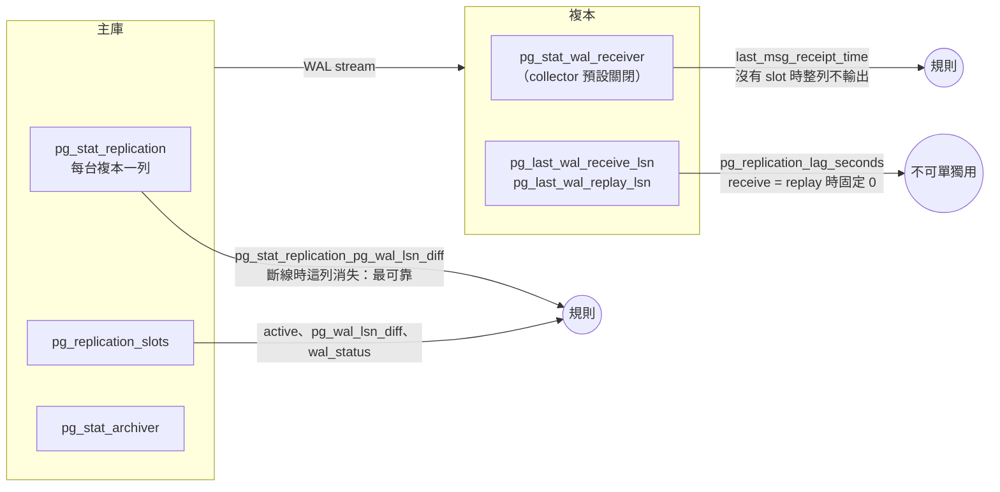

# PostgreSQL 本體怎麼監控

[元件卡](../components/postgres_exporter.md)回答「exporter 真的有在量嗎」。這頁回答另一個問題：**PostgreSQL 本身該看哪些訊號**，每個訊號從 PostgreSQL 的哪裡來、postgres_exporter v0.20.1 有沒有輸出、要什麼權限、在哪個版本會變。內容依九個面向排列：監測自檢、可用性、工作量、飽和、複寫、叢集與共識、資料維護、資料保護、容量。

依據是 PostgreSQL 與 exporter 的原始碼，加上幾組小實驗：PostgreSQL 16.15 與 17.11 各一組主從，切斷複寫、停複本、讓 archive 失敗、用完連線、kill 一個 backend、提升複本、把 pg_wal 寫滿<span class="at-chip at-ev-tested">實測</span>[^pg-exp-target]；另一組補 archive 新鮮度、`archive_mode`、資料庫大小與 session 錯誤計數<span class="at-chip at-ev-tested">實測</span>[^pg-asp-exp]。Patroni 與備份工具的部分只讀原始碼，沒有實驗。

## 先講結論

1. **時間延遲不能單獨用。**`pg_replication_lag_seconds` 在複本收到的 WAL 都已套用時固定是 0：主庫沒寫入時是 0，複本斷線 40 秒、主庫持續寫入時也是 0。延遲要看主庫端的位元組 `pg_stat_replication_pg_wal_lsn_diff`，「有沒有在收」要看主庫上那一列還在不在。<span class="at-chip at-ev-tested">實測</span>[^pg-exp-target][^pg-c-replication-lag]
2. **一個表鎖就能讓監控整個消失。**`stat_user_tables` 對每張表呼叫 `pg_table_size()`，要拿 AccessShareLock。有人持有 ACCESS EXCLUSIVE（ALTER TABLE、VACUUM FULL）時 exporter 卡住、`up` 變 0，而且每次 scrape 都多一條等鎖的連線：5 秒 scrape 時一個 exporter 25 秒內累積 5 條（兩個 exporter 共 11 條）。<span class="at-chip at-ev-tested">實測</span>[^pg-exp-target-raw][^pg-c-user-tables-size]
3. **crash recovery 不會改變 postmaster 啟動時間。**kill -9 一個 backend，PostgreSQL 0.3 秒內重新初始化，`pg_up` 一直是 1，`pg_postmaster_start_time_seconds` 不變；看得出來的只有 `pg_stat_database_*` counter 被歸零（crash recovery 會丟棄累積統計）。<span class="at-chip at-ev-tested">實測</span>[^pg-exp-target][^pg-src-starttime][^pg-src-crash-stats]
4. **沒有 pg_monitor 的帳號看到的是 NULL，不是錯誤。**`pg_stat_replication` 只剩 pid、`pg_stat_wal_receiver` 除了 pid 以外都是 NULL、`pg_stat_activity` 看不到別人的 state。對應的 collector 都回報成功，只是沒有資料或數字是 0。<span class="at-chip at-ev-tested">實測</span>[^pg-exp-target][^pg-src-walsnd-privs][^pg-src-walrcv-privs]
5. **連線額滿時 exporter 要有保留位子。**沒有保留位子的 exporter：`pg_up` 仍是 1（舊連線還在），collector 結果整組消失。授予 `pg_use_reserved_connections`（16 起）的 exporter 照常看到 15 條連線。<span class="at-chip at-ev-tested">實測</span>[^pg-exp-target][^pg-src-reserved]
6. **split brain 只有跨 instance 才看得出來。**提升複本後舊主庫仍在跑，兩台的 `pg_replication_is_replica` 都是 0，各自的規則都正常。要在 target 上加 cluster label，計算每個 cluster 有幾台不在 recovery。<span class="at-chip at-ev-tested">實測</span>[^pg-exp-target]
7. **慢 SQL、鎖佇列、CPU、OOM 各有不同的第一個訊號。**執行中的慢查詢不在 pg_stat_statements 裡；DDL 鎖佇列要看「等鎖數 + ACCESS EXCLUSIVE」；CPU 不夠時 scrape 先變慢；OOM 只看得到 counter 歸零。見[效能與故障情境](#perf)。<span class="at-chip at-ev-tested">實測</span>[^pg-perf-exp]
8. **很多關鍵欄位 exporter 根本不輸出**：`sync_state`、`write_lag`／`flush_lag`／`replay_lag`、`synchronous_standby_names`、`backend_xid` 的 age、`last_failed_wal`、索引是否有效、timeline、磁碟剩餘空間。見[盲點](#blind-spots)。
9. **核心 PostgreSQL 沒有共識機制。**streaming replication 不選主、不偵測主庫故障，提升只在有人呼叫 `pg_promote()` 時發生；`synchronous_standby_names` 的 `ANY n` 只決定 commit 等幾台。要監控 leader、quorum，對象是 Patroni 這類 HA 工具和它的 DCS。見[叢集與共識](#cluster)。<span class="at-chip at-ev-code">讀碼</span>[^pg-asp-src17-doc-nofailover][^pg-asp-src17-promote][^pg-asp-src17-syncrep-wait]
10. **archive 失敗時 `failed_count` 增加得很慢，`last_archive_age` 才是一直變大的那個。**失敗 100 秒、持續寫入，`failed_count` 只從 0 變 3，`last_archive_age` 到 120 秒。`archive_mode` 是 enum，exporter 不輸出，關掉時看起來和剛啟動一樣。見[資料保護](#protection)。<span class="at-chip at-ev-tested">實測</span>[^pg-asp-exp]
11. **備份與磁碟都不在 postgres_exporter 裡。**base backup 多久以前成功要問備份工具（pgbackrest_exporter 或自己寫的 textfile metric），磁碟剩餘空間要問 node_exporter。見[資料保護](#protection)、[容量](#capacity)。<span class="at-chip at-ev-code">讀碼</span>[^pg-asp-pbe-since-last][^pg-asp-ne-avail]

### 九個面向一覽 {#aspects}

| 面向 | 這頁的重點 | 元件卡的訊號 | 證據 |
|---|---|---|---|
| [監測自檢](#exporter) | exporter 四層「活著」、表鎖讓 scrape 消失、版本讓 metric 消失 | exporter-up、collectors-present、collector-success、legacy-scrape-error、monitor-privilege、scrape-budget、series-volume、probe-blast-radius、version-semantics、lock-blocks-exporter、pg-stat-statements | <span class="at-chip at-ev-tested">實測</span> |
| [可用性](#availability) | 重啟與 crash recovery、pg_wal 寫滿、OOM | db-up、restart-and-crash、wal-disk、oom-crash | <span class="at-chip at-ev-tested">實測</span> |
| [工作量](#workload) | TPS、rollback、deadlock、慢 SQL、session 錯誤 | throughput-drop、deadlocks-rollbacks、slow-sql、session-errors | <span class="at-chip at-ev-tested">實測</span> |
| [飽和](#saturation) | 連線上限、鎖等待、cache、temp、checkpoint | connection-headroom、sessions-and-locks、lock-queue、cache-and-temp、resource-pressure、checkpoint-pressure | <span class="at-chip at-ev-tested">實測</span> |
| [複寫](#replication) | 位元組延遲、receiver、slot、角色與 split brain | replication-semantics、standby-streaming、wal-receiver、replication-lag、replication-slots、standby-conflicts、sync-replication、promotion | <span class="at-chip at-ev-tested">實測</span> |
| [叢集與共識](#cluster) | 核心沒有；Patroni 的 leader lock、DCS、pause、timeline | patroni-up、patroni-leader、patroni-dcs、patroni-paused、patroni-timeline（`applies_when: patroni`） | <span class="at-chip at-ev-code">讀碼</span> |
| [資料維護](#maintenance) | wraparound、xmin horizon、autovacuum、失效索引 | wraparound、xmin-horizon、autovacuum、invalid-indexes | <span class="at-chip at-ev-tested">實測</span> |
| [資料保護](#protection) | archive 成敗與新鮮度、archive_mode、base backup | archiver、archive-freshness、archive-config、backup-freshness | <span class="at-chip at-ev-tested">實測</span>／<span class="at-chip at-ev-code">讀碼</span> |
| [容量](#capacity) | 資料庫與表的成長、磁碟預測、連線趨勢 | database-growth、disk-forecast、connection-trend | <span class="at-chip at-ev-tested">實測</span>／<span class="at-chip at-ev-code">讀碼</span> |

## 誰看得到什麼



## 監測自檢 {#exporter}

exporter 本身的訊號（`up`、`pg_up`、collector 成功與否、scrape 預算、權限、版本造成的 metric 消失）都在[元件卡](../components/postgres_exporter.md)。這頁只補兩點和 PostgreSQL 本體直接相關的：

- **表鎖讓 scrape 消失。**`stat_user_tables` 對每張表呼叫 `pg_table_size()`，要拿 AccessShareLock；ACCESS EXCLUSIVE 期間整次 scrape 卡住。exporter 帳號設 `lock_timeout` 後只剩這個 collector 失敗。見[鎖](#perf-locks)與[建議設定](#recommended)。<span class="at-chip at-ev-tested">實測</span>[^pg-exp-target-raw][^pg-c-user-tables-size]
- **其他面向依賴的外部 metric 也要有自檢。**Patroni 的 `/metrics`、pgbackrest_exporter、node_exporter 都是另外的 target；規則範本各配一條 `absent()` 或 `up == 0`（`PatroniMissing`、`PostgresBackupExporterFailing`、`PostgresDataDiskNotMonitored`），否則對應面向的規則在 job 名稱或 mountpoint 不對時回傳空。

## 叢集與共識 {#cluster}

**結論：核心 PostgreSQL 沒有共識、quorum 成員資格或自動選主。**「叢集與共識」只在部署了 HA 管理工具時才有對象可監控；這時要看的是那個工具與它的 DCS，不是 PostgreSQL 本身。沒有 HA 工具的部署，「誰是主庫、有沒有兩個主庫」由[複寫](#replication)的 promotion（cluster label 計數）回答，元件卡把 cluster 面向記在 `not_applicable_aspects`。

### 為什麼核心 PostgreSQL 沒有共識 {#cluster-why}

| 依據 | 內容 | 證據 |
|---|---|---|
| 文件 `high-availability.sgml`（16:1449、17:1457） | 「PostgreSQL does not provide the system software required to identify a failure on the primary and notify the standby database server.」同一節要求另外做 STONITH，避免兩邊都以為自己是主庫（17:1441） | <span class="at-chip at-ev-code">讀碼</span>[^pg-asp-src16-doc-nofailover][^pg-asp-src17-doc-nofailover][^pg-asp-src17-doc-stonith] |
| `xlogfuncs.c` `pg_promote()`（16:698、17:688） | 提升只是寫一個 promote 信號檔，由呼叫者（人或外部工具）決定；複本之間沒有投票 | <span class="at-chip at-ev-code">讀碼</span>[^pg-asp-src16-promote][^pg-asp-src17-promote] |
| `syncrep.c` `SyncRepGetSyncRecPtr()`（16:622／527、17:621／526）、`syncrep.h:36` | `ANY n`（`SYNC_REP_QUORUM`）與 `FIRST n`（`SYNC_REP_PRIORITY`）只決定「commit 的 WAL 要等哪幾台 standby 回報」；同步 standby 不夠時回傳 false，commit 等待，沒有任何選主或隔離 | <span class="at-chip at-ev-code">讀碼</span>[^pg-asp-src16-syncrep-wait][^pg-asp-src17-syncrep-wait][^pg-asp-src17-syncrep-method][^pg-asp-src16-syncrep-quorum-def] |
| 文件 `high-availability.sgml`（17:1232） | 「The method ANY specifies a quorum-based synchronous replication and makes transaction commits wait until their WAL records are replicated to at least the requested number of synchronous standbys」：quorum commit 是耐久性設定 | <span class="at-chip at-ev-code">讀碼</span>[^pg-asp-src17-doc-quorum] |

對照：YugabyteDB 這類 PostgreSQL 相容的分散式資料庫，每個 tablet 用 Raft 複寫，才有 leader、term、quorum 可以監控（只讀文件，見來源 `pg-yugabyte-raft`）。核心 PostgreSQL 的 streaming replication 是一主多從的 WAL 傳送，沒有這一層。

### HA 工具各自把「共識」放在哪裡 {#cluster-tools}

| 工具 | 誰決定主庫 | 該監控什麼 | 有沒有 Prometheus endpoint | 證據 |
|---|---|---|---|---|
| Patroni | DCS（etcd、Consul、ZooKeeper、Kubernetes）裡的 leader key；拿得到、續得了 lock 的節點才能當主庫，續不了就自己降級 | 每個叢集剛好一個 lock 持有者、DCS 聯絡時間、pause、timeline；DCS 本身的 quorum | 有：REST API `/metrics`（`patroni_*`，label `scope`、`name`） | <span class="at-chip at-ev-code">讀碼</span>[^pg-asp-patroni-doc-dcs][^pg-asp-patroni-etcd-cas][^pg-asp-patroni-demote-nolock] |
| repmgr | repmgrd 在節點間互相探測，可選 witness 節點；沒有外部 DCS | `repmgr cluster show` 的狀態、repmgrd 是否在跑 | 沒有內建；要自訂查詢 repmgr 的 metadata 表 | 只讀文件（來源 `pg-repmgr`） |
| pg_auto_failover | 一個 monitor 節點（本身是 PostgreSQL）跑狀態機，指揮 primary 與 secondary | 每個節點的 reported／goal state、monitor 本身活著 | 沒有內建；monitor 是單點，要另外監控 | 只讀文件（來源 `pg-autofailover`） |

### Patroni：訊號與規則 {#cluster-patroni}

`rules/targets/postgres.yml` 的 `patroni-cluster` 組，假設 Patroni 的 `/metrics` 在 `job="patroni"`。不用 Patroni 的環境整組刪掉（否則 `PatroniMissing` 會響）。

DCS 用 etcd 時，etcd 本身的 quorum、leader 與 alarm 見 [etcd：叢集與共識](etcd.md#cluster)；etcd 失去 quorum 時 `up` 仍是 1，要靠健康探測（實測）。

| 規則 | PostgreSQL 原始碼 | view／函式／DCS | Patroni 原始碼與查詢（v4.1.5） | metric | 條件 |
|---|---|---|---|---|---|
| `PatroniDown`、`PatroniMissing` | — | — | `api.py:584` `do_GET_metrics`；`api.py:625` 每個 series 帶 `scope`、`name`[^pg-asp-patroni-metrics][^pg-asp-patroni-labels] | `up{job="patroni"}` | `== 0`、`absent()` |
| `PatroniClusterUnlocked` | — | DCS 的 leader key；etcd3 用 `create_revision='0'` 的 compare-and-set 搶 lock（`etcd3.py:979`）[^pg-asp-patroni-etcd-cas] | `api.py:1444` `cluster.is_unlocked()` → `api.py:710`[^pg-asp-patroni-unlocked][^pg-asp-patroni-unlocked-metric] | `patroni_cluster_unlocked` | `max by (scope) == 1` 持續 1 分鐘 |
| `PatroniMultiplePrimaries`、`PatroniNoPrimary` | `xlogfuncs.c:652`（REL_16_15）[^pg-asp-src16-is-in-recovery] | `pg_is_in_recovery()` | `postgresql/__init__.py:70` 的 `TL_LSN`：`CASE WHEN pg_is_in_recovery() THEN 0 ELSE ...`，決定 role → `api.py:644`；standby leader 在 `api.py:653`[^pg-asp-patroni-tl-lsn][^pg-asp-patroni-primary][^pg-asp-patroni-standby-leader] | `patroni_primary`、`patroni_standby_leader` | `count by (scope) (== 1) > 1`；主庫與 standby leader 都是 0 |
| `PatroniDcsUnreachable` | — | 從 DCS 讀叢集狀態 | 讀到就更新 `_last_seen`（`dcs/__init__.py:1773`）→ `api.py:724`[^pg-asp-patroni-dcs-seen-set][^pg-asp-patroni-dcs-seen] | `patroni_dcs_last_seen` | `time() −` 它 `> 60`（2 × 預設 ttl 30 秒[^pg-asp-patroni-doc-ttl]） |
| `PatroniFailsafeActive` | — | DCS 不通 | 主庫降級（`ha.py:2362`），failsafe 生效則不降級 → `api.py:712`[^pg-asp-patroni-demote-dcs][^pg-asp-patroni-failsafe] | `patroni_failsafe_mode_is_active` | `== 1` |
| `PatroniPaused` | — | DCS 的 `/config` pause | `api.py:733`[^pg-asp-patroni-paused] | `patroni_is_paused` | `max by (scope) == 1` 持續 1 小時 |
| `PatroniTimelineDiverged` | `xlogfuncs.c:447`（REL_16_15）[^pg-asp-src16-walfile-name] | `pg_walfile_name(pg_current_wal_lsn())` 的前 8 碼 | `__init__.py:70`；複本用 leader 的或快取的 timeline（`api.py:1423`）→ `api.py:719`[^pg-asp-patroni-tl-lsn][^pg-asp-patroni-replica-tl][^pg-asp-patroni-timeline] | `patroni_postgres_timeline` | 依 scope，大於 0 的最大值 > 最小值，持續 10 分鐘 |

要注意的地方（讀碼，沒有實驗）：

- **`patroni_primary` 不是「持有 leader lock」。**`api.py` 的說明寫「holds the leader lock」，程式卻是 `postgres['role'] == PRIMARY`，而 role 來自 `pg_is_in_recovery()`。所以它和 postgres_exporter 的 `pg_replication_is_replica == 0` 量的是同一件事；「lock 在誰手上」要看 `patroni_cluster_unlocked` 與 Patroni REST API 的 `/cluster`。這反而讓 `PatroniMultiplePrimaries` 抓得到「lock 只有一個、PostgreSQL 卻有兩台可寫」。<span class="at-chip at-ev-code">讀碼</span>[^pg-asp-patroni-primary][^pg-asp-patroni-tl-lsn]
- **舊主庫的 Patroni 停了、PostgreSQL 還在跑時，Patroni 的 metric 看不到它。**這種 split brain 只有 postgres_exporter 那邊的 `PostgresMultiplePrimaries`（cluster label 計數）看得到，兩組規則要一起用。
- **DCS 整個掛掉時，所有節點同時降級成唯讀。**PostgreSQL 與 postgres_exporter 都正常、`pg_up=1`，只有 `PatroniDcsUnreachable` 與寫入失敗看得出來。DCS 本身（例如 etcd 的 `etcd_server_has_leader`、Consul 的 raft metric）要有自己的監控，不在這張卡的範圍。<span class="at-chip at-ev-code">讀碼</span>[^pg-asp-patroni-demote-dcs][^pg-asp-patroni-doc-dcs]

## 複寫與 HA {#replication}

| 要看什麼 | PostgreSQL 的來源 | exporter metric（collector） | 預設 | 權限／版本 | 證據 |
|---|---|---|---|---|---|
| 主庫看得到複本 | `pg_stat_replication` | `pg_stat_replication_pg_wal_lsn_diff{application_name, state, slot_name}`（stat_replication）[^pg-c-statrep-query] | 開 | 需要 pg_read_all_stats[^pg-src-walsnd-privs] | <span class="at-chip at-ev-tested">實測</span> |
| 位元組延遲 | `pg_current_wal_lsn() − replay_lsn` | 同上（只有 replay，沒有 write／flush） | 開 | — | <span class="at-chip at-ev-tested">實測</span> |
| 時間延遲 | `write_lag`、`flush_lag`、`replay_lag` | 無 | — | 閒置時 PostgreSQL 自己會清成 NULL[^pg-src-lag-clear] | <span class="at-chip at-ev-tested">實測</span> |
| 複本端延遲 | `pg_last_xact_replay_timestamp()` | `pg_replication_lag_seconds`、`pg_replication_last_replay_seconds`（replication） | 開 | receive = replay 時 lag 固定 0 | <span class="at-chip at-ev-tested">實測</span> |
| 複本在收 WAL | `pg_stat_wal_receiver` | `pg_stat_wal_receiver_*`（stat_wal_receiver）[^pg-c-walrecv-default] | 關 | 需要 pg_read_all_stats[^pg-src-walrcv-privs]；**沒有 slot 時不輸出**[^pg-c-walrecv-slotnull] | <span class="at-chip at-ev-tested">實測</span> |
| 同步複寫 | `synchronous_standby_names`、`pg_stat_replication.sync_state` | 無（settings 只輸出 bool／integer／real）[^pg-c-settings-query] | — | — | <span class="at-chip at-ev-tested">實測</span> |
| 角色 | `pg_is_in_recovery()` | `pg_replication_is_replica`（replication） | 開 | — | <span class="at-chip at-ev-tested">實測</span> |
| timeline | `pg_control_checkpoint().timeline_id` | 無 | — | — | <span class="at-chip at-ev-tested">實測</span> |
| inactive slot | `pg_replication_slots.active`、`wal_status` | `pg_replication_slots_active`、`pg_replication_slots_wal_status{wal_status}` | 開 | — | <span class="at-chip at-ev-tested">實測</span> |
| 複本查詢衝突 | `pg_stat_database_conflicts` | `pg_stat_database_conflicts_confl_*`（舊架構內建）[^pg-c-conflicts-legacy] | 開 | — | <span class="at-chip at-ev-code">讀碼</span> |

### 延遲：位元組與時間

實驗：PostgreSQL 16 主庫加兩台複本，scrape 5 秒。<span class="at-chip at-ev-tested">實測</span>[^pg-exp-target]

| 情境 | 複本 `pg_replication_lag_seconds` | 複本 `pg_replication_last_replay_seconds` | 主庫 `pg_stat_replication_pg_wal_lsn_diff` | 主庫 `replay_lag`（直接查） |
|---|---|---|---|---|
| 閒置 60 秒 | 0 | 46–50 | 0 | NULL |
| 每秒一筆 commit | 0 | 0.01–0.7 | 0 | 0.001–0.002 秒 |
| 切斷 receiver 40 秒，主庫持續寫入 | **0** | 36–37 | **該列消失** | 該列消失 |

切斷期間在複本上直接查：`pg_last_wal_receive_lsn() = pg_last_wal_replay_lsn()` 是 true、`pg_stat_wal_receiver` 0 列、最後套用的交易是 39.9 秒前。主庫上 slot `standby_a` 變成 active=0、保留的 WAL 開始增加。

為什麼時間延遲會騙人：exporter 的公式是「receive_lsn 等於 replay_lsn 就回 0，否則 now() − 最後套用的交易時間」[^pg-c-replication-lag]。複本斷線後不再收到新 WAL，收到的都已套用，兩者相等，所以是 0。主庫沒寫入時同理。反過來，`pg_replication_last_replay_seconds` 在沒寫入時會一直變大，看起來像落後。PostgreSQL 自己的 `replay_lag` 在閒置時也會被清成 NULL[^pg-src-lag-clear]。真的要時間延遲，做法是在主庫每幾秒寫一筆 heartbeat，在複本上算 `now() − 最後一筆 heartbeat`。

### 提升與 split brain

在 PostgreSQL 17 上對複本執行 `pg_promote()`，舊主庫不動：<span class="at-chip at-ev-tested">實測</span>[^pg-exp-target]

- 兩台的 `pg_replication_is_replica` 都是 0；`count by (cluster) (pg_replication_is_replica == 0)` 在 pg17 是 2、在 pg16 是 1。
- `changes(pg_replication_is_replica[2m])` 只有被提升的那台是 1，舊主庫是 0：只看角色變化的規則不知道舊主庫還在接受寫入。
- 舊主庫的 `pg_stat_replication` 那一列消失（複本離開了），新主庫的 `pg_stat_wal_receiver` 也消失；三個 instance 的 `pg_replication_lag_seconds` 都是 0。
- timeline 只能直接查：新主庫 `timeline_id=2`、舊主庫 1。exporter 沒有輸出 timeline。

規則寫法：`count by (cluster) (pg_replication_is_replica == 0) > 1`（split brain）與 `count by (cluster) (pg_replication_is_replica) unless count by (cluster) (pg_replication_is_replica == 0)`（沒有主庫）。前者要求每個 instance 只被一個 job 抓，否則同一台會被算兩次。

### Replication slot {#replication-slots}

PostgreSQL 16 主庫，停掉用 slot `standby_a` 的複本，並建一個從未被使用的 slot `orphan`；設 `max_slot_wal_keep_size=64MB` 後產生約 120MB WAL 再 CHECKPOINT。<span class="at-chip at-ev-tested">實測</span>[^pg-exp-target-raw]

| 時間點 | `pg_wal_lsn_diff` | `safe_wal_size_bytes` | `wal_status` |
|---|---|---|---|
| 沒設上限（`max_slot_wal_keep_size=-1`），保留 33MB → 100MB | 33MB → 100MB | **不存在** | reserved |
| 設 64MB，`standby_a` 保留 33MB | 33MB | 50MB | reserved |
| 設 64MB，`orphan` 保留 117MB | 117MB | −33MB | unreserved |
| CHECKPOINT 之後 | **兩個 slot 都消失** | **兩個 slot 都消失** | lost |

slot 一旦 lost，`restart_lsn` 變 NULL，保留量相關的 series 跟著消失，只看 `pg_wal_lsn_diff > X` 的規則在最嚴重的時候回傳空；要另外看 `wal_status{wal_status=~"unreserved|lost"}`。複本重新啟動後一直回報「requested WAL segment ... has already been removed」，但 `pg_up=1`、`is_replica=1`，主庫上沒有它那一列；這時它的 `pg_replication_lag_seconds` 是 103 秒（差別在 receiver 是第一次啟動還是斷線重連：斷線重連時 `flushedUpto` 不重設，receive 位置仍等於 replay 位置，lag 是 0；複本重啟後 receiver 第一次啟動，`flushedUpto` 被設成當前 WAL segment 的開頭，比 replay 位置小，公式改走「now − 最後套用時間」。這次實驗沒有直接查 `pg_last_wal_receive_lsn()`，原因是讀碼[^pg-trace-pg16-walrcv-flushinit][^pg-trace-pg16-walrcv-segstart]），和上面「切斷 receiver」時的 0 不同，**同一個 metric 在兩種斷線下行為不一樣**。

用 slot 的備份工具（pg_receivewal、Barman streaming）停掉時一樣會讓 WAL 在主庫累積，規則同上；archive 見[資料保護](#protection)。

## 可用性 {#availability}

| 要看什麼 | PostgreSQL 的來源 | exporter metric（collector） | 預設 | 權限／版本 | 證據 |
|---|---|---|---|---|---|
| 重啟 | `pg_postmaster_start_time()` | `pg_postmaster_start_time_seconds`（postmaster） | 關 | — | <span class="at-chip at-ev-tested">實測</span> |
| crash recovery | log：`all server processes terminated; reinitializing`；crash recovery 丟棄累積統計[^pg-src-crash-reinit][^pg-src-crash-stats] | `resets(pg_stat_database_xact_commit)`（stat_database） | 開 | 16、17 已核對原始碼會歸零[^pg-trace-pg16-crash-stats]；13～15 沒有核對 | <span class="at-chip at-ev-tested">實測</span> |
| pg_wal 大小 | `pg_ls_waldir()` | `pg_wal_size_bytes`、`pg_wal_segments`（wal）[^pg-c-wal-query] | 開 | 需要 pg_monitor | <span class="at-chip at-ev-tested">實測</span> |
| 連得上 | 連線本身 | `pg_up`（舊架構）、collector 是否有結果 | 開 | 見元件卡 | <span class="at-chip at-ev-tested">實測</span> |

重點：

- **WAL 寫滿時 PostgreSQL 直接停機。**pg_wal 放在 160MB tmpfs、用 slot 擋住回收：寫 WAL 的 backend PANIC，postmaster 重新初始化，recovery 寫不進 WAL 又 FATAL，最後 `database system is shut down`，容器退出。exporter 看到的是 `pg_up=0`、所有 collector 消失；之前的 `pg_wal_size_bytes` 是唯一的預警。磁碟的長期趨勢見[容量](#capacity)。<span class="at-chip at-ev-tested">實測</span>[^pg-exp-target-raw]
- **OOM kill 只讓 counter 歸零。**kernel 殺的是 backend，不是 postmaster，啟動時間不變。見[讓 TPS 下降或當掉的內部因素](#perf-internal)。<span class="at-chip at-ev-tested">實測</span>[^pg-perf-exp]

## 資源與飽和 {#saturation}

| 要看什麼 | PostgreSQL 的來源 | exporter metric（collector） | 預設 | 權限／版本 | 證據 |
|---|---|---|---|---|---|
| 連線數 vs 上限 | `pg_stat_activity`、`max_connections`、`superuser_reserved_connections`、`reserved_connections` | `pg_stat_activity_count`、`pg_settings_*`（stat_activity、settings） | 開 | `reserved_connections` 16 起 | <span class="at-chip at-ev-tested">實測</span> |
| active／idle／等鎖 | `pg_stat_activity.state`、`wait_event_type` | `pg_stat_activity_count{state, wait_event_type}`[^pg-c-activity-labels] | 開 | 需要 pg_read_all_stats | <span class="at-chip at-ev-tested">實測</span> |
| 鎖 | `pg_locks` | `pg_locks_count{mode}`（locks）[^pg-c-locks-query] | 開 | 看不出誰擋誰；不含 transactionid 鎖[^pg-trace-ex-locks-dbnotnull] | <span class="at-chip at-ev-tested">實測</span> |
| cache hit | `pg_stat_database.blks_hit／blks_read` | `pg_stat_database_blks_*` | 開 | 只算 shared_buffers | <span class="at-chip at-ev-tested">實測</span> |
| temp file | `pg_stat_database.temp_files／temp_bytes` | `pg_stat_database_temp_*` | 開 | 暫存檔刪除時才計入[^pg-trace-pg17-temp-call] | <span class="at-chip at-ev-tested">實測</span> |
| checkpoint 壓力 | ≤16 `pg_stat_bgwriter`；17 `pg_stat_checkpointer`[^pg-src-bgwriter16][^pg-src-checkpointer-view] | ≤16 `pg_stat_bgwriter_checkpoints_*`（stat_bgwriter）；17 `pg_stat_checkpointer_num_*`（stat_checkpointer）[^pg-c-bgwriter-17][^pg-c-checkpointer-17] | 開／**關** | 17 起換 collector | <span class="at-chip at-ev-tested">實測</span> |
| autovacuum worker 全滿 | `pg_stat_activity.backend_type`、`autovacuum_max_workers` | `pg_stat_activity_count{backend_type="autovacuum worker"}`、`pg_settings_autovacuum_max_workers`[^res-pe-activity-labels][^res-pg-av-report-activity]；1 小時平均 ≥ 90%（例子，PostgresAutovacuumWorkersFull） | 開 | 要看得到其他角色的行程 | <span class="at-chip at-ev-code">讀碼</span> |
| backend 自己 fsync、checkpoint sync 時間 | ≤16 `pg_stat_bgwriter.buffers_backend_fsync`、`checkpoint_sync_time`；17 `pg_stat_checkpointer.sync_time` | `pg_stat_bgwriter_buffers_backend_fsync_total`[^res-pe-backend-fsync][^res-pg16-backend-fsync]、`pg_stat_bgwriter_checkpoint_sync_time_total`[^res-pe-ckpt-sync]、`pg_stat_checkpointer_sync_time_total`[^res-pe-checkpointer-sync]（PostgresBackendFsync、PostgresCheckpointSyncSlow） | 開／**關** | backend fsync 17 起移除[^res-pe-bgwriter-17] | <span class="at-chip at-ev-code">讀碼</span> |

CPU、記憶體、OOM kill 與磁碟延遲 postgres_exporter 都沒有，已由 [主機與容器資源](../components/host.md) 補上（規則只讀碼，host lab 之後排程）。

重點：

- **連線上限要扣兩種保留。**一般使用者能用的是 `max_connections − superuser_reserved_connections − reserved_connections`。實驗中 20 − 3 − 2 = 15：app 用到第 15 條之後再連，得到「remaining connection slots are reserved for roles with privileges of the pg_use_reserved_connections role」。<span class="at-chip at-ev-tested">實測</span>[^pg-exp-target]
- **`pg_stat_activity_count` 不等於連線數。**它排除的只是 collector 自己那條連線（舊架構的常駐 idle 連線照樣算進去），也排除 state 是 NULL 的 background process[^pg-trace-ex-activity-self]；和 `pg_stat_database_numbackends` 不會相等。
- **cache hit 比例只適合畫圖。**OS page cache 命中在 PostgreSQL 眼中也是 read，比例偏低不一定是問題。
- **16 的複本 checkpoint 數包含 restartpoint。**16 在複本上把 restartpoint 算進 `checkpoints_req`／`checkpoints_timed`，17 分到 `restartpoints_*`；同一條規則在升級前後對複本的意義不同。<span class="at-chip at-ev-code">讀碼</span>[^pg-trace-pg16-ckpt-req][^pg-trace-pg17-rstpt-req]
- **checkpoint 規則要接兩個名字。**同一個 `CHECKPOINT` 指令，16 讓 `pg_stat_bgwriter_checkpoints_req_total` 加 1，17 讓 `pg_stat_checkpointer_num_requested_total` 加 1；17 的複本另有 `restartpoints_*`。17 沒開 stat_checkpointer 時兩個名字都不存在。<span class="at-chip at-ev-tested">實測</span>[^pg-exp-target]

## 工作量與效能 {#workload}

| 要看什麼 | PostgreSQL 的來源 | exporter metric（collector） | 預設 | 權限／版本 | 證據 |
|---|---|---|---|---|---|
| TPS | `pg_stat_database.xact_commit`（`pg_stat_get_db_xact_commit()`）[^pg-asp-src16-statdb-commit][^pg-asp-src16-func-xact-commit] | `pg_stat_database_xact_commit`（stat_database）[^pg-c-database-columns] | 開 | 包含 exporter 自己的交易 | <span class="at-chip at-ev-tested">實測</span> |
| 寫入量 | `tup_inserted`／`tup_updated`／`tup_deleted` | `pg_stat_database_tup_*` | 開 | — | <span class="at-chip at-ev-tested">實測</span> |
| rollback、deadlock | `xact_rollback`、`deadlocks` | `pg_stat_database_xact_rollback`、`pg_stat_database_deadlocks` | 開 | rollback 含應用主動 ROLLBACK | <span class="at-chip at-ev-tested">實測</span> |
| 查詢延遲、QPS | `pg_stat_statements` | `pg_stat_statements_seconds_total`、`calls_total`（stat_statements）[^pg-asp-c-statements-calls][^pg-asp-c-statements-seconds] | 關 | 每台都要 `shared_preload_libraries`；17 欄位改名[^pg-c-statements-pg17] | <span class="at-chip at-ev-tested">實測</span> |
| session 被斷、FATAL、客戶端沒說再見 | `pg_stat_database.sessions_killed`／`sessions_fatal`／`sessions_abandoned`（14 起）[^pg-asp-src16-statdb-sessions-fatal][^pg-asp-src16-sessions-count] | **無**：stat_database 的欄位清單沒有 `sessions_*`[^pg-asp-c-statdb-columns] | — | — | <span class="at-chip at-ev-tested">實測</span>[^pg-asp-exp] |
| SQL 錯誤（ERROR） | 只有 log，沒有任何 view 計數 | 無 | — | 用 log 管線計數 | <span class="at-chip at-ev-code">讀碼</span> |

重點：

- **QPS 用 `rate(pg_stat_statements_calls_total)` 加總。**只涵蓋前 100 名、排除總耗時最低的 10%，所以是下限，不是精確值。collector 先排除最低的 10%，queryid 會隨排名進出，`rate()` 會斷斷續續；沒有 pg_read_all_stats 的帳號看到的 series 只有三分之一（27 vs 83），collector 仍回報成功。<span class="at-chip at-ev-tested">實測</span>[^pg-exp-target][^pg-c-statements-topn]
- **TPS 掉到 0 時 exporter 不會顯示 0。**規則用「不到昨天同時段一半」（`PostgresThroughputDrop`），見[效能與故障情境](#perf)。
- **session 錯誤計數要自訂查詢。**實驗中 `pg_terminate_backend()` 一個 session 後 `sessions_killed=1`，exporter 沒有任何 `sessions_*`；連一個不存在的資料庫得到 FATAL，沒有算進任何資料庫的 `sessions_fatal`（連線沒進到資料庫）。補法：sql_exporter 查 `SELECT datname, sessions_fatal, sessions_killed, sessions_abandoned FROM pg_stat_database` 輸出成 counter，對 `increase()` 告警。<span class="at-chip at-ev-tested">實測</span>[^pg-asp-exp][^pg-asp-exp-raw]
- 慢 SQL 與鎖造成的 TPS 下降見[慢 SQL 怎麼找](#perf-slow-sql)、[鎖](#perf-locks)。

### 證據鏈 {#workload-chain}

| 規則 | PostgreSQL 原始碼 | view／函式 | exporter 原始碼與 SQL | metric | 證據 |
|---|---|---|---|---|---|
| `PostgresThroughputDrop`、`PostgresHighRollbackRatio` | 交易結束時累加 commit／rollback（17 `pgstat_database.c:259`）[^pg-trace-pg17-xact-count]；`pgstatfuncs.c:1082`（16）／`:1076`（17） | `pg_stat_database.xact_commit`、`xact_rollback`（16 `system_views.sql:1029`、17:1055）[^pg-asp-src16-statdb-commit][^pg-asp-src17-statdb-commit] | `pg_stat_database.go:229` 欄位清單，`SELECT ... FROM pg_stat_database`[^pg-asp-c-statdb-columns][^pg-trace-ex-db-query] | `pg_stat_database_xact_commit`、`xact_rollback` | <span class="at-chip at-ev-tested">實測</span>[^pg-perf-exp] |
| `PostgresSlowStatement` | 語句結束時 `calls += 1`、`total_time += total_time`（16 `pg_stat_statements.c:1355`）[^pg-asp-src16-pgss-store] | `pg_stat_statements.calls`、`total_exec_time` | `pg_stat_statements.go:188`（13 起的查詢）、`:114`／`:120` 輸出成 `calls_total`、`seconds_total`[^pg-perf-c-stmt-pg13-query][^pg-asp-c-statements-calls][^pg-asp-c-statements-seconds] | `pg_stat_statements_calls_total`、`seconds_total` | <span class="at-chip at-ev-tested">實測</span>[^pg-perf-exp] |
| （無規則）session 錯誤 | `pgstat_database.c:227` 依斷線原因累加 `sessions_fatal` 等（16、17）[^pg-asp-src16-sessions-count][^pg-asp-src17-sessions-count] | `pg_stat_database.sessions_*`（16 `system_views.sql:1052`、17:1078）[^pg-asp-src17-statdb-sessions-fatal] | 沒有查這幾欄（`pg_stat_database.go:229`） | 無 | <span class="at-chip at-ev-tested">實測</span>[^pg-asp-exp] |

## 資料維護與完整性 {#maintenance}

| 要看什麼 | PostgreSQL 的來源 | exporter metric（collector） | 預設 | 權限／版本 | 證據 |
|---|---|---|---|---|---|
| XID／multixact age | `age(datfrozenxid)`、`mxid_age(datminmxid)` | `pg_database_wraparound_age_datfrozenxid_seconds`、`..._datminmxid_seconds`（database_wraparound）[^pg-c-wraparound-query] | 關 | 名稱是 seconds，實際是交易數 | <span class="at-chip at-ev-code">讀碼</span> |
| 長交易、idle in transaction | `pg_stat_activity.xact_start`、`state` | `pg_stat_activity_max_tx_duration{state}`（stat_activity）[^pg-c-activity-query]；`pg_long_running_transactions*`（long_running_transactions）[^pg-c-longtx-query] | 開／關 | 看別人的 session 需要 pg_read_all_stats[^pg-src-activity-privs] | <span class="at-chip at-ev-tested">實測</span> |
| 擋住 vacuum 的 XID | `pg_stat_activity.backend_xid`／`backend_xmin`、`pg_replication_slots.xmin`、`pg_prepared_xacts` | 無 | — | — | <span class="at-chip at-ev-tested">實測</span> |
| autovacuum、dead tuple | `pg_stat_user_tables` | `pg_stat_user_tables_n_dead_tup`、`last_autovacuum`（stat_user_tables） | 開 | 只有 DSN 那一個資料庫 | <span class="at-chip at-ev-tested">實測</span> |
| bloat | 需要 pgstattuple 或估算查詢 | 無 | — | — | — |
| 失效索引、checksum 失敗 | `pg_index.indisvalid`、`pg_stat_database.checksum_failures`、amcheck | 無 | — | — | <span class="at-chip at-ev-code">讀碼</span> |

重點：

- **idle in transaction 擋住 vacuum。**實驗中一個 session 開了交易拿到 XID 後閒置，之後燒掉 3000 個 XID、更新整張表再 VACUUM：VACUUM 回報「10000 are dead but not yet removable，removable cutoff 是 3003 XIDs old」。exporter 這時能看到的是 `max_tx_duration{state="idle in transaction"}=36s` 與 `n_dead_tup=10001`，看不到「卡住幾個 XID」。<span class="at-chip at-ev-tested">實測</span>[^pg-exp-target-raw]
- **`database_wraparound` 量的不是卡住的交易。**它是 `datfrozenxid` 的 age，代表 vacuum 凍結到哪裡；卡住的交易會讓它長期無法下降，但短期看不出來。PostgreSQL 在 2^31 − 4000 萬時開始警告、− 300 萬時拒絕新的 XID（16 與 17 相同）。<span class="at-chip at-ev-code">讀碼</span>[^pg-src-xid-warn][^pg-src-xid-stop]

## 資料保護 {#protection}

能不能還原要三樣東西都在：一份 base backup、從那份備份之後連續的 WAL archive、還原時拿得到兩者。PostgreSQL 只知道第二樣的一半（archive_command 有沒有成功），postgres_exporter 只輸出其中三個數字。

| 要看什麼 | PostgreSQL 的來源 | exporter metric（collector） | 預設 | 權限／版本 | 證據 |
|---|---|---|---|---|---|
| archive 成敗 | `pg_stat_archiver`（16:1097、17:1123）；`pgstat_report_archiver()` 成功時更新 `last_archived_timestamp`（`pgstat_archiver.c:47`）[^pg-asp-src16-archiver-view][^pg-asp-src16-archiver-ok] | `pg_stat_archiver_failed_count`、`archived_count`（stat_archiver）[^pg-asp-c-archiver-default] | 開 | 沒有 `last_failed_wal`、`.ready` 數 | <span class="at-chip at-ev-tested">實測</span> |
| archive 新鮮度 | `pg_stat_archiver.last_archived_time` | `pg_stat_archiver_last_archive_age` = `extract(epoch from now() − last_archived_time)`[^pg-asp-c-archiver-age] | 開 | 從沒成功時是 NULL，不輸出[^pg-asp-c-archiver-agenull] | <span class="at-chip at-ev-tested">實測</span> |
| `archive_timeout` | GUC，integer、單位秒（16 `guc_tables.c:2021`）[^pg-asp-src16-guc-archive-timeout] | `pg_settings_archive_timeout_seconds`（settings）[^pg-asp-c-settings-seconds] | 開 | — | <span class="at-chip at-ev-tested">實測</span> |
| `archive_mode` | GUC，**enum**（16 `guc_tables.c:4774`、17:4936，位在 `ConfigureNamesEnum`）[^pg-asp-src16-guc-archive-mode][^pg-asp-src17-guc-archive-mode][^pg-asp-src16-guc-enum-table] | **無**：settings 只查 `vartype IN ('bool','integer','real')`[^pg-asp-c-settings-vartype] | — | — | <span class="at-chip at-ev-tested">實測</span> |
| base backup 新鮮度 | PostgreSQL 不知道 | **無**；pgBackRest 用 pgbackrest_exporter 的 `pgbackrest_backup_since_last_completion_seconds`[^pg-asp-pbe-since-last] | — | 社群 exporter | <span class="at-chip at-ev-code">讀碼</span> |
| 備份用的 slot | `pg_replication_slots` | `pg_replication_slots_active`、`pg_wal_lsn_diff`、`wal_status`（見[複寫](#replication)） | 開 | — | <span class="at-chip at-ev-tested">實測</span> |

### archive 失敗時哪個數字在動

兩組實驗，PostgreSQL 16 與 17 結果相同：<span class="at-chip at-ev-tested">實測</span>[^pg-exp-target-raw][^pg-asp-exp][^pg-asp-exp-raw]

- `archive_command` 換成會失敗的 script、產生 3 個 WAL 檔後等 75 秒：`pg_stat_archiver_failed_count` 0 → 9，`increase(...[1m])` 約 3：archiver 每輪重試 3 次後休息約 60 秒[^pg-trace-pg17-arch-retries]。`archived_count` 停在 1，`last_archive_age` 一路變大。修好之後 30 秒內 `archived_count` 仍沒有增加（archiver 還在休息），規則的 `for` 不要短於 1–2 分鐘。
- `archive_timeout=30`、失敗 100 秒且每 10 秒寫 1.8MB：`failed_count` 0 → 3、`archived_count` 停在 4、`last_archive_age` 120 秒（> 3 × 30）。直接查才看得到 `last_failed_wal=000000010000000000000005` 與 1 個 `.ready` 檔。
- `pg_settings` 裡 `archive_mode|on|enum`、`archive_command|/archive.sh|string`；exporter 只有 `pg_settings_archive_timeout_seconds 30`。`archive_mode=off` 時 `pg_stat_archiver` 照樣存在、`archived_count=0`、沒有 `last_archive_age`，和「剛啟動還沒 archive」看起來一樣，要在盤點時 `SHOW archive_mode`。

`last_archive_age` 不能單獨當 alert：`archive_timeout` 只在上次切換後有「重要」WAL 時才強制切 segment（16 `checkpointer.c:642`、17:657）[^pg-asp-src16-archive-timeout-switch][^pg-asp-src17-archive-timeout-switch]，閒置時 age 本來就會一直變大。所以 `PostgresArchiveStale` 要求這段時間有寫入，並以 `archive_timeout` 當尺度；從沒成功過的情況由 `PostgresArchiveNeverSucceeded` 補位。

### base backup：備份工具的 metric

PostgreSQL 與 postgres_exporter 都看不到 base backup。三種常見工具的做法：

| 工具 | 最後成功時間從哪裡來 | 建議 |
|---|---|---|
| pgBackRest | `pgbackrest info --output=json`；pgbackrest_exporter（woblerr，v0.25.0）輸出 `pgbackrest_backup_since_last_completion_seconds{stanza, backup_type}` = 現在 − 最後一份備份的時間[^pg-asp-pbe-since-last-calc]，讀取失敗時 `pgbackrest_exporter_status=0`[^pg-asp-pbe-exporter-status]；另有 `pgbackrest_wal_archive_status`[^pg-asp-pbe-wal-status] | 用範本的 `PostgresBackupTooOld`、`PostgresBackupExporterFailing` |
| WAL-G | `wal-g backup-list --json` | 備份 job 成功後用 node_exporter textfile collector 寫 `postgres_backup_last_success_timestamp_seconds`，對 `time() −` 它與 `absent()` 告警 |
| Barman | `barman list-backups`、`barman check` | 同上；或用社群的 barman exporter（未核對） |

WAL-G 與 Barman 的做法只是建議的模式，沒有讀它們的原始碼，也沒有實驗。

### 證據鏈 {#protection-chain}

| 規則 | PostgreSQL 原始碼 | view／函式 | exporter 原始碼與 SQL | metric | 證據 |
|---|---|---|---|---|---|
| `PostgresArchiveStale` | `pgstat_archiver.c:47`（16、17）成功時寫 `last_archived_timestamp`；`checkpointer.c:642`（16）／`:657`（17）只在有重要 WAL 時強制切換；`guc_tables.c:2021`（16）`archive_timeout` 單位秒 | `pg_stat_archiver.last_archived_time`；`pg_settings` | `pg_stat_archiver.go:59`：`extract(epoch from now() - last_archived_time) AS last_archive_age`；`pg_setting.go:147` 把 s 轉成 `_seconds` | `pg_stat_archiver_last_archive_age`、`pg_settings_archive_timeout_seconds`、`pg_stat_database_tup_*`、`pg_replication_is_replica` | <span class="at-chip at-ev-tested">實測</span>：失敗 100 秒時 age 120 秒[^pg-asp-exp] |
| `PostgresArchiveNeverSucceeded` | `pgstat_archiver.c` 失敗時只更新 `failed_count`、`last_failed_*` | `pg_stat_archiver.failed_count`；`last_archived_time` 為 NULL | `pg_stat_archiver.go:94`：`lastArchiveAge.Valid` 才輸出 | `pg_stat_archiver_failed_count`、`last_archive_age`（不存在） | <span class="at-chip at-ev-code">讀碼</span>[^pg-asp-c-archiver-agenull] |
| `PostgresBackupTooOld` | — | pgBackRest `info` | pgbackrest_exporter `backrest_last_backup_metrics.go:19`、`:182` | `pgbackrest_backup_since_last_completion_seconds` | <span class="at-chip at-ev-code">讀碼</span>[^pg-asp-pbe-since-last][^pg-asp-pbe-since-last-calc] |
| `PostgresBackupExporterFailing` | — | — | `backrest_exporter_metrics.go:12` | `pgbackrest_exporter_status` | <span class="at-chip at-ev-code">讀碼</span>[^pg-asp-pbe-exporter-status] |

## 容量與成長 {#capacity}

| 要看什麼 | PostgreSQL 的來源 | exporter metric（collector） | 預設 | 權限／版本 | 證據 |
|---|---|---|---|---|---|
| 資料庫大小 | `pg_database_size()`：`calculate_database_size()` 走訪每個 tablespace 下的資料庫目錄（16 `dbsize.c:119`）[^pg-asp-src16-dbsize-calc] | `pg_database_size_bytes{datname}`（database）：先列出 `pg_database`，再對每個資料庫跑 `SELECT pg_database_size($1)`[^pg-asp-c-dbsize-default][^pg-asp-c-dbsize-query][^pg-asp-c-dbsize-loop] | 開 | 要有該資料庫的 CONNECT 或 pg_read_all_stats（16 `dbsize.c:134`、17:133）[^pg-asp-src16-dbsize-acl][^pg-asp-src17-dbsize-acl] | <span class="at-chip at-ev-tested">實測</span> |
| 表大小 | `pg_table_size()` | `pg_stat_user_tables_table_size_bytes`（stat_user_tables）[^pg-asp-c-user-tables-default] | 開 | 只有 DSN 那一個資料庫；會等表鎖 | <span class="at-chip at-ev-tested">實測</span> |
| 磁碟剩餘空間 | 作業系統 | 無；用 node_exporter `node_filesystem_avail_bytes`、`size_bytes`[^pg-asp-ne-avail][^pg-asp-ne-size] | — | 要知道資料目錄、pg_wal、tablespace 各在哪個掛載點 | <span class="at-chip at-ev-code">讀碼</span> |
| 連線趨勢 | `pg_stat_activity` | `pg_stat_activity_count` 對照 `pg_settings_max_connections` | 開 | — | <span class="at-chip at-ev-tested">實測</span> |

實驗：寫入 4 萬列 × 900 字元後，`pg_database_size('postgres')` 7699479 → 48700439，exporter 的 `pg_database_size_bytes{datname="postgres"}` 是 4.8700439e+07；`pg_stat_user_tables_table_size_bytes{relname="grow"}` 4.100096e+07 等於 `pg_table_size('grow')`。16 與 17 相同。<span class="at-chip at-ev-tested">實測</span>[^pg-asp-exp]

重點：

- **成長告警只抓異常。**範本 `PostgresDatabaseSizeDoubled` 是「大於 1GB 且一週內翻倍」；正常的成長趨勢用圖看。`offset 7d` 需要保留一週以上的資料。
- **磁碟預測要配 `absent()`。**`PostgresDataDiskFullSoon` 用 `predict_linear(...[6h], 4d) < 0` 且剩餘不到 20%；mountpoint 或 job 不對時整條規則回傳空，由 `PostgresDataDiskNotMonitored` 補位。pg_wal 的突發成長（archive 失敗、slot）線性預測來不及，看[可用性](#availability)的 `PostgresWalRetained`。
- **`pg_database_size()` 本身有成本。**它走訪整個資料庫目錄，資料庫多、檔案多時會吃掉 scrape 預算（看 `pg_scrape_collector_duration_seconds{collector="database"}`）；帳號沒有權限時 database collector 整個失敗。

### 證據鏈 {#capacity-chain}

| 規則 | PostgreSQL 原始碼 | view／函式 | exporter 原始碼與 SQL | metric | 證據 |
|---|---|---|---|---|---|
| `PostgresDatabaseSizeDoubled` | `dbsize.c:119`（16）`calculate_database_size()`；權限檢查 `:134`（16）／`:133`（17） | `pg_database_size(name)` | `pg_database.go:28` 預設開；`:68` `SELECT pg_database_size($1)`；`:125` 每個資料庫一次 | `pg_database_size_bytes` | <span class="at-chip at-ev-tested">實測</span>：值與 `pg_database_size()` 相同[^pg-asp-exp] |
| `PostgresDataDiskFullSoon`、`PostgresDataDiskNotMonitored` | —（作業系統 statfs） | — | node_exporter v1.12.1 `filesystem_common.go:115`（avail）、`:103`（size） | `node_filesystem_avail_bytes`、`node_filesystem_size_bytes` | <span class="at-chip at-ev-code">讀碼</span>[^pg-asp-ne-avail][^pg-asp-ne-size] |

## 效能與故障情境 {#perf}

這一節跨工作量、飽和、可用性三個面向，依情境排列。

實驗：PostgreSQL 16.15 一台（1 CPU、768MB），pgbench scale 10、8 個 client、限速 200 tps；兩個 exporter，`e-plain` 的帳號沒設 `lock_timeout`，`e-lt` 的帳號設了 1 秒；scrape 5 秒。TPS 指 `sum(rate(pg_stat_database_xact_commit{datname="bench"}[15s]))`，它包含 exporter 自己的交易，閒置時也有每秒 7～14 筆。時間都是主機牆鐘；pgbench 的 `-T`／`-R` 用容器時鐘，這台機器的容器時鐘有時比牆鐘慢約 30%，這次量到的差距很小（容器 `sleep 10` = 10.2 秒）。<span class="at-chip at-ev-tested">實測</span>[^pg-perf-exp][^pg-perf-exp-raw]

### 總表

| 情境 | 應用看到的 | exporter 最先動的 | exporter 的盲點 | 接得到的規則 |
|---|---|---|---|---|
| 慢 SQL（全表掃描每秒一次、一個 40 秒查詢） | 背景 TPS 偶爾下降 | per-queryid 平均 0.33～0.45 秒 | 執行中的查詢不在 pg_stat_statements；沒有 mean／max、計畫、查詢全文 | `PostgresSlowStatement`、`PostgresLongRunningTransaction` |
| 列鎖（idle in transaction 持有 row lock 30 秒） | 15 秒內 0 tps | `pg_stat_activity_count{wait_event_type="Lock"}` 0 → 8 | 看不出誰擋誰；`pg_locks_count` 沒有 transactionid 鎖 | `PostgresLockWaitLong`、`PostgresLockWaits`、`PostgresIdleInTransaction` |
| DDL 排在長交易後面 | 0 tps 約 35 秒 | `e-lt`：等鎖 9 → 17、`accessexclusivelock`=1；`e-plain`：`up`=0 | 沒設 `lock_timeout` 的 exporter 整個消失 | `PostgresLockQueuePileUp`；`e-plain` 只剩 `PostgresExporterDown` |
| CPU 1 → 0.1 核 | TPS −75%，延遲 30 秒 | TPS 與 `scrape_duration_seconds` 0.05 → 3.6 秒同時 | 沒有 CPU 使用率；active 數沒有清楚變化 | `PostgresThroughputDrop`、`PostgresScrapeNearTimeout` |
| work_mem 64kB | 延遲 +19% | `temp_bytes` 0 → 約 7MB/s | 暫存檔刪除時才計入 | 無（畫圖） |
| shared_buffers 16MB | 限速下 TPS 不變；容量 −11% | cache hit 0.98 → 0.93、`blks_read` 約 2 倍 | OS cache 命中也算 read | 無（畫圖）；重啟由 `PostgresRestarted` 接 |
| max_wal_size 32MB | 限速下 TPS 不變 | `checkpoints_req` 60 秒 +6 | — | `PostgresCheckpointsMostlyRequested` |
| idle in transaction 100 秒 | TPS 不變，延遲 2.4 → 3.4 ms | `n_dead_tup` 線性增加、表大小 2 倍 | 沒有 XID age（直接查是 12047） | `PostgresIdleInTransaction`、`PostgresTooManyDeadTuples` |
| 連線風暴 | 已連上的照常；新連線被拒 | collector 結果全部消失（`up`、`pg_up` 仍是 1） | 最嚴重的 35 秒沒有任何 PostgreSQL metric | `PostgresCollectorsMissing` |
| backend 被 OOM kill | 所有連線斷掉，之後 0 tps | `resets(xact_commit)`=1、`pg_up` 一個 scrape 是 0 | 啟動時間不變；沒有記憶體使用量 | `PostgresCrashRecovery`、`PostgresThroughputDrop` |
| pg_wal 寫滿 | 停機 | 見[可用性](#availability)（另一組實驗） | — | `PostgresWalRetained`、`PostgresDown` |

### 慢 SQL 怎麼找 {#perf-slow-sql}

今天能用的只有兩個來源：

1. **pg_stat_statements**（`--collector.stat_statements`，預設關[^pg-perf-c-stmt-disabled]）。每個 queryid 有 `calls_total`、`seconds_total`、`rows_total`、`block_read_seconds_total`、`block_write_seconds_total`，label 只有 `user`、`datname`、`queryid`[^pg-perf-c-stmt-labels]。平均延遲 = `rate(seconds_total) / rate(calls_total)`；實驗中全表掃描是 0.33～0.45 秒，和直接查的 mean 431 ms 一致。
2. **pg_stat_activity**：`pg_stat_activity_max_tx_duration{state="active"}` 是執行中交易的最長年齡[^pg-perf-c-activity-maxtx]，`--collector.long_running_transactions` 另有一個不分 label 的最大值。

限制（實測或讀碼）：

- **執行中的查詢看不到。**pg_stat_statements 在查詢結束時才累加。40 秒的 `pg_sleep` 執行到第 20 秒時，exporter 只有 `max_tx_duration{state="active"}`=18.6 秒，沒有 queryid、沒有文字；結束後才出現 mean=40014 ms。<span class="at-chip at-ev-tested">實測</span>
- **只有總和。**exporter 不輸出 `mean`／`max`／`stddev_exec_time`、`shared_blks_read`、`temp_blks_written`；`block_read_seconds_total` 要 `track_io_timing=on` 才不是 0[^pg-perf-c-stmt-pg13-query]。<span class="at-chip at-ev-tested">實測</span>
- **只取前 100 名，排除總耗時最低的 10%**[^pg-perf-c-stmt-limit][^pg-perf-c-stmt-percentile]；series 數 = 名次數 × 5 種 metric，排名進出時 `rate()` 會斷。實驗中前幾名是 exporter 自己的 catalog 查詢。PostgreSQL 端最多追蹤 `pg_stat_statements.max`（預設 5000）個語句[^pg-perf-src-pgss-max]。
- **查詢文字。**`--collector.stat_statements.include_query` 加一條 `pg_stat_statements_query_id{queryid, query}`[^pg-perf-c-stmt-queryid]，文字截在 120 字元（`--collector.stat_statements.query_length`）[^pg-perf-c-stmt-querylen]，常數已正規化成 `$1`。`pg_stat_activity.query` 另受 `track_activity_query_size`（預設 1024 位元組）截斷[^pg-perf-src-activity-size]，exporter 沒有輸出。
- **log 不會變成 metric。**`log_min_duration_statement` 會寫「duration: 575.653 ms statement: ...」[^pg-perf-src-duration-log]，auto_explain 寫計畫；兩者都要靠 log 系統（VictoriaLogs 等）查。
- **前置條件**：每一台都要 `shared_preload_libraries=pg_stat_statements`（要重啟）、在 DSN 的資料庫 `CREATE EXTENSION`、exporter 有 `pg_read_all_stats`（否則只看得到自己的查詢）。缺任何一項時 metric 不存在，由 `PostgresStatStatementsMissing` 提醒。

直接查：

```sql
-- 平均最慢的語句（PostgreSQL 13+）
SELECT queryid, calls, round(mean_exec_time) AS mean_ms, round(max_exec_time) AS max_ms,
       shared_blks_read, temp_blks_written, left(query, 80)
FROM pg_stat_statements ORDER BY mean_exec_time DESC LIMIT 10;
-- 現在跑最久的查詢
SELECT pid, now() - query_start AS running, wait_event_type, wait_event, left(query, 80)
FROM pg_stat_activity WHERE state = 'active' AND pid <> pg_backend_pid() ORDER BY query_start LIMIT 10;
```

### 鎖 {#perf-locks}

**列鎖。**一個交易 `UPDATE pgbench_branches WHERE bid=1` 後不 commit：pgbench 15 秒內掉到 0（TPC-B 每筆都更新 branches），exporter 的 TPS 217 → 7.7。第一個 scrape 就看到 `pg_stat_activity_count{wait_event_type="Lock"}`=8；`max_tx_duration{wait_event_type="Lock"}` 與 `{state="idle in transaction"}` 每 5 秒一起加 5。直接查 `pg_locks`：transactionid 上的 ShareLock 未授予 3 個、tuple 的 ExclusiveLock 未授予 5 個；exporter 的 `pg_locks_count` 沒有 `sharelock`（transactionid 鎖的 database 是 NULL，被排除[^pg-trace-ex-locks-dbnotnull]），只有 `exclusivelock`=8 這類總數，granted 與等待中混在一起[^pg-perf-c-locks-nogranted]。<span class="at-chip at-ev-tested">實測</span>

**DDL 鎖佇列。**A 開交易讀 `pgbench_accounts` 不結束，B 執行 `ALTER TABLE pgbench_accounts ADD COLUMN`：B 等 ACCESS EXCLUSIVE 43 秒，期間所有 pgbench 交易都排在 B 後面，0 tps 約 35 秒。原因是 PostgreSQL 的新鎖請求只要和**等待中**的請求衝突就要排隊，不只看已持有的鎖[^pg-perf-src-lock-waitmask]。直接查：13 個等鎖 session 全部有 blocker，8 個 UPDATE 的 `pg_blocking_pids` 都是 DDL 的 pid，DDL 的 blocker 是 A。<span class="at-chip at-ev-tested">實測</span>

| | `e-plain`（沒設 `lock_timeout`） | `e-lt`（`lock_timeout=1s`） |
|---|---|---|
| `up` | 0，共 40 秒 | 1 |
| `scrape_duration_seconds` | 4.0（timeout） | 1.05 |
| 失敗的部分 | 全部；4 條連線卡在等 relation 鎖 | 只有 `stat_user_tables`（「canceling statement due to lock timeout」） |
| 看得到的 | 無 | 等鎖 9 → 17、`accessexclusivelock`=1 |

這就是[一個表鎖就能讓監控整個消失](#exporter)那個結論的完整版：DDL 本身只是排隊，但 exporter 的 `pg_table_size()` 也排在它後面。

**lock_timeout 與 deadlock_timeout。**B 先 `SET lock_timeout='2s'` 時，2 秒後「canceling statement due to lock timeout」[^pg-perf-src-lock-timeout]，pgbench 只有一個 5 秒區間延遲變 543 ms，exporter 只在一個 scrape 看到 9 個等鎖。`deadlock_timeout`（預設 1s）只決定何時做 deadlock 檢查，並在 `log_lock_waits=on` 時寫「still waiting for ... after 1000 ms」[^pg-perf-src-lock-wait-log]，不會取消等待。DDL 的標準做法是 `SET lock_timeout` 加重試。<span class="at-chip at-ev-tested">實測</span>

直接查誰擋誰：

```sql
SELECT pid, pg_blocking_pids(pid) AS blocked_by, wait_event_type, wait_event,
       now() - state_change AS waiting, left(query, 60)
FROM pg_stat_activity WHERE wait_event_type = 'Lock' ORDER BY state_change;
SELECT locktype, relation::regclass, mode, granted, count(*)
FROM pg_locks WHERE NOT granted GROUP BY 1, 2, 3, 4;
```

### 讓 TPS 下降或當掉的內部因素 {#perf-internal}

| 情境 | TPS（exporter） | 最先動的 metric | 其他觀察 |
|---|---|---|---|
| CPU 1.0 → 0.1 核 | 220 → 38～63 | 同一個 scrape：TPS 與 `scrape_duration_seconds` 0.05 → 3.6 秒（兩個 exporter 都是，離 4 秒 timeout 很近） | active 數在 1～8 之間跳；`wait_event_type` 空白（在 CPU 上）0～5；改回後 TPS 衝到 741 補積壓 |
| work_mem 64MB → 64kB | 查詢延遲 42 → 50 ms | `temp_bytes` 0 → 2～7.5 MB/s、`temp_files` 1.2～5.2/s | pg_stat_statements 平均 0.04 → 0.05 秒；資料在 OS cache，差距小 |
| shared_buffers 16MB（重啟） | 限速下不變；不限速 700 → 623 tps | cache hit 0.98 → 0.93、`blks_read` 100～200 → 170～340/s | 正常重啟：`changes(pg_postmaster_start_time_seconds)`=1、counter 沒有歸零 |
| max_wal_size 32MB | 不變 | `checkpoints_req` 3 → 9（60 秒）、`buffers_checkpoint` 約 2 倍 | log「checkpoints are occurring too frequently (10 seconds apart)」[^pg-perf-src-ckpt-frequent] |
| idle in transaction 100 秒 | 不變（延遲 2.4 → 3.4 ms） | `n_dead_tup` 478 → 17899 線性增加 | autovacuum 每 30 秒跑 5 次，「0 removed ... dead but not yet removable」；`pgbench_branches` 352KB → 720KB，放開後 dead tuple 歸零但大小不縮 |
| 連線風暴（8 + 36 條，`max_connections=40`） | 已連上的 200 tps 照常；之後 35 秒**沒有資料** | collector 結果全部消失；`up`、`pg_up` 仍是 1 | 新連線「too many clients already」；exporter「remaining connection slots are reserved for roles with the SUPERUSER attribute」；`PostgresConnectionsNearLimit` 在這段沒有資料可算 |
| OOM（cgroup 400MB、`array_agg` 1.5 億個整數） | 約 200 → 0，之後不回來 | `pg_stat_database_xact_commit` 10856 → 31（`resets`=1）、`pg_up` 一個 scrape 是 0 | 「terminated by signal 9: Killed」[^pg-perf-src-child-signal] →「all server processes terminated; reinitializing」[^pg-perf-src-reinit] → redo 1.6 秒；docker `OOMKilled=true`、`RestartCount=0`；pgbench 8 個 client 全部 abort；啟動時間不變 |

重點：

- **限速負載下，多數設定錯誤不會讓 TPS 掉。**shared_buffers、work_mem、max_wal_size 太小時，先動的是 `blks_read`、`temp_bytes`、`checkpoints_req`，TPS 要到接近容量才會掉。只看 TPS 的規則抓不到這類問題，這些 metric 適合放在排查用的面板。
- **TPS 掉到 0 時 exporter 不會顯示 0。**xact_commit 包含 exporter 自己的交易（實驗中閒置時 7～14/s）；規則用相對值（不到昨天一半），不要寫 `== 0`。
- **CPU 不夠時 exporter 自己也變慢。**scrape 從 0.05 秒變 3.6 秒，再慢一點就超過 `scrape_timeout`，`up` 變 0，看起來像 exporter 壞了。
- **OOM 之後要看應用有沒有重連。**PostgreSQL 1.6 秒內恢復，但被斷掉的連線不會自己回來；`PostgresThroughputDrop` 會在這時接手。
- **沒有重做 pg_wal 寫滿**：另一組實驗已觀察到 PANIC 後停機，見[可用性](#availability)。

### 新增的規則

`rules/targets/postgres.yml` 的 `postgres-target-perf` 組：

| 規則 | 條件 | 實驗中 |
|---|---|---|
| `PostgresThroughputDrop` | commit 速率不到昨天同時段一半，且昨天 > 10/s，持續 10 分鐘 | 規則本身沒有在 lab 評估（沒有一天前的資料）。降幅：CPU −75%，鎖與 OOM 降到只剩 exporter 自己的 4～14/s，都低於基線一半；連線風暴時沒有資料（由 `PostgresCollectorsMissing` 接） |
| `PostgresLockQueuePileUp` | 等鎖 ≥ 5 且 `accessexclusivelock` > 0，持續 1 分鐘 | DDL 情境在 `e-lt` 上兩個條件同時成立 40 秒（t+25～t+65）；`e-plain` 這段沒有資料 |
| `PostgresLockWaitLong` | 等鎖 session 的交易年齡 > 60 秒 | 列鎖 30 秒時到 30.8 秒（實驗沒有持續到 60 秒） |
| `PostgresSlowStatement` | 某 queryid 平均 > 1 秒，且每秒呼叫 > 0.01 | 全表掃描 0.45 秒，未達門檻；門檻請依服務調整 |
| `PostgresStatStatementsMissing` | `pg_up`=1 但沒有任何 pg_stat_statements metric | — |

## Exporter 覆蓋矩陣 {#coverage}

postgres_exporter v0.20.1。「預設」指沒有加 `--collector.<name>` 或 `--no-collector.<name>` 時的狀態。

| PostgreSQL 來源 | collector | 主要 metric | 預設 | 權限 | 版本差異 |
|---|---|---|---|---|---|
| `pg_stat_activity` | stat_activity | `pg_stat_activity_count`、`max_tx_duration` | 開 | pg_read_all_stats，否則別人的 session 沒有 state | — |
| `pg_stat_activity` | long_running_transactions | `pg_long_running_transactions`、`_oldest_timestamp_seconds` | 關 | 同上 | — |
| `pg_stat_activity` | stat_activity_autovacuum | `pg_stat_activity_autovacuum_timestamp_seconds` | 關 | 同上 | — |
| `pg_stat_activity` | process_idle | `pg_process_idle_seconds`（histogram） | 關 | 同上 | — |
| `pg_locks` | locks | `pg_locks_count{datname, mode}` | 開 | — | — |
| `pg_stat_database` | stat_database | `xact_*`、`blks_*`、`temp_*`、`deadlocks`、`conflicts`、`stats_reset`、`active_time_seconds_total` | 開 | — | `active_time` 14 起；沒有 `checksum_failures`、`sessions_*` |
| `pg_stat_database_conflicts` | 舊架構內建 | `pg_stat_database_conflicts_confl_*` | 開 | — | — |
| `pg_database` | database | `pg_database_size_bytes`、`connection_limit` | 開 | CONNECT 或 pg_read_all_stats | 每個資料庫一次 `pg_database_size()` |
| `pg_database.datfrozenxid／datminmxid` | database_wraparound | `pg_database_wraparound_age_*` | 關 | — | — |
| `pg_postmaster_start_time()` | postmaster | `pg_postmaster_start_time_seconds` | 關 | — | — |
| `pg_settings` | settings | `pg_settings_*`（只有 bool、integer、real；`archive_mode`、`synchronous_standby_names` 不在內） | 開 | — | `reserved_connections` 16 起 |
| `pg_ls_waldir()` | wal | `pg_wal_size_bytes`、`pg_wal_segments` | 開 | pg_monitor | — |
| `pg_stat_bgwriter` | stat_bgwriter | `pg_stat_bgwriter_checkpoints_*`、`buffers_*` | 開 | — | 17 起只剩 `buffers_clean`、`maxwritten_clean`、`buffers_alloc` |
| `pg_stat_checkpointer` | stat_checkpointer | `pg_stat_checkpointer_num_*`、`restartpoints_*` | 關 | — | 只有 17 起；16 以下 success=1、沒有資料 |
| `pg_stat_archiver` | stat_archiver | `failed_count`、`archived_count`、`last_archive_age` | 開 | — | `last_archive_age` 在第一次成功前不存在 |
| `pg_stat_replication` | stat_replication | `pg_wal_lsn_diff`、`pg_current_wal_lsn_bytes` | 開 | pg_read_all_stats，否則沒有 `pg_wal_lsn_diff` | — |
| `pg_is_in_recovery()` 等 | replication | `pg_replication_is_replica`、`lag_seconds`、`last_replay_seconds` | 開 | — | — |
| `pg_replication_slots` | replication_slots | `active`、`pg_wal_lsn_diff`、`safe_wal_size_bytes`、`wal_status` | 開 | — | `safe_wal_size`、`wal_status` 13 起；`safe_wal_size` 在 `max_slot_wal_keep_size=-1` 時不存在 |
| `pg_stat_wal_receiver` | stat_wal_receiver | `last_msg_receipt_time`、`received_tli`、`latest_end_lsn` 等 | 關 | pg_read_all_stats，否則除了 pid 都是 NULL、整列不輸出 | `slot_name` 為 NULL 時整列不輸出 |
| `pg_stat_user_tables` | stat_user_tables | `n_dead_tup`、`last_autovacuum`、`table_size_bytes` 等 | 開 | — | 只看 DSN 那個資料庫；`pg_table_size()` 會等表鎖 |
| `pg_statio_user_tables` | statio_user_tables | `heap_blocks_*`、`idx_blocks_*` | 開 | — | — |
| `pg_statio_user_indexes` | statio_user_indexes | `idx_blks_read_total`、`idx_blks_hit_total` | 關 | — | — |
| `pg_stat_progress_vacuum` | stat_progress_vacuum | `heap_blks_scanned`、`index_vacuums`、`phase` 等 | 開 | — | — |
| `pg_stat_statements` | stat_statements | `calls_total`、`seconds_total`、`rows_total`、`block_*_seconds_total` | 關 | pg_read_all_stats，否則只看到自己的查詢 | 13 起 `total_exec_time`；17 起 `shared_blk_*_time` |
| `pg_buffercache_summary()` | buffercache_summary | `pg_buffercache_summary_*` | 關 | extension | 16 起 |
| `pg_stat_wal`、`pg_stat_io`、`pg_stat_subscription` | 無 | — | — | — | 14／16 起才有的 view 都沒有 collector |
| Patroni REST API | 不是 postgres_exporter | `patroni_*`（`/metrics`，label `scope`、`name`） | — | — | v4.1.5 讀碼 |
| pgBackRest | 不是 postgres_exporter | `pgbackrest_*`（pgbackrest_exporter） | — | — | v0.25.0 讀碼 |

## 盲點與補法 {#blind-spots}

| 盲點 | 為什麼重要 | 補法 |
|---|---|---|
| `sync_state`、`synchronous_standby_names` | 同步 standby 消失時 commit 會卡住 | 自訂查詢 `SELECT application_name, sync_state FROM pg_stat_replication` |
| `write_lag`／`flush_lag`／`replay_lag` | 時間延遲；且閒置時會變 NULL | 自訂查詢，或 heartbeat 表 |
| `backend_xid`／`backend_xmin` 的 XID age、slot 的 `xmin`／`catalog_xmin`、`pg_prepared_xacts` | 直接回答「vacuum 被誰擋住、擋了幾個 XID」 | 自訂查詢 `max(age(backend_xid))`、`max(age(xmin))` |
| `last_failed_wal`、`.ready` 檔數 | archive 卡在哪個檔、積了多少 | 自訂查詢 `pg_stat_archiver`；或看 log |
| 失效索引、checksum 失敗 | 查詢計畫錯誤、資料損毀 | 自訂查詢 `pg_index WHERE NOT indisvalid`、`pg_stat_database.checksum_failures`；排程 amcheck |
| timeline | 判斷誰是新主庫、是否分岔 | 自訂查詢 `pg_control_checkpoint()` |
| 磁碟剩餘空間、唯讀 | WAL 寫滿就停機 | node_exporter 的 `node_filesystem_avail_bytes`（`PostgresDataDiskFullSoon`）；已由 [主機與容器資源](../components/host.md) 補上（規則只讀碼，host lab 之後排程） |
| 行程 CPU、記憶體、OOM kill、fsync 延遲 | exporter 都沒有；17 起連 backend fsync 也沒有 | 已由 [主機與容器資源](../components/host.md) 補上（規則只讀碼，host lab 之後排程）；OOM 的原因（哪個查詢）只在 server log |
| `archive_mode`、`archive_command` | 關掉 archive 時看起來和剛啟動一樣 | 盤點時 `SHOW archive_mode`；或自訂查詢輸出 0／1 |
| `sessions_fatal`／`sessions_killed`／`sessions_abandoned` | 連線被斷、認證後失敗的次數 | 自訂查詢 `pg_stat_database`（14 起） |
| SQL 錯誤數 | 沒有任何 view 計數 | log 管線計數（VictoriaLogs、mtail） |
| base backup 新鮮度 | 沒有備份時 archive 再正常也還原不了 | pgbackrest_exporter；WAL-G、Barman 用 textfile collector |
| leader lock、DCS、timeline（Patroni） | 核心 PostgreSQL 沒有這些概念 | Patroni 的 `/metrics`（`patroni-cluster` 規則組） |
| 其他資料庫的表 | stat_user_tables 只看 DSN 的資料庫 | 每個資料庫各設一個 DSN（或 `/probe`） |
| `pg_stat_wal`、`pg_stat_io` | WAL 產生速度、I/O 來源 | 自訂查詢 |

自訂查詢的 queries.yaml 已經棄用，而且查詢失敗時沒有單獨的成功指標（見元件卡）。這裡改用 query-exporter，每個查詢有自己的成功／失敗計數；「資料庫有、exporter 沒輸出」的項目都補上了，見[下一節](#custom-queries)。

## 用自訂查詢補上 {#custom-queries}

**結論**：「資料庫有、exporter 沒輸出」的盲點都可以用 query-exporter 5.2.2 的自訂查詢補上，在 PostgreSQL 17.11 主庫＋同步複本上實測過 metric 會出現、會跟著狀態變。SQL 錯誤數補不了：PostgreSQL 沒有任何 view 計數 ERROR，只能從 log 算。<span class="at-chip at-ev-tested">實測</span>[^pg-q-exp]

| 項目 | 內容 |
|---|---|
| 工具 | query-exporter 5.2.2（Docker 映像 `adonato/query-exporter:5.2.2`，預設 port 9560） |
| 設定 | [queries/query-exporter/postgres.yaml](https://github.com/HahaSula/alert-trust/blob/main/queries/query-exporter/postgres.yaml)：DSN 用環境變數 `QE_PRIMARY_DSN`、`QE_PRIMARY_APP_DSN`、`QE_STANDBY_DSN` |
| 帳號 | `CREATE ROLE qe_monitor LOGIN ...; GRANT pg_monitor TO qe_monitor;`。`pg_ls_archive_statusdir()` 從 public 收回後只授權給 pg_monitor；別人 session 的 `backend_xid` 與 `pg_stat_replication` 的欄位也要 pg_monitor[^pg-q-pg17-archstatus-revoke][^pg-q-pg17-archstatus-grant][^pg-src-walsnd-privs] |
| 版本 | `sessions_*`、`pg_stat_wal` 14 起，`pg_stat_io` 16 起；只讀過 16.15、17.11 的原始碼，17.11 實測[^pg-q-pg16-view-statio][^pg-q-pg17-view-statio][^pg-q-pg16-view-statwal] |
| 規則 | [rules/targets/postgres.yml](https://github.com/HahaSula/alert-trust/blob/main/rules/targets/postgres.yml) 的 `postgres-custom-queries` 組，假設 `job="query-exporter"` |

### query-exporter 怎麼把結果變成 metric {#custom-queries-behaviour}

這幾點決定規則要怎麼寫，全部讀過 5.2.2 的原始碼，前五點也在 lab 看到（`_total`、`_created` 是 prometheus_client 的命名，只有實測）。

| 行為 | 對規則的影響 | 證據 |
|---|---|---|
| 欄位是 NULL 時輸出 0 | `write_lag` 等閒置時是 NULL，metric 是 0；checksums 沒開時 `checksum_failures` 是 NULL，也是 0，所以另外輸出 `pgq_data_checksums_enabled` | <span class="at-chip at-ev-tested">實測</span>[^pg-q-qe-null-zero][^pg-q-pg17-checksum-null][^pg-q-exp] |
| 查詢失敗或逾時時不清掉舊值，只增加 `queries_total{status="error"\|"timeout"}`，`query_timestamp` 停住 | 值規則看到的是舊值；要用 `time() - query_timestamp` 判斷新不新（`PostgresCustomQueryStale`） | <span class="at-chip at-ev-tested">實測</span>[^pg-q-qe-error-status][^pg-q-qe-timeout-status][^pg-q-qe-builtin-timestamp][^pg-q-exp] |
| 查詢沒有回傳列時不更新；有設 `expiration` 的 series 在超過時間沒更新後、下一次被抓取時移除 | 每台 standby、每張表一條 series 的 metric 一定要設 `expiration`，否則複本斷線後延遲停在最後的值 | <span class="at-chip at-ev-tested">實測</span>[^pg-q-qe-norows][^pg-q-qe-expire][^pg-q-qe-expire-on-scrape][^pg-q-exp] |
| 每個 metric 自動加 `database` label（設定裡的資料庫名稱）；label 欄位是 NULL 時輸出字串 `None` | 規則用 `database` 區分主庫、複本與各資料庫 | <span class="at-chip at-ev-tested">實測</span>[^pg-q-qe-db-label][^pg-q-exp] |
| counter 輸出成 `_total`，另外多一條 `_created` | series 數幾乎加倍 | <span class="at-chip at-ev-tested">實測</span>[^pg-q-exp] |
| 欄位名稱或數量對不上是 fatal：該查詢在那個資料庫上不再執行，直到重啟；SQL 錯誤（例如版本沒有這個 view）不是 fatal，每次重試 | 版本不支援的查詢要把 DSN 從該查詢的 `databases` 拿掉；被移除的查詢靠 `PostgresCustomQueryStale` 發現 | <span class="at-chip at-ev-code">讀碼</span>[^pg-q-qe-fatal][^pg-q-qe-doomed] |
| `timeout` 是客戶端計時，到期時丟掉連線 | 設定另用 `connect-sql` 設 `statement_timeout`、`lock_timeout`，讓伺服器端也會中止 | <span class="at-chip at-ev-code">讀碼</span>[^pg-q-qe-wait-for][^pg-q-qe-timeout-drop] |

### 每個盲點的查詢與證據 {#custom-queries-evidence}

| 盲點 | metric | PostgreSQL 來源 | lab 看到的變化 | 規則 |
|---|---|---|---|---|
| 同步 standby | `pgq_replication_sync_standbys`、`pgq_replication_sync_required` | `pg_stat_replication.sync_state`（sync、quorum、potential、async）；`synchronous_standby_names` 只有名單時要求 1 台，`FIRST n`／`ANY n` 要求 n 台[^pg-q-pg17-view-syncstate][^pg-q-pg17-walsnd-quorum][^pg-q-pg17-syncrep-gram-list][^pg-q-pg17-syncrep-gram-any] | 停掉複本：1 → 0，要求仍是 1 | `PostgresSyncStandbyMissing` |
| 時間延遲 | `pgq_replication_{write,flush,replay}_lag_seconds{application_name}` | 沒有新的延遲樣本時欄位是 NULL[^pg-q-pg16-walsnd-lagnull][^pg-trace-pg17-walsnd-lagnull] | 寫入中 replay 0.024 秒；停止 30 秒後 psql 是 NULL、metric 是 0；複本停掉後 series 在 expiration 後消失 | `PostgresReplicationReplayLagHigh` |
| 誰擋住 vacuum | `pgq_oldest_{backend_xid,backend_xmin,slot_xmin,slot_catalog_xmin,prepared_xact}_age`、`pgq_prepared_xacts` | `pg_stat_activity.backend_xid`、`pg_replication_slots.xmin`、`pg_prepared_xacts`；`age()` 是 XID 數[^pg-q-pg17-view-backendxid][^pg-q-pg17-view-slot-xmin][^pg-q-pg17-view-prepared][^pg-trace-pg17-xid-age] | 消耗 3000 個 XID 後：backend_xid 3001、prepared 3002、複本 snapshot 經 hot_standby_feedback 讓主庫 slot xmin 3002 | `PostgresXminHorizonHeld`、`PostgresPreparedXactLingering` |
| archive 設定與積壓 | `pgq_archive_mode`、`pgq_archive_command_set`、`pgq_archive_failing`、`pgq_archive_ready_files` | `archive_mode=off` 時 `archive_command` 顯示 `(disabled)`；`.ready` 檔在 `pg_wal/archive_status`[^pg-q-pg17-archcmd-disabled][^pg-q-pg17-archstatus-dir][^pg-asp-src17-guc-archive-mode] | archive 失敗：failing 0 → 1、ready 0 → 3；清空 archive_command：command_set 1 → 0 | `PostgresArchiveModeOff`、`PostgresArchiveCommandEmpty`、`PostgresArchiveLastAttemptFailed`、`PostgresArchiveBacklog` |
| 失效索引 | `pgq_invalid_indexes`（每個 DSN 的資料庫） | `pg_index.indisvalid`；CREATE INDEX CONCURRENTLY 失敗會留下 invalid 的索引[^pg-q-pg17-indisvalid][^pg-q-pg17-doc-cic-invalid] | app 資料庫 0 → 1，postgres 資料庫維持 0 | `PostgresInvalidIndex` |
| checksum 失敗 | `pgq_checksum_failures_total`、`pgq_data_checksums_enabled` | `pg_stat_database.checksum_failures`，checksums 沒開時是 NULL[^pg-q-pg17-view-checksum][^pg-q-pg17-checksum-null] | 改壞一頁再讀：0 → 1 | `PostgresChecksumFailure`、`PostgresDataChecksumsOff` |
| timeline | `pgq_checkpoint_timeline_id`、`pgq_in_recovery` | `pg_control_checkpoint()` 的 timeline 是最後一次 checkpoint 的[^pg-q-pg17-control-tli] | 提升並 checkpoint 後複本 1 → 2、in_recovery 1 → 0；舊主庫仍是 1 | `PostgresTimelineChanged` |
| `pg_stat_wal`、`pg_stat_io` | `pgq_wal_*_total`、`pgq_io_{reads,writes,extends,fsyncs}_total{backend_type}` | 兩個 view 的欄位[^pg-q-pg17-view-statwal][^pg-q-pg17-view-statio] | wal_records 30857 → 639564；io writes 只有 checkpointer 在增加 | `PostgresWalBuffersFull`、`PostgresBackendsWritingBuffers`（門檻未實測） |
| `sessions_*` | `pgq_db_sessions{,_abandoned,_fatal,_killed}_total{datname}` | `pg_stat_database`（14 起）[^pg-q-pg17-view-sessions-killed][^pg-asp-src17-statdb-sessions-fatal] | terminate 一個 session：killed 0 → 1 | `PostgresSessionsKilledOrFatal` |
| 其他資料庫的表 | `pgq_tables_over_vacuum_threshold`、`pgq_table_dead_tuples{schemaname,relname}`（前 5 張） | `pg_stat_user_tables` 只看連線的資料庫，所以每個資料庫一個 DSN | app 資料庫 dead tuple 152504，postgres 資料庫沒有 series | `PostgresTablesNeedVacuum` |
| 自訂查詢本身 | `up`、`query_timestamp`、`queries_total`、`database_errors_total` | —— | REVOKE pg_monitor：archive 查詢 error 0 → 3、metric 保留舊值、`query_timestamp` 停住；停掉複本：standby 的查詢記成 timeout | `PostgresQueryExporterDown`、`PostgresCustomQueryStale`、`PostgresCustomQueryFailing` |

### 成本與 cardinality {#custom-queries-cost}

- **連線**：每個 DSN 預設一條常駐連線（`connection-pool` 的 `size` 預設 1），這份設定 3 條；要算進 `max_connections`。[^pg-q-qe-pool-default]
- **查詢頻率**：同步與延遲 15s、XID age 與 pg_stat_wal 30s、archive、實例、pg_stat_io、sessions 1m；每個資料庫掃 `pg_index` 與 `pg_stat_user_tables` 的兩個查詢 5m、timeout 20 秒。表與索引很多時這兩個最貴。
- **series 數**（lab，一主一從、4 個資料庫）：一次 /metrics 248 條 `pgq_*`，其中 106 條是 counter 的 `_created`；最多的是 `pgq_io_*`，每個 DSN 每個 metric 10 個 backend_type。label 都有上限：standby 數、backend_type（固定的十幾種）、資料庫數、每個資料庫 5 張表。
- **會變動的 label**：`pgq_replication_standbys` 的 `state`、`sync_state` 與 `pgq_table_dead_tuples` 的表名會換，所以設了 `expiration`（1m、15m），舊組合會消失。
- **沒驗證的部分**：PostgreSQL 16 只讀原始碼；18 改了 `pg_stat_wal`／`pg_stat_io` 的欄位，這份設定沒有在 18 跑過。

## 建議的 exporter 設定 {#recommended}

- **帳號**：`GRANT pg_monitor TO exporter;`，16 起再加 `GRANT pg_use_reserved_connections TO exporter;` 並設 `reserved_connections`。
- **鎖等待**：`ALTER ROLE exporter SET lock_timeout = '1s';`，讓 stat_user_tables 等鎖時失敗而不是卡住整次 scrape。實測：同樣持有 ACCESS EXCLUSIVE 30 秒，沒設時 `up=0`、5 條等鎖連線；設了之後 `up=1`、scrape 1.05 秒，只有 `pg_scrape_collector_success{collector="stat_user_tables"}=0`，`pg_locks_count{mode="accessexclusivelock"}=1` 照常看得到。<span class="at-chip at-ev-tested">實測</span>[^pg-exp-target-raw]
- **逾時**：`--collection-timeout` 設得比 `scrape_timeout` 短（預設 1m）。
- **collector**：主庫與複本都加 `--collector.database_wraparound --collector.postmaster --collector.long_running_transactions`；17 以上加 `--collector.stat_checkpointer`；複本加 `--collector.stat_wal_receiver`（且複本要用 replication slot）；有 pg_stat_statements 時加 `--collector.stat_statements`。
- **label**：每組主從在 target 上加同一個 `cluster` label，才能寫 split brain 與「沒有主庫」的規則。
- **規則**：[rules/targets/postgres.yml](https://github.com/HahaSula/alert-trust/blob/main/rules/targets/postgres.yml)。`postgres-target-*` 四組之外，新增 `postgres-protection`（archive 新鮮度、備份）、`postgres-capacity`（資料庫成長、磁碟預測，需要 node_exporter）、`patroni-cluster`（只在用 Patroni 時）。每組開頭的註解列出要改的 job 名稱與 mountpoint。
- **外部 metric**：Patroni 的 REST API `/metrics`、pgbackrest_exporter、node_exporter 各自設 job；三者都不經過 postgres_exporter。

## 版本陷阱（13–17） {#versions}

| 版本 | 變化 | 對規則的影響 |
|---|---|---|
| 13 | `pg_replication_slots` 加 `wal_status`、`safe_wal_size`；`pg_stat_statements` 改成 `total_exec_time` | exporter 依版本切換查詢，13 以下沒有這兩個 slot metric |
| 14 | `pg_stat_database.active_time`、`pg_stat_wal` | exporter 有 `active_time`，沒有 `pg_stat_wal` |
| 15 | 累積統計改放共享記憶體（stats collector 移除）；crash 後丟棄統計這點各版相同 | counter 歸零可以當 crash 訊號；也會讓 `offset` 比較誤判 |
| 16 | `reserved_connections`、`pg_use_reserved_connections`、`pg_stat_io` | 連線上限要多扣一項；exporter 沒有 `pg_stat_io` |
| 17 | checkpoint 欄位從 `pg_stat_bgwriter` 移到 `pg_stat_checkpointer`；`pg_stat_statements` 的 `blk_*_time` 改名 | 沒開 stat_checkpointer 時 checkpoint 規則回傳空；stat_statements collector 已依版本切換 |

## 實驗 {#lab}

效能與故障情境的腳本與輸出在 [lab/targets/postgres/perf](https://github.com/HahaSula/alert-trust/tree/main/lab/targets/postgres/perf)：`run.sh`（S0–S9）、`run-s10.sh`（OOM），摘要 `results/summary.txt`。[^pg-perf-exp][^pg-perf-exp-raw]

腳本與原始輸出在 [lab/targets/postgres/target](https://github.com/HahaSula/alert-trust/tree/main/lab/targets/postgres/target)：`run.sh` 是主要的十幾個情境，`run2.sh` 補跑 slot 失效、XID horizon 與 lock_timeout 對照，`run3.sh` 補跑 archive 失敗（前兩次用 ALTER SYSTEM 改 archive_command，被命令列設定蓋掉而沒有生效）。摘要在 `results/summary.txt`。[^pg-exp-target][^pg-exp-target-raw]

自訂查詢（query-exporter 5.2.2）的腳本與輸出在 [lab/targets/postgres/custom-queries](https://github.com/HahaSula/alert-trust/tree/main/lab/targets/postgres/custom-queries)：`run.sh` 約 6 分鐘，摘要 `results/summary.txt`。[^pg-q-exp][^pg-q-exp-raw]

九個面向補洞（archive 新鮮度、`archive_mode`、資料庫大小、session 錯誤計數）的腳本與輸出在 [lab/targets/postgres/aspects](https://github.com/HahaSula/alert-trust/tree/main/lab/targets/postgres/aspects)：`run.sh` 約 3 分鐘，摘要 `results/summary.txt`。Patroni、pgBackRest、node_exporter 的部分沒有實驗，只讀原始碼。[^pg-asp-exp][^pg-asp-exp-raw]
